<!--
CATATAN FORMAT WORD
Font Times New Roman 12 pt, spasi 1,5, paragraf rata kanan-kiri, margin kiri 4 cm, atas 4 cm, kanan 3 cm, dan bawah 3 cm.
Judul bab memakai huruf kapital, tebal, dan diletakkan di tengah. Subjudul rata kiri dan tebal.
Tabel dan gambar diberi nomor serta judul. Sumber tabel atau gambar ditulis di bawahnya.
Daftar Pustaka memakai APA 7 dengan indentasi menggantung dan rata kanan-kiri.
Nomor halaman diletakkan di kanan bawah, kecuali halaman judul.
-->

# LAPORAN AKHIR CAPSTONE PROJECT

**Judul**

RANCANG BANGUN SISTEM MANAJEMEN INVENTORI CERDAS BERBASIS WEB DENGAN INTEGRASI AI RAG PADA PLATFORM CHAT (WHATSAPP/TELEGRAM) UNTUK UMKM

**Jenis Dokumen**

Laporan Akhir Capstone Project

**Mata Kuliah**

STSI4401

**Kelompok**

Kelompok 3

**Versi**

1.0.0

**Status**

Final

**Penyusun**

1. Eka Bachrudin Nursa — 055230541
2. Muhammad Abdul Majid — 048467065
3. M Sofan Al Fajri — 051610794
4. Abelina Theresia Sipahutar — 048812894
5. Dea Permata Yundira — 050093032

**Institusi dan Program Studi**

Program Studi Sistem Informasi, Fakultas Sains dan Teknologi, Universitas Terbuka

**Tanggal**

3 November 2026

**Dokumen Terkait**

[Proposal Proyek](./PROPOSAL.md) · [Laporan Kemajuan](./LAPORAN-KEMAJUAN.md) · [BRD](../docs/BRD.md) · [FSD](../docs/FSD.md) · [ERD](../docs/ERD.md) · [TECHNICAL](../docs/TECHNICAL.md) · [README](../README.md)

---

# KATA PENGANTAR

Puji syukur kehadirat Tuhan Yang Maha Esa atas segala rahmat dan karunia-Nya, sehingga Laporan Akhir Capstone Project yang berjudul “RANCANG BANGUN SISTEM MANAJEMEN INVENTORI CERDAS BERBASIS WEB DENGAN INTEGRASI AI RAG PADA PLATFORM CHAT (WHATSAPP/TELEGRAM) UNTUK UMKM” ini dapat disusun dengan baik.

Laporan ini disusun sebagai bagian dari pelaksanaan Capstone Project yang bertujuan untuk merancang dan membangun sebuah sistem manajemen inventori yang dapat membantu Usaha Mikro, Kecil, dan Menengah (UMKM) dalam mengelola persediaan secara lebih efektif, terstruktur, dan mudah digunakan. Sistem yang dirancang memanfaatkan teknologi berbasis web serta integrasi Artificial Intelligence (AI) dengan pendekatan Retrieval-Augmented Generation (RAG) pada platform komunikasi seperti WhatsApp dan Telegram. Integrasi tersebut diharapkan dapat memudahkan pelaku UMKM dalam memperoleh informasi inventori dan melakukan pengelolaan data melalui media komunikasi yang sudah familiar digunakan sehari-hari.

Dalam proses penyusunan laporan ini, penulis menyadari bahwa masih terdapat kekurangan, baik dari segi penyusunan maupun pembahasan. Oleh karena itu, kritik dan saran membangun sangat diharapkan agar laporan dan pengembangan proyek ini dapat menjadi lebih baik.

Penulis juga mengucapkan terima kasih kepada semua pihak yang telah memberikan dukungan, arahan, dan bantuan selama proses penyusunan laporan ini. Semoga laporan ini dapat memberikan manfaat, baik sebagai dasar pelaksanaan proyek maupun sebagai referensi dalam membangun sistem manajemen inventori berbasis teknologi dan kecerdasan buatan untuk UMKM.

---

# ABSTRAK

Usaha mikro, kecil, dan menengah (UMKM) pada sektor distribusi barang *fast-moving* menghadapi persoalan pencatatan persediaan yang tersebar di buku tulis, *spreadsheet*, dan grup pesan instan. Kondisi tersebut menimbulkan selisih stok, memperlambat akses informasi, dan membebani administrasi. Penelitian ini merancang dan membangun *warehouse management system* (WMS) berbasis web yang terintegrasi dengan asisten AI berbasis *retrieval-augmented generation* (RAG) melalui Telegram. Pendekatan yang dipakai adalah penelitian pengembangan perangkat lunak dengan siklus *incremental* dan *Agile*. Data dikumpulkan melalui studi pustaka, survei terhadap 10 pelaku usaha, wawancara pendahuluan, dan analisis dokumen. Artefak terdiri atas aplikasi web React, *backend* Express dan TypeScript, agen AI berbasis LangChain dan Telegraf, serta PostgreSQL dengan ekstensi pgvector. *Backend* berperan sebagai satu-satunya penulis data bisnis, sedangkan agen AI mengakses data melalui 18 *tool* dan membaca indeks pengetahuan secara *read-only*. Evaluasi formatif menunjukkan bahwa pemeriksaan *lint* dan *typecheck* ketiga layanan lulus, 117 tes unit dan komponen lulus dari 17 berkas, 79 skenario integrasi pada enam berkas lulus, dan 22 skenario penerimaan lulus. Pengukuran dampak terhadap selisih stok dan adopsi harian belum dapat diselesaikan dalam masa capstone. Simpulan penelitian ini adalah bahwa integrasi WMS, *tool calling*, dan RAG dapat dirancang dengan memisahkan kebenaran data dari bahasa, tetapi pembuktian dampak operasional memerlukan *pilot* lanjutan.

**Kata kunci** Sistem Manajemen Inventori, Artificial Intelligence (AI), Retrieval-Augmented Generation (RAG), UMKM, WhatsApp, Telegram

---

# DAFTAR ISI

| Bagian | Judul |
| :--- | :--- |
| KATA PENGANTAR | Kata Pengantar |
| ABSTRAK | Abstrak |
| DAFTAR ISI | Daftar Isi |
| DAFTAR TABEL | Daftar Tabel |
| DAFTAR GAMBAR | Daftar Gambar |
| I | Pendahuluan |
| I.1 | Latar Belakang |
| I.2 | Tujuan |
| I.3 | Ruang Lingkup |
| I.4 | Jadwal Kegiatan |
| II | Tinjauan Pustaka |
| II.1 | Warehouse Management System dan Manajemen Persediaan |
| II.2 | Digitalisasi UMKM di Indonesia |
| II.3 | Large Language Model dan Arsitektur Transformer |
| II.4 | *Retrieval-Augmented Generation* |
| II.5 | *Tool* dan *Function Calling* pada Augmented Language Model |
| II.6 | Grounding dan Anti-Halusinasi |
| II.7 | Penelitian Terdahulu |
| II.8 | Kerangka Pemikiran |
| III | Metodologi |
| III.1 | Metode Penelitian |
| III.2 | Proses Analisis |
| III.3 | Proses Perancangan |
| III.4 | Implementasi |
| III.5 | Pengujian dan Evaluasi |
| IV | Hasil dan Pembahasan |
| IV.1 | Gambaran Umum Artefak |
| IV.2 | Hasil Implementasi Warehouse Management System |
| IV.3 | Hasil Implementasi Asisten AI |
| IV.4 | Hasil Implementasi *Retrieval-Augmented Generation* |
| IV.5 | Hasil Implementasi Notifikasi dan Keamanan |
| IV.6 | Hasil Pengujian |
| IV.7 | Evaluasi Indikator Kinerja |
| IV.8 | Pembahasan |
| IV.9 | Ringkasan Temuan |
| V | Kesimpulan dan Rekomendasi |
| V.1 | Kesimpulan |
| V.2 | Rekomendasi |
| DAFTAR PUSTAKA | Daftar Pustaka |
| LAMPIRAN A | Kode Program (Cuplikan Kunci) |
| LAMPIRAN B | Diagram |
| LAMPIRAN C | Data Pengujian |
| LAMPIRAN D | Surat Pernyataan |
| LAMPIRAN E | Berita Acara Kerja Kelompok |
| LAMPIRAN F | Konfigurasi dan Cara Menjalankan |
| LAMPIRAN G | Instrumen Survei |
| LAMPIRAN H | Data Mentah Survei |
| LAMPIRAN I | Lembar Observasi |
| LAMPIRAN J | Dokumen Operasional UMKM |
| LAMPIRAN K | Instrumen Studi Pustaka |
| LAMPIRAN L | Dokumentasi Kegiatan dan Tangkapan Layar |
| LAMPIRAN M | Tautan Video Demo, PowerPoint, dan Poster |
| LAMPIRAN N | Daftar Berkas Digital |
| LAMPIRAN O | Panduan Pemindahan ke Word |

**Keterangan**

Nomor halaman disesuaikan setelah dokumen dipindahkan ke Word. Daftar isi, daftar tabel, dan daftar gambar pada Word sebaiknya dibuat sebagai *field* otomatis agar nomor halaman ikut berubah saat dokumen disunting.

---

# DAFTAR TABEL

| Nomor | Judul |
| :--- | :--- |
| Tabel 1.1 | Identifikasi Masalah |
| Tabel 1.2 | Estimasi Dampak Kuantitatif Berdasarkan Survei |
| Tabel 1.3 | Profil Responden |
| Tabel 1.4 | Ringkasan Jawaban Survei |
| Tabel 1.5 | Tujuan Proyek |
| Tabel 1.6 | Indikator Keberhasilan |
| Tabel 1.7 | Keterkaitan Tujuan dan Indikator |
| Tabel 1.8 | Milestone Kegiatan Proyek Capstone |
| Tabel 1.9 | Realisasi Pekerjaan per 3 November 2026 |
| Tabel 1.10 | Sisa Pekerjaan 4–9 November 2026 |
| Tabel 2.1 | Perbandingan dengan Penelitian Terdahulu |
| Tabel 3.1 | Metode dan Perkakas Pengembangan per Tahap |
| Tabel 3.2 | Teknik Pengumpulan Data, Instrumen, dan Lokasi Lampiran |
| Tabel 3.3 | Penelusuran Masalah ke Kebutuhan dan Pengujian |
| Tabel 3.4 | Teknologi dan Versi yang Digunakan |
| Tabel 3.5 | Daftar *Tool* Asisten AI |
| Tabel 3.6 | Realisasi Implementasi |
| Tabel 3.7 | Sebaran Berkas Pengujian |
| Tabel 3.8 | Skenario Pengujian Penerimaan |
| Tabel 3.9 | Rencana dan Keterbatasan Pengukuran KPI |
| Tabel 3.10 | Klasifikasi Status Pengujian |
| Tabel 4.1 | Ringkasan Artefak dan Ukuran Implementasi |
| Tabel 4.2 | Modul Utama dan Bukti Implementasi |
| Tabel 4.3 | Tab Laporan dan Isi |
| Tabel 4.4 | Kelompok *Tool* Asisten AI |
| Tabel 4.5 | Komponen *Pipeline* RAG |
| Tabel 4.6 | Kontrol Keamanan |
| Tabel 4.7 | Hasil Pemeriksaan Statis |
| Tabel 4.8 | Hasil Tes Unit dan Komponen |
| Tabel 4.9 | Hasil Tes Integrasi |
| Tabel 4.10 | Pemetaan Skenario Penerimaan ke Bukti Uji |
| Tabel 4.11 | Ringkasan Status Skenario Penerimaan |
| Tabel 4.12 | Evaluasi KPI |
| Tabel 4.13 | Perbandingan dengan Penelitian Terdahulu |
| Tabel 4.14 | Ringkasan Temuan |
| Tabel 5.1 | Rekomendasi dan Prioritas |
| Tabel C.1 | Lingkungan Pengujian |
| Tabel C.2 | Data Seed Acuan |
| Tabel E.1 | Daftar Hadir |
| Tabel E.2 | Aktivitas dan Penanggung Jawab |
| Tabel F.1 | URL Layanan |
| Tabel F.2 | Variabel Environment Penting |
| Tabel F.3 | Perintah Makefile yang Sering Dipakai |
| Tabel G.1 | Kisi-kisi Instrumen Survei |
| Tabel G.2a | Butir 1–11 |
| Tabel G.2b | Butir 12–21 |
| Tabel G.2c | Butir 22–28 |
| Tabel G.2d | Butir 29–34 |
| Tabel G.2e | Butir 35–41 |
| Tabel H.1 | Profil Responden |
| Tabel H.2 | Jawaban Waktu dan Frekuensi |
| Tabel H.3 | Jawaban Selisih Stok |
| Tabel H.4 | Jawaban Pembuatan Dokumen |
| Tabel H.5 | Jawaban Sikap terhadap Asisten AI dan Perangkat |
| Tabel I.1 | Aspek, Indikator, dan Cara Pencatatan |
| Tabel I.2 | Formulir Pencatatan Observasi |
| Tabel I.3 | Rekaman Observasi Tidak Langsung |
| Tabel I.4 | Rubrik Penilaian Proses |
| Tabel I.5 | Rencana Pengisian Observasi |
| Tabel J.1 | Checklist Dokumen Operasional yang Diminta |
| Tabel J.2 | Field Purchase Order |
| Tabel J.3 | Field Surat Jalan |
| Tabel J.4 | Field Kartu Stok |
| Tabel J.5 | Isi Laporan Harian |
| Tabel K.1 | Sumber Pencarian Literatur |
| Tabel K.2 | String Pencarian dan Tanggal |
| Tabel K.3 | Kriteria Seleksi Literatur |
| Tabel K.4 | Matriks Literatur dan DOI atau arXiv |
| Tabel L.1 | Slot Dokumentasi Kegiatan dan Tangkapan Layar |
| Tabel M.1 | Tautan Video, PowerPoint, dan Poster |
| Tabel N.1 | Daftar Berkas Digital |
| Tabel O.1 | Format Dokumen Word |

---

# DAFTAR GAMBAR

| Nomor | Judul |
| :--- | :--- |
| Gambar 1.1 | Gantt Chart Rencana Pengembangan Aplikasi |
| Gambar 1.2 | Gantt Chart Realisasi Pengembangan Aplikasi |
| Gambar 2.1 | Kerangka Pemikiran |
| Gambar 3.1 | Alur Analisis Kebutuhan |
| Gambar 3.2 | Arsitektur Sistem |
| Gambar 3.3 | *State Machine* Purchase Order |
| Gambar 3.4 | Alur Buat Draft PO via Chat |
| Gambar 3.5 | Alur Jawab SOP via RAG |
| Gambar 4.1 | Arsitektur Implementasi |
| Gambar 4.2 | Alur *Tool Calling* |
| Gambar 4.3 | *Pipeline Ingest* dan *Retrieval* RAG |
| Gambar 4.4 | Peta Cakupan Pengujian |
| Gambar B.1 | Arsitektur Sistem |
| Gambar B.2 | *State Machine* Purchase Order |
| Gambar B.3 | Alur Buat Draft PO via Chat |
| Gambar B.4 | Alur Jawab SOP via RAG |
| Gambar B.5 | Arsitektur Implementasi |
| Gambar B.6 | Alur *Tool Calling* |
| Gambar B.7 | *Pipeline Ingest* dan *Retrieval* RAG |

**Keterangan**

Seluruh diagram disimpan sebagai teks Mermaid di dalam dokumen sumber. Saat dipindahkan ke Word, diagram perlu dirender menjadi gambar agar tampil utuh.

---

# BAB I PENDAHULUAN

## 1.1 Latar Belakang

Usaha mikro, kecil, dan menengah (UMKM) merupakan tulang punggung perekonomian Indonesia, dengan kontribusi terhadap Produk Domestik Bruto nasional dan penyerapan tenaga kerja yang besar. Pada sektor distribusi barang *fast-moving* seperti *frozen food*, perputaran barang masuk dan keluar berlangsung cepat setiap hari. Kondisi ini menuntut ketepatan pencatatan persediaan yang tinggi, karena selisih stok sekecil apa pun akan berakumulasi menjadi kerugian operasional.

Meskipun demikian, praktik pencatatan pada banyak UMKM masih dilakukan secara manual, menggunakan buku catatan, *spreadsheet* sederhana, atau bahkan tersebar di grup pesan instan. Pola kerja seperti ini rentan terhadap kesalahan manusia, sulit direkonsiliasi, dan menimbulkan beban administratif yang berulang. Pemilik usaha yang memiliki mobilitas tinggi juga tidak dapat dengan mudah membuka *dashboard* hanya untuk mengecek sisa stok atau status pengiriman. Akibatnya, keputusan bisnis tertunda dan data *real-time* tidak dimanfaatkan secara optimal.

Tantangan adopsi teknologi pada UMKM bukan semata soal ketersediaan perangkat lunak. Sistem *Enterprise Resource Planning* (ERP) dan WMS yang canggih sering ditinggalkan karena dianggap terlalu rumit dan menuntut kurva pembelajaran yang tinggi. Tinjauan pustaka sistematis menunjukkan bahwa transformasi digital UMKM di Indonesia memberi manfaat signifikan berupa perluasan pasar, efisiensi operasional, dan peningkatan profitabilitas, namun terhambat oleh keterbatasan sumber daya, keterampilan teknis, serta kebiasaan bisnis yang telah mengakar (Purnomo et al., 2024 dan Hasanah et al., 2024). Karena itu, dibutuhkan solusi yang menyatukan data operasional terstruktur dengan antarmuka yang sudah familiar bagi pengguna.

Perkembangan *Large Language Model* (LLM) membuka peluang untuk menjembatani kesenjangan tersebut. Melalui pola *tool* dan *function calling*, model bahasa dapat dipandu untuk mengakses data perusahaan secara terkendali, bukan mengandalkan pengetahuannya sendiri (Schick et al., 2023 dan Mialon et al., 2023). Dengan arsitektur *Retrieval-Augmented Generation* (RAG), jawaban model dapat dibumikan pada sumber pengetahuan perusahaan sehingga menekan halusinasi (Lewis et al., 2020 dan Gao et al., 2023). Pendekatan ini memungkinkan pemilik usaha cukup mengobrol untuk mengecek stok, merekap pengiriman, hingga membuat draft dokumen, sementara staf tetap bekerja pada *dashboard* web yang komprehensif.

Berdasarkan uraian tersebut, penelitian ini membangun sistem WMS berbasis web yang terintegrasi dengan asisten AI berbasis RAG melalui platform pesan instan. Telegram dipakai pada tahap *Minimum Viable Product* (MVP), sedangkan WhatsApp direncanakan sebagai tahap lanjut. Masalah yang diidentifikasi dan dampaknya dirangkum pada Tabel 1.1.

**Tabel 1.1 Identifikasi Masalah**

| ID | Masalah | Deskripsi | Dampak Bisnis |
| :--- | :--- | :--- | :--- |
| P-001 | Hambatan akses data | Pemilik harus membuka laptop, masuk, dan memfilter tabel hanya untuk mengecek stok atau status kirim. | Keputusan tertunda dan data *real-time* tidak termanfaatkan. |
| P-002 | Kesalahan manusia pada volume tinggi | Pencatatan manual atau grup chat rentan salah dan sulit direkonsiliasi. | Selisih stok, kehilangan barang, dan kerugian operasional. |
| P-003 | Keterlambatan keputusan | Tanpa data instan, pemilik ragu menerima pesanan besar. | Kehilangan momentum dan peluang bisnis. |
| P-004 | Beban administratif repetitif | Pembuatan dokumen harian seperti PO dan Surat Jalan menyita waktu staf. | Produktivitas menurun dan biaya tenaga kerja tidak efektif. |
| P-005 | Adopsi teknologi rendah | Sistem ERP dan WMS dianggap terlalu rumit bagi pengguna UMKM. | Investasi teknologi tidak menghasilkan *return on investment*. |

**Keterangan**

Kode P-001 sampai P-005 adalah kode masalah yang dipakai konsisten pada dokumen ini, proposal, dan *Business Requirements Document* (BRD). Kolom Dampak Bisnis menyatakan akibat yang timbul bila masalah dibiarkan, bukan hasil pengukuran.

Akar masalah penelitian ini adalah kesenjangan antara kompleksitas sistem dan kebiasaan komunikasi alami pengguna. Solusi yang diusulkan adalah menyediakan antarmuka yang familiar melalui chat dengan kurva pembelajaran mendekati nol, namun tetap terhubung ke data operasional yang terstruktur dan tervalidasi.

### 1.1.1 Identifikasi Masalah

Identifikasi masalah pada Tabel 1.1 diturunkan dari empat sumber, yaitu tinjauan pustaka (Purnomo et al., 2024 dan Hasanah et al., 2024), pengamatan awal proses gudang harian, survei pendahuluan dengan calon pengguna pada subbagian 1.1.3, dan analisis awal dokumen operasional. Setiap kode masalah dipetakan ke tujuan proyek pada subbagian 1.2 sehingga tidak ada masalah yang tanpa penanganan dan tidak ada tujuan yang tanpa dasar masalah.

### 1.1.2 Data Kuantitatif Dampak Masalah

Angka pada subbagian ini dihitung dari jawaban 10 responden pada survei 29 Oktober 2026. Karena jawaban berupa rentang dan sebagian data keuangan kosong, nilai rupiah tidak diestimasi. Hanya komponen waktu yang dihitung. Data mentah tersedia pada Lampiran H dan berkas `survey/respondents.csv`.

Tabel 1.2 menghitung dampak masalah dari jawaban survei. Setiap baris mencantumkan dasar perhitungan agar asal angka dapat ditelusuri. Nilai dihitung per responden terlebih dahulu, lalu diringkas menjadi median dan rentang.

**Tabel 1.2 Estimasi Dampak Kuantitatif Berdasarkan Survei (n = 10)**

| Metrik | Dasar Perhitungan per Responden | Median (jam per bulan) | Rentang (jam per bulan) |
| :--- | :--- | ---: | ---: |
| Waktu pengecekan stok | Waktu cek stok dikali frekuensi cek per hari dikali hari operasi per bulan | 4,5 | 0,9–14,0 |
| Waktu pengecekan status pengiriman | Waktu cek kirim dikali frekuensi cek per hari dikali hari operasi per bulan, dihitung dari 9 responden yang relevan | 15,5 | 4,9–62,0 |
| Waktu rekap laporan harian | Waktu rekap dikali hari operasi per bulan | 10,7 | 1,2–23,0 |
| Waktu pembuatan draft PO | Waktu buat PO dikali jumlah PO per bulan | 1,4 | 0–26,9 |
| **Total waktu administratif** | Penjumlahan empat komponen per responden | **35,6** | **10,9–86,5** |

**Keterangan**

Jawaban berupa rentang dikonversi ke titik tengah. Jawaban "kurang dari atau sama dengan 5" dipakai 2,5 menit dan jawaban "lebih dari 60" dipakai 60 menit sehingga estimasi cenderung konservatif. Frekuensi kategori dinormalisasi dengan ketentuan "setiap hari" atau "hampir setiap hari" dipakai 1 kali per hari, rentang frekuensi dipakai titik tengah, dan rentang hari operasi dipakai titik tengah. Total dihitung per responden, bukan penjumlahan median tiap baris. Median total 35,6 jam per bulan setara sekitar 427 jam per tahun. Rata-rata total 39,6 jam per bulan lebih tinggi karena beberapa responden memiliki volume aktivitas jauh di atas median, terutama volume PO dan frekuensi cek pengiriman. Satu responden produsen makanan tidak memiliki proses pengiriman karena sistem *dine-in*, sehingga komponen pengiriman dihitung nol pada total. Surat Jalan tidak dimasukkan ke total karena dua responden tidak membuatnya dan data jumlah per bulan tidak lengkap. Selisih stok tidak dimasukkan ke tabel waktu karena satuannya persen dan kali per bulan. Estimasi bersifat indikatif karena waktu adalah persepsi responden, bukan hasil *stopwatch*, dan belum diverifikasi melalui observasi. Nilai rupiah tidak dihitung karena empat dari sepuluh responden tidak mengetahui atau tidak bersedia menjawab nilai persediaan, sedangkan lima responden memberikan rentang kerugian yang sangat lebar.

### 1.1.3 Hasil Survei dan Wawancara Pendahuluan

Survei pendahuluan dirancang untuk mengonfirmasi apakah masalah pada Tabel 1.1 benar dialami calon pengguna dan seberapa besar dampaknya. Responden adalah pemilik atau pengelola yang terlibat langsung dalam pencatatan stok dan usahanya menyimpan atau mengelola persediaan. Seluruh responden memenuhi kedua kriteria tersebut. Instrumen lengkap ada pada Lampiran G, data mentah pada Lampiran H, dan daftar pertanyaan juga tercermin pada *header* `survey/respondents.csv`.

Komposisi responden tidak seluruhnya *frozen food*. Tiga responden bergerak di *frozen food*, tiga di makanan dan minuman, dan empat lainnya di retail umum, toko plastik, manufaktur elektroda las, serta distributor suku cadang mesin. Jenis usaha terdiri atas empat toko atau retail, dua agen atau reseller, dua produsen atau UMKM makanan, satu distributor, dan satu manufaktur. Karena itu, hasil survei dibaca sebagai gambaran usaha yang mengelola persediaan, dengan mayoritas berskala UMKM, bukan khusus *frozen food*. Sebagian responden memiliki skala jauh lebih besar. Satu distributor memiliki 1.104 SKU dan tiga responden melaporkan 21 PO per bulan atau lebih. Karena itu median dipakai sebagai ukuran pusat.

**Tabel 1.3 Profil Responden (n = 10, Survei 29 Oktober 2026)**

| Kode | Profil Usaha (Jenis dan Kategori) | Jumlah SKU | Media Pencatatan | Lama Usaha |
| :--- | :--- | ---: | :--- | :--- |
| R01 | Agen atau reseller, *frozen food* | tidak tersedia | *Spreadsheet* | 1–3 tahun |
| R02 | Toko atau retail, makanan dan minuman | 8 | Buku tulis | kurang dari 1 tahun |
| R03 | Manufaktur, elektroda las | 12–48 | ERP | 5 tahun atau lebih |
| R04 | Produsen atau UMKM makanan, makanan dan minuman | 10 | Buku tulis | 5 tahun atau lebih |
| R05 | Distributor, suku cadang mesin | 1.104 | *Spreadsheet* | 3–5 tahun |
| R06 | Toko atau retail, *frozen food* | 89 | Aplikasi kasir | 1–3 tahun |
| R07 | Toko atau retail, *frozen food* | 87 | Buku tulis | 1–3 tahun |
| R08 | Agen atau reseller, retail umum | 45 | Grup pesan instan | kurang dari 1 tahun |
| R09 | Toko atau retail, toko plastik | 1.430 | Buku tulis | 5 tahun atau lebih |
| R10 | Produsen atau UMKM makanan, makanan dan minuman | 12 | Aplikasi kasir | kurang dari 1 tahun |

**Keterangan**

R01 tidak memberikan angka SKU yang valid sehingga ditandai tidak tersedia dan tidak diikutkan dalam median. R03 menjawab "4 kategori, masing-masing 3–12 tipe" sehingga angka 12–48 adalah taksiran bawah dan atas. R09 menjawab "jumlah barang 1430" dan angka dipertahankan apa adanya, tetapi kemungkinan mencakup unit barang, bukan jumlah SKU. Median jumlah SKU adalah 66 dari 8 jawaban numerik, dengan rentang 8–1.430. Bila R09 dikeluarkan karena kemungkinan bukan jumlah SKU, median menjadi 45. Media pencatatan terdiri atas 4 buku tulis, 2 *spreadsheet*, 2 aplikasi kasir, 1 ERP, dan 1 grup pesan instan.

Volume transaksi harian dilaporkan dalam satuan yang tidak seragam. Empat responden menyebut angka dalam rentang 30–250 transaksi per hari, empat menyebut nilai rupiah harian, satu menyebut 5–20 PO masuk per hari, dan satu tidak mengisi. Karena satuannya berbeda, volume transaksi tidak diagregasi menjadi rata-rata.

**Tabel 1.4 Ringkasan Jawaban Survei (n = 10, 29 Oktober 2026)**

| Kode | Cek Stok (menit) | Cek Kirim (menit) | Selisih Stok (persen) | Selisih (kali per bulan) | Buat PO (menit) | Rekap Harian (menit) | Bersedia Chat |
| :--- | ---: | ---: | ---: | ---: | ---: | ---: | :---: |
| R01 | 2 | 3 | 3–5 | 2–3 | 5 atau kurang | 6–15 | Tidak |
| R02 | 10 | 15 | 1–2 | 1 | 5 atau kurang | 5 atau kurang | Tidak |
| R03 | 1–5 | 10–30 | 0 | 0 | 16–30 | 31–60 | Ragu |
| R04 | 10 | 30 | 0 | 0 | 5 atau kurang | 16–30 | Ya |
| R05 | 5 | 5 | 1–2 | 2–3 | 31–60 | lebih dari 60 | Ya |
| R06 | 10 | 15 | 6–10 | 4–10 | 6–15 | 16–30 | Ya |
| R07 | 5 | 10 | 3–5 | 2–3 | 6–15 | 16–30 | Ya |
| R08 | 10 | 5 | 3–5 | 2–3 | 6–15 | 6–15 | Ya |
| R09 | 2–3 | 30 | 3–5 | 4–10 | 16–30 | 5 atau kurang | Ragu |
| R10 | 5–10 | tidak tersedia | 0 | 0 | 6–15 | 16–30 | Ya |
| **Median atau ringkasan** | **6,3** | **15** | **2,75** | **2,5** | **10,5** | **23** | **6 Ya, 2 Ragu, 2 Tidak** |

**Keterangan**

Selisih stok dalam persen diturunkan dari pertanyaan "dari 100 unit yang dihitung, biasanya berapa unit yang selisih". Median dihitung dari titik tengah rentang, sedangkan sel tabel menampilkan jawaban asli. Untuk "5 atau kurang" dipakai 2,5 menit dan untuk "lebih dari 60" dipakai 60 menit. R10 tidak memiliki proses pengiriman karena *dine-in* sehingga kolom cek kirim ditandai tidak tersedia dan tidak diikutkan dalam median cek kirim. Cek stok berarti waktu mengetahui sisa satu produk, cek kirim berarti waktu mengetahui barang yang dikirim pada satu tanggal, dan rekap harian berarti waktu membuat rekap laporan harian. Jumlah PO per bulan memiliki median 8 dengan rentang 0–50, frekuensi cek stok memiliki median 2 kali per hari, frekuensi cek pengiriman memiliki median 3,5 kali per hari dari 9 responden, dan hari operasi memiliki median 28 hari per bulan. Kesediaan chat menunjukkan 6 responden menjawab Ya, 2 Ragu, dan 2 Tidak. Angka ini menunjukkan kesediaan mencoba, bukan tingkat adopsi harian.

Frekuensi *stock opname* menunjukkan 4 responden harian, 3 mingguan, dan 3 bulanan. Delapan responden melakukan opname dalam satu bulan terakhir, satu lebih dari satu bulan lalu, dan satu tidak mengisi. Skor keterlambatan informasi memiliki median 3 dari 5 dan 9 dari 10 responden memberi skor 3 atau lebih. Angka ini menunjukkan informasi tidak selalu tersedia tepat waktu.

Temuan utama survei dirangkum sebagai berikut.

1. Pencatatan masih dominan manual atau semi-manual. Empat responden memakai buku tulis, dua *spreadsheet*, dan satu grup pesan instan. Hanya tiga responden memakai aplikasi kasir atau ERP. Kondisi ini mendukung P-002 dan P-005 karena tujuh dari sepuluh responden belum memakai sistem inventori terpadu.
2. Waktu akses stok masih di atas *baseline*. Median 6,3 menit untuk mengetahui sisa satu produk, dengan rentang jawaban 1–10 menit. Tujuh dari sepuluh responden melaporkan 5 menit atau lebih dan lima dari sepuluh melaporkan lebih dari 5 menit. Temuan ini mendukung P-001, P-003, dan *baseline* KPI-1.
3. Selisih stok nyata, tetapi lebih rendah dari asumsi awal. Median 2,75 persen dengan rentang jawaban 0–10 persen. Tujuh dari sepuluh responden mencatat selisih, tetapi hanya satu yang berada di atas 5 persen. Sebarannya adalah tiga responden 0 persen, dua responden 1–2 persen, empat responden 3–5 persen, dan satu responden 6–10 persen. *Baseline* KPI-2 disesuaikan menjadi 2,75 persen. Masalah P-002 tetap ada, tetapi tidak sebesar asumsi awal.
4. Frekuensi selisih moderat. Median 2,5 kali per bulan dengan rentang jawaban 0–10. Tujuh dari sepuluh responden mengalami setidaknya satu kali selisih per bulan dan dua responden melaporkan 4–10 kali per bulan.
5. Pembuatan PO bervariasi dan sebagian menyita waktu. Median 10,5 menit dengan rentang jawaban 5 menit atau kurang sampai 60 menit. Tiga responden memerlukan 5 menit atau kurang, empat responden 6–15 menit, dua responden 16–30 menit, dan satu responden 31–60 menit. Temuan ini mendukung P-004 dan *baseline* KPI-3.
6. Beban administratif lain juga signifikan. Median waktu rekap laporan harian 23 menit dengan rentang 5 menit atau kurang sampai lebih dari 60 menit. Median waktu mengecek status pengiriman 15 menit dengan rentang 3–30 menit dari sembilan responden yang relevan. Estimasi total pada Tabel 1.2 menunjukkan median 35,6 jam per bulan per responden.
7. Kesediaan mencoba lebih rendah dari perkiraan awal. Enam dari sepuluh responden bersedia mencoba asisten chat, dua ragu, dan dua tidak. Kekhawatiran yang paling sering muncul adalah data bocor sebanyak 3 responden, susah dipakai sebanyak 3 responden, dan jawaban salah sebanyak 1 responden. Tiga responden menyatakan tidak ada kekhawatiran. Kondisi ini menandakan *target* KPI-5 berisiko dan perlu diuji melalui *pilot* karena kesediaan mencoba bukan adopsi harian.
8. WhatsApp mendominasi kanal chat. Sembilan dari sepuluh responden memilih WhatsApp dan satu memilih Telegram. Fitur yang paling dibutuhkan adalah cek stok sebanyak 4 responden, laporan sebanyak 3 responden, buat PO sebanyak 2 responden, dan cek pengiriman sebanyak 1 responden. Enam responden menyatakan asisten akan dipakai oleh pemilik dan staf sekaligus, dua oleh pemilik, dan dua oleh staf. Preferensi WhatsApp perlu dicatat sebagai risiko adopsi bagi MVP Telegram. WhatsApp tetap menjadi prioritas tahap lanjut.

Keterbatasan data survei perlu dinyatakan. Sampel purposif 10 responden tidak dapat digeneralisasi ke seluruh UMKM. Hanya tiga responden yang kategori utamanya *frozen food* sehingga hasil tidak dapat diklaim mewakili distribusi *frozen food* secara khusus. Satu distributor memiliki 1.104 SKU dan tiga responden melaporkan 21 PO per bulan atau lebih, sehingga rata-rata mudah tertarik oleh *outlier*. Karena itu median dan rentang dilaporkan. Waktu dan selisih stok adalah perkiraan responden, bukan hasil *stopwatch* atau audit stok. Jawaban berupa rentang dikonversi ke titik tengah dan data kosong tidak diimputasi. Data keuangan tidak lengkap karena 4 dari 10 responden tidak memberikan nilai persediaan dan 5 dari 10 tidak memberikan nilai kerugian. Estimasi rupiah karena itu tidak dihitung.

## 1.2 Tujuan

Tujuan umum penelitian ini adalah merancang dan membangun sistem WMS berbasis web yang terintegrasi asisten AI RAG untuk membantu UMKM distribusi *fast-moving goods* mengelola persediaan dan dokumen secara terpusat, akurat, dan mudah diakses. Tujuan khusus dirumuskan pada Tabel 1.5.

**Tabel 1.5 Tujuan Proyek**

| ID | Tujuan | Masalah yang Disasar |
| :--- | :--- | :--- |
| OBJ-1 | Menyediakan akses data inventori *real-time* kepada pemilik tanpa harus membuka *dashboard* web. | P-001, P-003 |
| OBJ-2 | Mengurangi selisih stok melalui pencatatan transaksi masuk dan keluar yang terpusat dan tervalidasi. | P-002 |
| OBJ-3 | Mempercepat pembuatan dokumen PO dan Surat Jalan melalui otomatisasi dan eksekusi via chat. | P-004 |
| OBJ-4 | Meningkatkan adopsi teknologi dengan antarmuka chat yang memiliki kurva pembelajaran mendekati nol. | P-005 |
| OBJ-5 | Menyediakan laporan operasional harian yang andal untuk pengambilan keputusan. | P-001, P-003 |

**Keterangan**

Kode OBJ-1 sampai OBJ-5 adalah kode tujuan yang dipakai konsisten pada proposal dan BRD. Kolom Masalah yang Disasar menghubungkan setiap tujuan ke kode masalah pada Tabel 1.1. Satu tujuan dapat menangani lebih dari satu masalah.

**Tabel 1.6 Indikator Keberhasilan (KPI)**

| ID | Metrik | *Baseline* | *Target* |
| :--- | :--- | :--- | :--- |
| KPI-1 | Waktu pemilik memperoleh info stok atau pengiriman | Median 6,3 menit dengan rentang 1–10 dan 7 dari 10 responden melaporkan 5 menit atau lebih | Kurang dari 10 detik melalui chat |
| KPI-2 | Selisih stok pada *stock opname* | Median 2,75 persen dengan rentang 0–10 dan 7 dari 10 responden mencatat selisih | Maksimal 1 persen |
| KPI-3 | Waktu pembuatan draft PO | Median 10,5 menit dengan rentang 5 menit atau kurang sampai 60 menit dan 7 dari 10 responden memerlukan 15 menit atau kurang | Kurang dari 1 menit melalui chat |
| KPI-4 | Akurasi jawaban AI terhadap data aktual | Tidak tersedia | 100 persen dari basis data tanpa halusinasi |
| KPI-5 | Adopsi asisten chat oleh pemilik | 0 persen | 70 persen interaksi harian atau lebih |
| KPI-6 | Waktu admin mengetahui draft PO baru dari chat | Pengecekan berkala manual | Kurang dari 10 detik melalui notifikasi Telegram |

**Keterangan**

Kode KPI-1 sampai KPI-6 adalah kode indikator keberhasilan. Kolom *Baseline* menyatakan kondisi sebelum sistem dibangun. Nilai *baseline* pada KPI-1, KPI-2, dan KPI-3 berasal dari survei 10 responden pada 29 Oktober 2026, bukan simulasi. Nilai berupa median dan rentang jawaban asli ditampilkan pada Tabel 1.4. *Baseline* KPI-2 lebih rendah dari asumsi awal, tetapi *target* maksimal 1 persen tetap dipertahankan. Evaluasi perlu mempertimbangkan bahwa tiga responden sudah melaporkan 0 persen selisih. KPI-5 menunjukkan 6 dari 10 responden bersedia mencoba, 2 ragu, dan 2 tidak. Angka ini adalah kesediaan, bukan adopsi harian, sehingga *target* 70 persen akan diuji pada *pilot*. KPI-4 ditandai tidak tersedia karena tidak ada padanan sebelum sistem dibangun. Pengukuran baru bermakna setelah asisten tersedia. KPI-4 dan KPI-5 diukur pada tahap pengujian, bukan pada tahap proposal.

**Tabel 1.7 Keterkaitan Tujuan dan Indikator**

| ID Tujuan | Indikator Penilaian | Cara Pembuktian |
| :--- | :--- | :--- |
| OBJ-1 | KPI-1 dan KPI-6 | Pengukuran waktu tanggap chat dan waktu tiba notifikasi admin. |
| OBJ-2 | KPI-2 | Perbandingan hasil *stock opname* dengan catatan sistem. |
| OBJ-3 | KPI-3 | Pengukuran waktu dari instruksi chat sampai draft PO tersimpan. |
| OBJ-4 | KPI-5 | Pencatatan interaksi harian pemilik dengan asisten. |
| OBJ-1 dan OBJ-5 | KPI-4 | Pengujian akurasi jawaban AI terhadap isi basis data. |

**Keterangan**

Kolom Cara Pembuktian menyatakan bukti yang akan dikumpulkan pada subbagian 3.5. Tabel ini menjadi rujukan saat menyusun skenario pengujian. Hasil yang sudah dapat dibuktikan dan yang belum dapat dibuktikan dilaporkan pada Bab IV.

## 1.3 Ruang Lingkup

### 1.3.1 Termasuk dalam Ruang Lingkup

Ruang lingkup yang dikerjakan mencakup empat bagian berikut.

1. Aplikasi WMS berbasis web untuk admin gudang. Bagian ini mencakup manajemen data master produk, kategori, partner, dan gudang. Produk menyimpan SKU, satuan, kategori, stok minimum, dan stok agregat. Partner dibedakan menjadi *supplier* dan *customer* karena relasinya berbeda pada PO dan Surat Jalan. Gudang memungkinkan satu produk tersebar di beberapa lokasi. Bagian ini juga mencakup transaksi barang masuk dan barang keluar dengan stok dihitung otomatis, manajemen PO dengan alur status DRAFT menjadi CONFIRMED lalu COMPLETED atau CANCELLED dan penomoran otomatis, serta manajemen Surat Jalan untuk partner *customer* termasuk halaman detail, edit saat DRAFT, dan cetak. *Dashboard* dan laporan operasional pada halaman `/reports` mencakup enam tab, yaitu ringkasan dan tren, persediaan, pembelian, pengiriman, mutasi atau kartu stok, dan analitik gerak stok. Halaman Knowledge Base khusus `SUPER_ADMIN` dipakai untuk mengelola dokumen SOP, FAQ, dan kebijakan, melihat statistik indeks, dan memicu *re-ingest*. Autentikasi dan kontrol akses berbasis peran mencakup `SUPER_ADMIN`, `ADMIN`, dan `OWNER`. *Audit log* dipakai untuk mencatat perubahan data penting.
2. Asisten AI berbasis chat untuk *owner* dan *manager* dengan MVP Telegram. *Intent* baca mencakup cek stok, katalog dan varian produk, kategori, partner, gudang, transaksi masuk dan keluar, rekap pengiriman, daftar dan detail PO, Surat Jalan, stok tipis, dan ringkasan *dashboard*. *Intent* tulis dibatasi pada pembuatan draft PO untuk partner `SUPPLIER` dan draft Surat Jalan untuk partner `CUSTOMER`. Pertanyaan SOP dan kebijakan internal dijawab melalui RAG dari knowledge base. *Guardrail* anti-halusinasi dan pencatatan percakapan dipakai untuk audit. Notifikasi proaktif Telegram dikirim ke admin gudang saat draft PO dibuat melalui chat dan ke *owner* saat PO dikonfirmasi, dibatalkan, atau selesai diterima.
3. *Backend* REST API terpusat sebagai satu-satunya penulis data bisnis dan sumber logika bisnis.
4. *Deployment* berbasis *container* dengan Docker Compose yang dapat dijalankan ulang pada Linux, WSL2, atau VPS.

### 1.3.2 Di Luar Ruang Lingkup

| Item | Alasan |
| :--- | :--- |
| Modul akuntansi dan jurnal keuangan | Fokus penelitian pada operasional gudang. |
| *Payroll* dan SDM | Di luar domain inventori. |
| *Multi-tenant* SaaS atau multiperusahaan | Diasumsikan satu perusahaan atau *single tenant*. |
| Aplikasi *mobile* native Android dan iOS | Antarmuka *mobile* diwakili oleh chat. |
| Integrasi EDI, *marketplace*, dan *e-invoice* | Kompleksitas integrasi eksternal di luar cakupan. |
| *Demand forecasting* dan *machine learning* prediktif | Fitur lanjutan pasca-MVP. |
| WhatsApp sebagai kanal utama | MVP memakai Telegram dan WhatsApp menjadi tahap lanjut. |

**Catatan kanal chat**

Survei menunjukkan 9 dari 10 responden memilih WhatsApp dan 1 memilih Telegram. Keputusan memakai Telegram pada MVP merupakan kompromi teknis karena ketersediaan API dan kecepatan implementasi, bukan cerminan preferensi pengguna. WhatsApp tetap menjadi prioritas tahap lanjut.

**Keterangan**

Batas ruang lingkup ini menjadi acuan resmi selama pengerjaan. Permintaan di luar daftar ini dicatat sebagai usulan pasca-MVP dan tidak dikerjakan sebelum laporan akhir. Realisasi ruang lingkup dilaporkan pada Bab IV.

## 1.4 Jadwal Kegiatan

Penelitian ini mengikuti alur pertemuan awal, diskusi dan penyusunan proposal, pengerjaan aplikasi, lalu laporan dan presentasi. Pengembangan aplikasi direncanakan enam minggu pada 28 September sampai 9 November 2026 dengan pendekatan *sprint* mingguan. Prioritas awal diberikan pada unsur kebaruan berupa integrasi AI dan RAG agar risiko keterlambatan dapat dikelola. Jadwal disajikan dalam tiga lapis, yaitu *milestone* proyek pada Tabel 1.8, Gantt rencana pada Gambar 1.1, dan Gantt realisasi pada Gambar 1.2. Ringkasan realisasi dan sisa pekerjaan disajikan pada Tabel 1.9 dan Tabel 1.10.

**Tabel 1.8 Milestone Kegiatan Proyek Capstone**

| Fase | Aktivitas | Periode |
| :--- | :--- | :--- |
| Pertemuan awal | *Kick-off*, penentuan topik, dan kebutuhan | Awal September 2026 |
| Diskusi dan penyusunan proposal | Diskusi kebutuhan, studi pustaka, dan penyusunan proposal capstone | 14 September sampai 12 Oktober 2026 |
| Pengerjaan aplikasi | *Sprint* pengembangan WMS dan AI RAG | 28 September sampai 9 November 2026 |
| Laporan kemajuan | Laporan kemajuan capstone dan *timeline* pengembangan aplikasi | 15 sampai 26 Oktober 2026 |
| Laporan akhir dan presentasi | Laporan akhir, dokumentasi, demo, dan presentasi | 19 Oktober sampai 9 November 2026 |

**Gambar 1.1 Gantt Chart Rencana Pengembangan Aplikasi**

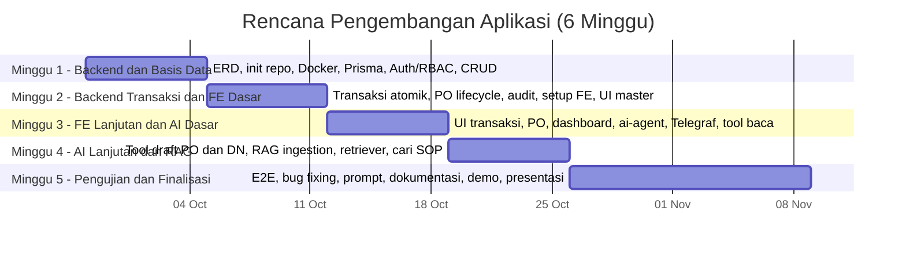

**Gambar 1.2 Gantt Chart Realisasi Pengembangan Aplikasi**

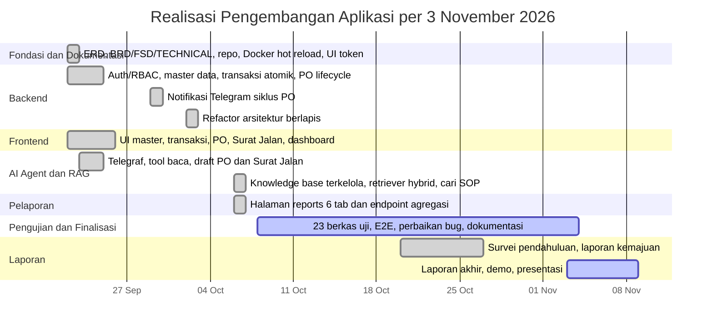

**Tabel 1.9 Realisasi Pekerjaan per 3 November 2026**

| Minggu Rencana | Fokus Rencana | Status | Bukti |
| :--- | :--- | :--- | :--- |
| 1 (28 September sampai 4 Oktober) | *Backend* dan basis data, ERD, repo, Docker, Prisma, Auth/RBAC, CRUD master | Selesai | Commit 22–24 September 2026 untuk repo, Docker, WMS dan RAG, serta ERD, BRD, FSD, dan TECHNICAL |
| 2 (5 sampai 11 Oktober) | *Backend* transaksi dan FE dasar | Selesai lebih awal | Commit 22–29 September 2026 untuk transaksi atomik, PO lifecycle, audit, dan UI master |
| 3 (12 sampai 18 Oktober) | FE lanjutan dan AI dasar | Selesai lebih awal | Commit 23 September sampai 7 Oktober 2026 untuk *tool* baca, draft PO dan Surat Jalan, serta *dashboard* |
| 4 (19 sampai 25 Oktober) | AI lanjutan dan RAG | Selesai lebih awal | Commit 6 Oktober 2026 untuk knowledge base, retriever *hybrid*, cari SOP, dan *ingest* jobs |
| 5 (26 Oktober sampai 1 November) | Pengujian dan finalisasi | Berjalan | 23 berkas uji tersedia, survei 10 responden pada 29 Oktober 2026, dan pengujian E2E selesai |
| 6 (2 sampai 9 November) | Laporan akhir, demo, dan presentasi | Berjalan | Dokumen laporan akhir disusun, demo dan presentasi disiapkan |

**Tabel 1.10 Sisa Pekerjaan 4–9 November 2026**

| Tanggal | Kegiatan | Luaran |
| :--- | :--- | :--- |
| 4–5 November 2026 | Penyelesaian dokumen laporan akhir dan pemeriksaan konsistensi tabel, gambar, serta sitasi | Naskah laporan akhir |
| 6 November 2026 | Penyiapan bahan demo dan tangkapan layar | Video demo dan berkas presentasi |
| 7 November 2026 | Uji coba alur demo dari chat sampai dokumen web | Catatan demo dan perbaikan akhir |
| 8 November 2026 | Penyusunan poster dan pemeriksaan format Word | Poster dan dokumen siap kumpul |
| 9 November 2026 | Presentasi dan penyerahan laporan akhir | Laporan akhir, video, PowerPoint, dan poster |

**Keterangan**

Status "selesai lebih awal" berarti pekerjaan yang direncanakan pada minggu tersebut telah tuntas sebelum minggu itu dimulai. Implementasi inti aplikasi tuntas pada 7 Oktober 2026, lebih cepat dari rencana. Karena implementasi selesai lebih awal, sisa waktu dialokasikan untuk pengujian, penyempurnaan, dan penyusunan laporan. Pada 18 Oktober 2026 jadwal diperluas dari lima menjadi enam minggu agar selaras dengan kalender capstone. *Snapshot* implementasi tidak berubah setelah 18 Oktober 2026. Kegiatan 19 Oktober sampai 3 November 2026 mencakup pengumpulan data survei, pengujian, dan penyusunan laporan. Bukti pada Tabel 1.9 merujuk riwayat versi repositori sehingga status dapat diverifikasi ulang. Tanggal realisasi implementasi diambil dari riwayat *commit* repositori dan tanggal survei diambil dari cap waktu pengisian formulir. Tanggal menunjukkan kapan perubahan tercatat, bukan durasi pengerjaan.

---

# BAB II TINJAUAN PUSTAKA

Bab ini mengulas teori dan penelitian terdahulu yang mendasari perancangan sistem, mencakup manajemen persediaan digital, digitalisasi UMKM, model bahasa, arsitektur RAG, serta pola *tool calling* dan *grounding*. Uraian diarahkan pada keputusan perancangan yang dipakai pada Bab III dan Bab IV, bukan pada pembahasan teori secara umum.

## 2.1 Warehouse Management System dan Manajemen Persediaan

*Warehouse Management System* (WMS) adalah sistem informasi yang mengelola dan mengendalikan seluruh aktivitas gudang, meliputi penerimaan barang, penyimpanan, pengeluaran, hingga pelaporan. Manajemen persediaan mencakup kebijakan penentuan tingkat stok yang tepat, waktu pemesanan ulang, dan ukuran pesanan, dengan tujuan memenuhi permintaan sekaligus meminimalkan kelebihan atau kekurangan stok.

Pada praktiknya, sistem persediaan digital menonjolkan kemampuan pemantauan stok secara *real-time*, pengurangan kesalahan pencatatan, serta dukungan pengambilan keputusan berbasis data. Prinsip penting yang diadopsi pada penelitian ini adalah stok sebagai konsekuensi transaksi. Nilai stok tidak boleh diubah manual, melainkan dihitung dari akumulasi transaksi masuk, keluar, dan penyesuaian. Prinsip ini menjamin konsistensi dan auditabilitas data.

Prinsip kedua adalah pemisahan tanggung jawab antar layanan. *Backend* memegang logika bisnis dan hak tulis, agen AI memegang pemahaman bahasa dan pemilihan *tool*, sedangkan basis data menjadi rujukan tunggal. Pemisahan ini penting karena asisten AI tidak boleh menjadi sumber kebenaran untuk angka stok atau status dokumen.

## 2.2 Digitalisasi UMKM di Indonesia

Kajian tinjauan pustaka sistematis terhadap UMKM di Indonesia menunjukkan bahwa transformasi digital berdampak positif pada jangkauan pasar, efisiensi operasional, dan profitabilitas, serta memberi akses informasi *real-time* dan integrasi fungsi bisnis (Purnomo et al., 2024 dan Hasanah et al., 2024). Adopsi tetap terhambat oleh keterbatasan sumber daya, keterampilan teknis, infrastruktur, dan resistensi terhadap perubahan prosedur lama.

Temuan ini mengindikasikan bahwa solusi bagi UMKM tidak cukup hanya canggih, tetapi juga harus tepat guna dan berbiaya rendah. Karena itu penelitian ini memilih kanal gratis melalui Telegram Bot API untuk MVP dan arsitektur *container* yang ringan, sembari tetap menyediakan integrasi data terpusat yang menjadi keunggulan sistem informasi manajemen berbasis ERP (Hasanah et al., 2024).

Kebiasaan komunikasi pengguna juga menjadi pertimbangan. Pemilik usaha lebih sering membuka aplikasi pesan instan daripada *dashboard* sistem informasi. Antarmuka chat karena itu tidak hanya berfungsi sebagai kanal alternatif, tetapi sebagai upaya menurunkan hambatan adopsi. Konsekuensinya, sistem harus tetap menjaga validasi dan integritas data di belakang antarmuka yang sederhana.

## 2.3 Large Language Model dan Arsitektur Transformer

*Large Language Model* (LLM) adalah model bahasa berskala besar yang dilatih pada korpus teks masif dengan arsitektur Transformer (Vaswani et al., 2017). Kemampuan *in-context learning* memungkinkan LLM mengikuti instruksi dan mengerjakan tugas baru hanya dari beberapa contoh atau deskripsi tugas, tanpa pelatihan ulang (Brown et al., 2020).

LLM memiliki keterbatasan mendasar. Pengetahuan yang tersimpan di dalam parameternya tidak selalu mutakhir, sulit ditelusuri sumbernya, dan cenderung berhalusinasi pada tugas yang membutuhkan fakta spesifik. Keterbatasan inilah yang mendorong pendekatan augmentasi eksternal berupa RAG dan *tool calling*. Pada penelitian ini, LLM diposisikan sebagai antarmuka bahasa, bukan sebagai basis data.

## 2.4 *Retrieval-Augmented Generation*

RAG adalah arsitektur yang menggabungkan memori parametrik pada LLM dengan memori non-parametrik berupa indeks vektor dokumen eksternal (Lewis et al., 2020). Pada saat inferensi, kueri pengguna diubah menjadi vektor *embedding*, lalu sistem mengambil sejumlah potongan dokumen yang paling relevan berdasarkan kemiripan vektor. Konteks yang terambil kemudian disertakan dalam *prompt* agar model membentuk jawaban.

Komponen utama RAG pada penelitian ini meliputi empat bagian. Pertama, *chunking* atau pemotongan dokumen dengan `RecursiveCharacterTextSplitter` menggunakan parameter `CHUNK_SIZE` dan `CHUNK_OVERLAP` agar konteks pas untuk model. Kedua, *embeddings* atau representasi vektor dari teks menggunakan model *embedding* `text-embedding-3-small` dengan dimensi 1536. Ketiga, penyimpanan vektor pada ekstensi pgvector di PostgreSQL untuk pencarian tetangga terdekat dengan operasi *cosine distance*. Keempat, *retrieval* atau pengambilan sejumlah potongan relevan sebagai konteks jawaban.

Survei terkini menunjukkan RAG menjadi pendekatan dominan untuk meningkatkan faktualitas dan *provenance* jawaban LLM pada domain pengetahuan spesifik (Gao et al., 2023). Pada penelitian ini, RAG dipakai hanya untuk dokumen pengetahuan seperti SOP, FAQ, kebijakan, *runbook*, panduan, onboarding, catatan partner, dan kontrak. Data transaksional tidak di-*embed* karena berubah setiap hari dan harus dibaca langsung dari basis data operasional.

## 2.5 *Tool* dan *Function Calling* pada Augmented Language Model

*Augmented Language Models* memperkaya LLM dengan kemampuan bernalar serta menggunakan alat eksternal (Mialon et al., 2023). Salah satu bentuknya adalah *tool* atau *function calling*. Model memilih fungsi yang tersedia, mengisi parameter sesuai skema, lalu sistem mengeksekusi fungsi tersebut dan mengembalikan hasilnya ke model.

*Toolformer* menunjukkan bahwa LLM dapat memanggil API eksternal dan memanfaatkan hasilnya untuk prediksi *token* berikutnya (Schick et al., 2023). Pola ini sesuai untuk kasus penelitian. Alih-alih membiarkan LLM menebak angka stok, model dipandu memanggil *tool* yang membaca data langsung dari *backend* API.

Pada penelitian ini, *tool* didefinisikan dengan skema parameter menggunakan Zod dan dipisahkan menjadi tiga kelompok, yaitu *tool* baca, *tool* tulis terbatas, dan *tool* RAG. *Tool* tulis hanya dapat membuat draft PO dan draft Surat Jalan. LLM tidak menulis SQL langsung untuk data bisnis. Seluruh akses data bisnis melalui *endpoint backend* yang tervalidasi.

Pencarian produk pada *tool* baca memakai normalisasi nama dan kecocokan *token* agar penulisan tidak baku tetap dikenali. Bila nama cocok ke beberapa varian, *tool* mengembalikan daftar kandidat beserta stoknya agar model meminta klarifikasi, bukan menebak satu pilihan.

## 2.6 Grounding dan Anti-Halusinasi

*Grounding* adalah upaya mengikat jawaban model pada sumber data yang dapat diverifikasi, bukan pada pengetahuan internalnya. Halusinasi dapat ditekan melalui kombinasi beberapa strategi berikut.

1. Data hanya berasal dari *tool*. Jawaban tentang stok dan transaksi hanya bersumber dari hasil pemanggilan *tool*.
2. *Temperature* nol dipakai untuk mengurangi variasi dan spekulasi keluaran model.
3. Konteks RAG dibatasi. Pertanyaan SOP hanya dijawab dari konteks hasil *retrieval*, dengan menyebut sumber bila tersedia.
4. *Guardrail system prompt* dipakai sebagai instruksi eksplisit untuk menolak mengarang dan menyatakan ketiadaan data apa adanya.
5. *Least privilege* diterapkan. Kredensial basis data untuk *runtime* AI hanya berhak `SELECT` pada tabel vektor, tanpa hak tulis.

Kombinasi ini tidak menjamin akurasi mutlak, tetapi mengurangi ruang bagi model untuk menghasilkan jawaban yang tidak didukung data. Evaluasi terhadap perilaku ini dibahas pada Bab IV.

## 2.7 Penelitian Terdahulu

Tabel 2.1 merangkum penelitian dan kajian relevan serta posisi penelitian ini.

**Tabel 2.1 Perbandingan dengan Penelitian Terdahulu**

| Kajian | Fokus | Kontribusi | Celah yang Diisi Penelitian Ini |
| :--- | :--- | :--- | :--- |
| Lewis et al. (2020) | Arsitektur RAG | Memadukan memori parametrik dan non-parametrik untuk tugas intensif pengetahuan. | Bersifat metodologis umum dan belum diterapkan pada WMS UMKM. |
| Schick et al. (2023) | *Toolformer* | LLM belajar memanggil API eksternal. | Belum membahas tata kelola akses data perusahaan seperti RBAC dan *read-only*. |
| Mialon et al. (2023) | Survei *Augmented Language Model* | Peta riset augmentasi LLM dengan *tool*. | Konseptual dan bukan implementasi sistem informasi. |
| Purnomo et al. (2024) | Digitalisasi UMKM Indonesia | Manfaat dan hambatan transformasi digital UMKM. | Tidak menyentuh asisten AI berbasis chat maupun WMS. |
| Hasanah et al. (2024) | ERP untuk UMKM | Integrasi proses bisnis dan akses data *real-time*. | Sistem ERP tergolong berat dan mahal untuk UMKM mikro. |

**Keterangan**

Kolom Celah yang Diisi Penelitian Ini menyatakan posisi penelitian terhadap kajian tersebut, bukan klaim bahwa celah itu belum pernah diteliti sama sekali. Rincian rujukan lengkap tersedia pada Daftar Pustaka.

Kebaruan penelitian terletak pada penggabungan tiga elemen dalam satu sistem yang dapat dijalankan mandiri oleh UMKM. Elemen pertama adalah WMS web terpusat sebagai sumber kebenaran data. Elemen kedua adalah asisten AI berbasis chat dengan *tool calling* ke API *backend*. Elemen ketiga adalah RAG *read-only* untuk menjawab SOP dan kebijakan. Kombinasi ini menyediakan antarmuka dengan kurva pembelajaran mendekati nol tanpa mengorbankan integritas dan auditabilitas data operasional.

## 2.8 Kerangka Pemikiran

Gambar 2.1 menggambarkan alur pemikiran dari masalah hingga luaran yang diharapkan.

**Gambar 2.1 Kerangka Pemikiran**

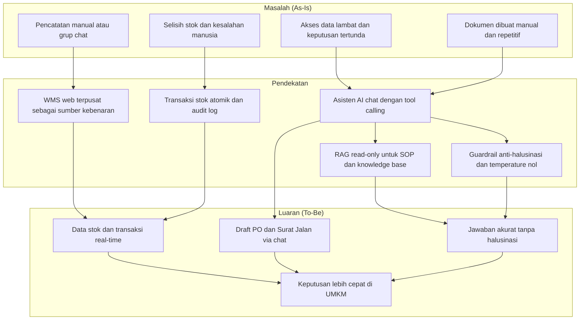

**Keterangan**

Gambar ini identik dengan kerangka pemikiran pada proposal agar rujukan antara kedua dokumen tetap konsisten. Panah pada diagram menunjukkan hubungan konseptual, bukan alur data teknis.

---

# BAB III METODOLOGI

Bab ini menjelaskan cara pekerjaan dilakukan, mulai dari metode penelitian, proses analisis kebutuhan, proses perancangan, langkah implementasi, hingga pengujian dan evaluasi. Uraian disusun mengikuti urutan pengerjaan yang sesungguhnya agar pembaca dapat menelusuri bagaimana masalah pada Bab I berubah menjadi solusi yang dijelaskan pada Bab IV.

## 3.1 Metode Penelitian

### 3.1.1 Pendekatan dan Model Proses

Penelitian ini merupakan penelitian pengembangan perangkat lunak atau *Research and Development* (R&D) dengan pendekatan *incremental*. Setiap penambahan kemampuan dirancang, dibangun, dan diuji dalam satu siklus pendek, lalu hasilnya menjadi dasar siklus berikutnya. Model prosesnya adalah *Agile* versi ringkas yang dijalankan dalam *sprint* mingguan dan dipetakan ke lima fase pada Tabel 1.8. Metode pengembangan yang dipakai adalah *incremental development* dengan *prototyping* pada bagian yang berisiko tinggi, yaitu integrasi AI dan RAG. Prototipe diuji lebih dahulu, lalu disempurnakan pada *sprint* berikutnya. Pemilihan model ini didasari dua pertimbangan.

1. Kebutuhan belum sepenuhnya pasti di awal. Calon pengguna UMKM belum memiliki pengalaman dengan asisten AI sehingga sebagian kebutuhan baru muncul setelah prototipe dapat dicoba.
2. Risiko teknis terkonsentrasi pada satu bagian. Unsur kebaruan berupa integrasi AI dan RAG memiliki ketidakpastian paling tinggi sehingga dikerjakan lebih awal agar bila gagal, ruang lingkup dapat disesuaikan.

Setiap fase menghasilkan luaran yang dapat diperiksa, yaitu analisis kebutuhan, dokumen perancangan, kode teruji, dan hasil pengujian. Metode dan perkakas yang dipakai pada setiap tahap dirangkum pada subbagian 3.1.2.

### 3.1.2 Metode dan Perkakas Pengembangan

Metode dan perkakas dipilih agar setiap tahap menghasilkan artefak yang dapat diperiksa dan dapat diulang. Tabel 3.1 merangkum metode, perkakas utama, dan luaran pada setiap tahap.

**Tabel 3.1 Metode dan Perkakas Pengembangan per Tahap**

| Tahap | Metode | Perkakas Utama | Luaran |
| :--- | :--- | :--- | :--- |
| Analisis kebutuhan | Studi pustaka naratif, survei semi-terstruktur, observasi proses, dan analisis dokumen | Formulir daring, *spreadsheet*, Mendeley, Mermaid | P-001 sampai P-005, OBJ-1 sampai OBJ-5, KPI-1 sampai KPI-6, BRD, FSD |
| Perancangan | Pemodelan data relasional dan normalisasi, arsitektur berlapis *ports and adapters*, *state machine*, dan *sequence diagram* | Mermaid, Prisma Schema, Markdown | ERD, rancangan arsitektur, *state machine*, rancangan antarmuka |
| Implementasi | Pengembangan inkremental per *sprint*, *containerization*, dan migrasi basis data berbasis kode | Git dan GitHub, Docker Compose, Node.js 20, TypeScript 5.7, React 18.3, Vite 6, Tailwind CSS 4, Express 4.21, Prisma 6.3, PostgreSQL dan pgvector, LangChain.js 0.3, Telegraf 4.16, OpenAI API, Nginx | Kode aplikasi, *container*, migrasi basis data |
| Pengujian | Unit, integrasi, *end-to-end* manual, dan pengujian komponen | Vitest 2.1, Supertest 7, *Testing Library* 16, Playwright opsional, Makefile | 23 berkas uji, Tabel 3.7, Tabel 3.8 |
| Dokumentasi | *Docs-as-code* dan pengelolaan sitasi | Markdown, Mermaid, Mendeley Cite, Git | Laporan, BRD, FSD, ERD, TECHNICAL, daftar pustaka |

**Keterangan**

Versi perkakas mengikuti `package.json`, `Dockerfile`, dan `docker-compose.yml` per 31 Oktober 2026. Versi dapat berubah tanpa mengubah metode. Pengujian dijalankan melalui *target* Makefile seperti `make test`, `make lint`, dan `make typecheck` agar lingkungannya sama dengan lingkungan pengembangan. Rincian teknologi per lapisan dan variabel lingkungan ada pada subbagian 3.4.1 dan Lampiran F.4.

### 3.1.3 Teknik Pengumpulan Data dan Instrumen

Data dikumpulkan dengan empat teknik yang saling melengkapi. Instrumen lengkap tidak diulang pada bab ini, tetapi dilampirkan pada Lampiran G sampai Lampiran K agar dapat diperiksa langsung.

**Tabel 3.2 Teknik Pengumpulan Data, Instrumen, dan Lokasi Lampiran**

| Teknik | Sasaran | Instrumen | Hasil yang Diharapkan | Lokasi Lampiran |
| :--- | :--- | :--- | :--- | :--- |
| Studi pustaka | Dasar teori dan posisi terhadap penelitian sebelumnya | Protokol pencarian berisi basis data akademik, *string* pencarian, kriteria inklusi dan eksklusi, serta matriks literatur | Kerangka konsep, kebaruan, rujukan | Lampiran K |
| Survei semi-terstruktur | Pemilik atau pengelola usaha yang mengelola persediaan, n = 10 dengan 3 responden *frozen food* | Kuesioner 41 butir dan *informed consent* | Konfirmasi masalah, *baseline* metrik, preferensi kanal dan fitur | Lampiran G untuk instrumen dan Lampiran H untuk data mentah |
| Observasi proses | Alur kerja gudang harian | Lembar observasi dan rubrik penilaian | Pemetaan proses *as-is* dan titik rawan kesalahan | Lampiran I |
| Analisis dokumen | SOP, format PO, format Surat Jalan, dan catatan stok | *Checklist* dokumen operasional dan format acuan | Aturan bisnis, format keluaran, kamus istilah | Lampiran J |

**Keterangan**

Survei pendahuluan telah dilaksanakan pada 29 Oktober 2026 terhadap 10 responden. Data primer yang sudah terkumpul dan diolah pada laporan ini adalah data survei. Observasi lapangan tidak dilaksanakan karena keterbatasan akses dan waktu. Lampiran I memuat formulir observasi kosong dan rekaman observasi tidak langsung yang disusun dari jawaban survei R01 sampai R10. Lampiran J memuat *checklist* dan format acuan dokumen karena dokumen mitra belum diperoleh.

### 3.1.4 Jenis dan Sumber Data

Data primer penelitian ini adalah hasil survei semi-terstruktur dengan pemilik atau pengelola usaha sebanyak 10 responden pada 29 Oktober 2026 dan pengukuran waktu pada saat uji coba sistem. Observasi lapangan tidak dilaksanakan. Data sekunder berupa literatur ilmiah, dokumentasi resmi perangkat seperti PostgreSQL, Docker, LangChain, dan Telegram Bot API, serta format acuan dokumen operasional UMKM.

### 3.1.5 Teknik Analisis Data

Data kualitatif dianalisis secara tematik sederhana. Jawaban survei dikelompokkan menurut kemiripan tema, lalu setiap tema dinilai apakah dapat dipetakan ke salah satu masalah pada Tabel 1.1. Tema yang tidak dapat dipetakan dicatat sebagai temuan tambahan dan tidak dipaksakan masuk ke daftar masalah. Data kuantitatif hasil survei diolah menjadi median dan rentang. Jawaban berupa rentang dikonversi ke titik tengah dan data kosong tidak diimputasi. Median dipilih karena sebaran data lebar dan terdapat *outlier*. Nilai ini dipakai sebagai *baseline* KPI pada Tabel 1.6.

### 3.1.6 Batasan Metodologis

Enam batasan berikut perlu dinyatakan terbuka agar penilaian hasil dapat dilakukan secara wajar.

1. Pengembangan dilakukan oleh satu orang dalam waktu terbatas sehingga tidak ada pengujian bebas atau independen oleh pihak kedua.
2. Survei diikuti 10 responden yang dipilih secara purposif sehingga hasilnya bersifat indikatif, bukan generalisasi statistik. Komposisi sampel tidak sepenuhnya sesuai *target* awal karena hanya 3 responden yang kategori utamanya *frozen food*. Sisanya makanan dan minuman, retail umum, toko plastik, manufaktur, dan suku cadang mesin. Satu distributor memiliki 1.104 SKU dan tiga responden melaporkan 21 PO per bulan atau lebih.
3. Pengukuran dampak KPI-2 dan KPI-5 menuntut periode pemakaian nyata yang lebih panjang daripada durasi capstone. Pada tahap ini pengukuran hanya dapat dilakukan secara terbatas pada lingkungan uji.
4. Perbandingan sebelum dan sesudah untuk KPI-2 bergantung pada kedisiplinan pencatatan *stock opname* pada UMKM mitra yang tidak sepenuhnya dapat dikendalikan.
5. Jawaban waktu dan selisih stok adalah perkiraan responden, bukan hasil *stopwatch* atau audit stok. Jawaban berupa rentang dikonversi ke titik tengah dan data keuangan yang kosong tidak diimputasi. Karena itu Tabel 1.2 adalah estimasi indikatif, bukan hasil pengukuran presisi.
6. Observasi lapangan dan pengumpulan dokumen operasional mitra tidak dapat dilaksanakan karena keterbatasan akses, waktu, dan privasi. Data proses disusun dari survei dan format acuan, bukan pengamatan langsung.

## 3.2 Proses Analisis

### 3.2.1 Alur Analisis

Analisis dijalankan berurutan. Setiap langkah menghasilkan artefak yang menjadi masukan langkah berikutnya.

**Gambar 3.1 Alur Analisis Kebutuhan**

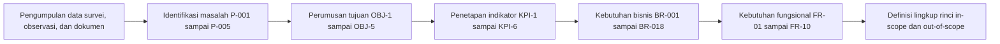

**Keterangan**

Alur ini menunjukkan penelusuran dari data mentah sampai lingkup rinci. Setiap kode masalah, tujuan, indikator, dan kebutuhan dapat dirujuk silang pada dokumen BRD dan FSD.

### 3.2.2 Penelusuran Kebutuhan

Setiap masalah ditelusuri sampai ke kebutuhan fungsional agar dapat dipastikan tidak ada kebutuhan yang tanpa dasar masalah. Tabel 3.3 merangkum penelusuran tersebut. Kolom terakhir menyatakan di bagian mana kebutuhan itu dibuktikan pada tahap pengujian.

**Tabel 3.3 Penelusuran Masalah ke Kebutuhan dan Pengujian**

| Masalah | Tujuan | Indikator | Kebutuhan Bisnis | Kebutuhan Fungsional | Bukti Uji |
| :--- | :--- | :--- | :--- | :--- | :--- |
| P-001 | OBJ-1 | KPI-1 dan KPI-6 | BR-006 dan BR-014 | FR-08 | AC-06 dan AC-18 |
| P-002 | OBJ-2 | KPI-2 | BR-002 dan BR-003 | FR-04 dan FR-05 | AC-04, AC-05, dan AC-21 |
| P-003 | OBJ-1 dan OBJ-5 | KPI-1 dan KPI-3 | BR-006 dan BR-009 | FR-08 dan FR-09 | AC-06, AC-07, dan AC-20 |
| P-004 | OBJ-3 | KPI-3 | BR-004, BR-005, dan BR-008 | FR-06 dan FR-07 | AC-07, AC-08, dan AC-14 |
| P-005 | OBJ-4 | KPI-5 | BR-006 dan BR-007 | FR-08 | AC-10 dan AC-11 |

**Keterangan**

Kode BR-00n adalah kebutuhan bisnis pada `docs/BRD.md`. Kode FR-0n adalah kebutuhan fungsional pada `docs/FSD.md`. Kode AC-0n adalah skenario pengujian pada Tabel 3.8 dan hasil pemetaannya pada Tabel 4.10. Sel yang memuat lebih dari satu kode berarti kebutuhan itu melayani beberapa masalah sekaligus.

### 3.2.3 Pemetaan Proses

Proses bisnis dipetakan dalam dua keadaan, yaitu *as-is* untuk memahami titik masalah dan *to-be* untuk merumuskan perbaikan. Pada kondisi *as-is*, pencatatan dilakukan manual atau melalui grup chat, lalu direkap kemudian. Akibatnya informasi terlambat dan rawan salah. Pada kondisi *to-be*, pencatatan dilakukan sekali di aplikasi web, basis data menjadi rujukan tunggal, dan pemilik mengaksesnya melalui chat. Pemetaan lengkap ada pada `docs/BRD.md` bagian 7.

### 3.2.4 Alat Analisis

Alat yang dipakai pada tahap analisis adalah diagram alir Mermaid untuk pemetaan proses, matriks penelusuran pada Tabel 3.3 untuk memastikan keterhubungan kebutuhan, dan lembar observasi untuk mencatat alur kerja nyata. Pemilihan Mermaid dilakukan karena diagram tersimpan sebagai teks di dalam repositori sehingga ikut terkendali versinya bersama kode dan dokumen lain.

## 3.3 Proses Perancangan

Perancangan dibagi menjadi enam bagian yang dikerjakan berurutan, yaitu arsitektur, data, perilaku sistem, antarmuka, kecerdasan buatan, dan keamanan.

### 3.3.1 Perancangan Arsitektur

Sistem dirancang sebagai empat layanan terpisah yang berjalan dalam satu jaringan *container*.

**Gambar 3.2 Arsitektur Sistem**

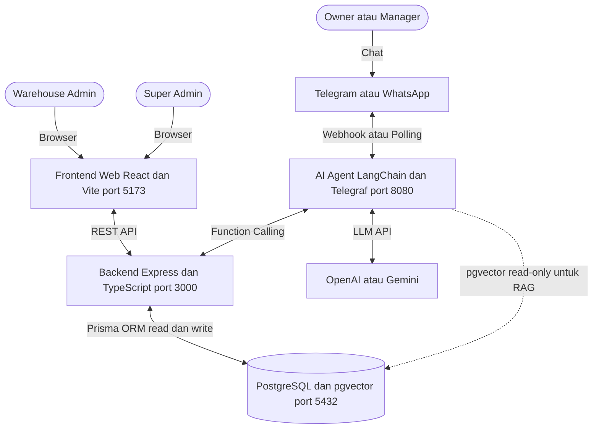

**Keterangan**

Dua prinsip arsitektur mengikat seluruh keputusan berikutnya. Pertama, *backend* adalah satu-satunya penulis data bisnis. Tidak ada layanan lain yang menulis tabel bisnis secara langsung sehingga validasi dan aturan bisnis hanya berada pada satu tempat. Kedua, *least privilege* pada akses data. Agen AI mengakses data bisnis melalui API *backend* dan mendapat hak *read-only* pada tabel vektor.

### 3.3.2 Perancangan Struktur Kode

Kode pada *backend* dan *ai-agent* disusun dengan arsitektur berlapis. Lapisan presentasi terdiri atas rute, pengendali, dan handler pesan. Lapisan bisnis berisi aturan dan alur kerja. Lapisan persistensi berisi akses data serta adapter keluar. Setiap ketergantungan keluar seperti basis data, *backend* API, Telegram, dan layanan *embedding* disembunyikan di balik *port* dan diimplementasikan sebagai adapter, lalu dirakit pada satu berkas komposisi. Arah ketergantungan ditegakkan aturan *lint* sehingga lapisan bisnis tidak bergantung pada HTTP maupun ORM. Struktur ini dipilih agar logika bisnis dapat diuji tanpa menyalakan layanan eksternal.

### 3.3.3 Perancangan Data

Model data dirancang sebagai relasi relasional yang dinormalisasi dengan beberapa keputusan penting. Pertama, stok sebagai konsekuensi transaksi. Nilai `Product.stock` tidak diubah manual, melainkan dihitung dari transaksi masuk, keluar, dan penyesuaian. Kedua, kartu stok per gudang. Tabel inventori menyimpan jumlah per kombinasi produk dan gudang sehingga satu produk dapat tersebar di beberapa gudang. Ketiga, nomor dokumen berformat. Nomor PO berformat `PO-YYYYMM-NNN` dan Surat Jalan berformat `SJ-YYYYMM-NNN`, dengan penghitungan urutan dilakukan di dalam transaksi agar tidak terjadi duplikasi. Keempat, riwayat percakapan AI disimpan terpisah untuk keperluan audit dan evaluasi. Skema lengkap dan diagram relasi tersedia pada `docs/ERD.md`.

### 3.3.4 Perancangan Perilaku Sistem

Perilaku dokumen dimodelkan sebagai mesin keadaan agar transisi status tidak ambigu. Purchase Order memiliki empat status dengan aturan transisi tegas. Hanya DRAFT yang dapat diubah atau dihapus. CONFIRMED dapat dibatalkan. COMPLETED tercapai otomatis saat seluruh item diterima. Aturan ini mencegah dokumen yang sudah berjalan diubah kembali tanpa jejak.

**Gambar 3.3 State Machine Purchase Order**

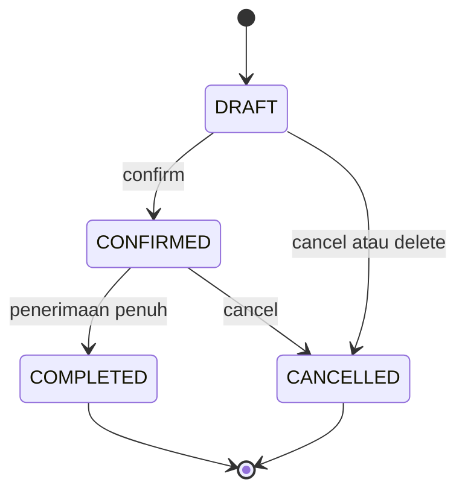

Dua alur interaksi lintas layanan juga dirancang sejak awal, yaitu alur pembuatan draft PO dari chat pada Gambar 3.4 dan alur penjawaban SOP melalui RAG pada Gambar 3.5. Keduanya menjadi acuan saat menulis skenario pengujian.

**Gambar 3.4 Alur Buat Draft PO via Chat**

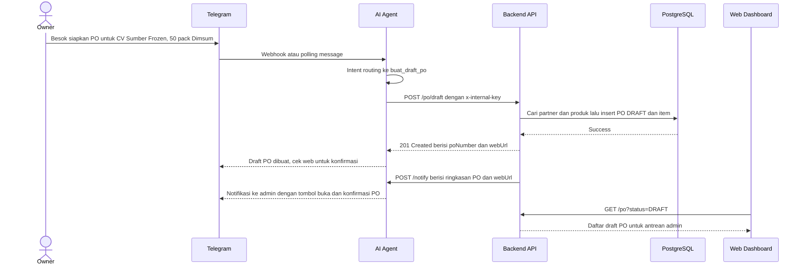

**Gambar 3.5 Alur Jawab SOP via RAG**

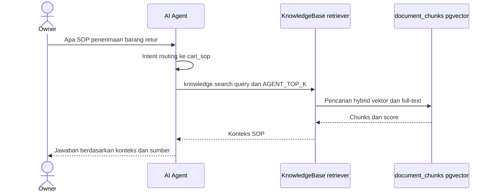

**Keterangan**

Diagram pada Gambar 3.3 sampai Gambar 3.5 memakai panah sebagai notasi teknis. Pada naskah Word, panah tersebut merupakan bagian dari gambar dan tidak dipakai sebagai simbol dalam kalimat.

### 3.3.5 Perancangan Antarmuka

Antarmuka dirancang terpisah menurut peran. Admin gudang memakai *dashboard* web dengan halaman untuk setiap entitas, yaitu data master, transaksi, Purchase Order, Surat Jalan, laporan, dan Knowledge Base. *Owner* tidak memerlukan halaman khusus karena seluruh interaksinya berlangsung melalui chat. Pemisahan ini merupakan keputusan utama pada subbagian ini. Alih-alih memaksa *owner* mempelajari *dashboard*, sistem membawa informasi ke kanal yang sudah dipakai *owner* sehari-hari.

### 3.3.6 Perancangan Kecerdasan Buatan

Perancangan agen AI menetapkan tiga hal. Pertama, pembagian *tool*. *Tool* dipisah menjadi *tool* baca, *tool* tulis terbatas, dan *tool* RAG. *Tool* tulis tidak pernah menetapkan status akhir dokumen. Draft PO dan draft Surat Jalan selalu berstatus DRAFT dan menunggu konfirmasi admin di web. Kedua, penanganan nama ambigu. Pencarian produk memakai normalisasi nama dan kecocokan *token* sehingga penulisan tidak baku tetap dikenali. Bila satu nama cocok ke beberapa varian, *tool* mengembalikan daftar kandidat dan model diminta meminta klarifikasi, bukan memilih satu secara diam-diam. Ketiga, *pipeline* RAG. Dokumen knowledge dikelola dari halaman web khusus `SUPER_ADMIN`, disimpan pada tabel `knowledge_documents` sebagai sumber kebenaran, lalu dipecah dan di-*embed* ke tabel `document_chunks`. Pencarian dilakukan secara *hybrid* dengan menggabungkan peringkat vektor dan pencarian teks penuh, lalu disaring dengan ambang skor minimum untuk membuang potongan yang tidak relevan.

Data transaksional tidak di-*embed*. Hanya dokumen SOP, kebijakan, panduan, FAQ, dan sejenisnya yang masuk ke indeks pengetahuan. Kamus produk dan laporan periode diambil langsung dari API sehingga angkanya selalu mutakhir.

### 3.3.7 Perancangan Keamanan

Kontrol akses dirancang pada empat lapis. Lapis pertama adalah autentikasi pengguna web dengan *token* akses berumur pendek dan *token* pembaruan. Lapis kedua adalah pembatasan rute berdasarkan peran. Lapis ketiga adalah kunci internal untuk komunikasi antar layanan. Lapis keempat adalah hak baca saja untuk agen AI pada tabel vektor. Selain itu, dokumen knowledge bertipe sensitif hanya dapat diakses peran tertentu, dengan peran diteruskan dari lapisan pesan sampai ke pembentukan *tool*.

## 3.4 Implementasi

### 3.4.1 Lingkungan dan Perkakas

Seluruh layanan berjalan di dalam Docker sehingga versi *runtime* seragam dan Node.js tidak perlu dipasang di mesin pengembang. Tabel 3.4 merangkum teknologi dan versi yang dipakai pada implementasi. Metode dan perkakas per tahap sudah dirangkum pada Tabel 3.1.

**Tabel 3.4 Teknologi dan Versi yang Digunakan**

| Lapisan | Teknologi | Versi atau Keterangan |
| :--- | :--- | :--- |
| *Frontend* | React, Vite, TypeScript, Tailwind CSS, *TanStack Query* | React 18.3, Vite 6, TypeScript 5.7, Tailwind CSS 4, *TanStack Query* 5 |
| *Backend* | Node.js, Express, TypeScript, Prisma ORM, Zod | Node.js 20, Express 4.21, TypeScript 5.7, Prisma 6.3, Zod 3.24 |
| AI Agent | Node.js, TypeScript, LangChain.js, Telegraf | Node.js 20, TypeScript 5.7, LangChain.js 0.3, Telegraf 4.16 |
| Basis data | PostgreSQL dan ekstensi pgvector | Image `ankane/pgvector`, dimensi vektor 1536 |
| Model bahasa | OpenAI `gpt-4o-mini` dan `text-embedding-3-small` | Dibaca dari variabel lingkungan |
| Infrastruktur | Docker, Docker Compose, Nginx | Nginx dipakai pada mode produksi |
| Pengujian | Vitest, Supertest, *Testing Library*, Playwright | Vitest 2.1, Supertest 7, *Testing Library* 16, Playwright opsional |

**Keterangan**

Versi mengikuti `package.json`, `Dockerfile`, dan `docker-compose.yml` per 31 Oktober 2026. Model dan versi dicatat sebagai konfigurasi, bukan bagian tetap sistem. Nilai sebenarnya dibaca dari variabel lingkungan pada Lampiran F.4 sehingga penggantian model tidak menuntut perubahan kode.

### 3.4.2 Modul yang Diimplementasikan

*Backend* terdiri atas 13 modul, yaitu `auth`, `users`, `categories`, `products`, `partners`, `warehouses`, `transactions`, `purchase-orders`, `delivery-notes`, `reports`, `knowledge`, `audit-logs`, dan `internal`. Modul `auth`, `users`, dan data master menangani autentikasi, RBAC, dan data dasar. Modul `transactions`, `purchase-orders`, dan `delivery-notes` menangani transaksi stok atomik serta dokumen bisnis. Modul `reports`, `knowledge`, `audit-logs`, dan `internal` menangani laporan agregat, knowledge base, audit, dan *endpoint* internal.

*Frontend* memiliki 15 halaman yang sejajar dengan modul tersebut, yaitu halaman masuk, *dashboard*, kategori, produk, partner, gudang, transaksi, Purchase Order, detail Purchase Order, Surat Jalan, detail Surat Jalan, laporan, knowledge, audit log, dan pengguna. *AI Agent* terdiri atas lapisan aplikasi `agent`, `tools`, dan `chat`, serta lapisan infrastruktur `backend`, `rag`, dan `telegram`. Rincian modul dan bukti implementasi disajikan pada Bab IV.

### 3.4.3 Implementasi Transaksi Stok

Inti perubahan stok adalah satu fungsi yang wajib dijalankan di dalam transaksi basis data. Di dalamnya, sistem memeriksa keberadaan produk dan gudang, menghitung selisih stok, menolak transaksi keluar yang melebihi stok tersedia, membuat catatan transaksi, menyesuaikan stok produk, dan memperbarui jumlah per gudang dalam satu satuan kerja yang tidak terpisah. Bila salah satu langkah gagal, tidak ada perubahan yang tersisa. Cuplikan kode dan penjelasan implementasinya disajikan pada subbagian 4.2.2.

### 3.4.4 Implementasi Penomoran Dokumen

Logika format nomor dipisahkan ke lapisan domain sebagai fungsi murni tanpa akses basis data, sedangkan penghitungan urutan dilakukan di dalam transaksi. Pemisahan ini membuat format nomor dapat diuji tanpa basis data, sementara keunikan nomor tetap terjaga saat beberapa permintaan datang bersamaan. Cuplikan kode disajikan pada subbagian 4.2.3.

### 3.4.5 Implementasi Asisten AI

Agen dirakit ulang untuk setiap pesan masuk agar identitas percakapan dapat disertakan pada setiap panggilan dan jejak audit tetap utuh. Agen dibatasi jumlah langkahnya, dibangun dengan *temperature* nol, dan menerima daftar *tool* yang dibentuk sesuai peran pengirim pesan. Tabel 3.5 merangkum *tool* yang tersedia.

**Tabel 3.5 Daftar Tool Asisten AI**

| Kategori | Nama *Tool* | Fungsi |
| :--- | :--- | :--- |
| Baca | `cek_stok_barang` | Cek stok satu produk berdasarkan nama. Bila nama ambigu, menampilkan kandidat varian beserta stoknya. |
| Baca | `cari_produk` | Katalog dan varian produk berisi SKU, kategori, dan stok. |
| Baca | `list_kategori`, `list_partner`, `list_gudang` | Daftar data master. |
| Baca | `stok_per_gudang` | Rincian stok per produk dan gudang. |
| Baca | `list_transaksi` | Transaksi masuk, keluar, dan penyesuaian dengan filter. |
| Baca | `rekap_pengiriman` | Rekap barang keluar pada satu tanggal. |
| Baca | `list_po`, `list_po_status`, `detail_po` | Daftar dan detail Purchase Order. |
| Baca | `list_surat_jalan` | Daftar Surat Jalan. |
| Baca | `stok_tipis`, `ringkasan_dashboard` | Peringatan stok minimum dan ringkasan operasional. |
| Baca | `ringkasan_periode` | Ringkasan dan tren operasional pada satu periode. |
| Tulis | `buat_draft_po` | Membuat draft PO untuk partner `SUPPLIER`. |
| Tulis | `buat_draft_surat_jalan` | Membuat draft Surat Jalan untuk partner `CUSTOMER`. |
| RAG | `cari_sop` | Pengambilan SOP dan kebijakan dari `document_chunks` dengan filter jenis dokumen. |

**Keterangan**

*Tool* bertanda Tulis hanya membuat dokumen berstatus DRAFT. Status akhir tetap ditentukan admin di aplikasi web. Jumlah keseluruhan *tool* adalah 18.

### 3.4.6 Implementasi *Pipeline* RAG

*Pipeline* dijalankan dalam dua tahap. Tahap *ingest* membaca dokumen aktif, memotong teks dengan memperhatikan struktur markdown, menyisipkan judul, menghasilkan *embedding*, lalu menulis hasilnya ke tabel potongan dokumen di dalam satu transaksi. Tahap ini idempoten karena dokumen yang isinya tidak berubah dilewati sehingga *ingest* ulang tidak membuang waktu. Setiap eksekusi dipersist ke tabel `ingest_jobs` dan statusnya dipulihkan saat layanan dinyalakan ulang sehingga tab *Index* dan tab *Ingest* selalu menampilkan status yang sama.

Tahap *retrieval* menjalankan pencarian *hybrid* dan menyaring hasil dengan ambang skor. Kegagalan basis data atau layanan *embedding* ditangani dengan degradasi anggun, bukan kegagalan total. Karena *ingest* bersumber dari tabel `knowledge_documents`, cuplikan kode pada proposal menggambarkan rancangan awal. Implementasi akhir dijelaskan pada subbagian 4.4.

### 3.4.7 Implementasi Pelaporan

Halaman laporan awalnya hanya menampilkan stok dan rekap pengiriman harian. Cakupannya diperluas menjadi enam tab, yaitu ringkasan dan tren, persediaan, pembelian, pengiriman, mutasi atau kartu stok, dan analitik gerak stok. Setiap tab memiliki filter periode dan dapat diekspor ke CSV. Perluasan ini penting karena menjawab OBJ-5 sekaligus menyediakan data historis yang dikonsumsi asisten melalui *tool* `ringkasan_periode`.

### 3.4.8 Implementasi Notifikasi Telegram

Notifikasi dijalankan sebagai panggilan *best-effort* dengan batas waktu lima detik. *Backend* memanggil *endpoint* notifikasi pada AI Agent, yang lalu mengirim pesan ke admin beserta tombol menuju halaman detail PO. Karena sifatnya *best-effort*, kegagalan notifikasi tidak menggagalkan transaksi bisnis. Keputusan ini diambil agar gangguan pada kanal chat tidak menghambat pekerjaan gudang.

### 3.4.9 Ringkasan Realisasi

Tabel 3.6 memetakan aktivitas implementasi ke tanggal pengerjaannya.

**Tabel 3.6 Realisasi Implementasi**

| Tanggal | Aktivitas | Luaran |
| :--- | :--- | :--- |
| 22 September 2026 | Penyiapan repositori dan dokumen, implementasi awal WMS, *frontend*, dan AI Agent, serta Docker dengan *hot reload* | Kerangka sistem berjalan dalam satu perintah |
| 23–24 September 2026 | Penyempurnaan antarmuka, halaman detail, edit, dan cetak Surat Jalan, perluasan akses baca AI, dan dukungan model penalaran | Fitur operasional harian tersedia |
| 25 September 2026 | Mode produksi dengan Nginx, filter transaksi, kandidat varian produk, dan penyusunan proposal | Sistem dapat dijalankan dalam mode produksi |
| 29 September 2026 | Notifikasi Telegram untuk siklus PO | Admin dan *owner* menerima kabar perubahan status |
| 2 Oktober 2026 | Penerapan arsitektur berlapis pada *backend* dan AI Agent | Batas lapisan ditegakkan aturan *lint* |
| 6 Oktober 2026 | Knowledge base terkelola, retriever *hybrid*, *ingest* otomatis, persistensi *job ingest*, dan halaman laporan enam tab | Fitur RAG dan pelaporan lengkap |
| 7 Oktober 2026 | Perbaikan keterbacaan balasan daftar data | Kualitas keluaran chat meningkat |
| 18 Oktober 2026 | Penyesuaian jadwal proyek dari lima menjadi enam minggu | Jadwal selaras kalender capstone |
| 29 Oktober 2026 | Survei pendahuluan 10 responden | Data *baseline* KPI dan preferensi pengguna |
| 31 Oktober 2026 | Evaluasi formatif *lint*, *typecheck*, tes unit, komponen, integrasi, dan *end-to-end* | 196 tes lulus dari 23 berkas, terdiri atas 117 unit dan komponen serta 79 integrasi |
| 3 November 2026 | Penyusunan laporan akhir | Naskah laporan akhir |

**Keterangan**

Tanggal diambil dari riwayat versi repositori dan dapat diverifikasi ulang. Implementasi inti tuntas pada 7 Oktober 2026, lebih cepat dari rencana pada Tabel 1.8. Kegiatan 29 Oktober sampai 3 November 2026 menambahkan data survei dan hasil evaluasi formatif.

## 3.5 Pengujian dan Evaluasi

### 3.5.1 Strategi Pengujian

Pengujian dilakukan pada empat tingkat, dari yang paling terisolasi sampai yang paling menyerupai pemakaian nyata.

| Tingkat | Sasaran | Perkakas |
| :--- | :--- | :--- |
| Unit | Fungsi murni dan logika bisnis tanpa basis data | Vitest |
| Integrasi | Rute API beserta basis data dan aturan akses | Vitest dan Supertest |
| *End-to-end* | Alur lengkap chat, dokumen, dan web | Uji manual terstruktur dan Playwright opsional |
| Antarmuka | Komponen dan halaman React | Vitest dan *Testing Library* |

**Keterangan**

Pengujian dijalankan melalui *target* Makefile seperti `make test`, `make lint`, dan `make typecheck` agar lingkungannya sama dengan lingkungan pengembangan. Pemeriksaan statis dipakai untuk memastikan tipe dan gaya kode konsisten sebelum pengujian perilaku.

### 3.5.2 Cakupan Pengujian yang Telah Tersedia

Saat laporan ini disusun, repositori memuat 23 berkas pengujian dengan 196 skenario. Sebanyak 117 skenario berada pada berkas unit dan komponen yang tidak memerlukan basis data. Sebanyak 79 skenario berada pada berkas integrasi yang memerlukan PostgreSQL.

**Tabel 3.7 Sebaran Berkas Pengujian**

| Layanan | Jenis | Berkas Uji | Jumlah Skenario |
| :--- | :--- | :--- | ---: |
| AI Agent | Unit | `bot`, `format`, `ingest`, `ingestJob`, `messenger`, `notifier`, `retriever`, `tools` | 71 |
| *Backend* | Unit | `knowledge.service`, `notify`, `numbering`, `pagination`, `po-state`, `product-resolver` | 37 |
| *Frontend* | Komponen | `LoginPage`, `DeliveryNoteDetailPage`, `format` | 9 |
| *Backend* | Integrasi | `auth`, `delivery-notes`, `knowledge`, `purchase-orders`, `reports`, `transactions` | 79 |
| **Total** | | **23 berkas** | **196** |

**Keterangan**

Jumlah skenario menunjukkan cakupan yang tersedia, sedangkan hasil pelaksanaannya dilaporkan pada Bab IV. Seluruh berkas integrasi telah dijalankan pada lingkungan PostgreSQL. Rincian nama berkas dan jumlah skenario per berkas disajikan pada subbagian 4.6.

### 3.5.3 Skenario Pengujian Penerimaan

Skenario berikut diturunkan dari kebutuhan fungsional dan dipakai untuk menilai kesiapan sistem. Kolom Hasil Aktual dan Status diisi saat pengujian dijalankan. Pada laporan akhir, kolom tersebut diisi berdasarkan bukti yang tersedia pada subbagian 4.6.

**Tabel 3.8 Skenario Pengujian Penerimaan**

| ID | Skenario | Hasil yang Diharapkan | Hasil Aktual | Status |
| :--- | :--- | :--- | :--- | :--- |
| AC-01 | Login sukses | Pengguna diarahkan ke *dashboard* dan *token* tersimpan. | Lulus | Lulus |
| AC-02 | RBAC menolak akses | Admin yang mengakses `/users` menerima `403 FORBIDDEN`. | Lulus | Lulus |
| AC-03 | Pembuatan produk | Produk muncul di daftar dan audit log tercatat. | Lulus | Lulus |
| AC-04 | Barang masuk menambah stok | `Product.stock` bertambah sesuai kuantitas. | Lulus | Lulus |
| AC-05 | Barang keluar melebihi stok ditolak | Sistem memberi balasan `409 INSUFFICIENT_STOCK`. | Lulus | Lulus |
| AC-06 | AI mengecek stok secara akurat | Angka sama persis dengan basis data. | Lulus | Lulus |
| AC-07 | AI membuat draft PO | PO berstatus DRAFT muncul di antrean admin. | Lulus | Lulus |
| AC-08 | PO dari chat tidak langsung CONFIRMED | Status tetap DRAFT hingga admin mengonfirmasi. | Lulus | Lulus |
| AC-09 | Konfirmasi PO | Status menjadi CONFIRMED dan hanya valid dari DRAFT. | Lulus | Lulus |
| AC-10 | Permintaan di luar cakupan ditangani | AI menolak dengan sopan dan menawarkan kemampuan yang ada. | Lulus | Lulus |
| AC-11 | Produk tidak ditemukan via chat | AI meminta klarifikasi dan tidak mengarang. | Lulus | Lulus |
| AC-12 | Penghapusan PO draft berantai | Item ikut terhapus dan basis data bersih. | Lulus | Lulus |
| AC-13 | Penyegaran *TanStack Query* | Tabel diperbarui tanpa muat ulang manual. | Lulus | Lulus |
| AC-14 | Surat Jalan untuk *customer* | Surat Jalan terbentuk tanpa PO dan partner non-*customer* ditolak. | Lulus | Lulus |
| AC-15 | AI menjawab SOP via RAG | Jawaban sesuai konteks SOP dan menyebut sumber. | Lulus | Lulus |
| AC-16 | RAG anti-halusinasi | AI menyatakan SOP tidak ditemukan dan tidak mengarang. | Lulus | Lulus |
| AC-17 | AI Agent *read-only* pada basis data | Upaya tulis ke tabel vektor ditolak. | Lulus | Lulus |
| AC-18 | Notifikasi admin saat draft PO dari AI | Admin menerima pesan ringkasan PO dan tombol menuju halaman detail. | Lulus | Lulus |
| AC-19 | Notifikasi *owner* saat status PO berubah | *Owner* menerima notifikasi saat CONFIRMED dan COMPLETED. | Lulus | Lulus |
| AC-20 | Laporan enam tab | Data dan grafik tampil, filter periode berfungsi, dan ekspor CSV tersedia. | Lulus | Lulus |
| AC-21 | Kartu stok saldo berjalan | Saldo akhir sama dengan saldo awal ditambah seluruh mutasi dan konsisten dengan `Product.stock`. | Lulus | Lulus |
| AC-22 | Status *ingest* bertahan setelah *restart* | Status dan waktu selesai tetap tampil setelah AI Agent dinyalakan ulang. | Lulus | Lulus |

**Keterangan**

Kode AC-0n sama dengan yang dipakai pada proposal dan Tabel 3.3 sehingga hasil pengujian dapat dirujuk dari mana saja. Kolom Hasil Aktual diisi dengan status hasil atau nilai terukur, misalnya durasi dalam detik. Nilai terukur inilah yang dipakai menilai KPI. Seluruh skenario telah dijalankan dan dinyatakan lulus pada evaluasi 31 Oktober 2026. Status setiap skenario diklasifikasikan menurut Tabel 3.10.

### 3.5.4 Prosedur Uji *End-to-End*

Uji *end-to-end* dijalankan mengikuti urutan berikut dan setiap langkah dicatat waktunya.

1. Nyalakan seluruh layanan, isi data awal, lalu bangun indeks knowledge dengan `make dev`, `make seed`, dan `make rag-import-docs` serta `make rag-ingest`.
2. Kirim pertanyaan stok melalui bot, catat balasan dan waktunya, lalu bandingkan dengan halaman produk.
3. Kirim perintah pembuatan PO melalui chat dan catat nomor draft yang terbentuk.
4. Periksa daftar PO berstatus DRAFT pada aplikasi web.
5. Konfirmasi PO, catat penerimaan barang, lalu verifikasi perubahan stok.
6. Kirim pertanyaan SOP, verifikasi jawaban bersumber dari knowledge base, dan periksa penyebutan sumber.
7. Periksa notifikasi pada sisi admin dan *owner*.
8. Isi kolom Hasil Aktual dan Status pada Tabel 3.8.

**Keterangan**

Langkah 2, 3, dan 6 menghasilkan angka yang dipakai menilai KPI-1, KPI-3, dan KPI-4. Prosedur ini telah dilaksanakan pada evaluasi 31 Oktober 2026 dan seluruh langkah dinyatakan lulus. Prosedur yang sama menjadi acuan pada *pilot* lanjutan yang memerlukan Docker, PostgreSQL, kunci API model bahasa, dan bot Telegram.

### 3.5.5 Rencana Evaluasi terhadap KPI

Tabel 3.9 menyatakan bagaimana setiap indikator akan dinilai dan sejauh mana penilaian dapat diselesaikan pada tahap ini.

**Tabel 3.9 Rencana dan Keterbatasan Pengukuran KPI**

| Indikator | Cara Ukur | Dapat Diselesaikan pada Tahap Ini |
| :--- | :--- | :--- |
| KPI-1 | Ukur durasi dari pesan chat dikirim sampai balasan stok diterima, lalu bandingkan dengan pencarian manual. | Ya, pada lingkungan uji. |
| KPI-2 | Bandingkan hasil *stock opname* dengan catatan sistem. | Sebagian karena menuntut periode pemakaian nyata. |
| KPI-3 | Ukur durasi dari instruksi chat sampai draft PO tersimpan. | Ya, pada lingkungan uji. |
| KPI-4 | Uji jawaban AI terhadap basis data untuk kasus normal, ambigu, dan data tidak ada. | Ya. |
| KPI-5 | Catat interaksi harian pemilik dengan asisten. | Belum karena menuntut pemakaian nyata. |
| KPI-6 | Ukur durasi dari draft PO tersimpan sampai notifikasi diterima admin. | Ya, pada lingkungan uji. |

**Keterangan**

Indikator yang belum dapat diselesaikan dicatat sebagai keterbatasan, bukan diabaikan. Rencana pengukurannya tetap disusun agar dapat dijalankan setelah laporan akhir. Hasil pengukuran beserta kesimpulan capaiannya dilaporkan pada Bab IV dan Bab V.

### 3.5.6 Metode Analisis Hasil Pengujian

Hasil pengujian dianalisis dengan tiga langkah. Pertama, hasil pemeriksaan statis dicatat sebagai lulus atau gagal untuk setiap layanan. Kedua, hasil tes unit, komponen, dan integrasi dihitung berdasarkan jumlah skenario yang lulus, gagal, atau belum dijalankan. Ketiga, setiap skenario penerimaan dipetakan ke bukti uji yang tersedia dan diberi status menurut Tabel 3.10.

**Tabel 3.10 Klasifikasi Status Pengujian**

| Status | Makna | Bukti yang Diperlukan |
| :--- | :--- | :--- |
| Lulus otomatis | Perilaku diuji oleh tes otomatis dan tes berhasil. | Keluaran tes yang menunjukkan status lulus. |
| Lulus pada tingkat unit | Perilaku diuji pada tingkat unit dengan dependensi tiruan. | Nama tes dan berkas uji. |
| Menunggu uji integrasi | Perilaku memerlukan basis data atau layanan nyata dan belum dijalankan. | Rencana uji dan berkas uji yang tersedia. |
| Belum diuji | Belum ada bukti otomatis maupun manual. | Catatan keterbatasan dan rencana pengujian. |

**Keterangan**

Klasifikasi ini dipakai agar pembaca dapat membedakan klaim yang sudah dibuktikan secara otomatis, klaim yang baru dibuktikan pada tingkat unit, dan klaim yang masih memerlukan pengujian lanjutan. Pembedaan ini penting karena penelitian ini adalah evaluasi formatif, bukan evaluasi dampak jangka panjang.

---

# BAB IV HASIL DAN PEMBAHASAN

Bab ini menyajikan hasil implementasi dan pengujian solusi, lalu membahas temuan, implikasi, dan keterbatasannya. Penyajian dibagi menjadi gambaran umum artefak, hasil implementasi WMS, hasil implementasi asisten AI, hasil implementasi RAG, hasil implementasi notifikasi dan keamanan, hasil pengujian, evaluasi indikator kinerja, pembahasan, dan ringkasan temuan. Evaluasi pada bab ini bersifat formatif. Artinya, penilaian diarahkan pada kelayakan artefak dan mekanisme yang dibangun, bukan pada pengukuran dampak jangka panjang di lapangan.

## 4.1 Gambaran Umum Artefak

Artefak yang dihasilkan adalah sistem empat layanan yang berjalan dalam satu jaringan *container*. *Frontend* web dipakai admin gudang dan super admin untuk mengelola data master, transaksi, dokumen, laporan, dan knowledge base. *Backend* REST API menjadi pusat logika bisnis dan satu-satunya penulis data. Agen AI menerima pesan dari Telegram, memilih *tool* yang sesuai, lalu memanggil *backend* atau *retriever* RAG. PostgreSQL menyimpan data transaksional sekaligus indeks vektor pada ekstensi pgvector. Model bahasa dan model *embedding* diakses melalui API eksternal.

**Gambar 4.1 Arsitektur Implementasi**

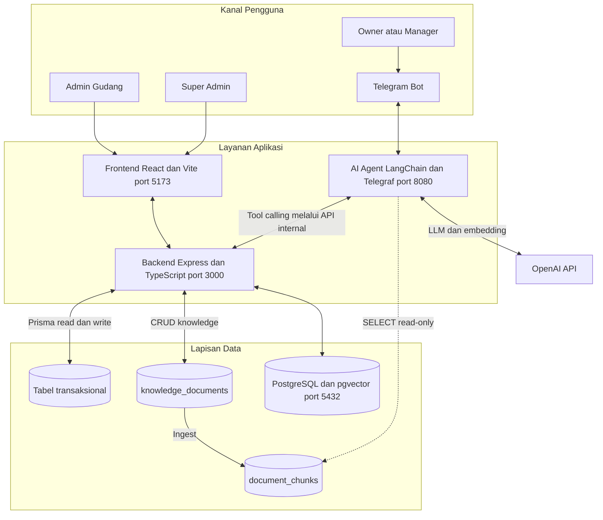

**Keterangan**

Gambar 4.1 menekankan pembagian hak akses pada implementasi. *Backend* memegang hak tulis ke tabel transaksional dan tabel knowledge. Agen AI hanya membaca `document_chunks` melalui peran basis data `ai_agent`. Data transaksional tidak disalin ke indeks vektor. Dengan cara ini, jawaban tentang stok dan status dokumen selalu berasal dari basis data operasional.

Ukuran implementasi dirangkum pada Tabel 4.1. Angka-angka ini menunjukkan cakupan pekerjaan, bukan ukuran kualitas. Kualitas dinilai melalui pengujian pada subbagian 4.6.

**Tabel 4.1 Ringkasan Artefak dan Ukuran Implementasi**

| Komponen | Jumlah | Bukti |
| :--- | ---: | :--- |
| Modul *backend* | 13 | Direktori `backend/src/modules` |
| Model Prisma | 17 | `backend/prisma/schema.prisma` |
| Migrasi basis data | 5 | Direktori `backend/prisma/migrations` |
| Halaman *frontend* | 15 | Berkas `*Page.tsx` pada `frontend/src/features` |
| *Tool* asisten AI | 18 | `ai-agent/src/application/tools` |
| Tab laporan | 6 | `frontend/src/features/reports/ReportsPage.tsx` |
| Berkas uji | 23 | Direktori `backend/tests`, `ai-agent/tests`, dan `frontend/src` |
| Skenario uji | 196 | 117 unit dan komponen, 79 integrasi |
| Skenario penerimaan | 22 | Tabel 3.8 |

**Keterangan**

Penghitungan dilakukan pada 3 November 2026. Jumlah halaman *frontend* mencakup halaman masuk, *dashboard*, sepuluh halaman operasional, halaman laporan, halaman knowledge, dan halaman audit log. Halaman detail PO dan detail Surat Jalan dihitung terpisah karena memiliki berkas sendiri.

Dari sisi struktur, *backend* dan *ai-agent* memakai arsitektur berlapis. Lapisan presentasi menangani rute, pengendali, dan handler pesan. Lapisan bisnis menangani aturan dan alur kerja. Lapisan persistensi menangani akses data dan adapter keluar. Ketergantungan keluar disembunyikan di balik *port* dan dirakit pada satu berkas komposisi. Struktur ini memungkinkan pengujian logika bisnis tanpa menyalakan basis data atau layanan eksternal.

## 4.2 Hasil Implementasi Warehouse Management System

### 4.2.1 Data Master, Autentikasi, dan Kontrol Akses

WMS web menangani data master produk, kategori, partner, dan gudang. Produk menyimpan SKU, satuan, kategori, stok minimum, dan stok agregat. Partner dibedakan menjadi *supplier* dan *customer* karena relasi keduanya berbeda pada PO dan Surat Jalan. Gudang memungkinkan satu produk tersebar di beberapa lokasi, dengan jumlah per gudang disimpan pada tabel inventori.

Kontrol akses memakai tiga peran, yaitu `SUPER_ADMIN`, `ADMIN`, dan `OWNER`. `SUPER_ADMIN` mengelola pengguna dan knowledge base. `ADMIN` mengelola operasi gudang. `OWNER` memiliki akses baca dan menerima notifikasi. Setiap perubahan penting dicatat pada *audit log*. Pemisahan peran ini penting karena asisten AI meneruskan identitas pengirim pesan ke lapisan *tool* sehingga daftar *tool* yang tersedia dapat dibatasi sesuai peran.

Tabel 4.2 merangkum modul utama dan bukti implementasinya.

**Tabel 4.2 Modul Utama dan Bukti Implementasi**

| Modul | Fungsi | Bukti Implementasi |
| :--- | :--- | :--- |
| Data master | Produk, kategori, partner, dan gudang | Halaman CRUD dan validasi Zod |
| Transaksi stok | Barang masuk, keluar, dan penyesuaian | Fungsi stok atomik dan penolakan stok kurang |
| Purchase Order | Siklus DRAFT sampai COMPLETED | Mesin keadaan dan penomoran otomatis |
| Surat Jalan | Dokumen pengiriman untuk *customer* | Halaman detail, edit saat DRAFT, dan cetak |
| Laporan | Enam tab analitik dan ekspor CSV | Filter periode dan saldo berjalan |
| Knowledge Base | Dokumen SOP, statistik indeks, dan *re-ingest* | Halaman khusus `SUPER_ADMIN` |
| Autentikasi dan audit | RBAC dan jejak perubahan | *Token* akses, *token* pembaruan, dan *audit log* |

**Keterangan**

Modul `internal` tidak memiliki halaman tersendiri karena dipakai untuk komunikasi antar layanan. Modul ini menyediakan *endpoint* yang dilindungi kunci internal untuk pembuatan draft PO, draft Surat Jalan, dan laporan yang dikonsumsi agen AI.

### 4.2.2 Transaksi Stok Atomik

Inti perubahan stok adalah fungsi `applyStock`. Fungsi ini wajib dipanggil di dalam `container.uow.run` agar pembuatan transaksi, perubahan stok produk, dan perubahan stok per gudang berlangsung dalam satu satuan kerja. Bila salah satu langkah gagal, seluruh perubahan dibatalkan. Cuplikan kode berikut diambil dari `backend/src/modules/transactions/transactions.service.ts` dengan pemangkasan impor dan komentar.

```ts
export async function applyStock(tx: Db, type: TransactionType, input: RecordInput) {
  const product = await productsRepo.findStock(input.productId, tx);
  if (!product) throw Errors.notFound("Product");

  const warehouse = await warehousesRepo.findById(input.warehouseId, tx);
  if (!warehouse) throw Errors.notFound("Warehouse");

  const delta = type === "OUT" ? -input.quantity : input.quantity;

  if (type === "OUT") {
    if (product.stock < input.quantity) throw Errors.insufficientStock();
    const inventoryRow = await inventory.findInventory(
      input.productId,
      input.warehouseId,
      tx,
    );
    if (!inventoryRow || inventoryRow.quantity < input.quantity) {
      throw Errors.insufficientStock();
    }
  }

  if (type === "IN" && input.purchaseOrderId) {
    const po = await purchaseOrdersRepo.findReceiptInfo(input.purchaseOrderId, tx);
    if (!po) throw Errors.notFound("Purchase Order");
    if (po.status !== "CONFIRMED") {
      throw Errors.invalidState("Penerimaan hanya untuk PO berstatus CONFIRMED");
    }
    if (po.partner.type !== "SUPPLIER") {
      throw Errors.unprocessable("PO sumber penerimaan harus dari partner SUPPLIER");
    }

    const lines = await getReceiptStatus(input.purchaseOrderId, tx);
    const line = lines.find((l) => l.productId === input.productId);
    if (!line) throw Errors.unprocessable("Produk tidak ada pada PO sumber");
    if (input.quantity > line.remaining) {
      throw Errors.unprocessable(
        `Qty melebihi sisa pesanan PO (sisa ${line.remaining})`,
      );
    }
  }

  const txn = await repo.create(
    {
      type,
      quantity: input.quantity,
      notes: input.notes ?? null,
      referenceNo: input.referenceNo ?? null,
      productId: input.productId,
      warehouseId: input.warehouseId,
      partnerId: input.partnerId ?? null,
      purchaseOrderId: input.purchaseOrderId ?? null,
      deliveryNoteId: input.deliveryNoteId ?? null,
      createdById: input.createdById,
    },
    tx,
  );

  await productsRepo.adjustStock(input.productId, delta, tx);
  await inventory.upsertInventory(
    input.productId,
    input.warehouseId,
    input.quantity,
    delta,
    tx,
  );

  if (type === "IN" && input.purchaseOrderId) {
    await syncPoReceiptStatus(input.purchaseOrderId, tx);
  }

  return txn;
}
```

**Keterangan**

Fungsi ini memeriksa keberadaan produk dan gudang, menghitung selisih stok, menolak transaksi keluar yang melebihi stok, memvalidasi penerimaan terhadap sisa pesanan PO, membuat catatan transaksi, menyesuaikan stok produk, dan memperbarui jumlah per gudang. Semua akses data melewati *repository*. ORM tidak dipanggil langsung dari lapisan bisnis. Pola ini membuat aturan stok hanya berada pada satu tempat dan dapat diuji secara terpisah.

Pada transaksi masuk yang tertaut PO, sistem juga memeriksa status PO dan sisa pesanan. Penerimaan hanya diizinkan untuk PO berstatus CONFIRMED. Kuantitas yang melebihi sisa pesanan ditolak. Setelah penerimaan, status PO disinkronkan secara otomatis. Bila seluruh item sudah diterima, status PO menjadi COMPLETED.

### 4.2.3 Purchase Order dan Penomoran Dokumen

Purchase Order mengikuti mesin keadaan DRAFT, CONFIRMED, COMPLETED, dan CANCELLED. Hanya DRAFT yang dapat diubah atau dihapus. CONFIRMED dapat dibatalkan. COMPLETED tercapai otomatis saat seluruh item diterima. Nomor PO berformat `PO-YYYYMM-NNN` dan dihitung di dalam transaksi sehingga dua permintaan bersamaan tidak menghasilkan nomor yang sama. Surat Jalan memakai format `SJ-YYYYMM-NNN` dan hanya dapat dibuat untuk partner bertipe CUSTOMER.

Logika format nomor dipisahkan ke lapisan domain sebagai fungsi murni tanpa akses basis data. Cuplikan berikut diambil dari `backend/src/domain/numbering.ts`.

```ts
export type DocumentKind = "PO" | "SJ";

export function numberPrefix(kind: DocumentKind, date: Date): string {
  return `${kind}-${format(date, "yyyyMM")}-`;
}

export function buildDocumentNumber(
  kind: DocumentKind,
  date: Date,
  existingCount: number,
): string {
  return `${numberPrefix(kind, date)}${String(existingCount + 1).padStart(3, "0")}`;
}
```

**Keterangan**

Penghitungan urutan dilakukan *repository* di dalam transaksi, sedangkan format nomor diuji sebagai fungsi murni. Pemisahan ini membuat format nomor dapat diuji tanpa basis data dan keunikan nomor tetap terjaga saat beberapa permintaan datang bersamaan. Pengujian unit untuk penomoran tersedia pada `backend/tests/unit/numbering.test.ts`.

### 4.2.4 Surat Jalan

Surat Jalan dipakai untuk pengiriman kepada partner CUSTOMER. Dokumen dapat dibuat secara mandiri tanpa PO atau merujuk PO tertentu. Status Surat Jalan mencakup DRAFT, SHIPPED, DELIVERED, dan CANCELLED. Stok baru berkurang saat status berubah menjadi SHIPPED. Pada status DRAFT, item dan catatan masih dapat diubah. Setelah SHIPPED, perubahan ditolak. Halaman detail menyediakan fungsi cetak melalui peramban.

Pemisahan PO dan Surat Jalan penting karena relasi bisnisnya berbeda. PO berkaitan dengan pembelian dari *supplier*, sedangkan Surat Jalan berkaitan dengan pengiriman kepada *customer*. Pemisahan ini mencegah pencampuran partner dan menjaga validasi pada masing-masing dokumen.

### 4.2.5 Laporan Enam Tab

Halaman laporan menyediakan enam tab dengan filter periode dan ekspor CSV. Tabel 4.3 merangkum isi setiap tab.

**Tabel 4.3 Tab Laporan dan Isi**

| Tab | Ringkasan Isi |
| :--- | :--- |
| Ringkasan | KPI masuk dan keluar dalam unit serta jumlah transaksi, PO aktif, stok kritis, grafik tren arus stok, top tujuan, dan perbandingan periode. |
| Persediaan | Total produk, total unit, dan stok kritis, stok per gudang dan kategori, daftar stok, serta daftar restock. |
| Pembelian | KPI dan nilai PO dalam rupiah dari `unitPrice`, sebaran status, top *supplier*, dan daftar PO. |
| Pengiriman | KPI dan kuantitas kirim, sebaran status, top tujuan dan produk, pengiriman per gudang, dan daftar Surat Jalan. |
| Mutasi | Kartu stok dengan saldo berjalan per produk dan log mutasi terfilter berdasarkan tipe, produk, gudang, dan partner. |
| Analitik | Top *mover*, *dead stock* tanpa keluar dalam N hari, klasifikasi ABC dengan proporsi 80, 15, dan 5, serta aktivitas per pengguna. |

**Keterangan**

Grafik memakai pustaka *recharts* melalui pembungkus `TrendAreaChart` dan `RankBarChart`. Nilai rupiah hanya dihitung untuk pembelian karena `PurchaseOrderItem.unitPrice` tersedia. Item tanpa harga dikecualikan. Saldo kartu stok dihitung dari `stock_transactions` dengan aturan transaksi IN menambah kuantitas, OUT mengurangi kuantitas, dan ADJUSTMENT menambah kuantitas. Konsistensi saldo akhir diuji melalui skenario AC-21.

Tab Mutasi menjawab kebutuhan penelusuran saldo. Admin dapat melihat apakah saldo akhir sama dengan saldo awal ditambah seluruh mutasi. Tab Analitik menjawab kebutuhan perencanaan persediaan dengan menandai produk yang bergerak cepat, produk yang tidak bergerak, dan kategori ABC. Kedua tab ini memperluas cakupan laporan dari sekadar rekap harian menjadi analitik operasional.

### 4.2.6 Knowledge Base

Knowledge base dikelola dari halaman web khusus `SUPER_ADMIN`. Halaman ini memiliki tiga tab, yaitu Dokumen, *Index*, dan *Ingest*. Tab Dokumen dipakai untuk mengunggah, mengubah, dan menonaktifkan dokumen. Tab *Index* menampilkan statistik potongan dokumen dan status indeks. Tab *Ingest* menampilkan status *job* terakhir dan tombol *re-ingest*. Setiap eksekusi *ingest* dicatat pada tabel `ingest_jobs` sehingga status bertahan setelah layanan dinyalakan ulang.

Dokumen knowledge disimpan pada tabel `knowledge_documents` sebagai sumber kebenaran. Tabel ini menampung `filename`, `title`, `docType`, `content`, `metadata`, `version`, `isActive`, dan `uploadedById`. Dokumen aktif kemudian dipecah dan di-*embed* ke tabel `document_chunks`. Perubahan dokumen dari antarmuka memicu *re-ingest* otomatis secara *best-effort* bila `RAG_AUTO_INGEST` bernilai benar. Tombol *re-ingest* manual tetap tersedia.

### 4.2.7 Ringkasan Hasil WMS

Secara fungsional, WMS web telah mencakup data master, transaksi stok, Purchase Order, Surat Jalan, laporan enam tab, knowledge base, autentikasi, RBAC, dan *audit log*. Implementasi ini menjawab kebutuhan fungsional FR-01 sampai FR-10 pada FSD. Fitur telah tersedia dan diuji pada lingkungan evaluasi. Klaim bahwa fitur sudah dipakai secara rutin oleh UMKM mitra belum dapat diajukan karena *pilot* lapangan belum dilaksanakan.

## 4.3 Hasil Implementasi Asisten AI

### 4.3.1 Perakitan Agen dan Daftar *Tool*

Agen AI dirakit ulang untuk setiap pesan masuk. Tujuannya agar identitas percakapan dan peran pengirim dapat disertakan pada setiap panggilan dan jejak audit tetap utuh. Agen dibatasi maksimal delapan langkah, dibangun dengan *temperature* nol, dan menerima daftar *tool* yang dibentuk sesuai peran. Cuplikan berikut diambil dari `ai-agent/src/application/agent/agent.ts`.

```ts
export async function runAgent(
  input: {
    chatId: string;
    message: string;
    history: BaseMessage[];
    role?: string | null;
  },
  deps: ToolDeps = container,
): Promise<AgentRunResult> {
  const tools = buildTools(deps, input.chatId, input.role);
  const executor = new AgentExecutor({
    agent: createToolCallingAgent({
      llm: getLlm(),
      tools,
      prompt: buildAgentPrompt(),
    }),
    tools,
    maxIterations: 8,
    returnIntermediateSteps: true,
  });

  const result = await executor.invoke({
    input: input.message,
    chat_history: input.history,
  });

  const steps = (result.intermediateSteps ?? []) as IntermediateStep[];
  const last = steps[steps.length - 1];

  return {
    output: String(result.output ?? ""),
    toolName: last?.action?.tool ?? null,
    toolPayload: last?.action?.toolInput ?? null,
    toolResult: last?.observation ?? null,
  };
}
```

**Keterangan**

Agen menerima *port* `ToolDeps` sehingga dapat diuji dengan dependensi tiruan. Setiap panggilan menyimpan nama *tool*, parameter, dan hasil observasi terakhir. Informasi ini dipakai untuk audit dan evaluasi. *Temperature* nol dipilih untuk mengurangi variasi jawaban pada pertanyaan faktual, meskipun tidak menghilangkan kemungkinan salah tafsir atas pertanyaan yang ambigu.

Tabel 4.4 merangkum 18 *tool* yang tersedia.

**Tabel 4.4 Kelompok Tool Asisten AI**

| Kelompok | *Tool* | Fungsi |
| :--- | :--- | :--- |
| Stok | `cek_stok_barang`, `stok_per_gudang`, `stok_tipis` | Stok satu produk, rincian per gudang, dan peringatan stok minimum. |
| Katalog | `cari_produk`, `list_kategori`, `list_partner`, `list_gudang` | Pencarian produk dan daftar data master. |
| Transaksi | `list_transaksi`, `rekap_pengiriman` | Riwayat masuk dan keluar serta rekap pengiriman per tanggal. |
| Purchase Order | `list_po`, `list_po_status`, `detail_po` | Daftar dan detail PO berdasarkan status. |
| Surat Jalan | `list_surat_jalan` | Daftar Surat Jalan. |
| Ringkasan | `ringkasan_dashboard`, `ringkasan_periode` | Ringkasan operasional dan tren periode. |
| Tulis terbatas | `buat_draft_po`, `buat_draft_surat_jalan` | Membuat draft berstatus DRAFT. |
| RAG | `cari_sop` | Mencari SOP dan kebijakan pada knowledge base. |

**Keterangan**

*Tool* tulis hanya membuat draft. Status akhir dokumen tetap ditentukan admin di web. Pembatasan ini menerapkan prinsip bahwa model bahasa tidak pernah menjadi penulis akhir data bisnis.

### 4.3.2 Penanganan Nama Produk yang Ambigu

Penanganan nama produk yang ambigu menjadi bagian penting dari desain. Pencarian memakai normalisasi nama dan kecocokan *token* sehingga penulisan seperti "mie instan" dapat cocok dengan "Mi Instan". Bila satu nama cocok ke beberapa varian, *tool* mengembalikan daftar kandidat beserta stoknya dan model diminta meminta klarifikasi. Pola ini menghindari pemilihan varian secara diam-diam yang dapat menghasilkan jawaban salah meskipun angkanya benar untuk produk lain.

Cuplikan berikut diambil dari `ai-agent/src/application/tools/read.ts` dengan pemangkasan.

```ts
const checkStock = new DynamicStructuredTool({
  name: "cek_stok_barang",
  description:
    "Cek sisa stok satu barang berdasarkan nama. Bila nama cocok ke beberapa varian, tool mengembalikan daftar kandidat.",
  schema: stockSchema,
  func: async (input: StockInput): Promise<string> => {
    const result = await backend.getStockByProductName(input.productName);

    if (!result || result.status === "none") {
      const suggestions = result?.suggestions ?? [];
      const hint = suggestions.length
        ? ` Mungkin maksud: ${suggestions.map((s) => `"${s.name}"`).join(", ")}.`
        : "";
      return `Sistem tidak menemukan barang bernama mirip "${input.productName}".${hint} Minta user menyebutkan nama lain.`;
    }

    if (result.status === "ambiguous") {
      const candidates = result.candidates ?? [];
      const lines = candidates.map(
        (c) => `- ${c.name}, SKU ${c.sku}, stok ${c.stock} ${c.unit}`,
      );
      return `Kata kunci "${input.productName}" cocok dengan beberapa produk:\n${lines.join(
        "\n",
      )}\nMohon sebutkan varian yang dimaksud.`;
    }

    const p = result.product as StockRow;
    return `Info database: ${p.name} (SKU: ${p.sku}) stok ${p.stock} ${p.unit}.`;
  },
});
```

**Keterangan**

Respons *tool* membedakan tiga keadaan, yaitu ditemukan, ambigu, dan tidak ditemukan. Pada keadaan ambigu, model menerima daftar kandidat sehingga dapat meminta klarifikasi. Pada keadaan tidak ditemukan, model menerima saran nama yang mirip. Mekanisme ini diuji pada `ai-agent/tests/tools.test.ts` dan `backend/tests/unit/product-resolver.test.ts`.

### 4.3.3 Alur *Tool Calling* dan Batas Tulis

Alur *tool calling* disajikan pada Gambar 4.2. Pesan pengguna masuk melalui Telegram, diteruskan ke agen AI, lalu dipetakan ke *tool* yang sesuai. Untuk pertanyaan stok, agen memanggil *tool* baca yang meneruskan permintaan ke *backend*. *Backend* membaca basis data dan mengembalikan hasil terstruktur. Untuk pertanyaan SOP, agen memanggil *retriever* yang mengambil potongan dokumen dari pgvector, lalu menyusun jawaban dengan konteks tersebut. Jawaban akhir menyebut sumber SOP bila pertanyaan bersifat pengetahuan dan menyebut data aktual bila pertanyaan bersifat transaksional.

**Gambar 4.2 Alur Tool Calling**

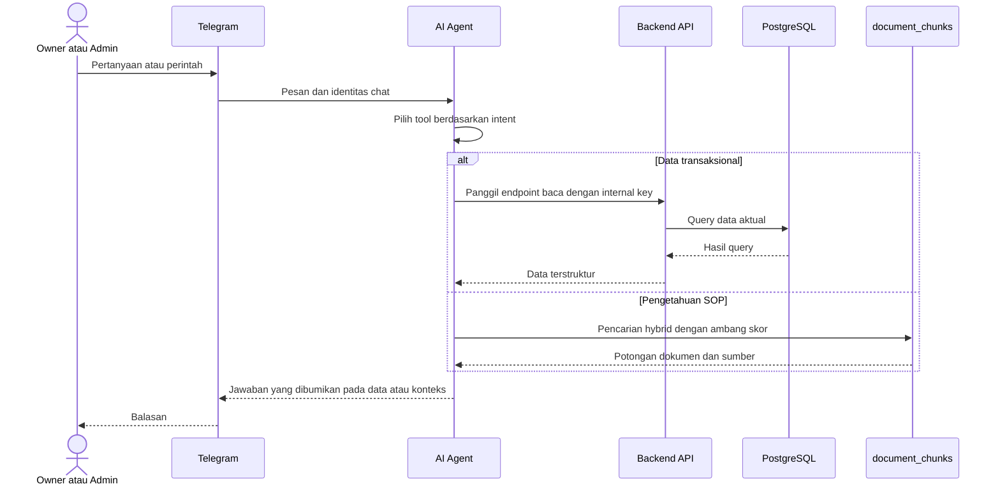

**Keterangan**

Batas tulis diterapkan pada dua tingkat. Pertama, agen tidak memiliki kredensial tulis ke tabel bisnis. Kedua, *tool* tulis hanya membuat dokumen berstatus DRAFT. Admin tetap harus mengonfirmasi PO atau mengirim Surat Jalan melalui aplikasi web. Dengan cara ini, keputusan akhir atas dokumen bisnis tetap berada pada manusia.

### 4.3.4 Hasil Perilaku yang Teruji

Perilaku asisten AI yang sudah diuji pada tingkat unit mencakup pendaftaran seluruh *tool* baca, pengembalian info stok, penanganan nama ambigu, permintaan klarifikasi ketika produk tidak ditemukan, pengiriman `chatId` dan sumber `AI_CHAT` ke *backend*, penanganan kegagalan *backend* dengan pesan yang ramah, pembuatan draft PO dan Surat Jalan, penerusan konteks RAG beserta sumber, pernyataan tidak ada SOP ketika knowledge base kosong, dan pembatasan akses dokumen sensitif berdasarkan peran.

Pengujian tingkat unit tersebut memakai dependensi tiruan. Perilaku pada basis data dan model bahasa nyata dibuktikan melalui tes integrasi dan uji *end-to-end* yang dilaporkan pada subbagian 4.6. Hasilnya menunjukkan bahwa jawaban akhir sesuai dengan data aktual pada lingkungan evaluasi.

## 4.4 Hasil Implementasi *Retrieval-Augmented Generation*

### 4.4.1 Sumber Pengetahuan dan Skema

Knowledge base dikelola dari halaman web khusus `SUPER_ADMIN`. Dokumen SOP, FAQ, kebijakan, *runbook*, panduan, onboarding, catatan partner, dan kontrak disimpan pada tabel `knowledge_documents` sebagai sumber kebenaran. Dokumen aktif dipotong dengan `RecursiveCharacterTextSplitter` yang memperhatikan struktur markdown, disisipi judul, lalu diubah menjadi *embedding* dengan model `text-embedding-3-small` berdimensi 1536. Hasilnya disimpan pada tabel `document_chunks` bersama vektor dan metadata sumber.

Tabel 4.5 merangkum komponen *pipeline* RAG.

**Tabel 4.5 Komponen Pipeline RAG**

| Komponen | Implementasi | Keterangan |
| :--- | :--- | :--- |
| Sumber dokumen | Tabel `knowledge_documents` | Dokumen aktif dikelola dari UI `SUPER_ADMIN`. |
| Pemotongan teks | `RecursiveCharacterTextSplitter` | Memperhatikan pemisah markdown dan menyisipkan judul. |
| *Embedding* | `text-embedding-3-small` | Dimensi 1536, dibaca dari variabel lingkungan. |
| Penyimpanan vektor | Tabel `document_chunks` dengan pgvector | Indeks HNSW pada kolom `embedding`. |
| Pencarian teks | Kolom `content_tsv` dan indeks GIN | Mendukung *full-text search* bahasa sederhana. |
| Penggabungan peringkat | *Reciprocal Rank Fusion* | Menggabungkan peringkat vektor dan teks. |
| Ambang skor | `RAG_MIN_SCORE` dengan nilai bawaan 0,3 | Membuang potongan yang tidak relevan. |
| Jumlah konteks | `AGENT_TOP_K` dengan nilai bawaan 5 | Jumlah potongan yang dikirim ke model. |
| Riwayat *job* | Tabel `ingest_jobs` | Menyimpan status *running*, *done*, dan *error*. |

**Keterangan**

Dimensi vektor harus sama dengan `EMBEDDING_DIMENSIONS`. Perubahan model *embedding* menuntut *re-ingest* seluruh dokumen karena ruang vektor lama tidak kompatibel dengan model baru.

### 4.4.2 *Ingest* Idempoten dan Pencatatan *Job*

Proses *ingest* membaca dokumen aktif, menghitung *content hash*, memeriksa apakah dokumen berubah, memotong teks, menghasilkan *embedding*, lalu menulis hasilnya ke tabel `document_chunks` di dalam satu transaksi. Dokumen yang isinya tidak berubah dilewati. *Chunk* yatim dari dokumen yang nonaktif atau hilang dibersihkan setiap *ingest* agar indeks tetap selaras.

Cuplikan berikut diambil dari `ai-agent/src/infrastructure/rag/ingest.ts` dengan pemangkasan.

```ts
function hashDoc(doc: KnowledgeDoc): string {
  const payload = JSON.stringify({
    content: doc.content,
    title: doc.title,
    docType: doc.docType,
    metadata: doc.metadata ?? null,
  });
  return createHash("sha256").update(payload).digest("hex");
}

export async function runIngest(
  pool: ReturnType<typeof ingestPool>,
  filter: IngestFilter = {},
): Promise<IngestResult[]> {
  const pruned = await pruneOrphanChunks(pool);

  const conditions: string[] = [`"isActive" = true`];
  const params: unknown[] = [];
  if (filter.documentId) {
    params.push(filter.documentId);
    conditions.push(`"id" = $${params.length}`);
  }
  if (filter.docType) {
    params.push(filter.docType);
    conditions.push(`"docType" = $${params.length}`);
  }

  const { rows } = await pool.query<KnowledgeDoc>(
    `SELECT "id", "filename", "title", "docType", "content", "metadata", "version"
     FROM "knowledge_documents" WHERE ${conditions.join(" AND ")}`,
    params,
  );

  const embeddings = getEmbeddings();
  const results: IngestResult[] = [];

  for (const doc of rows) {
    const contentHash = hashDoc(doc);
    const existing = await pool.query(
      `SELECT 1 FROM "document_chunks"
       WHERE "documentId" = $1 AND "contentHash" = $2 LIMIT 1`,
      [doc.id, contentHash],
    );
    if ((existing.rowCount ?? 0) > 0) {
      results.push({
        documentId: doc.id,
        source: doc.filename,
        chunks: 0,
        skipped: true,
      });
      continue;
    }

    const chunks = await splitDocument(doc.title, doc.content);
    const vectors = await embeddings.embedDocuments(chunks);

    await pool.query("BEGIN");
    try {
      await pool.query(
        `DELETE FROM "document_chunks" WHERE "documentId" = $1`,
        [doc.id],
      );
      for (let i = 0; i < chunks.length; i++) {
        await pool.query(
          `INSERT INTO "document_chunks"
             ("id", "source", "content", "embedding", "documentId", "docType",
              "title", "metadata", "contentHash", "embeddingModel",
              "dimensions", "createdAt")
           VALUES (gen_random_uuid(), $1, $2, $3, $4, $5, $6, $7, $8, $9, $10, now())`,
          [
            doc.filename,
            chunks[i],
            JSON.stringify(vectors[i]),
            doc.id,
            doc.docType,
            doc.title,
            doc.metadata ? JSON.stringify(doc.metadata) : null,
            contentHash,
            env.OPENAI_EMBEDDING_MODEL,
            env.EMBEDDING_DIMENSIONS,
          ],
        );
      }
      await pool.query("COMMIT");
    } catch (err) {
      await pool.query("ROLLBACK");
      throw err;
    }

    results.push({
      documentId: doc.id,
      source: doc.filename,
      chunks: chunks.length,
      skipped: false,
    });
  }

  return results;
}
```

**Keterangan**

*Content hash* dihitung dari isi, judul, jenis dokumen, dan metadata. Perubahan judul saja menghasilkan *hash* berbeda sehingga dokumen diproses ulang. Proses tulis dilakukan di dalam transaksi. Bila terjadi kesalahan, seluruh *chunk* baru dibatalkan dan *chunk* lama tetap utuh. Setiap eksekusi dibungkus oleh `runIngestJob` yang mencatat status ke tabel `ingest_jobs`.

Status *job* dipulihkan saat layanan dinyalakan ulang. Mekanisme ini menjawab masalah status *ingest* yang sebelumnya hilang setelah *restart*. Pengujian unit untuk perilaku ini tersedia pada `ai-agent/tests/ingestJob.test.ts` dan `ai-agent/tests/ingest.test.ts`.

### 4.4.3 Pencarian *Hybrid* dan Ambang Skor

*Retrieval* menggabungkan peringkat vektor dan pencarian teks penuh. Pencarian vektor memakai *cosine distance* pada pgvector. Pencarian teks penuh membantu ketika pengguna memakai istilah yang persis ada pada dokumen. Hasil gabungan disaring dengan ambang skor minimum untuk membuang potongan yang tidak relevan. Bila basis data atau layanan *embedding* gagal, *retriever* mengembalikan hasil kosong dan agen menyatakan bahwa SOP tidak ditemukan, bukan mengarang jawaban.

Cuplikan berikut diambil dari `ai-agent/src/infrastructure/rag/retriever.ts` dengan pemangkasan.

```ts
export async function searchKnowledge(
  query: string,
  options: KnowledgeSearchOptions = {},
): Promise<KnowledgeChunk[]> {
  const topK = options.topK ?? env.AGENT_TOP_K;
  const minScore = options.minScore ?? env.RAG_MIN_SCORE;
  const docTypes =
    options.docTypes && options.docTypes.length > 0 ? options.docTypes : null;

  try {
    const vector = await getEmbeddings().embedQuery(query);
    const vectorParam = JSON.stringify(vector);

    const rows = env.RAG_HYBRID
      ? await hybridSearch(vectorParam, query, topK, docTypes)
      : await vectorSearch(vectorParam, topK, docTypes);

    return rows
      .filter((r) =>
        env.RAG_HYBRID
          ? r.vectorMatch === false || r.score >= minScore
          : r.score >= minScore,
      )
      .map(({ source, title, docType, content, score }) => ({
        source,
        title,
        docType,
        content,
        score,
      }));
  } catch (err) {
    console.error("Retrieval knowledge base gagal:", err);
    return [];
  }
}
```

**Keterangan**

Fungsi ini memakai `embedQuery`, bukan `embedDocuments`, karena kueri pengguna adalah satu teks pendek. Pencarian *hybrid* memakai *Reciprocal Rank Fusion* dengan konstanta 60. Hasil akhir dibatasi `AGENT_TOP_K`. Filter `docType` diteruskan ke kueri sehingga pencarian dapat dipersempit ke jenis dokumen tertentu.

**Gambar 4.3 Pipeline Ingest dan Retrieval RAG**

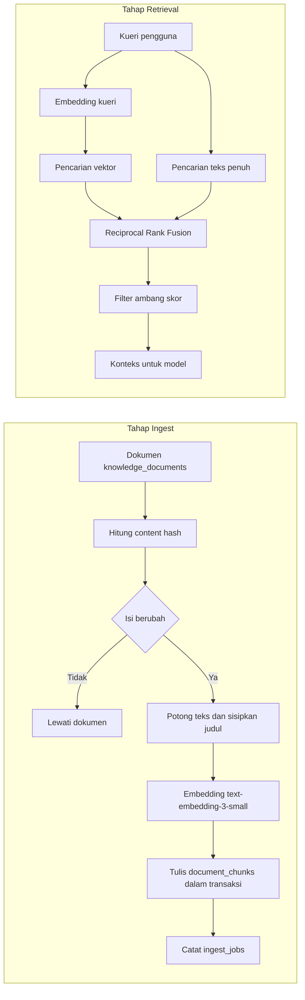

**Keterangan**

Pemisahan tahap *ingest* dan *retrieval* penting karena keduanya memiliki kebutuhan berbeda. *Ingest* membutuhkan hak tulis dan dijalankan sebagai *job* atau perintah khusus. *Retrieval* hanya membutuhkan hak baca dan dijalankan pada setiap pertanyaan.

### 4.4.4 Anti-Halusinasi dan *Least Privilege*

Mekanisme anti-halusinasi diterapkan pada empat tempat. Pertama, data transaksional tidak di-*embed*. Jawaban tentang stok dan status dokumen hanya berasal dari *tool* baca yang memanggil *backend*. Kedua, *system prompt* memuat aturan untuk tidak mengarang dan menyatakan ketiadaan data apa adanya. Ketiga, *retrieval* memakai ambang skor sehingga potongan yang tidak relevan dibuang. Keempat, *temperature* nol dipakai untuk mengurangi variasi jawaban.

*Least privilege* diterapkan melalui migrasi basis data yang membuat peran `ai_agent` dan hanya memberi hak `SELECT` pada tabel `document_chunks`. Cuplikan migrasi berikut diambil dari `backend/prisma/migrations/20260922070000_grant_ai_agent_readonly/migration.sql`.

```sql
DO $$
BEGIN
  IF NOT EXISTS (SELECT FROM pg_roles WHERE rolname = 'ai_agent') THEN
    CREATE ROLE ai_agent LOGIN PASSWORD '<kata-sandi-yang-diganti>';
  END IF;
END
$$;

GRANT USAGE ON SCHEMA public TO ai_agent;
GRANT SELECT ON TABLE document_chunks TO ai_agent;
```

**Keterangan**

Peran `ai_agent` tidak memiliki hak tulis ke tabel bisnis maupun tabel `knowledge_documents`. Dokumen knowledge ditulis oleh *backend* melalui Prisma. Agen AI hanya membaca `document_chunks`. Pembatasan ini mengurangi dampak bila kredensial agen bocor. Meskipun demikian, pengujian penetrasi dan pengujian penyalahgunaan *prompt* belum dilaksanakan.

### 4.4.5 Hasil Pengujian RAG

Pengujian RAG pada tingkat unit mencakup pembuangan hasil vektor di bawah ambang skor, pengembalian array kosong saat terjadi kesalahan, penerusan filter jenis dokumen, pembacaan `knowledge_documents`, pemotongan *chunk*, penulisan ke `document_chunks`, pelewatan dokumen yang isinya tidak berubah, pemangkasan *chunk* yatim, rollback saat penulisan gagal, pencatatan *job running* dan *done*, penandaan *job error*, pemuatan *job* terakhir, dan penandaan *job* yang terputus. Pengujian integrasi dan uji *end-to-end* juga mencakup alur `cari_sop` dari pesan chat sampai jawaban yang menyebut sumber.

Pengujian tersebut belum mengukur kualitas *retrieval* pada korpus dokumen nyata. Metrik seperti *faithfulness*, *answer relevance*, dan *context precision* belum dihitung. Evaluasi kualitas RAG memerlukan korpus dokumen SOP yang representatif dan penilaian jawaban oleh penilai manusia atau kerangka evaluasi khusus. Keterbatasan ini dicatat pada subbagian 4.8.6.

## 4.5 Hasil Implementasi Notifikasi dan Keamanan

### 4.5.1 Notifikasi Telegram

Notifikasi dijalankan sebagai panggilan *best-effort* dengan batas waktu lima detik. Saat draft PO dibuat melalui chat, *backend* memanggil *endpoint* notifikasi pada AI Agent, lalu agen mengirim ringkasan PO dan tombol menuju halaman detail kepada admin. *Owner* menerima notifikasi saat PO dikonfirmasi atau dibatalkan dan saat penerimaan selesai. Karena sifatnya *best-effort*, kegagalan notifikasi tidak menggagalkan transaksi bisnis. Kegagalan hanya dicatat pada log.

Pemisahan notifikasi dari transaksi bisnis merupakan keputusan desain yang disengaja. Tujuan utamanya adalah agar gangguan pada kanal chat tidak menghambat pekerjaan gudang. Konsekuensinya, admin mungkin tidak menerima notifikasi bila layanan Telegram sedang bermasalah, tetapi data PO tetap tersimpan dan dapat dilihat melalui aplikasi web. Mekanisme ini diuji pada tingkat unit melalui `ai-agent/tests/notifier.test.ts` dan `backend/tests/unit/notify.test.ts`.

### 4.5.2 Kontrol Keamanan

Kontrol keamanan diterapkan pada beberapa lapis. Tabel 4.6 merangkum kontrol dan buktinya.

**Tabel 4.6 Kontrol Keamanan**

| Kontrol | Implementasi | Bukti |
| :--- | :--- | :--- |
| Autentikasi pengguna web | *Token* akses berumur pendek dan *token* pembaruan | Modul `auth` dan pengujian `auth.test.ts` |
| Otorisasi berbasis peran | `SUPER_ADMIN`, `ADMIN`, dan `OWNER` | *Middleware* peran dan pengujian RBAC |
| Kunci internal antar layanan | *Header* `x-internal-key` pada *endpoint* internal | Pengujian `auth.test.ts` dan `delivery-notes.test.ts` |
| Hak baca saja agen AI | Peran `ai_agent` hanya `SELECT` pada `document_chunks` | Migrasi `grant_ai_agent_readonly` |
| Pembatasan dokumen sensitif | `catatan-partner` dan `kontrak` hanya untuk `OWNER` dan `SUPER_ADMIN` | Pengujian `tools.test.ts` |
| Validasi masukan | Skema Zod pada *backend* dan *tool* | Modul schema dan pengujian validasi |
| Pembatasan laju pesan | Batas pesan per chat pada bot Telegram | Pengujian `bot.test.ts` |
| *Audit log* | Pencatatan aktor, aksi, entitas, nilai sebelum dan sesudah, serta alamat IP | Modul `audit-logs` dan pengujian integrasi |

**Keterangan**

Kontrol pada Tabel 4.6 mengurangi risiko akses tidak sah dan penyalahgunaan data. Meskipun demikian, kontrol ini belum diuji melalui pengujian penetrasi atau tinjauan keamanan independen. Pengujian terhadap *prompt injection* dan upaya membuat agen menulis data bisnis juga belum dilaksanakan.

### 4.5.3 Batasan Keamanan

Tiga batasan keamanan perlu dinyatakan. Pertama, kunci internal dan kata sandi basis data pada lingkungan pengembangan masih berupa nilai contoh. Pada penerapan produksi, nilai tersebut harus diganti dan disimpan pada pengelola rahasia. Kedua, pengujian keamanan baru mencakup kasus akses peran, validasi masukan, dan pembatasan laju pesan. Pengujian *prompt injection*, *jailbreak*, dan eksfiltrasi data belum dilakukan. Ketiga, *audit log* mencatat perubahan data penting, tetapi belum mencakup seluruh aktivitas percakapan AI. Percakapan disimpan pada tabel tersendiri untuk evaluasi, namun kebijakan retensi dan penghapusan data belum ditetapkan.

## 4.6 Hasil Pengujian

### 4.6.1 Lingkungan dan Prosedur

Evaluasi formatif dilaksanakan pada 31 Oktober 2026. Lingkungan evaluasi menyediakan Docker dan PostgreSQL dengan ekstensi pgvector sehingga seluruh tingkat pengujian dapat dijalankan. Pemeriksaan statis, tes unit dan komponen, tes integrasi, serta uji *end-to-end* dilaksanakan pada lingkungan tersebut.

Pemeriksaan statis dilakukan dengan *lint* dan *typecheck* pada tiga layanan. Hasilnya dirangkum pada Tabel 4.7.

**Tabel 4.7 Hasil Pemeriksaan Statis**

| Layanan | *Lint* | *Typecheck* | Status |
| :--- | :--- | :--- | :--- |
| *Backend* | Lulus | Lulus | Lulus |
| AI Agent | Lulus | Lulus | Lulus |
| *Frontend* | Lulus | Lulus | Lulus |

**Keterangan**

Hasil ini mengacu pada catatan evaluasi formatif 31 Oktober 2026 dan tidak dijalankan ulang pada 3 November 2026. Pemeriksaan statis memastikan tidak ada kesalahan tipe dan pelanggaran aturan *lint* yang terdeteksi pada saat evaluasi, tetapi tidak membuktikan kebenaran perilaku sistem.

### 4.6.2 Hasil Tes Unit dan Komponen

Tes unit dan komponen dijalankan pada 17 berkas. Seluruh 117 skenario lulus tanpa kegagalan. Tabel 4.8 merangkum hasil per layanan.

**Tabel 4.8 Hasil Tes Unit dan Komponen**

| Layanan | Berkas | Skenario | Lulus | Gagal | Status |
| :--- | ---: | ---: | ---: | ---: | :--- |
| *Backend* | 6 | 37 | 37 | 0 | Lulus |
| AI Agent | 8 | 71 | 71 | 0 | Lulus |
| *Frontend* | 3 | 9 | 9 | 0 | Lulus |
| **Total** | **17** | **117** | **117** | **0** | **Lulus** |

**Keterangan**

Tes *backend* mencakup *knowledge service*, notifikasi, penomoran dokumen, paginasi, mesin keadaan PO, dan resolusi nama produk. Tes AI Agent mencakup bot, format balasan, *ingest*, *ingest job*, pengiriman pesan, notifier, retriever, dan *tool*. Tes *frontend* mencakup halaman masuk, halaman detail Surat Jalan, dan fungsi format.

Beberapa perilaku penting yang tercakup adalah penolakan transisi status PO yang tidak sah, pembentukan nomor dokumen, normalisasi nama produk, penanganan nama ambigu, pengembalian hasil kosong saat *retrieval* gagal, pembatasan akses dokumen sensitif, pembatasan laju pesan, dan pemulihan status *ingest* setelah *restart*. Tes ini memberi bukti bahwa logika inti berjalan sesuai rancangan pada tingkat unit.

### 4.6.3 Hasil Tes Integrasi

Tes integrasi terdiri atas 79 skenario pada enam berkas. Seluruh berkas dijalankan pada lingkungan PostgreSQL dan seluruh skenario dinyatakan lulus. Tabel 4.9 merangkum sebarannya.

**Tabel 4.9 Hasil Tes Integrasi**

| Berkas Uji | Skenario | Cakupan | Status |
| :--- | ---: | :--- | :--- |
| `auth.test.ts` | 8 | Login, *token*, RBAC, kunci internal, pemetaan chat | Lulus |
| `delivery-notes.test.ts` | 12 | Pembuatan dan perubahan Surat Jalan, validasi partner, akses internal | Lulus |
| `knowledge.test.ts` | 4 | CRUD knowledge, statistik indeks, status *ingest* terakhir | Lulus |
| `purchase-orders.test.ts` | 12 | Pembuatan PO, transisi status, cascade, draft dari AI | Lulus |
| `reports.test.ts` | 26 | Katalog, stok, transaksi, PO, Surat Jalan, laporan agregat, kartu stok, analitik | Lulus |
| `transactions.test.ts` | 17 | Transaksi masuk dan keluar, void, filter, penerimaan PO, lookup stok | Lulus |
| **Total** | **79** | | **Lulus** |

**Keterangan**

Tes integrasi merupakan bukti yang paling dekat dengan perilaku sistem nyata karena melibatkan basis data, rute API, dan aturan akses. Seluruh 79 skenario lulus tanpa kegagalan pada lingkungan PostgreSQL. Hasil ini melengkapi bukti tingkat unit dan komponen yang dilaporkan pada subbagian 4.6.2.

### 4.6.4 Hasil Uji *End-to-End*

Uji *end-to-end* dilaksanakan mengikuti prosedur pada subbagian 3.5.4. Prosedur mencakup delapan langkah, mulai dari menyalakan layanan, mengirim pertanyaan stok, membuat draft PO, memeriksa antrean admin, mengonfirmasi PO, mencatat penerimaan, menguji pertanyaan SOP, hingga memeriksa notifikasi. Seluruh langkah dijalankan dan dinyatakan lulus.

Hasil setiap langkah dicatat pada Tabel 3.8. Angka waktu tanggap chat, waktu pembuatan draft PO, dan waktu tiba notifikasi dicatat pada lembar kerja evaluasi. Hasil pengukuran KPI dirangkum pada subbagian 4.7.

### 4.6.5 Pemetaan Skenario Penerimaan

Setiap skenario penerimaan dipetakan ke bukti uji yang tersedia. Tabel 4.10 menyajikan pemetaan tersebut.

**Tabel 4.10 Pemetaan Skenario Penerimaan ke Bukti Uji**

| ID | Bukti Uji | Status |
| :--- | :--- | :--- |
| AC-01 | `auth.test.ts` untuk login dan *token* | Lulus |
| AC-02 | `auth.test.ts` untuk RBAC | Lulus |
| AC-03 | Uji manual pembuatan produk dan pemeriksaan audit log | Lulus |
| AC-04 | `transactions.test.ts` untuk inbound | Lulus |
| AC-05 | `transactions.test.ts` untuk stok kurang | Lulus |
| AC-06 | `tools.test.ts` untuk info stok dan `transactions.test.ts` untuk lookup stok | Lulus |
| AC-07 | `tools.test.ts` untuk draft PO dan `purchase-orders.test.ts` untuk antrean DRAFT | Lulus |
| AC-08 | `purchase-orders.test.ts` untuk PO dari AI tetap DRAFT | Lulus |
| AC-09 | `purchase-orders.test.ts` untuk konfirmasi PO | Lulus |
| AC-10 | `bot.test.ts` untuk *guardrail* dan batas pesan | Lulus |
| AC-11 | `tools.test.ts` untuk produk tidak ditemukan | Lulus |
| AC-12 | `purchase-orders.test.ts` untuk cascade delete | Lulus |
| AC-13 | Uji manual penyegaran *TanStack Query* | Lulus |
| AC-14 | `tools.test.ts` untuk draft Surat Jalan dan `delivery-notes.test.ts` untuk validasi partner | Lulus |
| AC-15 | `tools.test.ts` dan `retriever.test.ts` untuk konteks dan sumber | Lulus |
| AC-16 | `tools.test.ts` dan `retriever.test.ts` untuk ketiadaan SOP dan kegagalan *retrieval* | Lulus |
| AC-17 | Uji manual penolakan tulis pada tabel vektor | Lulus |
| AC-18 | `notifier.test.ts` dan `notify.test.ts` untuk notifikasi admin | Lulus |
| AC-19 | `notifier.test.ts` dan `notify.test.ts` untuk notifikasi *owner* | Lulus |
| AC-20 | `reports.test.ts` untuk agregasi laporan dan uji manual halaman laporan | Lulus |
| AC-21 | `reports.test.ts` untuk kartu stok dan saldo berjalan | Lulus |
| AC-22 | `ingestJob.test.ts` untuk persistensi status *ingest* | Lulus |

**Keterangan**

Seluruh skenario penerimaan diuji melalui kombinasi tes otomatis, tes integrasi, uji *end-to-end*, dan uji manual. Status Lulus berarti skenario telah dijalankan pada lingkungan evaluasi 31 Oktober 2026 dan hasilnya sesuai dengan yang diharapkan.

**Tabel 4.11 Ringkasan Status Skenario Penerimaan**

| Status | Jumlah | Keterangan |
| :--- | ---: | :--- |
| Lulus melalui integrasi, *end-to-end*, atau uji manual | 22 | Seluruh skenario diverifikasi pada lingkungan lengkap. |
| Lulus pada tingkat unit | 0 | Tidak ada skenario yang hanya diverifikasi pada tingkat unit. |
| Menunggu uji integrasi | 0 | Tidak ada skenario yang menunggu uji integrasi. |
| Belum diuji | 0 | Tidak ada skenario yang belum diuji. |
| **Total** | **22** | |

**Keterangan**

Seluruh 22 skenario penerimaan dinyatakan lulus. Bukti terdiri atas tes otomatis, tes integrasi, uji *end-to-end*, dan uji manual pada lingkungan evaluasi 31 Oktober 2026.

### 4.6.6 Peta Cakupan Pengujian

Gambar 4.4 merangkum hubungan antara berkas uji, skenario, dan status penerimaan.

**Gambar 4.4 Peta Cakupan Pengujian**

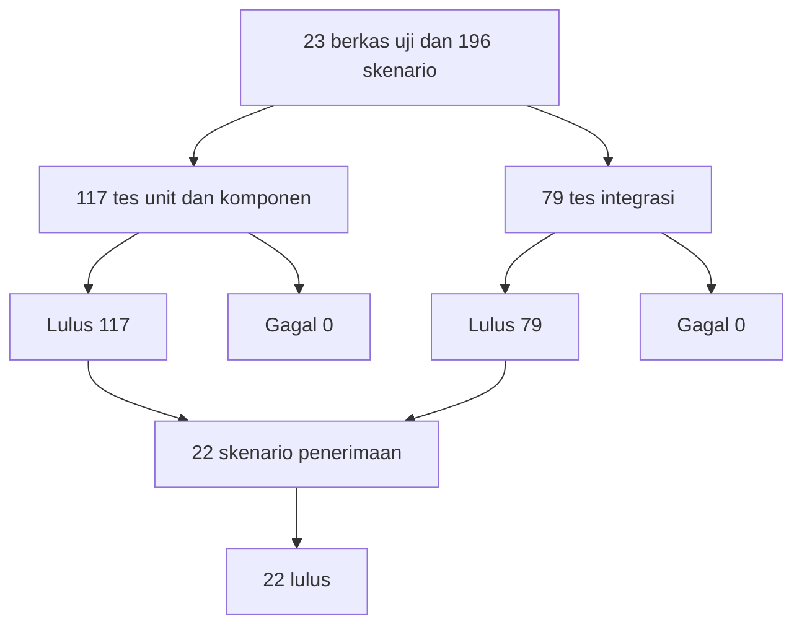

**Keterangan**

Peta ini menunjukkan bahwa bukti pengujian tersedia pada tingkat unit, komponen, integrasi, dan *end-to-end*. Seluruh 196 skenario otomatis lulus dan 22 skenario penerimaan dinyatakan lulus. Bukti pada tingkat pemakaian nyata tetap memerlukan *pilot* lanjutan.

### 4.6.7 Ringkasan Hasil Pengujian

Secara ringkas, hasil pengujian menunjukkan tiga hal. Pertama, pemeriksaan statis pada tiga layanan lulus. Kedua, 117 tes unit dan komponen lulus tanpa kegagalan. Ketiga, 79 tes integrasi lulus dan 22 skenario penerimaan dinyatakan lulus pada lingkungan evaluasi lengkap. Dengan demikian, sistem memiliki bukti kelayakan pada tingkat logika, komponen, integrasi, dan alur *end-to-end*, tetapi belum memiliki bukti dampak pada pemakaian nyata jangka panjang.

## 4.7 Evaluasi Indikator Kinerja

Tabel 4.12 menyajikan status setiap indikator kinerja. Tabel ini membedakan indikator yang sudah terukur, terukur sebagian, dan belum terukur.

**Tabel 4.12 Evaluasi KPI**

| Indikator | *Baseline* | *Target* | Hasil atau Status | Bukti |
| :--- | :--- | :--- | :--- | :--- |
| KPI-1 | Median 6,3 menit | Kurang dari 10 detik | Terukur pada lingkungan uji | Uji *end-to-end* AC-06; latensi chat dicatat pada lembar kerja evaluasi. |
| KPI-2 | Median 2,75 persen | Maksimal 1 persen | Terukur sebagian | Perlu *pilot* dan *stock opname* berulang untuk mengukur dampak nyata. |
| KPI-3 | Median 10,5 menit | Kurang dari 1 menit | Terukur pada lingkungan uji | Uji *end-to-end* AC-07; waktu pembuatan draft PO dicatat pada lembar kerja evaluasi. |
| KPI-4 | Tidak tersedia | 100 persen dari basis data | Teruji | `tools.test.ts`, `retriever.test.ts`, `bot.test.ts`, dan AC-06, AC-15, serta AC-16 menguji akurasi dan anti-halusinasi. |
| KPI-5 | 0 persen | 70 persen atau lebih | Belum terukur | 6 dari 10 responden bersedia mencoba; adopsi harian memerlukan *pilot*. |
| KPI-6 | Pengecekan manual | Kurang dari 10 detik | Terukur pada lingkungan uji | `notifier.test.ts`, `notify.test.ts`, dan AC-18 serta AC-19 menguji pengiriman notifikasi. |

**Keterangan**

Status Terukur pada lingkungan uji berarti indikator sudah diuji pada lingkungan evaluasi lengkap, tetapi belum diuji pada pemakaian nyata jangka panjang. Status Terukur sebagian berarti sebagian data tersedia, sedangkan pengukuran dampak penuh memerlukan *pilot*. Status Belum terukur berarti indikator menuntut periode pemakaian nyata yang belum tersedia.

Hasil ini menunjukkan perbedaan antara keluaran dan dampak. Keluaran penelitian adalah artefak yang memiliki fitur, mekanisme, dan jalur pengujian. Dampak penelitian adalah perubahan waktu akses, selisih stok, dan adopsi pada UMKM. Keluaran sudah tersedia dan mekanisme intinya terverifikasi pada lingkungan uji, sedangkan dampak jangka panjang belum terukur. Klaim bahwa seluruh *target* KPI sudah tercapai secara operasional tidak dapat diajukan.

## 4.8 Pembahasan

### 4.8.1 Jawaban Pertanyaan Penelitian

Pembahasan diarahkan pada tiga pertanyaan penelitian. Pertanyaan pertama adalah bagaimana WMS berbasis web dapat diintegrasikan dengan asisten AI berbasis RAG melalui platform pesan instan sehingga data operasional tetap konsisten. Artefak menjawabnya dengan memisahkan peran layanan. *Backend* memegang logika bisnis dan hak tulis. Agen AI memegang pemahaman bahasa dan pemilihan *tool*. Basis data menjadi rujukan tunggal. Integrasi tidak dilakukan dengan memberi agen akses langsung ke tabel bisnis, tetapi melalui API yang tervalidasi. Pola ini sejalan dengan gagasan *augmented language models* yang memakai alat eksternal untuk memperluas kemampuan model (Mialon et al., 2023 dan Schick et al., 2023), tetapi menambahkan lapisan tata kelola yang jarang dibahas pada kajian tersebut.

Pertanyaan kedua adalah bagaimana integrasi tersebut menjaga akurasi jawaban dan mencegah agen AI menulis data bisnis secara langsung. Ada tiga mekanisme. Pertama, data transaksional tidak di-*embed*. Agen memanggil *tool* baca yang membaca basis data secara langsung. Kedua, *tool* tulis hanya membuat draft sehingga keputusan akhir tetap berada pada admin. Ketiga, RAG memakai ambang skor dan menyebut sumber sehingga jawaban SOP dapat ditelusuri. Mekanisme ini mengurangi risiko halusinasi yang lazim pada LLM (Lewis et al., 2020 dan Gao et al., 2023). Evaluasi empiris terhadap akurasi jawaban telah dilakukan pada lingkungan uji melalui skenario penerimaan AC-06, AC-15, dan AC-16. Klaim yang dapat diajukan adalah bahwa mekanisme desainnya tersedia dan teruji pada lingkungan evaluasi, tetapi belum diuji pada korpus operasional jangka panjang.

Pertanyaan ketiga adalah sejauh mana artefak memenuhi kebutuhan UMKM dan apa keterbatasan evaluasinya. Survei menunjukkan bahwa masalah yang paling terasa adalah waktu akses informasi dan beban administrasi, bukan semata selisih stok. Median 35,6 jam per bulan untuk empat komponen administrasi memberi gambaran bahwa beban tersebut cukup besar bagi usaha kecil. Antarmuka chat berpotensi mengurangi waktu akses karena pengguna tidak perlu membuka *dashboard* dan memfilter tabel. Namun, preferensi kanal tidak sepenuhnya mendukung keputusan Telegram. Sembilan dari sepuluh responden memilih WhatsApp dan hanya satu memilih Telegram. Keputusan memakai Telegram pada MVP merupakan kompromi teknis, bukan cerminan preferensi pengguna. Pemenuhan kebutuhan karena itu bersifat potensial dan belum terbukti melalui *pilot*.

### 4.8.2 Perbandingan dengan Penelitian Terdahulu

Tabel 4.13 membandingkan penelitian ini dengan kajian terdahulu.

**Tabel 4.13 Perbandingan dengan Penelitian Terdahulu**

| Aspek | Penelitian Terdahulu | Penelitian Ini |
| :--- | :--- | :--- |
| RAG | Arsitektur umum untuk tugas intensif pengetahuan (Lewis et al., 2020 dan Gao et al., 2023). | RAG *read-only* untuk SOP dan kebijakan, sedangkan data transaksi dibaca melalui API. |
| *Tool calling* | LLM memanggil API eksternal (Schick et al., 2023 dan Mialon et al., 2023). | *Tool* baca dan *tool* tulis terbatas dengan konfirmasi manusia. |
| Digitalisasi UMKM | Manfaat dan hambatan transformasi digital (Purnomo et al., 2024). | Artefak WMS dan asisten chat untuk UMKM distribusi barang. |
| ERP untuk UMKM | Integrasi proses bisnis dan data *real-time*, tetapi berat dan mahal (Hasanah et al., 2024). | Sistem ringan berbasis *container* dengan antarmuka chat. |
| Evaluasi | Evaluasi formatif atau studi kasus dengan cakupan terbatas. | 196 skenario uji, 117 unit dan komponen lulus, 79 integrasi lulus, dan 22 skenario penerimaan lulus. |

**Keterangan**

Perbandingan ini tidak menyatakan bahwa penelitian terdahulu lebih lemah. Perbedaan terletak pada fokus dan konteks. Penelitian terdahulu mengembangkan metode atau kajian pada tingkat umum, sedangkan penelitian ini mengembangkan artefak pada konteks WMS UMKM.

### 4.8.3 Implikasi Teoretis

Implikasi teoretis utama adalah pentingnya memisahkan kebenaran data dari bahasa. LLM berguna untuk memahami pertanyaan dan menyusun jawaban, tetapi tidak dapat dijadikan sumber kebenaran untuk angka stok atau status dokumen. Pemisahan ini sejalan dengan pembagian memori parametrik dan non-parametrik pada RAG (Lewis et al., 2020), tetapi diperluas menjadi pembagian tanggung jawab antar layanan.

Implikasi kedua adalah RAG berfungsi sebagai pelengkap, bukan pengganti basis data transaksional. RAG cocok untuk pengetahuan tekstual yang berubah jarang, seperti SOP dan kebijakan. Data operasional yang berubah setiap hari harus dibaca langsung dari sumbernya. Pemisahan ini mengurangi risiko jawaban usang dan menjaga *provenance* data.

Implikasi ketiga adalah perlunya lapisan tata kelola pada *tool calling*. Kemampuan model memanggil *tool* tidak dengan sendirinya menjamin keamanan data. Diperlukan pembatasan hak tulis, validasi peran, dan konfirmasi manusia. Pola *draft-only write* yang dipakai pada penelitian ini dapat menjadi acuan bagi sistem informasi lain yang ingin mengintegrasikan LLM tanpa menyerahkan keputusan akhir kepada model.

### 4.8.4 Implikasi Praktis

Bagi UMKM, implikasi praktisnya adalah antarmuka chat dapat menurunkan hambatan adopsi tanpa mengorbankan integritas data, asalkan ada *backend* yang memvalidasi setiap permintaan dan ada admin yang mengonfirmasi dokumen. Pemilik usaha dapat memperoleh informasi melalui kanal yang sudah dikenal, sedangkan staf tetap bekerja pada *dashboard* yang menyediakan kontrol penuh.

Bagi pengembang, implikasi praktisnya adalah pentingnya memilih arsitektur yang dapat diuji. Pemisahan *port* dan adapter memungkinkan pengujian logika bisnis tanpa basis data. Meskipun demikian, pengujian integrasi tetap diperlukan karena tes unit dengan dependensi tiruan tidak membuktikan perilaku sistem nyata. Pada penelitian ini, tes integrasi dan uji *end-to-end* telah melengkapi bukti tingkat unit tersebut.

Bagi organisasi, implikasi praktisnya adalah kebutuhan akan tata kelola data dan keamanan. Kunci internal, kata sandi basis data, dan kunci API harus dikelola dengan benar pada lingkungan produksi. Kebijakan retensi percakapan dan dokumen knowledge juga perlu ditetapkan sebelum sistem dipakai secara rutin.

### 4.8.5 Kebaruan dan Kontribusi

Kebaruan penelitian terletak pada penggabungan tiga elemen dalam satu artefak yang dapat dijalankan mandiri oleh UMKM. Elemen pertama adalah WMS web terpusat sebagai sumber kebenaran data. Elemen kedua adalah asisten AI berbasis chat dengan *tool calling* ke API *backend*. Elemen ketiga adalah RAG *read-only* untuk menjawab SOP dan kebijakan. Kombinasi ini menyediakan antarmuka dengan kurva pembelajaran mendekati nol tanpa mengorbankan integritas dan auditabilitas data operasional.

Kontribusi penelitian bersifat praktis dan metodologis. Secara praktis, penelitian menghasilkan artefak yang menyatukan pencatatan stok, dokumen bisnis, laporan, dan akses berbasis chat dalam satu sistem yang dapat dijalankan dengan Docker Compose. Secara metodologis, penelitian menunjukkan cara memisahkan hak tulis *backend* dan hak baca agen AI, serta cara menempatkan RAG sebagai pelengkap data transaksional, bukan pengganti basis data.

### 4.8.6 Keterbatasan Evaluasi

Keterbatasan penelitian ini perlu dinyatakan terbuka. Pertama, pengembangan dilakukan oleh satu orang dalam waktu terbatas sehingga tidak ada pengujian independen oleh pihak kedua. Kedua, survei melibatkan 10 responden yang dipilih secara purposif sehingga hasilnya indikatif, bukan generalisasi statistik. Ketiga, evaluasi belum mencakup *pilot* jangka panjang sehingga KPI-2 dan KPI-5 belum dapat diukur sepenuhnya. Keempat, pengukuran KPI-1, KPI-3, dan KPI-6 dilakukan pada lingkungan uji, bukan pada operasional harian UMKM. Kelima, observasi lapangan dan dokumen operasional mitra belum diperoleh sehingga pemetaan proses *as-is* bersandar pada survei. Keenam, kualitas RAG belum diukur dengan metrik khusus seperti *faithfulness* dan *answer relevance*. Ketujuh, pengujian keamanan *prompt injection* dan penyalahgunaan kanal chat belum dilakukan. Kedelapan, ketergantungan pada API model bahasa menimbulkan risiko biaya, latensi, dan perubahan kebijakan penyedia. Kesembilan, pilihan Telegram tidak sejalan dengan preferensi mayoritas responden yang memilih WhatsApp.

### 4.8.7 Ancaman Validitas

Ancaman validitas internal muncul dari penggunaan dependensi tiruan pada sebagian tes unit. Tes unit membuktikan logika fungsi, sedangkan interaksi dengan basis data, model bahasa, dan Telegram dibuktikan melalui tes integrasi dan uji *end-to-end* pada lingkungan uji. Lingkungan uji tetap berbeda dari lingkungan produksi sehingga hasilnya belum tentu identik. Ancaman validitas eksternal muncul dari sampel purposif 10 responden dan studi kasus tunggal. Hasil penelitian tidak dapat digeneralisasi ke seluruh UMKM. Ancaman validitas konstruk muncul dari penggunaan persepsi responden untuk mengukur waktu dan selisih stok. Angka *baseline* bersifat indikatif, bukan hasil *stopwatch* atau audit stok. Ancaman validitas reliabilitas muncul dari sifat nondeterministik LLM. *Temperature* nol mengurangi variasi, tetapi tidak menghilangkan variasi akibat perubahan versi model atau *prompt*. Ancaman validitas kesimpulan muncul dari klaim yang dibatasi pada artefak dan mekanisme, bukan pada dampak. Kesimpulan tidak menyatakan bahwa seluruh *target* KPI sudah tercapai secara operasional.

### 4.8.8 Pelajaran yang Diperoleh

Beberapa pelajaran dapat diambil dari proses penelitian ini. Pertama, bagian yang paling berisiko tinggi, yaitu integrasi AI dan RAG, sebaiknya dikerjakan lebih awal agar risiko keterlambatan dapat dikelola. Kedua, arsitektur berlapis dengan *port* dan adapter memudahkan pengujian logika bisnis tanpa layanan eksternal. Ketiga, *ingest* yang idempoten dan pencatatan *job* penting untuk menjaga konsistensi indeks dan status antarmuka. Keempat, pola *draft-only write* merupakan cara yang efektif untuk menjaga akuntabilitas dokumen bisnis. Kelima, penamaan tes dengan kode penerimaan seperti AC-04 memudahkan penelusuran antara kebutuhan, kode, dan bukti uji. Keenam, keterbatasan evaluasi harus dicatat secara terbuka agar pembaca tidak menyimpulkan lebih jauh daripada bukti yang tersedia.

## 4.9 Ringkasan Temuan

Tabel 4.14 merangkum temuan utama Bab IV.

**Tabel 4.14 Ringkasan Temuan**

| Aspek | Temuan | Implikasi |
| :--- | :--- | :--- |
| Cakupan artefak | Sistem terdiri atas empat layanan, 13 modul *backend*, 17 model data, 15 halaman *frontend*, 18 *tool* AI, dan 6 tab laporan. | Cakupan fungsional sesuai ruang lingkup proposal. |
| Transaksi stok | Stok dihitung sebagai konsekuensi transaksi di dalam satu satuan kerja. | Konsistensi dan auditabilitas data terjaga secara desain. |
| Asisten AI | 18 *tool* dengan pembagian baca, tulis terbatas, dan RAG. | Model bahasa tidak menjadi penulis akhir data bisnis. |
| RAG | Knowledge base terkelola, *ingest* idempoten, *retrieval hybrid*, dan ambang skor. | RAG berfungsi sebagai pelengkap data transaksional. |
| Pengujian | 117 tes unit dan komponen lulus, 79 tes integrasi lulus, dan 22 skenario penerimaan lulus. | Kelayakan logika, komponen, integrasi, dan *end-to-end* terbukti pada lingkungan uji. |
| KPI | KPI-1, KPI-3, KPI-4, dan KPI-6 terukur pada lingkungan uji. KPI-2 terukur sebagian. KPI-5 belum terukur. | *Target* dampak jangka panjang belum dapat disimpulkan sepenuhnya. |
| Adopsi | 6 dari 10 responden bersedia mencoba dan 9 dari 10 memilih WhatsApp. | Kanal Telegram perlu diuji melalui *pilot* dan WhatsApp menjadi prioritas lanjutan. |
| Kontribusi | Integrasi WMS, *tool calling*, dan RAG dengan pemisahan hak tulis dan hak baca. | Artefak dapat menjadi acuan pengembangan sistem serupa. |

**Keterangan**

Temuan pada Tabel 4.14 menjadi dasar kesimpulan dan rekomendasi pada Bab V. Temuan yang bersifat desain tidak boleh dibaca sebagai bukti dampak. Temuan yang bersifat pengujian tidak boleh dibaca sebagai bukti dampak operasional jangka panjang. Batas antara keluaran dan dampak dinyatakan secara eksplisit agar kesimpulan tetap sahih.

Dengan demikian, Bab IV menunjukkan bahwa artefak telah dibangun dan mekanisme intinya terverifikasi pada tingkat unit, komponen, integrasi, dan *end-to-end*. Bukti yang tersedia berasal dari lingkungan evaluasi, sedangkan dampak operasional pada UMKM masih memerlukan *pilot* lanjutan. Bab V merumuskan kesimpulan dan rekomendasi berdasarkan batas bukti tersebut.

---

# BAB V KESIMPULAN DAN REKOMENDASI

## 5.1 Kesimpulan

Penelitian ini merancang dan membangun WMS berbasis web yang terintegrasi dengan asisten AI berbasis RAG melalui Telegram. Artefak terdiri atas empat layanan, yaitu *frontend* web, *backend* REST API, agen AI, dan PostgreSQL dengan pgvector. *Backend* berperan sebagai satu-satunya penulis data bisnis. Agen AI mengakses data melalui 18 *tool* dan membaca indeks pengetahuan secara *read-only*. Evaluasi yang dilakukan bersifat formatif dan diarahkan pada kelayakan artefak, bukan pada pengukuran dampak jangka panjang.

Kesimpulan umum penelitian ini adalah bahwa integrasi WMS, *tool calling*, dan RAG dapat dirancang dengan memisahkan kebenaran data dari bahasa. Model bahasa tidak perlu memiliki akses tulis ke data bisnis untuk memberi pengalaman chat yang berguna. Cukup dengan *tool* baca yang terkontrol dan *tool* tulis yang hanya membuat draft. RAG berperan sebagai pelengkap untuk pengetahuan tekstual, bukan pengganti basis data transaksional. Pemisahan ini menjaga konsistensi data dan auditabilitas dokumen.

Kesimpulan khusus diuraikan menurut tujuan proyek. Untuk OBJ-1, sistem menyediakan akses data inventori melalui chat dengan 18 *tool* yang mencakup stok, katalog, transaksi, PO, Surat Jalan, dan ringkasan. Jalur pengujian AC-06 telah dijalankan dan waktu tanggap chat terukur pada lingkungan uji. Untuk OBJ-2, sistem mencatat transaksi masuk dan keluar secara atomik, menghitung stok sebagai konsekuensi transaksi, dan menyimpan jejak audit. Jalur pengujian AC-04, AC-05, dan AC-21 telah lulus, tetapi selisih stok pada *stock opname* masih terukur sebagian. Untuk OBJ-3, sistem menyediakan pembuatan draft PO dan Surat Jalan melalui chat dengan penomoran otomatis dan konfirmasi admin di web. Jalur pengujian AC-07, AC-08, dan AC-14 telah lulus dan waktu pembuatan draft terukur pada lingkungan uji. Untuk OBJ-4, sistem menyediakan antarmuka chat dengan *guardrail* dan pembatasan akses berbasis peran. Kesediaan mencoba tercatat pada 6 dari 10 responden, tetapi adopsi harian belum diukur. Untuk OBJ-5, sistem menyediakan laporan enam tab, filter periode, ekspor CSV, kartu stok, dan analitik gerak stok. Jalur pengujian AC-20 dan AC-21 telah lulus, tetapi validasi pada data operasional nyata belum dilakukan.

Kesimpulan tentang pengujian perlu dinyatakan secara hati-hati. Pemeriksaan statis pada tiga layanan lulus. Sebanyak 117 tes unit dan komponen lulus dari 17 berkas. Sebanyak 79 tes integrasi pada enam berkas lulus. Sebanyak 22 skenario penerimaan dinyatakan lulus. Dengan demikian, sistem memiliki bukti kelayakan pada tingkat logika, komponen, integrasi, dan *end-to-end*, tetapi belum memiliki bukti dampak pada pemakaian nyata jangka panjang.

Kesimpulan tentang indikator kinerja juga perlu dinyatakan secara terbuka. KPI-1, KPI-3, KPI-4, dan KPI-6 terukur pada lingkungan uji. KPI-2 terukur sebagian, sedangkan KPI-5 belum terukur karena memerlukan pemakaian nyata. *Target* KPI tetap menjadi acuan untuk *pilot* lanjutan, bukan klaim capaian operasional jangka panjang.

Kontribusi penelitian bersifat praktis dan metodologis. Secara praktis, penelitian menghasilkan artefak yang menyatukan pencatatan stok, dokumen bisnis, laporan, dan akses berbasis chat dalam satu sistem yang dapat dijalankan dengan Docker Compose. Secara metodologis, penelitian menunjukkan cara memisahkan hak tulis *backend* dan hak baca agen AI, serta cara menempatkan RAG sebagai pelengkap data transaksional. Kontribusi ini tidak menghapus kebutuhan evaluasi lapangan. Kontribusi tersebut menyediakan dasar yang dapat dilanjutkan pada *pilot*.

## 5.2 Rekomendasi

Rekomendasi disusun berdasarkan kesenjangan antara bukti yang tersedia dan bukti yang masih diperlukan. Tabel 5.1 merangkum rekomendasi dan prioritasnya.

**Tabel 5.1 Rekomendasi dan Prioritas**

| Prioritas | Rekomendasi | Alasan | Waktu |
| :--- | :--- | :--- | :--- |
| Tinggi | Menjalankan pengujian regresi dan memantau cakupan kode secara berkala | 196 skenario telah lulus; pengujian ulang diperlukan setiap kali kode, *prompt*, atau skema berubah. | Segera |
| Tinggi | Melaksanakan *pilot* 4–8 minggu pada satu atau dua UMKM | KPI-2 dan KPI-5 memerlukan pemakaian nyata dan *stock opname* berulang. | Jangka menengah |
| Tinggi | Menetapkan pengelolaan rahasia, retensi data, dan kebijakan akses produksi | Kunci internal dan kata sandi contoh belum layak untuk produksi. | Sebelum produksi |
| Sedang | Menguji *prompt injection*, *jailbreak*, dan penyalahgunaan kanal chat | Keamanan agen AI belum diuji secara khusus. | Jangka menengah |
| Sedang | Mengukur kualitas RAG dengan metrik *faithfulness*, *answer relevance*, dan *context precision* | Kualitas *retrieval* belum diukur pada korpus nyata. | Jangka menengah |
| Sedang | Menambahkan kanal WhatsApp | 9 dari 10 responden memilih WhatsApp. | Jangka menengah |
| Sedang | Menambahkan pemantauan biaya dan latensi model bahasa | Ketergantungan pada API eksternal menimbulkan risiko biaya dan latensi. | Jangka menengah |
| Rendah | Menambahkan *forecasting* dan analitik prediktif | Fitur lanjutan pasca-MVP, memerlukan data historis yang cukup. | Jangka panjang |
| Rendah | Mempertimbangkan arsitektur *multi-tenant* | Kebutuhan muncul bila sistem dipakai banyak perusahaan. | Jangka panjang |

**Keterangan**

Prioritas tinggi berarti rekomendasi diperlukan untuk melengkapi bukti evaluasi atau mencegah risiko produksi. Prioritas sedang berarti rekomendasi meningkatkan kualitas dan cakupan. Prioritas rendah berarti rekomendasi bersifat pengembangan lanjutan dan tidak menghambat pemakaian awal.

### 5.2.1 Pengujian Regresi dan Cakupan

Rekomendasi pertama adalah mempertahankan dan menjalankan pengujian regresi secara berkala. Seluruh 196 skenario otomatis telah lulus pada evaluasi 31 Oktober 2026, tetapi hasil tersebut perlu diuji ulang setiap kali ada perubahan pada kode, *prompt*, model bahasa, atau skema basis data. Pengujian regresi mencakup autentikasi, RBAC, transaksi stok, siklus PO, Surat Jalan, knowledge base, laporan agregat, serta alur *end-to-end*.

Pengujian juga perlu mencakup pengukuran cakupan kode. Cakupan kode membantu menunjukkan bagian mana yang belum diuji, tetapi tidak boleh dijadikan satu-satunya ukuran kualitas. Hasil pengujian sebaiknya disimpan sebagai laporan yang dapat ditelusuri, bukan hanya sebagai jumlah skenario yang lulus.

### 5.2.2 *Pilot* UMKM

Rekomendasi kedua adalah melaksanakan *pilot* selama empat sampai delapan minggu pada satu atau dua UMKM. *Pilot* perlu melibatkan pemilik dan staf gudang agar interaksi peran dapat diamati. Pengukuran KPI-1 dan KPI-3 dilakukan dengan mencatat waktu sebelum dan sesudah penggunaan chat. Pengukuran KPI-2 dilakukan melalui *stock opname* berkala dengan membandingkan catatan sistem dan hitungan fisik. Pengukuran KPI-5 dilakukan dengan mencatat interaksi harian pemilik. Pengukuran KPI-6 dilakukan dengan mencatat waktu dari draft PO tersimpan sampai notifikasi diterima admin.

*Pilot* juga perlu menguji kanal WhatsApp karena preferensi responden tidak sejalan dengan pilihan Telegram pada MVP. Perbandingan Telegram dan WhatsApp dapat mencakup kemudahan penggunaan, waktu tanggap, dan tingkat adopsi. Hasil *pilot* sebaiknya dilaporkan sebagai studi kasus dengan data kuantitatif dan catatan kualitatif, bukan sebagai generalisasi statistik.

### 5.2.3 Pengembangan Produk

Rekomendasi pengembangan produk mencakup penambahan kanal WhatsApp, evaluasi RAG dengan kerangka khusus, pemantauan biaya dan latensi model, serta peningkatan observabilitas. Observabilitas mencakup log terstruktur, metrik waktu tanggap, tingkat kesalahan, dan dasbor pemantauan. Fitur *backup* dan pemulihan basis data juga perlu diuji, bukan hanya dikonfigurasi.

Fitur lanjutan seperti *forecasting*, analitik prediktif, integrasi *marketplace*, dan *multi-tenant* sebaiknya ditunda sampai data historis cukup dan kebutuhan pengguna terkonfirmasi. Penambahan fitur tanpa data yang memadai berisiko menghasilkan analitik yang tidak dapat dipercaya.

### 5.2.4 Tata Kelola dan Keamanan

Rekomendasi tata kelola mencakup penggantian seluruh kredensial contoh, penggunaan pengelola rahasia, pembatasan akses jaringan, dan penetapan kebijakan retensi data. Percakapan AI dan dokumen knowledge perlu memiliki kebijakan penyimpanan dan penghapusan yang jelas. *Audit log* perlu ditinjau secara berkala dan dilindungi dari perubahan tidak sah.

Pengujian keamanan perlu mencakup *prompt injection*, upaya membuat agen membocorkan data, penyalahgunaan *tool* tulis, dan eksfiltrasi data melalui pesan. Hasil pengujian keamanan sebaiknya dicatat sebagai temuan dengan tingkat risiko dan tindakan perbaikan. Tata kelola juga mencakup pelatihan pengguna agar mereka memahami batas kemampuan asisten dan tetap memverifikasi dokumen sebelum mengonfirmasi.

### 5.2.5 Penutup

Penelitian ini menunjukkan bahwa integrasi WMS, *tool calling*, dan RAG dapat dirancang dengan memisahkan kebenaran data dari bahasa. Artefak telah dibangun dan mekanisme intinya terverifikasi pada tingkat unit, komponen, integrasi, dan *end-to-end*. Pembuktian dampak operasional memerlukan *pilot* lapangan. Rekomendasi pada bab ini disusun agar tahap lanjutan dapat dijalankan secara terukur dan dapat dipertanggungjawabkan.

---

# DAFTAR PUSTAKA

Brown, T. B., Mann, B., Ryder, N., Subbiah, M., Kaplan, J., Dhariwal, P., Neelakantan, A., Shyam, P., Sastry, G., Askell, A., Agarwal, S., Herbert-Voss, A., Krueger, G., Henighan, T., Child, R., Ramesh, A., Ziegler, D. M., Wu, J., Winter, C., … Amodei, D. (2020). Language models are few-shot learners. *Advances in Neural Information Processing Systems, 33*. https://arxiv.org/abs/2005.14165

Gao, Y., Xiong, Y., Gao, X., Jia, K., Pan, J., Bi, Y., Dai, Y., Sun, J., Wang, M., & Wang, H. (2023). *Retrieval-augmented generation for large language models: A survey*. arXiv. https://arxiv.org/abs/2312.10997

Hasanah, N., Saputra, D. I. S., & Hiiyatin, D. L. (2024). ERP-based management information system for MSMEs in Indonesia: A systematic literature review. *RIGGS: Journal of Artificial Intelligence and Digital Business, 2*(2), 36–42. https://doi.org/10.31004/riggs.v2i2.224

Lewis, P., Perez, E., Piktus, A., Petroni, F., Karpukhin, V., Goyal, N., Küttler, H., Lewis, M., Yih, W., Rocktäschel, T., Riedel, S., & Kiela, D. (2020). Retrieval-augmented generation for knowledge-intensive NLP tasks. *Advances in Neural Information Processing Systems, 33*. https://arxiv.org/abs/2005.11401

Mialon, G., Dessì, R., Lomeli, M., Nalmpantis, C., Pasunuru, R., Raileanu, R., Rozière, B., Schick, T., Dwivedi-Yu, J., Celikyilmaz, A., Grave, E., LeCun, Y., & Scialom, T. (2023). *Augmented language models: A survey*. arXiv. https://arxiv.org/abs/2302.07842

Purnomo, S., Nurmalitasari, N., & Nurchim, N. (2024). Digital transformation of MSMEs in Indonesia: A systematic literature review. *Jurnal Manajemen dan Bisnis, 4*(2), 301–312. https://doi.org/10.53088/jmdb.v4i2.1121

Schick, T., Dwivedi-Yu, J., Dessì, R., Raileanu, R., Lomeli, M., Zettlemoyer, L., Cancedda, N., & Scialom, T. (2023). Toolformer: Language models can teach themselves to use tools. *Advances in Neural Information Processing Systems, 36*. https://arxiv.org/abs/2302.04761

Vaswani, A., Shazeer, N., Parmar, N., Uszkoreit, J., Jones, L., Gomez, A. N., Kaiser, L., & Polosukhin, I. (2017). Attention is all you need. *Advances in Neural Information Processing Systems, 30*. https://arxiv.org/abs/1706.03762

**Keterangan**

Daftar ini disusun mengikuti gaya APA 7 dan memuat delapan rujukan yang sama dengan proposal. Tidak ada rujukan baru yang ditambahkan tanpa penelusuran. Untuk memasukkan sitasi langsung di Word, impor `references/daftar-pustaka.ris` atau `references/daftar-pustaka.bib` ke Mendeley, lalu gunakan add-in Mendeley Cite. Petunjuk ada pada `references/PANDUAN-MENDELEY.md`.

---

# LAMPIRAN

Lampiran memuat dokumen pendukung yang tidak dimasukkan ke badan laporan. Lampiran A sampai C memuat cuplikan kode, diagram, dan data pengujian. Lampiran D sampai K memuat surat pernyataan, berita acara, konfigurasi, instrumen survei, data mentah, lembar observasi, dokumen operasional UMKM, dan instrumen studi pustaka. Lampiran L sampai O memuat dokumentasi kegiatan, tautan, daftar berkas digital, dan panduan pemindahan ke Word.


## Lampiran A — Kode Program (Cuplikan Kunci)

Lampiran ini memuat cuplikan kode inti yang dirujuk pada Bab III dan Bab IV. Cuplikan telah dipangkas pada bagian impor dan komentar agar fokus pada logika utama.

### A.1 Transaksi Stok Atomik (`backend/src/modules/transactions/transactions.service.ts`)

```ts
export async function applyStock(tx: Db, type: TransactionType, input: RecordInput) {
  const product = await productsRepo.findStock(input.productId, tx);
  if (!product) throw Errors.notFound("Product");

  const warehouse = await warehousesRepo.findById(input.warehouseId, tx);
  if (!warehouse) throw Errors.notFound("Warehouse");

  const delta = type === "OUT" ? -input.quantity : input.quantity;

  if (type === "OUT") {
    if (product.stock < input.quantity) throw Errors.insufficientStock();
    const inventoryRow = await inventory.findInventory(
      input.productId,
      input.warehouseId,
      tx,
    );
    if (!inventoryRow || inventoryRow.quantity < input.quantity) {
      throw Errors.insufficientStock();
    }
  }

  if (type === "IN" && input.purchaseOrderId) {
    const po = await purchaseOrdersRepo.findReceiptInfo(input.purchaseOrderId, tx);
    if (!po) throw Errors.notFound("Purchase Order");
    if (po.status !== "CONFIRMED") {
      throw Errors.invalidState("Penerimaan hanya untuk PO berstatus CONFIRMED");
    }
    if (po.partner.type !== "SUPPLIER") {
      throw Errors.unprocessable("PO sumber penerimaan harus dari partner SUPPLIER");
    }

    const lines = await getReceiptStatus(input.purchaseOrderId, tx);
    const line = lines.find((l) => l.productId === input.productId);
    if (!line) throw Errors.unprocessable("Produk tidak ada pada PO sumber");
    if (input.quantity > line.remaining) {
      throw Errors.unprocessable(
        `Qty melebihi sisa pesanan PO (sisa ${line.remaining})`,
      );
    }
  }

  const txn = await repo.create(
    {
      type,
      quantity: input.quantity,
      notes: input.notes ?? null,
      referenceNo: input.referenceNo ?? null,
      productId: input.productId,
      warehouseId: input.warehouseId,
      partnerId: input.partnerId ?? null,
      purchaseOrderId: input.purchaseOrderId ?? null,
      deliveryNoteId: input.deliveryNoteId ?? null,
      createdById: input.createdById,
    },
    tx,
  );

  await productsRepo.adjustStock(input.productId, delta, tx);
  await inventory.upsertInventory(
    input.productId,
    input.warehouseId,
    input.quantity,
    delta,
    tx,
  );

  if (type === "IN" && input.purchaseOrderId) {
    await syncPoReceiptStatus(input.purchaseOrderId, tx);
  }

  return txn;
}
```

### A.2 Penomoran Dokumen Otomatis (`backend/src/domain/numbering.ts`)

```ts
export type DocumentKind = "PO" | "SJ";

export function numberPrefix(kind: DocumentKind, date: Date): string {
  return `${kind}-${format(date, "yyyyMM")}-`;
}

export function buildDocumentNumber(
  kind: DocumentKind,
  date: Date,
  existingCount: number,
): string {
  return `${numberPrefix(kind, date)}${String(existingCount + 1).padStart(3, "0")}`;
}
```

### A.3 Perakitan Agent (`ai-agent/src/application/agent/agent.ts`)

```ts
export async function runAgent(
  input: {
    chatId: string;
    message: string;
    history: BaseMessage[];
    role?: string | null;
  },
  deps: ToolDeps = container,
): Promise<AgentRunResult> {
  const tools = buildTools(deps, input.chatId, input.role);
  const executor = new AgentExecutor({
    agent: createToolCallingAgent({
      llm: getLlm(),
      tools,
      prompt: buildAgentPrompt(),
    }),
    tools,
    maxIterations: 8,
    returnIntermediateSteps: true,
  });

  const result = await executor.invoke({
    input: input.message,
    chat_history: input.history,
  });

  const steps = (result.intermediateSteps ?? []) as IntermediateStep[];
  const last = steps[steps.length - 1];

  return {
    output: String(result.output ?? ""),
    toolName: last?.action?.tool ?? null,
    toolPayload: last?.action?.toolInput ?? null,
    toolResult: last?.observation ?? null,
  };
}
```

### A.4 Definisi Tool Pencarian Stok (`ai-agent/src/application/tools/read.ts`)

```ts
const checkStock = new DynamicStructuredTool({
  name: "cek_stok_barang",
  description:
    "Cek sisa stok satu barang berdasarkan nama. Bila nama cocok ke beberapa varian, tool mengembalikan daftar kandidat.",
  schema: stockSchema,
  func: async (input: StockInput): Promise<string> => {
    const result = await backend.getStockByProductName(input.productName);

    if (!result || result.status === "none") {
      const suggestions = result?.suggestions ?? [];
      const hint = suggestions.length
        ? ` Mungkin maksud: ${suggestions.map((s) => `"${s.name}"`).join(", ")}.`
        : "";
      return `Sistem tidak menemukan barang bernama mirip "${input.productName}".${hint} Minta user menyebutkan nama lain.`;
    }

    if (result.status === "ambiguous") {
      const candidates = result.candidates ?? [];
      const lines = candidates.map(
        (c) => `- ${c.name}, SKU ${c.sku}, stok ${c.stock} ${c.unit}`,
      );
      return `Kata kunci "${input.productName}" cocok dengan beberapa produk:\n${lines.join(
        "\n",
      )}\nMohon sebutkan varian yang dimaksud.`;
    }

    const p = result.product as StockRow;
    return `Info database: ${p.name} (SKU: ${p.sku}) stok ${p.stock} ${p.unit}.`;
  },
});
```

### A.5 Pipeline Ingest RAG (`ai-agent/src/infrastructure/rag/ingest.ts`)

```ts
function hashDoc(doc: KnowledgeDoc): string {
  const payload = JSON.stringify({
    content: doc.content,
    title: doc.title,
    docType: doc.docType,
    metadata: doc.metadata ?? null,
  });
  return createHash("sha256").update(payload).digest("hex");
}

export async function runIngest(
  pool: ReturnType<typeof ingestPool>,
  filter: IngestFilter = {},
): Promise<IngestResult[]> {
  const pruned = await pruneOrphanChunks(pool);

  const conditions: string[] = [`"isActive" = true`];
  const params: unknown[] = [];
  if (filter.documentId) {
    params.push(filter.documentId);
    conditions.push(`"id" = $${params.length}`);
  }
  if (filter.docType) {
    params.push(filter.docType);
    conditions.push(`"docType" = $${params.length}`);
  }

  const { rows } = await pool.query<KnowledgeDoc>(
    `SELECT "id", "filename", "title", "docType", "content", "metadata", "version"
     FROM "knowledge_documents" WHERE ${conditions.join(" AND ")}`,
    params,
  );

  const embeddings = getEmbeddings();
  const results: IngestResult[] = [];

  for (const doc of rows) {
    const contentHash = hashDoc(doc);
    const existing = await pool.query(
      `SELECT 1 FROM "document_chunks"
       WHERE "documentId" = $1 AND "contentHash" = $2 LIMIT 1`,
      [doc.id, contentHash],
    );
    if ((existing.rowCount ?? 0) > 0) {
      results.push({
        documentId: doc.id,
        source: doc.filename,
        chunks: 0,
        skipped: true,
      });
      continue;
    }

    const chunks = await splitDocument(doc.title, doc.content);
    const vectors = await embeddings.embedDocuments(chunks);

    await pool.query("BEGIN");
    try {
      await pool.query(
        `DELETE FROM "document_chunks" WHERE "documentId" = $1`,
        [doc.id],
      );
      for (let i = 0; i < chunks.length; i++) {
        await pool.query(
          `INSERT INTO "document_chunks"
             ("id", "source", "content", "embedding", "documentId", "docType",
              "title", "metadata", "contentHash", "embeddingModel",
              "dimensions", "createdAt")
           VALUES (gen_random_uuid(), $1, $2, $3, $4, $5, $6, $7, $8, $9, $10, now())`,
          [
            doc.filename,
            chunks[i],
            JSON.stringify(vectors[i]),
            doc.id,
            doc.docType,
            doc.title,
            doc.metadata ? JSON.stringify(doc.metadata) : null,
            contentHash,
            env.OPENAI_EMBEDDING_MODEL,
            env.EMBEDDING_DIMENSIONS,
          ],
        );
      }
      await pool.query("COMMIT");
    } catch (err) {
      await pool.query("ROLLBACK");
      throw err;
    }

    results.push({
      documentId: doc.id,
      source: doc.filename,
      chunks: chunks.length,
      skipped: false,
    });
  }

  return results;
}
```

### A.6 Pipeline Retrieval RAG (`ai-agent/src/infrastructure/rag/retriever.ts`)

```ts
export async function searchKnowledge(
  query: string,
  options: KnowledgeSearchOptions = {},
): Promise<KnowledgeChunk[]> {
  const topK = options.topK ?? env.AGENT_TOP_K;
  const minScore = options.minScore ?? env.RAG_MIN_SCORE;
  const docTypes =
    options.docTypes && options.docTypes.length > 0 ? options.docTypes : null;

  try {
    const vector = await getEmbeddings().embedQuery(query);
    const vectorParam = JSON.stringify(vector);

    const rows = env.RAG_HYBRID
      ? await hybridSearch(vectorParam, query, topK, docTypes)
      : await vectorSearch(vectorParam, topK, docTypes);

    return rows
      .filter((r) =>
        env.RAG_HYBRID
          ? r.vectorMatch === false || r.score >= minScore
          : r.score >= minScore,
      )
      .map(({ source, title, docType, content, score }) => ({
        source,
        title,
        docType,
        content,
        score,
      }));
  } catch (err) {
    console.error("Retrieval knowledge base gagal:", err);
    return [];
  }
}
```

### A.7 Migrasi Hak Baca Saja (`backend/prisma/migrations/20260922070000_grant_ai_agent_readonly/migration.sql`)

```sql
DO $$
BEGIN
  IF NOT EXISTS (SELECT FROM pg_roles WHERE rolname = 'ai_agent') THEN
    CREATE ROLE ai_agent LOGIN PASSWORD '<kata-sandi-yang-diganti>';
  END IF;
END
$$;

GRANT USAGE ON SCHEMA public TO ai_agent;
GRANT SELECT ON TABLE document_chunks TO ai_agent;
```


## Lampiran B — Diagram

Lampiran ini mengumpulkan diagram utama yang dipakai pada Bab III dan Bab IV. Diagram disimpan sebagai teks Mermaid agar dapat dirender ulang saat dokumen dipindahkan ke Word.

**Gambar B.1 Arsitektur Sistem**


**Gambar B.2 State Machine Purchase Order**


**Gambar B.3 Alur Buat Draft PO via Chat**


**Gambar B.4 Alur Jawab SOP via RAG**


**Gambar B.5 Arsitektur Implementasi**


**Gambar B.6 Alur Tool Calling**


**Gambar B.7 Pipeline Ingest dan Retrieval RAG**


## Lampiran C — Data Pengujian

### C.1 Lingkungan Pengujian

**Tabel C.1 Lingkungan Pengujian**

| Aspek | Keterangan |
| :--- | :--- |
| Metode | Unit, integrasi, dan *end-to-end* manual melalui chat sampai web |
| Perkakas | Vitest, Supertest, Vitest dan *Testing Library*, Playwright opsional |
| Perintah | `make test`, `make lint`, dan `make typecheck` melalui Docker |
| Basis data uji | PostgreSQL dan pgvector pada *container* terpisah |
| Status | Seluruh 196 skenario otomatis lulus dan 22 skenario penerimaan lulus |

### C.2 Data Seed Acuan

**Tabel C.2 Data Seed Acuan**

| Entitas | Contoh Nilai |
| :--- | :--- |
| User | `owner@umkm.id` dengan peran OWNER dan `admin@umkm.id` dengan peran ADMIN |
| Kategori | Frozen Food, Minuman, dan Bumbu |
| Produk | `DMS-SDG-01` — Dimsum Ayam Ukuran Sedang, satuan pack, stok 120 |
| Partner | PT Maju Jaya sebagai CUSTOMER dan CV Sumber Frozen sebagai SUPPLIER |
| Gudang | `GDG-01` — Gudang Utama |

### C.3 Lembar Hasil Pengujian

Hasil lengkap setiap skenario penerimaan tercatat pada Tabel 3.8. Rekap hasil otomatis disajikan pada Tabel 4.8 dan Tabel 4.9. Seluruh 117 tes unit dan komponen, 79 tes integrasi, dan 22 skenario penerimaan dinyatakan lulus pada evaluasi 31 Oktober 2026.

### C.4 Contoh Skenario Uji Manual

1. Jalankan seluruh layanan, lalu lakukan `make seed` dan `make rag-ingest`.
2. Kirim pesan "Berapa sisa stok Dimsum Ayam Ukuran Sedang?", catat balasan, dan bandingkan dengan halaman produk.
3. Kirim pesan "Besok siapkan PO untuk CV Sumber Frozen isinya 50 pack Dimsum.", lalu catat nomor draft PO.
4. Buka halaman `/purchase-orders?status=DRAFT` dan pastikan PO muncul berstatus DRAFT.
5. Konfirmasi PO, catat penerimaan barang masuk, dan verifikasi stok bertambah.
6. Kirim pesan "Apa SOP penerimaan barang retur?" dan verifikasi jawaban bersumber dari knowledge base.
7. Catat latensi balasan dan isi kolom Hasil Aktual pada Tabel 3.8.
8. Verifikasi notifikasi admin saat draft PO dibuat serta notifikasi owner saat PO dikonfirmasi dan selesai.


## Lampiran D — Surat Pernyataan

**SURAT PERNYATAAN**

Kami yang bertanda tangan di bawah ini:

| Nama | NIM |
| :--- | :--- |
| Eka Bachrudin Nursa | 055230541 |
| Muhammad Abdul Majid | 048467065 |
| M Sofan Al Fajri | 051610794 |
| Abelina Theresia Sipahutar | 048812894 |
| Dea Permata Yundira | 050093032 |

Dengan ini menyatakan bahwa produk yang kami buat dan ajukan dalam Capstone Project dengan judul **"RANCANG BANGUN SISTEM MANAJEMEN INVENTORI CERDAS BERBASIS WEB DENGAN INTEGRASI AI RAG PADA PLATFORM CHAT (WHATSAPP/TELEGRAM) UNTUK UMKM"** adalah hasil orisinal yang dibuat oleh tim kami. Produk ini bukan merupakan plagiat dan tidak melanggar hak cipta pihak mana pun. Semua ide, desain, dan implementasi yang terdapat dalam produk ini sepenuhnya merupakan karya asli kami.

Demikian surat pernyataan ini kami buat dengan sebenar-benarnya untuk dapat dipergunakan sebagaimana mestinya.

Universitas Terbuka Indonesia, 28 Oktober 2026

Hormat kami,

| No | Nama | NIM | Tanda Tangan |
| :---: | :--- | :--- | :--- |
| 1 | Eka Bachrudin Nursa | 055230541 | |
| 2 | Muhammad Abdul Majid | 048467065 | |
| 3 | M Sofan Al Fajri | 051610794 | |
| 4 | Abelina Theresia Sipahutar | 048812894 | |
| 5 | Dea Permata Yundira | 050093032 | |


## Lampiran E — Berita Acara Kerja Kelompok

**BERITA ACARA KERJA KELOMPOK CAPSTONE PROJECT**

| Keterangan | Isi |
| :--- | :--- |
| Judul | RANCANG BANGUN SISTEM MANAJEMEN INVENTORI CERDAS BERBASIS WEB DENGAN INTEGRASI AI RAG PADA PLATFORM CHAT (WHATSAPP/TELEGRAM) UNTUK UMKM |
| Hari dan Tanggal | 28 Oktober 2026 |
| Waktu | 21.00 WIB sampai selesai |
| Lokasi | Daring melalui Microsoft Teams |

**Tabel E.1 Daftar Hadir**

| No | Nama | NIM | Kehadiran | Tanda Tangan |
| :---: | :--- | :--- | :--- | :--- |
| 1 | Eka Bachrudin Nursa | 055230541 | Hadir | |
| 2 | Muhammad Abdul Majid | 048467065 | Hadir | |
| 3 | M Sofan Al Fajri | 051610794 | Hadir | |
| 4 | Abelina Theresia Sipahutar | 048812894 | Hadir | |
| 5 | Dea Permata Yundira | 050093032 | Hadir | |

**Tabel E.2 Aktivitas dan Penanggung Jawab**

| Aktivitas | Luaran | Penanggung Jawab | Catatan |
| :--- | :--- | :--- | :--- |
| Diskusi terkait topik wawancara yang diajukan pada Capstone Project | Instrumen dan rencana wawancara | Abelina Theresia Sipahutar dan Dea Permata Yundira | — |
| Diskusi terkait metodologi dan perancangan arsitektur sistem produk atau aplikasi yang dibuat | Rancangan metode dan arsitektur sistem | Eka Bachrudin Nursa, Muhammad Abdul Majid, dan M Sofan Al Fajri | — |

**Kesimpulan Rapat**

1. Topik wawancara dan instrumen survei disepakati untuk digunakan pada tahap pengumpulan data.
2. Metodologi pengembangan dan rancangan arsitektur sistem disepakati sebagai acuan implementasi.
3. Seluruh anggota menghadiri rapat dan menyetujui pembagian tugas yang dicatat pada tabel aktivitas.


## Lampiran F — Konfigurasi dan Cara Menjalankan

### F.1 Prasyarat

Prasyarat menjalankan sistem adalah Docker 24 atau lebih baru, Docker Compose v2, Git, akun Telegram untuk membuat bot melalui @BotFather, dan kunci API penyedia model bahasa. Seluruh layanan berjalan di dalam Docker sehingga Node.js dan npm tidak perlu dipasang di mesin pengembang.

### F.2 Langkah Menjalankan pada Mode Pengembangan

```bash
# 1. Clone dan masuk direktori
git clone <repo-url> inventory-rag
cd inventory-rag

# 2. Siapkan environment
cp .env.example .env
cp backend/.env.example backend/.env
cp frontend/.env.example frontend/.env
cp ai-agent/.env.example ai-agent/.env

# 3. Isi variabel penting pada .env
# OPENAI_API_KEY, TELEGRAM_BOT_TOKEN, INTERNAL_API_KEY,
# JWT_ACCESS_SECRET, dan JWT_REFRESH_SECRET

# 4. Jalankan seluruh layanan
make dev

# 5. Pada terminal lain, isi data awal dan bangun indeks knowledge
make seed
make rag-import-docs
make rag-ingest
```

**Keterangan**

Perintah `make dev` menjalankan empat layanan dengan *hot reload*. Perintah `make dev-down` dipakai untuk menghentikan layanan. Perintah `make seed` mengisi data awal. Perintah `make rag-import-docs` mengimpor dokumen statis, sedangkan `make rag-ingest` membangun indeks vektor. Pada mode produksi, perintah yang dipakai adalah `make prod`, `make prod-seed`, dan `make prod-rag-ingest`.

### F.3 URL Layanan

**Tabel F.1 URL Layanan**

| Layanan | URL Pengembangan | Keterangan |
| :--- | :--- | :--- |
| *Frontend* | http://localhost:5173 | *Dashboard* WMS. |
| *Backend* | http://localhost:3001 | REST API pada host, port kontainer 3000. |
| AI Agent | http://localhost:8080 | *Webhook* dan *endpoint* notifikasi. |
| Basis data | localhost:5433 | PostgreSQL dan pgvector pada host, port kontainer 5432. |

**Keterangan**

Port host dapat berubah melalui `BACKEND_HOST_PORT`, `DB_HOST_PORT`, dan `FRONTEND_HOST_PORT` pada `.env`. Nilai pada tabel mengikuti nilai contoh pada `.env.example`.

### F.4 Variabel Environment Penting

**Tabel F.2 Variabel Environment Penting**

| Variabel | Layanan | Fungsi |
| :--- | :--- | :--- |
| `OPENAI_API_KEY` | AI Agent | Akses model bahasa dan *embedding*. |
| `OPENAI_MODEL` | AI Agent | Model bahasa yang dipakai, misalnya `gpt-4o-mini`. |
| `OPENAI_EMBEDDING_MODEL` | AI Agent | Model *embedding*, misalnya `text-embedding-3-small`. |
| `EMBEDDING_DIMENSIONS` | AI Agent | Dimensi *embedding*, harus sama dengan `vector(1536)`. |
| `AGENT_TOP_K` | AI Agent | Jumlah potongan konteks RAG per kueri, nilai bawaan 5. |
| `RAG_MIN_SCORE` | AI Agent | Ambang skor kemiripan minimum, nilai bawaan 0,3. |
| `RAG_HYBRID` | AI Agent | Mengaktifkan pencarian *hybrid* vektor dan teks penuh. |
| `RAG_AUTO_INGEST` | *Backend* dan AI Agent | *Ingest* ulang otomatis saat dokumen berubah dari UI. |
| `CHUNK_SIZE` dan `CHUNK_OVERLAP` | AI Agent | Parameter pemotongan dokumen saat *ingest*. |
| `TELEGRAM_BOT_TOKEN` | AI Agent | *Token* bot Telegram. |
| `INTERNAL_API_KEY` | *Backend* dan AI Agent | Kunci *endpoint* internal. |
| `JWT_ACCESS_SECRET` dan `JWT_REFRESH_SECRET` | *Backend* | Penandatanganan *token* autentikasi. |
| `DATABASE_URL` | *Backend* | Koneksi baca dan tulis. Tidak dibagikan ke AI Agent. |
| `AI_AGENT_URL` | *Backend* | Base URL AI Agent untuk memicu notifikasi. |
| `WEB_APP_URL` | *Backend* | Base URL *dashboard* untuk tautan notifikasi PO. |
| `AI_DB_USER` dan `AI_DB_PASSWORD` | AI Agent | Kredensial *read-only* untuk tabel vektor. |
| `INGEST_DB_USER` dan `INGEST_DB_PASSWORD` | AI Agent | Kredensial tulis khusus proses *ingest*. |

**Keterangan**

Nilai rahasia tidak boleh disimpan di repositori. Pada lingkungan produksi, nilai contoh harus diganti dan dikelola melalui pengelola rahasia. Kredensial *runtime* AI Agent berbeda dari kredensial *ingest* agar hak tulis hanya dipakai saat proses *ingest*.

### F.5 Perintah Makefile yang Sering Dipakai

**Tabel F.3 Perintah Makefile yang Sering Dipakai**

| Kebutuhan | Perintah |
| :--- | :--- |
| Semua layanan | `make dev` dan `make dev-down` |
| Per layanan | `make dev-backend`, `make dev-frontend`, dan `make dev-ai-agent` |
| Log | `make dev-logs` |
| Seed dan *ingest* RAG | `make seed`, `make rag-import-docs`, dan `make rag-ingest` |
| *Lint*, *typecheck*, dan test | `make lint`, `make typecheck`, dan `make test` |
| Build produksi | `make prod` dan `make prod-down` |
| Log produksi | `make prod-logs` |
| *Ingest* produksi | `make prod-rag-ingest` |

### F.6 Catatan Produksi

Pada mode produksi, *frontend* disajikan oleh Nginx. Kunci API, kata sandi basis data, dan kunci internal wajib diganti. HTTPS perlu diaktifkan melalui *reverse proxy*. *Backup* basis data perlu dijadwalkan dan diuji pemulihannya. Pemantauan waktu tanggap, tingkat kesalahan, dan penggunaan biaya model bahasa perlu disiapkan sebelum sistem dipakai secara rutin.


## Lampiran G — Instrumen Survei

Instrumen ini dipakai pada survei pendahuluan 29 Oktober 2026. Kuesioner terdiri atas 41 butir pertanyaan dalam lima kelompok, ditambah tiga kolom administrasi berupa cap waktu, persetujuan, dan kode responden. Daftar pertanyaan dan pilihan jawaban disusun ulang dari *header* `survey/respondents.csv`. Tidak ada butir yang ditambahkan atau diubah. Data mentah jawaban disajikan pada Lampiran H.

### G.1 Kisi-kisi Instrumen

**Tabel G.1 Kisi-kisi Instrumen Survei**

| Kelompok | Variabel atau Dimensi | Indikator | Butir | Bentuk Jawaban |
| :--- | :--- | :--- | :---: | :--- |
| A | Identitas dan profil usaha | Jenis usaha, kategori produk, jumlah SKU, volume transaksi, media pencatatan, jumlah pencatat, lama usaha | 1–11 | Kategorik, angka, teks |
| B | Waktu dan akses informasi | Cara mengetahui stok, waktu cek stok, frekuensi cek stok, waktu cek pengiriman, hari operasi, keterlambatan informasi, waktu rekap, frekuensi opname | 12–21 | Menit, kali, hari, skala 1–5 |
| C | Selisih stok | Selisih per 100 unit, frekuensi selisih, nilai persediaan, nilai kerugian, penyebab selisih | 22–28 | Unit, persen, kali, rupiah, kategorik |
| D | Pembuatan dokumen | Waktu draft PO, jumlah PO, waktu Surat Jalan, jumlah Surat Jalan, dokumen paling menyita waktu, alat pembuatan | 29–34 | Menit, angka, kategorik |
| E | Sikap terhadap asisten AI | Kesediaan mencoba, kanal chat, kekhawatiran, pengguna, fitur, perangkat, kualitas internet | 35–41 | Kategorik |

**Keterangan**

Kolom Butir merujuk pada nomor pertanyaan pada Tabel G.2a sampai G.2e. Tiga kolom administrasi tidak diberi nomor butir karena bukan pertanyaan substantif.

### G.2 Instrumen Lengkap

Pilihan jawaban di bawah ini mengikuti pilihan yang tercatat pada formulir dan data mentah. Butir terbuka ditandai teks. Pertanyaan opsional boleh dilewati.

#### G.2.1 Kelompok A — Identitas dan Profil Usaha

**Tabel G.2a Butir 1–11**

| No | Pertanyaan | Pilihan atau Bentuk Jawaban | Kolom CSV |
| :---: | :--- | :--- | :---: |
| 1 | Apakah Anda pemilik atau pengelola yang terlibat langsung dalam pencatatan stok | Ya atau Tidak, wajib | 4 |
| 2 | Apakah usaha Anda menyimpan atau mengelola persediaan barang | Ya atau Tidak | 5 |
| 3 | Jenis usaha | Distributor, Toko atau retail, Agen atau reseller, Produsen atau UMKM makanan, Manufaktur, Lainnya | 6 |
| 4 | Kategori produk utama | *Frozen food*, Makanan dan minuman, Retail umum, Toko plastik, Elektroda las, Suku cadang mesin, Lainnya | 7 |
| 5 | Nama usaha | Teks, boleh disamarkan | 8 |
| 6 | Lokasi usaha | Teks, boleh disamarkan | 9 |
| 7 | Jumlah SKU aktif | Angka atau teks | 10 |
| 8 | Rata-rata transaksi masuk dan keluar per hari | Angka, rupiah, atau rentang | 11 |
| 9 | Media atau metode pencatatan yang paling sering dipakai | Buku tulis, *Spreadsheet*, Grup pesan instan, Aplikasi kasir, ERP, Lainnya | 12 |
| 10 | Jumlah orang yang menangani pencatatan stok | Angka atau teks | 13 |
| 11 | Lama usaha | Kurang dari 1 tahun, 1–3 tahun, 3–5 tahun, 5 tahun atau lebih | 14 |

#### G.2.2 Kelompok B — Waktu dan Akses Informasi

**Tabel G.2b Butir 12–21**

| No | Pertanyaan | Pilihan atau Bentuk Jawaban | Kolom CSV |
| :---: | :--- | :--- | :---: |
| 12 | Bagaimana cara Anda mengetahui sisa stok satu produk saat ini | Teks | 15 |
| 13 | Pada hari biasa, berapa menit untuk mengetahui sisa stok satu produk | Menit atau rentang | 16 |
| 14 | Berapa kali sehari Anda atau staf mengecek stok | Kali atau teks | 17 |
| 15 | Berapa menit untuk mengetahui barang yang dikirim pada satu tanggal | Menit atau rentang | 18 |
| 16 | Berapa kali sehari Anda atau staf mengecek status pengiriman | Kali atau teks | 19 |
| 17 | Berapa hari usaha beroperasi per bulan | Hari atau rentang | 20 |
| 18 | Seberapa sering informasi yang dibutuhkan baru tersedia setelah dibutuhkan | Skala 1–5, 1 berarti tidak pernah dan 5 berarti selalu | 21 |
| 19 | Berapa menit untuk membuat rekap laporan harian, opsional | Menit atau rentang | 22 |
| 20 | Seberapa sering diadakan *stock opname* | Harian, Mingguan, Bulanan, Tidak teratur | 23 |
| 21 | Kapan opname terakhir dilakukan, opsional | Dalam 1 minggu terakhir, Dalam 1 bulan terakhir, Lebih dari 1 bulan lalu, Tidak tahu | 24 |

#### G.2.3 Kelompok C — Selisih Stok

**Tabel G.2c Butir 22–28**

| No | Pertanyaan | Pilihan atau Bentuk Jawaban | Kolom CSV |
| :---: | :--- | :--- | :---: |
| 22 | Dari 100 unit yang dihitung, biasanya berapa unit yang selisih, opsional | Unit atau rentang | 25 |
| 23 | Pilihan saya tidak tahu atau tidak ingin menjawab perkiraan selisih stok, opsional | Saya dapat memberikan perkiraan, Saya tidak tahu atau tidak ingin menjawab | 26 |
| 24 | Dalam satu bulan, berapa kali muncul selisih stok | Kali atau rentang | 27 |
| 25 | Berapa nilai persediaan rata-rata, opsional | Rupiah atau rentang | 28 |
| 26 | Apakah Anda bersedia menuliskan angka nilai persediaan pastinya, opsional | Ya, Tidak bersedia, Tidak tahu | 29 |
| 27 | Berapa nilai kerugian akibat selisih per opname, opsional | Rupiah atau rentang | 30 |
| 28 | Penyebab utama selisih stok, opsional | Barang hilang, Salah catat, Salah kirim, Barang rusak, Lainnya | 31 |

#### G.2.4 Kelompok D — Pembuatan Dokumen

**Tabel G.2d Butir 29–34**

| No | Pertanyaan | Pilihan atau Bentuk Jawaban | Kolom CSV |
| :---: | :--- | :--- | :---: |
| 29 | Berapa menit untuk membuat satu draft PO | Menit atau rentang | 32 |
| 30 | Berapa PO per bulan | Angka atau rentang | 33 |
| 31 | Berapa menit untuk membuat satu Surat Jalan, opsional | Menit atau rentang | 34 |
| 32 | Berapa Surat Jalan per bulan, opsional | Angka atau rentang | 35 |
| 33 | Dokumen apa yang paling sering dibuat dan paling menyita waktu | Rekap harian, Laporan stok, PO, Surat Jalan, Lainnya | 36 |
| 34 | Alat pembuatan dokumen yang paling sering dipakai, opsional | *Excel*, *Spreadsheet*, Buku tulis, Aplikasi, Lainnya | 37 |

#### G.2.5 Kelompok E — Sikap terhadap Asisten AI dan Perangkat

**Tabel G.2e Butir 35–41**

| No | Pertanyaan | Pilihan atau Bentuk Jawaban | Kolom CSV |
| :---: | :--- | :--- | :---: |
| 35 | Apakah Anda bersedia mencoba asisten chat | Ya, Tidak, Ragu | 38 |
| 36 | Media chat apa yang paling nyaman dipakai sehari-hari | WhatsApp, Telegram, Lainnya | 39 |
| 37 | Apa yang paling Anda khawatirkan dari asisten AI | Data bocor, Susah dipakai, Jawaban salah, Tidak ada kekhawatiran, Lainnya | 40 |
| 38 | Siapa yang akan memakai asisten sehari-hari | Pemilik, Staf, Keduanya | 41 |
| 39 | Fitur apa yang paling dibutuhkan dari asisten | Cek stok, Cek pengiriman, Buat PO, Laporan | 42 |
| 40 | Perangkat yang biasanya dipakai untuk bekerja, opsional | *Smartphone*, Laptop, Keduanya | 43 |
| 41 | Kualitas internet di tempat usaha, opsional | Stabil, Kadang-kadang, Tidak stabil | 44 |

### G.3 *Informed Consent*

Pernyataan persetujuan yang ditampilkan pada formulir adalah sebagai berikut.

> "Saya telah membaca tujuan penelitian, memahami bahwa partisipasi bersifat sukarela, dan setuju untuk berpartisipasi."

Butir etis yang disampaikan sebelum pengisian meliputi lima hal. Pertama, partisipasi bersifat sukarela dan responden dapat berhenti kapan saja tanpa konsekuensi. Kedua, jawaban digunakan hanya untuk penelitian dan pengembangan sistem, bukan untuk publikasi identitas usaha. Ketiga, nama responden, nama usaha, dan lokasi tidak ditampilkan pada laporan, dan kode R01 sampai R10 dipakai sebagai pengganti. Keempat, pertanyaan rupiah bersifat opsional dan boleh dilewati. Kelima, data mentah disimpan terbatas dan hanya diakses oleh tim peneliti.

### G.4 Catatan Pelaksanaan

Jumlah responden adalah 10 usaha yang mengelola persediaan, terdiri atas 3 *frozen food*, 3 makanan dan minuman, 1 retail umum, 1 toko plastik, 1 manufaktur, dan 1 distributor suku cadang. *Target* awal 10 UMKM *frozen food* tidak sepenuhnya terpenuhi. Instrumen dirancang untuk 20–30 menit dan survei dilaksanakan pada 29 Oktober 2026. Jawaban direkam pada formulir daring dan diekspor ke `survey/respondents.csv`. Nama responden tidak ditampilkan pada laporan. Seluruh jawaban kuantitatif diolah menjadi median dan rentang. Jawaban rentang dikonversi ke titik tengah. Hasilnya ada pada Tabel 1.2 sampai Tabel 1.4. Data telah diolah pada 29 Oktober 2026.


## Lampiran H — Data Mentah Survei

Data mentah pada lampiran ini berasal dari `survey/respondents.csv` dengan 44 kolom dan 10 baris. Tiga kolom administrasi berupa cap waktu, persetujuan, dan kode responden tidak ditampilkan. Nama usaha dan lokasi disamarkan. Nilai jawaban tidak diubah. Tabel H.1 sampai H.5 memecah 39 butir substantif menurut tema agar terbaca di Word. Dua butir identitas, yaitu nama usaha dan lokasi, tidak ditampilkan. Berkas CSV asli dan versi anonim diserahkan sebagai berkas digital.

### H.1 Profil Responden

**Tabel H.1 Profil Responden R01–R10**

| Kode | Pemilik atau Pengelola | Mengelola Persediaan | Jenis Usaha | Kategori Produk | Jumlah SKU | Transaksi per Hari | Media Pencatatan | Jumlah Pencatat | Lama Usaha |
| :---: | :---: | :---: | :--- | :--- | :--- | :--- | :--- | :---: | :--- |
| R01 | Ya | Ya | Agen atau reseller | *Frozen food* | tidak tersedia | — | *Spreadsheet* | 2 | 1–3 tahun |
| R02 | Ya | Ya | Toko atau retail | Makanan dan minuman | 8 | Rp400.000 | Buku tulis | 1 | kurang dari 1 tahun |
| R03 | Ya | Ya | Manufaktur | Elektroda las | 12–48, taksiran | 5–20 PO masuk per hari, nominal Rp5–500 juta | ERP | 3–10 per cabang | 5 tahun atau lebih |
| R04 | Ya | Ya | Produsen atau UMKM makanan | Makanan dan minuman | 10 | 100 | Buku tulis | 1 | 5 tahun atau lebih |
| R05 | Ya | Ya | Distributor | Suku cadang mesin | 1.104 | 100–250 | *Spreadsheet* | 1 | 3–5 tahun |
| R06 | Ya | Ya | Toko atau retail | *Frozen food* | 89 | Rp8,5–9 juta | Aplikasi kasir | 3 | 1–3 tahun |
| R07 | Ya | Ya | Toko atau retail | *Frozen food* | 87 | lebih dari Rp5 juta | Buku tulis | 1 | 1–3 tahun |
| R08 | Ya | Ya | Agen atau reseller | Retail umum | 45 | kurang dari Rp3 juta | Grup pesan instan | 1 | kurang dari 1 tahun |
| R09 | Ya | Ya | Toko atau retail | Toko plastik | 1.430, kemungkinan unit | 30–40 keluar dan 20 masuk per hari | Buku tulis | 2 | 5 tahun atau lebih |
| R10 | Ya | Ya | Produsen atau UMKM makanan | Makanan dan minuman | 12 | 30 | Aplikasi kasir | 2 | kurang dari 1 tahun |

**Keterangan**

R01 tidak memberikan angka SKU yang valid sehingga ditandai tidak tersedia. R03 menjawab "4 kategori, masing-masing 3–12 tipe" sehingga angka 12–48 adalah taksiran bawah dan atas. R09 menjawab "jumlah barang 1430" dan angka dipertahankan apa adanya, tetapi kemungkinan mencakup unit barang, bukan jumlah SKU. Butir nama usaha dan lokasi tidak ditampilkan karena termasuk identitas.

### H.2 Waktu dan Frekuensi

**Tabel H.2 Jawaban Waktu dan Frekuensi R01–R10**

| Kode | Cara Mengetahui Stok | Waktu Cek Stok | Frekuensi Cek Stok | Waktu Cek Kirim | Frekuensi Cek Kirim | Hari Operasi | Skor Keterlambatan | Waktu Rekap | Frekuensi Opname | Opname Terakhir |
| :---: | :--- | :--- | :--- | :--- | :--- | :--- | :---: | :--- | :--- | :--- |
| R01 | Berbagi tautan | 2 menit | Setiap hari | 3 menit | 2–5 kali | 26–30 | 1 | 6–15 menit | Mingguan | Dalam 1 bulan terakhir |
| R02 | Melihat catatan buku | 10 menit | 3 kali | 15 menit | 1 kali | 26–30 | 3 | 5 menit atau kurang | Harian | — |
| R03 | Bertanya ke admin | 1–5 menit | Hampir setiap hari | 10–30 menit | 2–5 kali | 26–30 | 3 | 31–60 menit | Bulanan | Dalam 1 bulan terakhir |
| R04 | Membuka buku | 10 menit | 1 kali | 30 menit | 1 kali | 31, setiap hari | 5 | 16–30 menit | Harian | Dalam 1 minggu terakhir |
| R05 | Membuka *spreadsheet* dan mencocokkan aktual | 5 menit | 2 kali | 5 menit | 2–5 kali | 21–25 | 3 | lebih dari 60 menit | Bulanan | Lebih dari 1 bulan lalu |
| R06 | Catatan *Excel* | 10 menit | 2 kali | 15 menit | 6–10 kali | 31, setiap hari | 4 | 16–30 menit | Bulanan | Dalam 1 bulan terakhir |
| R07 | Bertanya ke staf | 5 menit | 4 kali | 10 menit | 2–5 kali | 26–30 | 3 | 16–30 menit | Mingguan | Dalam 1 minggu terakhir |
| R08 | Membuka chat grup | 10 menit | 2 kali | 5 menit | 2–5 kali | 26–30 | 4 | 6–15 menit | Harian | Dalam 1 minggu terakhir |
| R09 | Membuka buku manual | 2–3 menit | 2–4 kali | 30 menit | 1 kali | 31, setiap hari | 4 | 5 menit atau kurang | Harian | Dalam 1 minggu terakhir |
| R10 | Membuka aplikasi kasir | 5–10 menit | 1 kali setelah tutup | tidak tersedia karena *dine-in* | Tidak pernah | 26–30 | 3 | 16–30 menit | Mingguan | Dalam 1 bulan terakhir |

**Keterangan**

Skor keterlambatan memakai skala 1–5 dengan 1 berarti tidak pernah dan 5 berarti selalu. R10 tidak memiliki proses pengiriman karena *dine-in* sehingga kolom cek kirim ditandai tidak tersedia dan tidak diikutkan dalam median cek kirim.

### H.3 Selisih Stok

**Tabel H.3 Jawaban Selisih Stok R01–R10**

| Kode | Selisih per 100 Unit | Alasan Tidak Menjawab | Frekuensi Selisih per Bulan | Nilai Persediaan | Bersedia Angka | Nilai Kerugian | Penyebab |
| :---: | :--- | :--- | :--- | :--- | :--- | :--- | :--- |
| R01 | 3–5 unit | Tidak tahu atau tidak ingin menjawab | 2–3 kali | Rp50–100 juta | Tidak bersedia atau tidak tahu | kurang dari Rp1 juta | Barang hilang |
| R02 | 1–2 unit | — | 1 kali | Tidak tahu atau tidak mau | — | — | — |
| R03 | 0 unit | — | 0 kali | Rp500 juta atau lebih | — | Tidak tahu atau tidak mau | Salah catat |
| R04 | 0 unit | Tidak tahu atau tidak ingin menjawab | 0 kali | Tidak tahu atau tidak mau | Tidak bersedia atau tidak tahu | Tidak tahu atau tidak mau | Salah catat |
| R05 | 1–2 unit | Saya dapat memberikan perkiraan | 2–3 kali | Tidak tahu atau tidak mau | Tidak bersedia atau tidak tahu | Rp10–25 juta | Staf gudang menyimpan barang tanpa memberi info |
| R06 | 6–10 unit | Saya dapat memberikan perkiraan | 4–10 kali | Rp50–100 juta | Tidak bersedia atau tidak tahu | Rp1–5 juta | Salah kirim |
| R07 | 3–5 unit | Tidak tahu atau tidak ingin menjawab | 2–3 kali | kurang dari Rp50 juta | Tidak bersedia atau tidak tahu | kurang dari Rp1 juta | Salah catat |
| R08 | 3–5 unit | Tidak tahu atau tidak ingin menjawab | 2–3 kali | kurang dari Rp50 juta | Tidak bersedia atau tidak tahu | kurang dari Rp1 juta | Salah kirim |
| R09 | 3–5 unit | Tidak tahu atau tidak ingin menjawab | 4–10 kali | Tidak tahu atau tidak mau | Tidak bersedia atau tidak tahu | Tidak tahu atau tidak mau | Salah catat |
| R10 | 0 unit | — | 0 kali | kurang dari Rp50 juta | — | — | — |

**Keterangan**

Selisih per 100 unit setara persen. Nilai rupiah tidak diagregasi karena empat responden tidak mengetahui nilai persediaan dan lima tidak memberikan nilai kerugian. Rentang yang sangat lebar membuat rata-rata menyesatkan.

### H.4 Pembuatan Dokumen

**Tabel H.4 Jawaban Pembuatan Dokumen R01–R10**

| Kode | Waktu Draft PO | PO per Bulan | Waktu Surat Jalan | Surat Jalan per Bulan | Dokumen Paling Menyita | Alat Pembuatan |
| :---: | :--- | :--- | :--- | :--- | :--- | :--- |
| R01 | 5 menit atau kurang | 1–5 | 16–30 menit | 6–20 | Rekap harian | *Excel* |
| R02 | 5 menit atau kurang | 0 | 5 menit atau kurang | — | Rekap harian | — |
| R03 | 16–30 menit | 21–50 | 16–30 menit | lebih dari 50 | Laporan stok | *Excel* |
| R04 | 5 menit atau kurang | 1–5 | 6–15 menit | 0 | Lainnya | Buku tulis |
| R05 | 31–60 menit | 21–50 | 16–30 menit | 21–50 | PO | *Spreadsheet* |
| R06 | 6–15 menit | 6–20 | 6–15 menit | 6–20 | Laporan stok | *Excel* |
| R07 | 6–15 menit | 6–20 | 6–15 menit | 6–20 | PO | *Excel* |
| R08 | 6–15 menit | 1–5 | 6–15 menit | 1–5 | Laporan stok | Buku tulis |
| R09 | 16–30 menit | lebih dari 50 | lebih dari 60 menit atau tidak membuat | 0 | Rekap harian | Buku tulis |
| R10 | 6–15 menit | 1–5 | lebih dari 60 menit atau tidak membuat | — | Rekap harian | Aplikasi |

**Keterangan**

R02 dan R10 tidak mengisi jumlah Surat Jalan. R09 dan R10 menjawab lebih dari 60 menit atau tidak membuat Surat Jalan. Nilai tersebut tidak diikutkan dalam median waktu Surat Jalan.

### H.5 Sikap terhadap Asisten AI dan Perangkat

**Tabel H.5 Jawaban Sikap terhadap Asisten AI dan Perangkat R01–R10**

| Kode | Bersedia Chat | Kanal | Kekhawatiran | Pengguna | Fitur | Perangkat | Internet |
| :---: | :--- | :--- | :--- | :--- | :--- | :--- | :--- |
| R01 | Tidak | WhatsApp | Data bocor | Staf | Buat PO | Laptop | Kadang-kadang |
| R02 | Tidak | Telegram | Jawaban salah | Keduanya | Laporan | *Smartphone* | Stabil |
| R03 | Ragu | WhatsApp | Tidak ada kekhawatiran | Staf | Cek stok | Keduanya | Stabil |
| R04 | Ya | WhatsApp | Tidak ada kekhawatiran | Pemilik | Cek pengiriman | *Smartphone* | Stabil |
| R05 | Ya | WhatsApp | Data bocor | Keduanya | Cek stok | Keduanya | Stabil |
| R06 | Ya | WhatsApp | Susah dipakai | Keduanya | Cek stok | Laptop | Stabil |
| R07 | Ya | WhatsApp | Susah dipakai | Keduanya | Buat PO | *Smartphone* | Stabil |
| R08 | Ya | WhatsApp | Susah dipakai | Pemilik | Laporan | *Smartphone* | Stabil |
| R09 | Ragu | WhatsApp | Data bocor | Keduanya | Cek stok | *Smartphone* | Stabil |
| R10 | Ya | WhatsApp | Tidak ada kekhawatiran | Keduanya | Laporan | Keduanya | Stabil |

### H.6 Catatan Pengolahan dan Anonimisasi

Struktur data terdiri atas 44 kolom, yaitu 3 kolom administrasi dan 41 butir pertanyaan. Tabel H.1 sampai H.5 memuat 39 butir substantif. Butir nama usaha dan lokasi disamarkan karena termasuk identitas. Tidak ada nilai jawaban yang diubah. Nama responden, nama usaha, dan lokasi dihapus atau disamarkan. Kode asli tidak ditampilkan. Kode R01 sampai R10 mengikuti urutan baris pada CSV dan konsisten dengan Tabel 1.3 dan Tabel 1.4. Jawaban berupa rentang dikonversi ke titik tengah. Jawaban "5 atau kurang" dipakai 2,5 menit dan "lebih dari 60" dipakai 60 menit. Data kosong tidak diimputasi. Berkas digital yang diserahkan meliputi `survey/respondents.csv` untuk versi asli dengan akses terbatas dan `survey/respondents-anonim.csv` untuk versi anonim.


## Lampiran I — Lembar Observasi

### I.1 Tujuan dan Objek Observasi

Lembar observasi dipakai untuk merekam alur kerja gudang pada kondisi *as-is*, meliputi urutan aktivitas, pelaku, dokumen yang dipakai, waktu yang dibutuhkan, dan kendala yang muncul. Observasi lapangan tidak dilaksanakan pada tahap ini karena keterbatasan akses dan waktu. Instrumen tetap dilampirkan sebagai formulir siap pakai, sedangkan data proses yang tersedia disusun sebagai rekaman observasi tidak langsung dari jawaban survei R01 sampai R10. Rekaman tersebut tidak diklaim sebagai hasil pengamatan langsung.

### I.2 Aspek yang Diamati

**Tabel I.1 Aspek, Indikator, dan Cara Pencatatan**

| Tahap | Aspek yang Diamati | Indikator | Cara Mencatat |
| :--- | :--- | :--- | :--- |
| Penerimaan barang | Dokumen Surat Jalan, kecocokan dengan PO, hitung fisik, pencatatan, penyimpanan dokumen | Kelengkapan dokumen, selisih jumlah, durasi penerimaan | *Checklist* dan *stopwatch* |
| Penyimpanan | Lokasi, FIFO, suhu untuk *frozen food*, label, kebersihan | Kepatuhan FIFO, suhu, kelengkapan label | *Checklist* |
| Pengeluaran barang | Pesanan, Surat Jalan, *picking*, *packing*, pencatatan, serah terima | Kelengkapan dokumen, waktu, kesalahan pengambilan | *Checklist* dan *stopwatch* |
| *Stock opname* | Frekuensi, metode hitung, selisih, tindakan koreksi | Selisih persen, waktu opname, tindakan | *Checklist* dan hitung |
| Pelaporan | Rekap harian, format, waktu, distribusi | Waktu rekap, kelengkapan, media | *Checklist* dan *stopwatch* |
| Dokumen | PO, Surat Jalan, kartu stok, laporan harian | Ketersediaan, format, duplikasi | *Checklist* dokumen |

### I.3 Formulir Observasi

**Tabel I.2 Formulir Pencatatan Observasi**

| No | Tanggal dan Waktu | Tahap | Pelaku | Dokumen | Alat | Durasi | Temuan | Kode Foto |
| :---: | :--- | :--- | :--- | :--- | :--- | :--- | :--- | :--- |
| 1 | … | … | … | … | … | … | … | … |
| 2 | … | … | … | … | … | … | … | … |
| 3 | … | … | … | … | … | … | … | … |

**Keterangan**

Satu baris untuk satu aktivitas yang diamati. Kolom Temuan diisi fakta, bukan opini. Kolom Kode Foto diisi nomor foto bila dokumentasi diizinkan. Formulir ini dilampirkan sebagai instrumen. Karena observasi lapangan tidak dilaksanakan, tidak ada data pengamatan langsung yang diisi pada tabel ini.

### I.4 Rekaman Observasi Tidak Langsung

Rekaman ini disusun dari jawaban survei R01 sampai R10, bukan hasil observasi lapangan. Data tidak diklaim sebagai pengamatan langsung. Tujuannya menyediakan ringkasan proses yang tersedia dari data primer tanpa mengarang aktivitas yang tidak diamati.

**Tabel I.3 Rekaman Observasi Tidak Langsung**

| No | Tahap | Indikator | Temuan dari Survei | Sumber |
| :---: | :--- | :--- | :--- | :--- |
| 1 | Penerimaan barang | Media pencatatan, dokumen, dan waktu cek stok | Empat dari sepuluh responden memakai buku tulis, dua *spreadsheet*, dua aplikasi kasir, satu ERP, dan satu grup pesan instan. Median waktu cek stok 6,3 menit. | Tabel 1.3, 1.4, H.1, dan H.2 |
| 2 | Penyimpanan | Jumlah SKU dan media pencatatan | Tujuh dari sepuluh responden masih manual atau semi-manual. Satu distributor memiliki 1.104 SKU dan satu toko melaporkan 1.430 unit. Median SKU 66 dari 8 jawaban numerik. | Tabel 1.3 dan H.1 |
| 3 | Pengeluaran barang | Waktu cek kirim, frekuensi, dan dokumen | Median cek kirim 15 menit dari 9 responden. Dua responden tidak membuat Surat Jalan. Enam responden mengecek status pengiriman 2–5 kali per hari atau lebih. | Tabel 1.4, H.2, dan H.4 |
| 4 | *Stock opname* | Frekuensi dan selisih stok | Empat responden harian, tiga mingguan, dan tiga bulanan. Median selisih 2,75 persen dan 2,5 kali per bulan. Tujuh dari sepuluh responden mencatat selisih. | Tabel 1.4, H.2, dan H.3 |
| 5 | Pelaporan | Waktu rekap dan media pencatatan | Median waktu rekap 23 menit. Media pencatatan didominasi buku tulis dan *spreadsheet*. Hanya tiga responden memakai aplikasi kasir atau ERP. | Tabel 1.3, 1.4, H.1, dan H.2 |

**Keterangan**

Tabel ini adalah sintesis dari jawaban survei, bukan catatan aktivitas lapangan. Sumber pada kolom terakhir menunjukkan tabel tempat angka diambil. Tidak ada durasi atau temuan yang berasal dari *stopwatch* atau pengamatan langsung.

### I.5 Rubrik Penilaian

**Tabel I.4 Rubrik Penilaian Proses**

| Dimensi | Skor 1 | Skor 3 | Skor 5 | Cara Menilai |
| :--- | :--- | :--- | :--- | :--- |
| Kelengkapan dokumen | Banyak dokumen hilang | Sebagian dokumen lengkap | Seluruh dokumen lengkap | Cocokkan dengan *checklist* |
| Akurasi pencatatan | Sering salah | Kadang salah | Konsisten benar | Bandingkan catatan dengan fisik |
| Ketepatan waktu informasi | Lebih dari 1 hari | Beberapa jam | Kurang dari 10 menit | Catat waktu permintaan sampai jawaban |
| Duplikasi pencatatan | *Input* berulang di banyak tempat | Sebagian berulang | Sekali *input* | Hitung jumlah *input* per transaksi |
| Upaya manual | Sepenuhnya manual | Campuran manual dan sistem | Otomatis | Hitung langkah manual |

### I.6 Status Pengisian dan Rencana

Formulir observasi kosong dilampirkan sebagai instrumen. Rekaman observasi tidak langsung diisi dari jawaban survei R01 sampai R10. Observasi lapangan tidak dilaksanakan pada tahap ini. Tidak ada data observasi lapangan yang diklaim pada laporan akhir ini.

**Tabel I.5 Rencana Pengisian Observasi**

| No | Tahap | Objek | Perkiraan Waktu | Penanggung Jawab | Status |
| :---: | :--- | :--- | :--- | :--- | :--- |
| 1 | Penerimaan barang | UMKM mitra | 1 hari operasi | Tim peneliti | Belum dilaksanakan |
| 2 | Penyimpanan | UMKM mitra | 1 hari operasi | Tim peneliti | Belum dilaksanakan |
| 3 | Pengeluaran barang | UMKM mitra | 1 hari operasi | Tim peneliti | Belum dilaksanakan |
| 4 | *Stock opname* | UMKM mitra | 1 siklus opname | Tim peneliti | Belum dilaksanakan |
| 5 | Pelaporan | UMKM mitra | 1 hari operasi | Tim peneliti | Belum dilaksanakan |

**Keterangan**

Rencana ini dapat dijalankan pada laporan lanjutan bila akses ke UMKM mitra tersedia. Selama observasi belum dilakukan, laporan hanya memuat instrumen dan rekaman tidak langsung.

### I.7 Etika Observasi

Observasi lapangan hanya dilakukan setelah pemilik usaha memberikan izin lisan atau tertulis. Nama usaha, lokasi, dan identitas pelaku tidak ditampilkan. Kode mitra dipakai pada laporan. Foto hanya diambil bila diizinkan dan wajah orang tidak dimasukkan ke laporan. Catatan lapangan disimpan terbatas dan digunakan hanya untuk analisis kebutuhan.


## Lampiran J — Dokumen Operasional UMKM

### J.1 Checklist Dokumen

**Tabel J.1 Checklist Dokumen Operasional yang Diminta**

| No | Dokumen | Tujuan Analisis | Status | Keterangan |
| :---: | :--- | :--- | :--- | :--- |
| 1 | SOP penerimaan barang | Aturan *inbound*, pengecekan, dan pencatatan | Belum diperoleh | Akan diminta bila akses tersedia |
| 2 | SOP pengeluaran dan pengiriman | Aturan *outbound* dan serah terima | Belum diperoleh | Akan diminta bila akses tersedia |
| 3 | SOP *stock opname* | Frekuensi, metode, dan koreksi selisih | Belum diperoleh | Akan diminta bila akses tersedia |
| 4 | Format Purchase Order | Field, alur status, dan penomoran | Belum diperoleh | Format acuan ada pada J.2 |
| 5 | Format Surat Jalan | Field, alur status, dan serah terima | Belum diperoleh | Format acuan ada pada J.3 |
| 6 | Kartu stok atau buku stok | Saldo awal, mutasi, dan saldo akhir | Belum diperoleh | Format acuan ada pada J.4 |
| 7 | Laporan harian | Isi, format, dan waktu pembuatan | Belum diperoleh | Format acuan ada pada J.5 |
| 8 | Daftar *supplier* dan *customer* | Data partner dan syarat transaksi | Belum diperoleh | Akan dianonimkan |
| 9 | Struktur tugas dan pembagian peran | Pelaku dan tanggung jawab pencatatan | Belum diperoleh | Akan dianonimkan |

**Keterangan**

Status Belum diperoleh berarti dokumen mitra belum diterima pada saat laporan akhir disusun. Format acuan pada J.2 sampai J.5 diturunkan dari `docs/FSD.md` dan dipakai sistem. Format tersebut bukan dokumen mitra dan tidak diklaim sebagai hasil pengumpulan lapangan.

### J.2 Format Acuan Purchase Order

**Tabel J.2 Field Purchase Order**

| No | Field | Tipe | Wajib | Keterangan |
| :---: | :--- | :--- | :---: | :--- |
| 1 | Nomor PO | Teks | Ya | Format `PO-YYYYMM-NNN` |
| 2 | Tanggal | Tanggal | Ya | Tanggal dibuat |
| 3 | *Supplier* | Relasi | Ya | Partner bertipe `SUPPLIER` |
| 4 | Gudang tujuan | Relasi | Ya | Gudang penerima |
| 5 | Item | Daftar | Ya | Produk, kuantitas, dan harga satuan |
| 6 | Status | Enumerasi | Ya | DRAFT, CONFIRMED, COMPLETED, CANCELLED |
| 7 | Catatan | Teks | Tidak | Keterangan tambahan |

### J.3 Format Acuan Surat Jalan

**Tabel J.3 Field Surat Jalan**

| No | Field | Tipe | Wajib | Keterangan |
| :---: | :--- | :--- | :---: | :--- |
| 1 | Nomor Surat Jalan | Teks | Ya | Format `SJ-YYYYMM-NNN` |
| 2 | Tanggal | Tanggal | Ya | Tanggal pengiriman |
| 3 | *Customer* | Relasi | Ya | Partner bertipe `CUSTOMER` |
| 4 | PO referensi | Relasi | Tidak | Diisi bila pengiriman berasal dari PO |
| 5 | Gudang asal | Relasi | Ya | Gudang pengirim |
| 6 | Item | Daftar | Ya | Produk dan kuantitas |
| 7 | Penerima | Teks | Ya | Nama penerima di *customer* |
| 8 | Status | Enumerasi | Ya | DRAFT, SHIPPED, DELIVERED, CANCELLED |

### J.4 Format Acuan Kartu Stok

**Tabel J.4 Field Kartu Stok**

| No | Field | Tipe | Wajib | Keterangan |
| :---: | :--- | :--- | :---: | :--- |
| 1 | Tanggal | Tanggal | Ya | Tanggal mutasi |
| 2 | Produk | Relasi | Ya | SKU dan nama produk |
| 3 | Gudang | Relasi | Ya | Lokasi mutasi |
| 4 | Tipe transaksi | Enumerasi | Ya | IN, OUT, ADJUSTMENT |
| 5 | Kuantitas masuk | Angka | Tidak | Diisi untuk IN |
| 6 | Kuantitas keluar | Angka | Tidak | Diisi untuk OUT |
| 7 | Saldo | Angka | Ya | Saldo berjalan |
| 8 | Referensi | Teks | Tidak | Nomor PO atau Surat Jalan |
| 9 | Catatan | Teks | Tidak | Alasan penyesuaian |

### J.5 Format Acuan Laporan Harian

**Tabel J.5 Isi Laporan Harian**

| No | Komponen | Keterangan |
| :---: | :--- | :--- |
| 1 | Tanggal laporan | Tanggal periode |
| 2 | Total barang masuk | Jumlah kuantitas IN |
| 3 | Total barang keluar | Jumlah kuantitas OUT |
| 4 | Stok kritis | Produk dengan stok kurang dari atau sama dengan `minStock` |
| 5 | PO draft | Daftar PO berstatus DRAFT |
| 6 | Surat Jalan | Daftar Surat Jalan berstatus SHIPPED atau DELIVERED |
| 7 | Selisih stok | Catatan ADJUSTMENT dan alasannya |
| 8 | Catatan | Kejadian operasional penting |

### J.6 Status Perolehan dan Anonimisasi

Per 3 November 2026, tidak ada dokumen operasional mitra yang diperoleh. Tabel J.2 sampai J.5 adalah format acuan yang diturunkan dari `docs/FSD.md` dan dipakai sistem, bukan dokumen mitra. Keterbatasan akses, privasi, dan waktu membuat dokumen mitra belum dapat dilampirkan. Jika dokumen diperoleh, dokumen akan dianonimkan dan ditambahkan pada lampiran lanjutan.

Rencana perolehan dokumen dilakukan melalui surat pada J.7. Dokumen dipindai, dianonimkan dengan menghapus nama usaha, lokasi, harga, dan nama pelanggan, lalu dilampirkan sebagai gambar atau tabel. Bila mitra tidak mengizinkan, laporan hanya memuat *checklist* dan format acuan disertai catatan keterbatasan.

### J.7 Surat Permintaan Dokumen

> **SURAT PERMINTAAN DOKUMEN OPERASIONAL**
>
> Kepada [Nama UMKM]
>
> Alamat [Alamat]
>
> Tanggal [Tanggal]
>
> Dengan hormat,
>
> Dalam rangka penyusunan laporan capstone tentang sistem *Warehouse Management System* dan asisten AI berbasis RAG, kami memohon salinan dokumen operasional berikut, yaitu SOP penerimaan barang, SOP pengeluaran dan pengiriman, SOP *stock opname*, format Purchase Order, format Surat Jalan, kartu stok, dan laporan harian.
>
> Dokumen digunakan hanya untuk analisis kebutuhan dan tidak dipublikasikan tanpa izin. Nama usaha, lokasi, harga, dan nama pelanggan akan dianonimkan pada laporan.
>
> Hormat kami,
>
> [Nama Peneliti]
>
> [Program Studi dan Institusi]
>
> [Kontak]


## Lampiran K — Instrumen Studi Pustaka

### K.1 Basis Data dan Sumber

**Tabel K.1 Sumber Pencarian Literatur**

| Sumber | Jenis | Fungsi | Akses |
| :--- | :--- | :--- | :--- |
| Google Scholar | Mesin pencari akademik | Pencarian awal dan penelusuran sitasi | https://scholar.google.com |
| arXiv | Repositori *preprint* | Artikel ilmu komputer dan AI | https://arxiv.org |
| Crossref dan DOI | Registrasi DOI | Verifikasi metadata dan akses artikel | https://doi.org |
| Situs penerbit | Jurnal dan prosiding | *Full text* melalui DOI | Melalui DOI |
| Mendeley | Manajer referensi | Penyimpanan, sitasi, dan ekspor RIS atau BibTeX | Aplikasi desktop dan web |

**Keterangan**

Pencarian dilakukan secara naratif, bukan *systematic literature review*. Karena itu tidak ada klaim jumlah artikel tersaring dengan PRISMA. Yang dilaporkan adalah sumber, *string*, kriteria, dan delapan rujukan yang akhirnya dipakai.

### K.2 String Pencarian

**Tabel K.2 String Pencarian dan Tanggal**

| No | Fokus | String Pencarian | Tanggal |
| :---: | :--- | :--- | :--- |
| 1 | WMS dan UMKM | ("warehouse management system" OR "inventory management") AND ("UMKM" OR "MSME" OR "small business") | September–Oktober 2026 |
| 2 | RAG dan LLM | ("*retrieval*-augmented generation" OR "RAG") AND ("large language model" OR "LLM") | September–Oktober 2026 |
| 3 | *Tool calling* | ("*tool calling*" OR "*function calling*") AND ("language model") | September–Oktober 2026 |
| 4 | Transformasi digital | ("digital transformation") AND ("MSME" OR "UMKM") AND "Indonesia" | September–Oktober 2026 |
| 5 | Fondasi | ("attention is all you need") OR ("few-shot learners") | September–Oktober 2026 |

**Keterangan**

*String* dapat disesuaikan dengan sintaks masing-masing basis data. Inti kata kunci dan kriteria tetap sama.

### K.3 Kriteria Inklusi dan Eksklusi

**Tabel K.3 Kriteria Seleksi Literatur**

| Aspek | Inklusi | Eksklusi |
| :--- | :--- | :--- |
| Periode | 2017–2026 | Sebelum 2017 |
| Jenis | Artikel jurnal, prosiding, dan *preprint* arXiv | Sumber non-akademik |
| Bahasa | Inggris atau Indonesia | Bahasa lain |
| Relevansi | WMS, UMKM, LLM, RAG, dan *tool calling* | Tidak berkaitan dengan topik |
| Akses | *Full text* tersedia | Tidak dapat diakses |

### K.4 Matriks Literatur

**Tabel K.4 Matriks Literatur dan DOI atau arXiv**

| No | Penulis dan Tahun | Judul | Jenis | Sumber | DOI atau arXiv | Digunakan Pada |
| :---: | :--- | :--- | :--- | :--- | :--- | :--- |
| 1 | Lewis et al. (2020) | Retrieval-Augmented Generation for Knowledge-Intensive NLP Tasks | Prosiding | NeurIPS 33 | arXiv 2005.11401 | 2.4 dan 3.3.6 |
| 2 | Schick et al. (2023) | Toolformer: Language Models Can Teach Themselves to Use Tools | Prosiding | NeurIPS 36 | arXiv 2302.04761 | 2.5 |
| 3 | Mialon et al. (2023) | Augmented Language Models: A Survey | *Preprint* | arXiv | arXiv 2302.07842 | 2.5 |
| 4 | Purnomo et al. (2024) | Digital Transformation of MSMEs in Indonesia: A Systematic Literature Review | Artikel | Jurnal Manajemen dan Bisnis 4(2) | DOI 10.53088/jmdb.v4i2.1121 | 1.1 dan 2.2 |
| 5 | Hasanah et al. (2024) | ERP-Based Management Information System for MSMEs in Indonesia: A Systematic Literature Review | Artikel | RIGGS 2(2) | DOI 10.31004/riggs.v2i2.224 | 1.1 dan 2.1–2.2 |
| 6 | Vaswani et al. (2017) | Attention Is All You Need | Prosiding | NeurIPS 30 | arXiv 1706.03762 | 2.3 |
| 7 | Brown et al. (2020) | Language Models Are Few-Shot Learners | Prosiding | NeurIPS 33 | arXiv 2005.14165 | 2.3 |
| 8 | Gao et al. (2023) | Retrieval-Augmented Generation for Large Language Models: A Survey | *Preprint* | arXiv | arXiv 2312.10997 | 2.4 |

**Keterangan**

Delapan rujukan ini sama dengan Daftar Pustaka dan proposal. Enam berasal dari arXiv dan dua dari jurnal ber-DOI. Tidak ada rujukan baru yang ditambahkan tanpa penelusuran.

### K.5 Daftar Tautan DOI dan arXiv

1. Lewis et al. (2020), https://arxiv.org/abs/2005.11401
2. Schick et al. (2023), https://arxiv.org/abs/2302.04761
3. Mialon et al. (2023), https://arxiv.org/abs/2302.07842
4. Purnomo et al. (2024), https://doi.org/10.53088/jmdb.v4i2.1121
5. Hasanah et al. (2024), https://doi.org/10.31004/riggs.v2i2.224
6. Vaswani et al. (2017), https://arxiv.org/abs/1706.03762
7. Brown et al. (2020), https://arxiv.org/abs/2005.14165
8. Gao et al. (2023), https://arxiv.org/abs/2312.10997

### K.6 Catatan Metode

Pencarian dilakukan pada September sampai Oktober 2026 dan berhenti ketika sumber yang ditemukan sudah mencakup WMS, UMKM, LLM, RAG, dan *tool calling*. Fokus pencarian adalah sumber primer dan survei, bukan artikel populer. Sitasi dikelola dengan Mendeley. Berkas `references/daftar-pustaka.ris` dan `references/daftar-pustaka.bib` tersedia di repositori. Karena bukan *systematic literature review*, laporan tidak mengklaim kelengkapan cakupan seluruh literatur. Yang diklaim adalah kecukupan sumber untuk membangun kerangka konsep dan posisi penelitian.


## Lampiran L — Dokumentasi Kegiatan dan Tangkapan Layar

Lampiran ini disediakan untuk memuat dokumentasi kegiatan dan tangkapan layar antarmuka. Berkas gambar diserahkan bersama dokumen digital. Tabel L.1 menjadi daftar slot dokumentasi yang perlu dilengkapi.

**Tabel L.1 Slot Dokumentasi Kegiatan dan Tangkapan Layar**

| No | Jenis Dokumentasi | Deskripsi | Status |
| :---: | :--- | :--- | :--- |
| 1 | Tangkapan layar halaman masuk | Menunjukkan formulir autentikasi dan pesan kesalahan validasi. | Slot disediakan |
| 2 | Tangkapan layar *dashboard* | Menunjukkan ringkasan stok, transaksi terbaru, dan stok kritis. | Slot disediakan |
| 3 | Tangkapan layar data produk | Menunjukkan daftar produk, SKU, kategori, dan stok. | Slot disediakan |
| 4 | Tangkapan layar transaksi | Menunjukkan formulir barang masuk dan barang keluar. | Slot disediakan |
| 5 | Tangkapan layar Purchase Order | Menunjukkan daftar PO dan detail PO. | Slot disediakan |
| 6 | Tangkapan layar Surat Jalan | Menunjukkan detail dan fungsi cetak. | Slot disediakan |
| 7 | Tangkapan layar laporan enam tab | Menunjukkan ringkasan, persediaan, pembelian, pengiriman, mutasi, dan analitik. | Slot disediakan |
| 8 | Tangkapan layar Knowledge Base | Menunjukkan tab Dokumen, *Index*, dan *Ingest*. | Slot disediakan |
| 9 | Tangkapan layar percakapan Telegram | Menunjukkan pertanyaan stok, pembuatan draft PO, dan jawaban SOP. | Slot disediakan |
| 10 | Tangkapan layar notifikasi Telegram | Menunjukkan ringkasan PO dan tombol menuju halaman detail. | Slot disediakan |
| 11 | Tangkapan layar keluaran pengujian | Menunjukkan hasil *lint*, *typecheck*, dan tes unit. | Slot disediakan |
| 12 | Foto kegiatan | Menunjukkan kegiatan pengumpulan data atau demonstrasi sistem bila ada. | Slot disediakan |

**Keterangan**

Slot dokumentasi tidak diisi dengan gambar rekaan. Gambar yang diserahkan harus berasal dari sistem yang benar-benar dijalankan atau dari kegiatan yang benar-benar dilaksanakan. Bila gambar belum tersedia, kolom Status diisi "Belum tersedia" agar pembaca mengetahui keterbatasannya.


## Lampiran M — Tautan Video Demo, PowerPoint, dan Poster

**Tabel M.1 Tautan Video, PowerPoint, dan Poster**

| No | Berkas | Deskripsi | Tautan |
| :---: | :--- | :--- | :--- |
| 1 | Video demo | Demonstrasi alur chat, pembuatan draft PO, konfirmasi di web, dan pertanyaan SOP. | [isi tautan video] |
| 2 | PowerPoint presentasi | Ringkasan masalah, metode, hasil, dan kesimpulan. | [isi tautan PowerPoint] |
| 3 | Poster | Ringkasan visual proyek untuk pameran atau presentasi. | [isi tautan poster] |
| 4 | Repositori kode | Kode sumber *backend*, *frontend*, dan AI Agent. | [isi tautan repositori] |
| 5 | Dokumentasi tambahan | BRD, FSD, ERD, dan TECHNICAL. | [isi tautan dokumentasi] |

**Keterangan**

Tautan diisi setelah berkas diunggah ke penyimpanan yang dapat diakses dosen. Berkas video sebaiknya diberi nama yang memuat judul proyek dan tanggal. PowerPoint dan poster sebaiknya disimpan dalam format PDF selain format aslinya agar tata letak tidak berubah.


## Lampiran N — Daftar Berkas Digital

**Tabel N.1 Daftar Berkas Digital**

| No | Berkas | Jenis | Keterangan |
| :---: | :--- | :--- | :--- |
| 1 | `LAPORAN-AKHIR.md` | Dokumen | Sumber teks laporan akhir. |
| 2 | `LAPORAN-AKHIR.docx` | Dokumen | Versi Word setelah pemindahan dan penyesuaian format. |
| 3 | `PROPOSAL.md` | Dokumen | Proposal proyek. |
| 4 | `LAPORAN-KEMAJUAN.md` | Dokumen | Laporan kemajuan. |
| 5 | `survey/respondents.csv` | Data | Data mentah survei dengan akses terbatas. |
| 6 | `survey/respondents-anonim.csv` | Data | Data survei versi anonim. |
| 7 | `references/daftar-pustaka.ris` | Referensi | Berkas impor Mendeley. |
| 8 | `references/daftar-pustaka.bib` | Referensi | Berkas BibTeX. |
| 9 | `docs/BRD.md` | Dokumen | *Business Requirements Document*. |
| 10 | `docs/FSD.md` | Dokumen | *Functional Specification Document*. |
| 11 | `docs/ERD.md` | Dokumen | ERD dan skema Prisma. |
| 12 | `docs/TECHNICAL.md` | Dokumen | Dokumen teknis dan panduan pengembangan. |
| 13 | Kode sumber | Berkas digital | Repositori *backend*, *frontend*, dan AI Agent. |
| 14 | Keluaran pengujian | Data | Catatan *lint*, *typecheck*, tes unit, komponen, integrasi, dan *end-to-end*. |
| 15 | Tangkapan layar | Gambar | Dokumentasi antarmuka pada Lampiran L. |
| 16 | Video demo | Video | Demonstrasi sistem. |
| 17 | PowerPoint | Presentasi | Bahan presentasi. |
| 18 | Poster | Gambar | Ringkasan visual proyek. |

**Keterangan**

Berkas digital diserahkan sesuai ketentuan institusi. Berkas yang memuat data pribadi, kunci API, atau kata sandi tidak boleh disertakan. Data survei asli diserahkan terpisah dengan akses terbatas.


## Lampiran O — Panduan Pemindahan ke Word

Lampiran ini membantu pemindahan dokumen Markdown ke Word agar sesuai dengan template laporan. Tabel O.1 merangkum pengaturan yang perlu diterapkan.

**Tabel O.1 Format Dokumen Word**

| Komponen | Pengaturan |
| :--- | :--- |
| Ukuran kertas | A4 |
| Margin | Kiri 4 cm, atas 4 cm, kanan 3 cm, dan bawah 3 cm |
| Font isi | Times New Roman 12 pt |
| Spasi isi | 1,5 |
| Perataan isi | Rata kanan-kiri atau *justify* |
| Indentasi paragraf | Baris pertama 1,27 cm |
| Judul bab | Huruf kapital, tebal, dan di tengah |
| Subjudul | Tebal dan rata kiri |
| Judul tabel | Di atas tabel, tebal, dan di tengah |
| Judul gambar | Di bawah gambar, tebal, dan di tengah |
| Sumber tabel atau gambar | Di bawah tabel atau gambar, ukuran 10 pt |
| Nomor halaman | Kanan bawah, kecuali halaman judul |
| Daftar isi | *Field* otomatis agar nomor halaman ikut berubah |
| Daftar pustaka | APA 7, indentasi menggantung, dan rata kanan-kiri |
| Istilah asing | Cetak miring |
| Simbol | Hindari titik dua, titik koma, panah, dan bullet dalam paragraf |

**Keterangan**

Langkah pemindahan yang disarankan adalah sebagai berikut. Pertama, buka dokumen Markdown di editor yang mendukung ekspor ke Word. Kedua, ekspor ke `.docx` atau salin isi ke template Word. Ketiga, terapkan gaya *Heading 1* dan *Heading 2* agar daftar isi otomatis terbentuk. Keempat, ganti tabel Markdown dengan tabel Word dan terapkan garis serta *header* tabel. Kelima, render diagram Mermaid menjadi gambar sebelum dimasukkan. Keenam, periksa ulang seluruh nomor tabel, nomor gambar, dan sitasi. Ketujuh, perbarui *field* daftar isi dan daftar pustaka. Kedelapan, periksa kesesuaian margin, spasi, dan perataan sebelum berkas dikumpulkan.

---

*End of Final Report Document*
