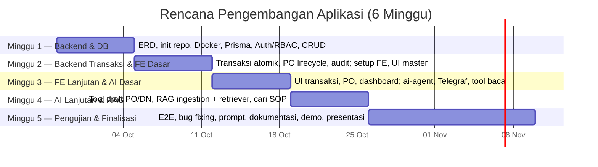
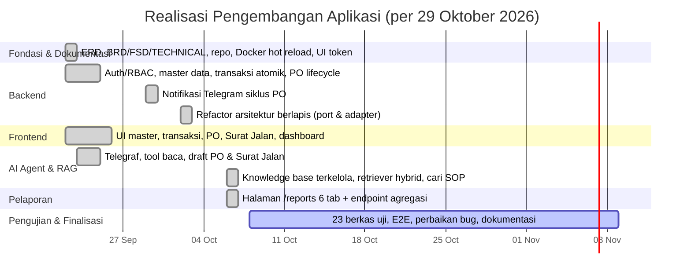
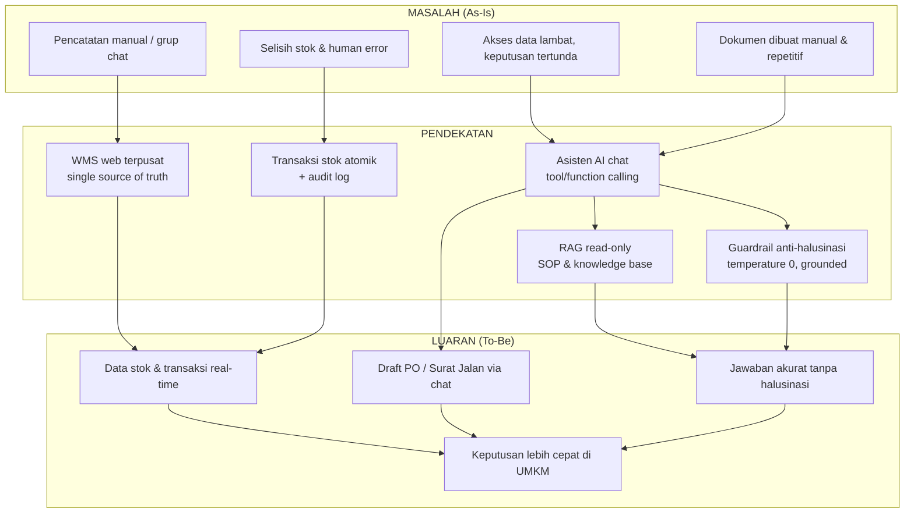
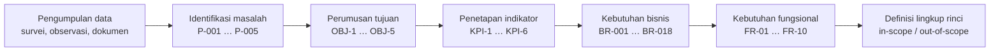
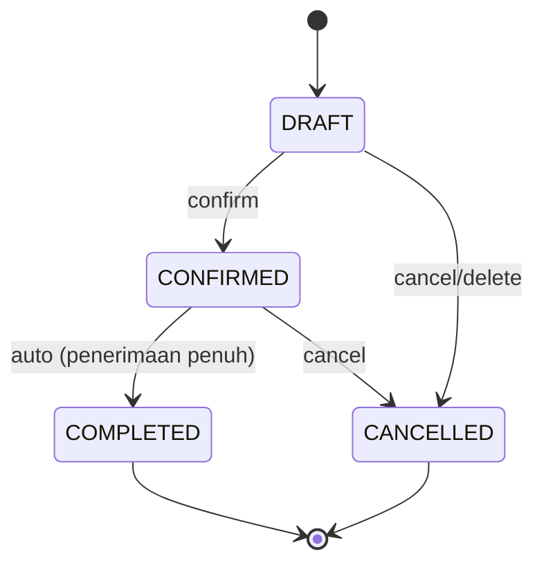
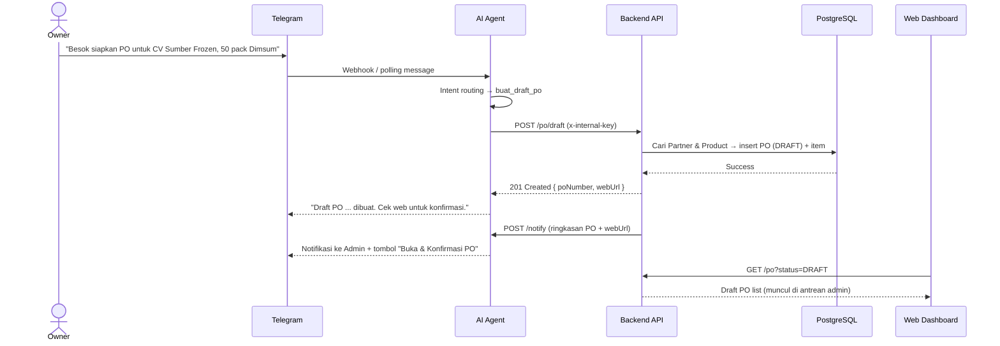
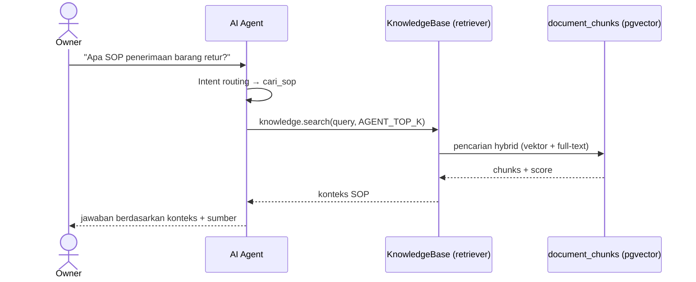

# Sistematika Laporan Kemajuan Capstone Project

**Judul Proyek:** Otomatisasi Warehouse Management System (WMS) dan Tata Kelola Dokumen Berbasis Web dengan Integrasi Asisten AI (RAG) pada Platform Pesan Instan

**Jenis Dokumen:** Laporan Kemajuan Capstone
**Versi:** 1.2.0
**Status:** Draft
**Status Data:** Data primer survei (n = 10, 29 Oktober 2026); data mentah anonim pada Lampiran H; estimasi rupiah tidak dihitung karena data keuangan tidak lengkap
**Penyusun:** [Nama Penyusun]
**Institusi/Program Studi:** [Nama Institusi / Program Studi]
**Pembimbing:** [Nama Pembimbing]
**Tanggal:** 31 Oktober 2026

**Dokumen Terkait:** [Proposal Proyek](./PROPOSAL.md) · [Data Survei](./survey/respondents.csv) · [Data Survei Anonim](./survey/respondents-anonim.csv) · [BRD](../docs/BRD.md) · [FSD](../docs/FSD.md) · [ERD](../docs/ERD.md) · [TECHNICAL](../docs/TECHNICAL.md) · [README](../README.md)

---

## Daftar Isi

- [Catatan Pembacaan Dokumen](#catatan-pembacaan-dokumen)
- [I. Pendahuluan](#i-pendahuluan)
  - [1.1 Latar Belakang](#11-latar-belakang)
    - [1.1.1 Identifikasi Masalah](#111-identifikasi-masalah)
    - [1.1.2 Data Kuantitatif Dampak Masalah](#112-data-kuantitatif-dampak-masalah)
    - [1.1.3 Hasil Survei/Wawancara Pendahuluan](#113-hasil-surveiwawancara-pendahuluan)
  - [1.2 Tujuan](#12-tujuan)
  - [1.3 Ruang Lingkup](#13-ruang-lingkup)
  - [1.4 Jadwal Kegiatan](#14-jadwal-kegiatan)
- [II. Tinjauan Pustaka](#ii-tinjauan-pustaka)
- [III. Metodologi](#iii-metodologi)
  - [3.1 Metode Penelitian](#31-metode-penelitian)
  - [3.2 Proses Analisis](#32-proses-analisis)
  - [3.3 Proses Perancangan](#33-proses-perancangan)
  - [3.4 Implementasi](#34-implementasi)
  - [3.5 Pengujian dan Evaluasi](#35-pengujian-dan-evaluasi)
- [IV. Hasil dan Pembahasan](#iv-hasil-dan-pembahasan)
- [V. Kesimpulan dan Rekomendasi](#v-kesimpulan-dan-rekomendasi)
- [Daftar Pustaka](#daftar-pustaka)
- [VI. Lampiran](#vi-lampiran)
  - [Daftar Lampiran](#daftar-lampiran)

---

## Catatan Pembacaan Dokumen

Empat hal yang perlu diketahui pembaca sebelum menilai isi dokumen ini.

**Pertama, bab yang masih kosong bukan kelalaian.** BAB IV (Hasil dan Pembahasan) dan BAB V (Kesimpulan dan Rekomendasi) sengaja dikosongkan karena hasil akhir dan kesimpulan baru dapat dirumuskan setelah seluruh target pengujian terpenuhi. Keduanya diisi pada tahap laporan akhir.

**Kedua, data pada BAB I berasal dari survei riil, bukan simulasi.** Subbagian 1.1.2 dan 1.1.3 memakai jawaban 10 responden yang disurvei pada 29 Oktober 2026. Sampel dipilih secara purposif, hanya tiga responden yang kategori utamanya *frozen food*, dan sebagian jawaban berupa rentang atau data keuangan yang tidak lengkap. Karena itu hasilnya dibaca sebagai gambaran indikatif, bukan generalisasi statistik; nilai rupiah tidak diestimasi. Data mentah tersedia pada `survey/respondents.csv` dan disajikan secara anonim pada Lampiran H.

**Ketiga, dokumen ini melanjutkan proposal.** Uraian yang sudah lengkap pada `PROPOSAL.md` — daftar pustaka, cuplikan kode, diagram, dan konfigurasi — tidak dikutip ulang seluruhnya; dokumen ini merujuk kembali ke sana. Bagian yang ditambahkan di sini adalah metodologi, data pendukung latar belakang, instrumen survei, data mentah, lembar observasi, dokumen operasional UMKM, protokol studi pustaka, dan status realisasi pekerjaan. Instrumen lengkap dilampirkan pada Lampiran G–K.

**Keempat, observasi lapangan tidak dilaksanakan.** Lampiran I memuat formulir observasi kosong dan rekaman observasi tidak langsung yang disusun dari jawaban survei R01–R10. Lampiran J memuat checklist dan format acuan dokumen karena dokumen operasional mitra belum diperoleh. Tidak ada data observasi lapangan yang diklaim pada laporan ini.

**Catatan penomoran.** Proposal memakai nomor sitasi gaya angka (`[1]`–`[8]`). Dokumen ini memakai gaya APA 7 author-date agar sitasi dapat dimasukkan langsung melalui Mendeley Cite di Word. Pemetaan antara kedua gaya tersedia pada `references/PANDUAN-MENDELEY.md`.

---

# I. PENDAHULUAN

## 1.1 Latar Belakang

Usaha Mikro, Kecil, dan Menengah (UMKM) merupakan tulang punggung perekonomian Indonesia, dengan kontribusi terhadap Produk Domestik Bruto nasional dan penyerapan tenaga kerja yang besar. Pada sektor distribusi barang *fast-moving* seperti *frozen food*, perputaran barang masuk dan keluar berlangsung cepat setiap hari. Kondisi ini menuntut ketepatan pencatatan persediaan yang tinggi, karena selisih stok sekecil apa pun akan berakumulasi menjadi kerugian operasional.

Meskipun demikian, praktik pencatatan pada banyak UMKM masih dilakukan secara manual, menggunakan buku catatan, *spreadsheet* sederhana, atau tersebar di grup pesan instan. Pola kerja seperti ini rentan terhadap kesalahan manusia, sulit direkonsiliasi, dan menimbulkan beban administratif yang berulang. Pemilik usaha yang memiliki mobilitas tinggi juga tidak dapat dengan mudah membuka *dashboard* hanya untuk mengecek sisa stok atau status pengiriman. Akibatnya, keputusan bisnis tertunda dan data *real-time* tidak dimanfaatkan secara optimal.

Tantangan adopsi teknologi pada UMKM bukan semata soal ketersediaan perangkat lunak. Sistem ERP/WMS yang canggih sering ditinggalkan karena dianggap terlalu rumit dan menuntut kurva pembelajaran yang tinggi. Tinjauan pustaka sistematis menunjukkan bahwa transformasi digital UMKM di Indonesia memberi manfaat signifikan berupa perluasan pasar, efisiensi operasional, dan peningkatan profitabilitas, namun terhambat oleh keterbatasan sumber daya, keterampilan teknis, serta kebiasaan bisnis yang telah mengakar (Purnomo et al., 2024; Hasanah et al., 2024). Karena itu, dibutuhkan solusi yang menyatukan **data operasional terstruktur** dengan **antarmuka yang sudah familiar** bagi pengguna.

Perkembangan *Large Language Model* (LLM) membuka peluang untuk menjembatani kesenjangan tersebut. Melalui pola *tool/function calling*, model bahasa dapat dipandu untuk mengakses data perusahaan secara terkendali, bukan mengandalkan pengetahuannya sendiri (Schick et al., 2023; Mialon et al., 2023). Dengan arsitektur *Retrieval-Augmented Generation* (RAG), jawaban model dapat dibumikan pada sumber pengetahuan perusahaan sehingga menekan halusinasi (Lewis et al., 2020; Gao et al., 2023). Pendekatan ini memungkinkan pemilik usaha cukup "mengobrol" untuk mengecek stok, merekap pengiriman, hingga membuat draft dokumen, sementara staf tetap bekerja pada *dashboard* web yang komprehensif.

Berdasarkan uraian tersebut, proyek ini membangun **sistem Warehouse Management System (WMS) berbasis web** yang terintegrasi dengan **asisten AI berbasis RAG** melalui platform pesan instan (Telegram, dengan WhatsApp sebagai tahap lanjut). Masalah yang diidentifikasi dan dampaknya dirangkum pada Tabel 1.1.

**Tabel 1.1 — Identifikasi Masalah**

| ID | Masalah | Deskripsi | Dampak Bisnis |
| :--- | :--- | :--- | :--- |
| P-001 | Hambatan akses data | Pemilik harus membuka laptop, login, dan memfilter tabel hanya untuk mengecek stok/status kirim. | Keputusan tertunda; data *real-time* tidak termanfaatkan. |
| P-002 | *Human error* pada volume tinggi | Pencatatan manual/grup chat rentan salah dan sulit direkonsiliasi. | Selisih stok, kehilangan barang, kerugian operasional. |
| P-003 | Keterlambatan keputusan | Tanpa data instan, pemilik ragu menerima pesanan besar. | Kehilangan momentum dan peluang bisnis. |
| P-004 | Beban administratif repetitif | Pembuatan dokumen harian (PO, Surat Jalan) menyita waktu staf. | Produktivitas menurun; biaya tenaga kerja tidak efektif. |
| P-005 | Adopsi teknologi rendah | Sistem ERP/WMS dianggap terlalu rumit bagi pengguna UMKM. | Investasi teknologi tidak menghasilkan ROI. |

**Keterangan:**
- `P-001` … `P-005` = kode masalah (*Problem*) ke-1 sampai ke-5. Penomoran `P-00n` dipakai konsisten pada dokumen ini, pada `PROPOSAL.md`, dan pada `docs/BRD.md`.
- Kolom **Dampak Bisnis** menyatakan akibat yang timbul bila masalah dibiarkan, bukan hasil pengukuran.

**Akar masalah (*root cause*):** kesenjangan antara kompleksitas sistem dan kebiasaan komunikasi alami pengguna. Solusi yang diusulkan adalah menyediakan antarmuka yang familiar (chat) dengan *zero-learning-curve*, namun tetap terhubung ke data operasional yang terstruktur dan tervalidasi.

### 1.1.1 Identifikasi Masalah

Identifikasi masalah pada Tabel 1.1 diturunkan dari empat sumber: tinjauan pustaka (Purnomo et al., 2024; Hasanah et al., 2024), pengamatan awal proses gudang harian, survei pendahuluan dengan calon pengguna (subbagian 1.1.3), dan analisis awal dokumen operasional. Setiap kode masalah dipetakan ke tujuan proyek pada subbagian 1.2 sehingga tidak ada masalah yang tanpa penanganan, dan tidak ada tujuan yang tanpa dasar masalah.

### 1.1.2 Data Kuantitatif Dampak Masalah

> **Catatan data.** Angka pada subbagian ini dihitung dari jawaban 10 responden pada survei 29 Oktober 2026. Karena jawaban berupa rentang dan sebagian data keuangan kosong, nilai rupiah tidak diestimasi; hanya komponen waktu yang dihitung. Data mentah tersedia pada [`survey/respondents.csv`](./survey/respondents.csv) dan disajikan secara anonim pada Lampiran H.

Tabel 1.2 menghitung dampak masalah dari jawaban survei. Setiap baris mencantumkan dasar perhitungan agar asal angka dapat ditelusuri. Nilai dihitung per responden terlebih dahulu, lalu diringkas menjadi median dan rentang.

**Tabel 1.2 — Estimasi Dampak Kuantitatif Berdasarkan Survei (n = 10)**

| Metrik | Dasar perhitungan per responden | Median (jam/bulan) | Rentang (jam/bulan) |
| :--- | :--- | ---: | ---: |
| Waktu pengecekan stok | Waktu cek stok × frekuensi cek/hari × hari operasi/bulan | 4,5 | 0,9–14,0 |
| Waktu pengecekan status pengiriman | Waktu cek kirim × frekuensi cek/hari × hari operasi/bulan (9 responden; satu responden tidak relevan) | 15,5 | 4,9–62,0 |
| Waktu rekap laporan harian | Waktu rekap × hari operasi/bulan | 10,7 | 1,2–23,0 |
| Waktu pembuatan draft PO | Waktu buat PO × jumlah PO/bulan | 1,4 | 0–26,9 |
| **Total waktu administratif** | Penjumlahan empat komponen per responden | **35,6** | **10,9–86,5** |

**Keterangan:**
- Jawaban berupa rentang dikonversi ke titik tengah; jawaban "≤5" dipakai 2,5 menit (titik tengah), dan ">60" dipakai 60 menit (batas bawah, sehingga estimasi cenderung konservatif).
- Frekuensi kategori dinormalisasi: "setiap hari" atau "hampir setiap hari" dipakai 1 kali/hari, rentang frekuensi dipakai titik tengah, dan rentang hari operasi dipakai titik tengah (26–30 = 28 hari; 21–25 = 23 hari).
- Total dihitung per responden, bukan penjumlahan median tiap baris; median tiap baris juga dihitung dari nilai per responden, bukan perkalian antar-median. Median total 35,6 jam/bulan setara ±427 jam/tahun; rata-rata total 39,6 jam/bulan lebih tinggi karena beberapa responden memiliki volume aktivitas jauh di atas median, terutama volume PO dan frekuensi cek pengiriman.
- Satu responden produsen makanan tidak memiliki proses pengiriman (sistem *dine-in*), sehingga komponen pengiriman dihitung 0 pada total; baris pengiriman hanya memakai 9 responden yang relevan.
- Surat Jalan tidak dimasukkan ke total karena dua responden tidak membuatnya dan data jumlah per bulan tidak lengkap.
- Selisih stok tidak dimasukkan ke tabel waktu karena satuannya persen dan kali/bulan; ringkasannya ada pada Tabel 1.4 (median 2,75%; median 2,5 kali/bulan).
- Estimasi bersifat indikatif: waktu adalah persepsi responden, bukan hasil *stopwatch*, dan belum diverifikasi melalui observasi. Tabel ini mencakup empat komponen, sehingga tidak dapat dibandingkan langsung dengan ilustrasi lama yang hanya menghitung cek stok dan PO.
- Nilai rupiah tidak dihitung. Empat dari sepuluh responden tidak mengetahui atau tidak bersedia menjawab nilai persediaan; enam jawaban lainnya berupa rentang (< Rp50 juta sampai ≥ Rp500 juta). Nilai kerugian hanya diberikan oleh lima responden dengan rentang sangat lebar (< Rp1 juta sampai Rp10–25 juta), sehingga agregasi rupiah akan menyesatkan. Dampak finansial tetap mungkin ada, tetapi tidak dapat diestimasi dari data ini.

### 1.1.3 Hasil Survei/Wawancara Pendahuluan

> **Catatan data.** Subbagian ini memakai hasil survei riil yang dilaksanakan pada 29 Oktober 2026 terhadap 10 responden. Nama dan nama usaha tidak ditampilkan; kode R01–R10 ditetapkan ulang untuk menjaga privasi dan konsistensi. Data mentah tersedia pada [`survey/respondents.csv`](./survey/respondents.csv) dan disajikan secara anonim pada Lampiran H.

Survei pendahuluan dirancang untuk mengonfirmasi apakah masalah pada Tabel 1.1 benar dialami calon pengguna dan seberapa besar dampaknya. Responden adalah pemilik atau pengelola yang terlibat langsung dalam pencatatan stok dan usahanya menyimpan/mengelola persediaan; seluruh responden memenuhi kedua kriteria tersebut. Instrumen lengkap ada pada **Lampiran G**, data mentah pada **Lampiran H**, dan daftar pertanyaan juga tercermin pada header `survey/respondents.csv`.

Komposisi responden tidak seluruhnya *frozen food*: tiga responden bergerak di *frozen food*, tiga di makanan-minuman, dan empat lainnya di retail umum, toko plastik, manufaktur elektroda las, serta distributor suku cadang mesin. Jenis usaha terdiri atas empat toko/retail, dua agen/reseller, dua produsen/UMKM makanan, satu distributor, dan satu manufaktur. Karena itu, hasil survei dibaca sebagai gambaran usaha yang mengelola persediaan, dengan mayoritas berskala UMKM, bukan khusus *frozen food*. Sebagian responden memiliki skala jauh lebih besar: satu distributor memiliki 1.104 SKU, dan tiga responden melaporkan ≥21 PO/bulan. Karena itu median dipakai sebagai ukuran pusat.

**Tabel 1.3 — Profil Responden (n = 10; Survei 29 Oktober 2026)**

| Kode | Profil Usaha (Jenis — Kategori) | Jumlah SKU | Media Pencatatan | Lama Usaha |
| :--- | :--- | ---: | :--- | :--- |
| R01 | Agen/reseller — *Frozen food* | n/a | *Spreadsheet* | 1–3 tahun |
| R02 | Toko/retail — Makanan-minuman | 8 | Buku tulis | < 1 tahun |
| R03 | Manufaktur — Elektroda las | 12–48 | ERP | ≥ 5 tahun |
| R04 | Produsen/UMKM makanan — Makanan-minuman | 10 | Buku tulis | ≥ 5 tahun |
| R05 | Distributor — Suku cadang mesin | 1.104 | *Spreadsheet* | 3–5 tahun |
| R06 | Toko/retail — *Frozen food* | 89 | Aplikasi kasir | 1–3 tahun |
| R07 | Toko/retail — *Frozen food* | 87 | Buku tulis | 1–3 tahun |
| R08 | Agen/reseller — Retail umum | 45 | Grup pesan instan | < 1 tahun |
| R09 | Toko/retail — Toko plastik | 1.430 | Buku tulis | ≥ 5 tahun |
| R10 | Produsen/UMKM makanan — Makanan-minuman | 12 | Aplikasi kasir | < 1 tahun |

**Keterangan:**
- R01 tidak memberikan angka SKU yang valid; jawabannya tidak dapat ditafsirkan sebagai jumlah SKU sehingga ditandai `n/a` dan tidak diikutkan dalam median.
- R03 menjawab "4 kategori, masing-masing 3–12 tipe"; angka 12–48 adalah taksiran bawah–atas dari jawaban tersebut.
- R09 menjawab "jumlah barang 1430"; angka dipertahankan apa adanya, tetapi kemungkinan mencakup unit barang, bukan jumlah SKU.
- Median jumlah SKU adalah **66** dari 8 jawaban numerik (R02, R04, R05, R06, R07, R08, R09, R10), dengan rentang 8–1.430. Bila R09 dikeluarkan karena kemungkinan bukan jumlah SKU, median menjadi 45. Angka ini hanya gambaran kasar karena sebaran sangat lebar.
- Media pencatatan: 4 buku tulis, 2 *spreadsheet*, 2 aplikasi kasir, 1 ERP, dan 1 grup pesan instan.

Volume transaksi harian dilaporkan dalam satuan yang tidak seragam: empat responden menyebut angka dalam rentang 30–250 transaksi/hari, empat menyebut nilai rupiah harian, satu menyebut 5–20 PO masuk/hari, dan satu tidak mengisi. Karena satuannya berbeda, volume transaksi tidak diagregasi menjadi rata-rata.

**Tabel 1.4 — Ringkasan Jawaban Survei (n = 10; 29 Oktober 2026)**

| Kode | Cek Stok (menit) | Cek Kirim (menit) | Selisih Stok (%) | Selisih (kali/bulan) | Buat PO (menit) | Rekap Harian (menit) | Bersedia Chat |
| :--- | ---: | ---: | ---: | ---: | ---: | ---: | :---: |
| R01 | 2 | 3 | 3–5 | 2–3 | ≤5 | 6–15 | Tidak |
| R02 | 10 | 15 | 1–2 | 1 | ≤5 | ≤5 | Tidak |
| R03 | 1–5 | 10–30 | 0 | 0 | 16–30 | 31–60 | Ragu |
| R04 | 10 | 30 | 0 | 0 | ≤5 | 16–30 | Ya |
| R05 | 5 | 5 | 1–2 | 2–3 | 31–60 | >60 | Ya |
| R06 | 10 | 15 | 6–10 | 4–10 | 6–15 | 16–30 | Ya |
| R07 | 5 | 10 | 3–5 | 2–3 | 6–15 | 16–30 | Ya |
| R08 | 10 | 5 | 3–5 | 2–3 | 6–15 | 6–15 | Ya |
| R09 | 2–3 | 30 | 3–5 | 4–10 | 16–30 | ≤5 | Ragu |
| R10 | 5–10 | n/a | 0 | 0 | 6–15 | 16–30 | Ya |
| **Median / ringkasan** | **6,3** | **15** | **2,75** | **2,5** | **10,5** | **23** | **6 Ya / 2 Ragu / 2 Tidak** |

**Keterangan:**
- Selisih stok (%) diturunkan dari pertanyaan "dari 100 unit yang dihitung, biasanya berapa unit yang selisih?"; 3–5 unit setara 3–5%.
- Median dihitung dari titik tengah rentang; sel tabel menampilkan jawaban asli. Untuk "≤5" dipakai 2,5 menit, dan ">60" dipakai 60 menit.
- R10 tidak memiliki proses pengiriman (*dine-in*), sehingga kolom cek kirim ditandai `n/a` dan tidak diikutkan dalam median cek kirim.
- Cek stok = waktu mengetahui sisa satu produk; cek kirim = waktu mengetahui barang yang dikirim pada satu tanggal; rekap harian = waktu membuat rekap laporan harian.
- Median cek stok 6,3 menit; median cek pengiriman 15 menit; median rekap harian 23 menit; median waktu buat PO 10,5 menit.
- Jumlah PO per bulan: median 8 (rentang 0–50); frekuensi cek stok median 2 kali/hari; frekuensi cek pengiriman median 3,5 kali/hari (9 responden); hari operasi median 28 hari/bulan.
- Kesediaan chat: 6 responden menjawab Ya, 2 Ragu, dan 2 Tidak. Angka ini menunjukkan kesediaan mencoba, bukan tingkat adopsi harian.

Frekuensi *stock opname*: 4 responden harian, 3 mingguan, dan 3 bulanan; delapan melakukan opname dalam satu bulan terakhir, satu lebih dari satu bulan lalu, dan satu tidak mengisi. Skor keterlambatan informasi memiliki median 3 dari 5 (9 dari 10 memberi skor ≥3), yang menunjukkan informasi tidak selalu tersedia tepat waktu.

**Temuan utama:**

1. **Pencatatan masih dominan manual atau semi-manual.** Empat responden memakai buku tulis, dua *spreadsheet*, dan satu grup pesan instan; hanya tiga responden memakai aplikasi kasir atau ERP. Kondisi ini mendukung P-002 dan P-005: tujuh dari sepuluh responden belum memakai sistem inventori terpadu.
2. **Waktu akses stok masih di atas baseline.** Median 6,3 menit untuk mengetahui sisa satu produk, dengan rentang jawaban 1–10 menit. Tujuh dari sepuluh responden melaporkan ≥5 menit dan lima dari sepuluh melaporkan >5 menit. Ini mendukung P-001/P-003 dan baseline KPI-1.
3. **Selisih stok nyata, tetapi lebih rendah dari asumsi awal.** Median 2,75% (rentang jawaban 0–10%); tujuh dari sepuluh responden mencatat selisih, tetapi hanya satu yang berada di atas 5% (6–10%). Sebarannya: tiga responden 0%, dua responden 1–2%, empat responden 3–5%, dan satu responden 6–10%. Baseline KPI-2 disesuaikan menjadi 2,75%; masalah P-002 tetap ada, tetapi tidak sebesar asumsi awal.
4. **Frekuensi selisih moderat.** Median 2,5 kali/bulan (rentang jawaban 0–10); tujuh dari sepuluh responden mengalami setidaknya satu kali selisih per bulan, dan dua responden melaporkan 4–10 kali/bulan.
5. **Pembuatan PO bervariasi dan sebagian menyita waktu.** Median 10,5 menit (rentang jawaban ≤5–60); tiga responden ≤5 menit, empat responden 6–15 menit, dua responden 16–30 menit, dan satu responden 31–60 menit. Ini mendukung P-004 dan baseline KPI-3.
6. **Beban administratif lain juga signifikan.** Median waktu rekap laporan harian 23 menit (rentang ≤5 sampai >60), dan median waktu mengecek status pengiriman 15 menit (rentang 3–30; sembilan responden yang relevan). Estimasi total pada Tabel 1.2 menunjukkan median 35,6 jam/bulan per responden.
7. **Kesediaan mencoba lebih rendah dari perkiraan awal.** Enam dari sepuluh responden bersedia mencoba asisten chat, dua ragu, dan dua tidak. Kekhawatiran yang paling sering muncul adalah data bocor (3), susah dipakai (3), dan jawaban salah (1); tiga responden menyatakan tidak ada kekhawatiran. Ini menandakan target KPI-5 (≥70% interaksi harian) berisiko dan perlu diuji melalui pilot, karena kesediaan mencoba bukan adopsi harian.
8. **WhatsApp mendominasi kanal chat.** Sembilan dari sepuluh responden memilih WhatsApp dan satu memilih Telegram. Fitur yang paling dibutuhkan adalah cek stok (4), laporan (3), buat PO (2), dan cek pengiriman (1). Enam responden menyatakan asisten akan dipakai oleh pemilik dan staf sekaligus, dua oleh pemilik, dan dua oleh staf. Preferensi WhatsApp ini perlu dicatat sebagai risiko adopsi bagi MVP Telegram; WhatsApp tetap menjadi prioritas tahap lanjut.

**Keterbatasan data:**
- Sampel purposif 10 responden tidak dapat digeneralisasi ke seluruh UMKM. Hanya tiga responden yang kategori utamanya *frozen food*, sehingga hasil tidak dapat diklaim mewakili distribusi *frozen food* secara khusus.
- Satu distributor memiliki 1.104 SKU, dan tiga responden melaporkan ≥21 PO/bulan; skala ini jauh lebih besar daripada responden lain, sehingga rata-rata mudah tertarik oleh outlier. Karena itu median dan rentang dilaporkan.
- Waktu dan selisih stok adalah perkiraan responden, bukan hasil *stopwatch* atau audit stok. Jawaban berupa rentang dikonversi ke titik tengah, dan data kosong tidak diimputasi.
- Data keuangan tidak lengkap: 4 dari 10 responden tidak memberikan nilai persediaan dan 5 dari 10 tidak memberikan nilai kerugian. Estimasi rupiah karena itu tidak dihitung.

## 1.2 Tujuan

Tujuan umum proyek ini adalah merancang dan membangun sistem WMS berbasis web yang terintegrasi asisten AI RAG untuk membantu UMKM distribusi *fast-moving goods* mengelola persediaan dan dokumen secara terpusat, akurat, dan mudah diakses. Tujuan khusus dirumuskan pada Tabel 1.5.

**Tabel 1.5 — Tujuan Proyek**

| ID | Tujuan | Masalah yang Disasar |
| :--- | :--- | :--- |
| OBJ-1 | Menyediakan akses data inventori *real-time* kepada pemilik tanpa harus membuka *dashboard* web. | P-001, P-003 |
| OBJ-2 | Mengurangi selisih stok melalui pencatatan transaksi masuk/keluar terpusat dan tervalidasi. | P-002 |
| OBJ-3 | Mempercepat pembuatan dokumen (PO & Surat Jalan) melalui otomatisasi dan eksekusi via chat. | P-004 |
| OBJ-4 | Meningkatkan adopsi teknologi dengan antarmuka chat yang *zero-learning-curve*. | P-005 |
| OBJ-5 | Menyediakan laporan operasional harian yang andal untuk pengambilan keputusan. | P-001, P-003 |

**Keterangan:**
- `OBJ-1` … `OBJ-5` = kode tujuan (*Objective*) ke-1 sampai ke-5. Kode ini dipakai konsisten pada `PROPOSAL.md` dan `docs/BRD.md`.
- Kolom **Masalah yang Disasar** menghubungkan setiap tujuan ke kode masalah pada Tabel 1.1. Satu tujuan dapat menangani lebih dari satu masalah.

**Tabel 1.6 — Indikator Keberhasilan (KPI)**

| ID | Metrik | Baseline | Target |
| :--- | :--- | :--- | :--- |
| KPI-1 | Waktu pemilik memperoleh info stok/pengiriman | Median 6,3 menit (rentang 1–10; 7/10 ≥5 menit) | < 10 detik (chat) |
| KPI-2 | Selisih stok pada *stock opname* | Median 2,75% (rentang 0–10; 7/10 mencatat selisih) | ≤ 1% |
| KPI-3 | Waktu pembuatan draft PO | Median 10,5 menit (rentang ≤5–60; 7/10 ≤15 menit) | < 1 menit (via chat) |
| KPI-4 | Akurasi jawaban AI terhadap data aktual | N/A | 100% (dari basis data, tanpa halusinasi) |
| KPI-5 | Adopsi asisten chat oleh pemilik | 0% | ≥ 70% interaksi harian |
| KPI-6 | Waktu admin mengetahui draft PO baru dari chat | Cek berkala manual | < 10 detik (notifikasi Telegram) |

**Keterangan:**
- `KPI-1` … `KPI-6` = kode *Key Performance Indicator* ke-1 sampai ke-6.
- Kolom **Baseline** menyatakan kondisi sebelum sistem dibangun. Nilai baseline pada KPI-1, KPI-2, dan KPI-3 berasal dari survei 10 responden pada 29 Oktober 2026 (subbagian 1.1.3), bukan simulasi. Nilai berupa median; rentang jawaban asli ditampilkan pada Tabel 1.4.
- Baseline KPI-2 (2,75%) lebih rendah dari asumsi awal (5–6,8%), tetapi target ≤1% tetap dipertahankan. Evaluasi perlu mempertimbangkan bahwa tiga responden sudah melaporkan 0% selisih.
- KPI-5: 6 dari 10 responden bersedia mencoba, 2 ragu, dan 2 tidak. Angka ini adalah kesediaan, bukan adopsi harian; target ≥70% akan diuji pada pilot.
- `N/A` pada KPI-4 berarti tidak ada padanan sebelum sistem dibangun, karena pengukuran baru bermakna setelah asisten tersedia.
- KPI-4 dan KPI-5 diukur pada tahap pengujian (subbagian 3.5), bukan pada tahap ini.

**Tabel 1.7 — Keterkaitan Tujuan dan Indikator**

| ID Tujuan | Indikator Penilaian | Cara Pembuktian |
| :--- | :--- | :--- |
| OBJ-1 | KPI-1, KPI-6 | Pengukuran waktu tanggap chat dan waktu tiba notifikasi admin. |
| OBJ-2 | KPI-2 | Perbandingan hasil *stock opname* dengan catatan sistem. |
| OBJ-3 | KPI-3 | Pengukuran waktu dari instruksi chat sampai draft PO tersimpan. |
| OBJ-4 | KPI-5 | Pencatatan interaksi harian pemilik dengan asisten. |
| OBJ-1, OBJ-5 | KPI-4 | Pengujian akurasi jawaban AI terhadap isi basis data. |

**Keterangan:**
- Kolom **Cara Pembuktian** menyatakan bukti yang akan dikumpulkan pada subbagian 3.5. Tabel ini menjadi rujukan saat menyusun skenario pengujian.

## 1.3 Ruang Lingkup

### 1.3.1 Termasuk dalam Ruang Lingkup (In-Scope)

1. **Aplikasi WMS berbasis web (untuk admin gudang):**
   - Manajemen data master: Produk (SKU, unit, kategori, stok minimum), Kategori, Partner (Supplier/Customer), dan Gudang (multi-gudang).
   - Transaksi **barang masuk (inbound)** dan **barang keluar (outbound)** dengan stok dihitung otomatis.
   - Manajemen **Purchase Order (PO)** dengan alur status `DRAFT → CONFIRMED → COMPLETED / CANCELLED` dan penomoran otomatis.
   - Manajemen **Surat Jalan / Delivery Note (DN)** untuk partner `CUSTOMER`, termasuk halaman detail, edit saat `DRAFT`, dan cetak.
   - *Dashboard* dan **laporan/analitik** operasional pada halaman `/reports` dengan enam tab: ringkasan & tren, persediaan, pembelian, pengiriman, mutasi/kartu stok, dan analitik gerak stok.
   - Halaman **Knowledge Base** khusus `SUPER_ADMIN` untuk mengelola dokumen SOP/FAQ/kebijakan, melihat statistik indeks, dan memicu re-ingest.
   - Autentikasi dan kontrol akses berbasis peran: `SUPER_ADMIN`, `ADMIN`, `OWNER`.
   - **Audit log** untuk perubahan data penting.
2. **Asisten AI berbasis chat (untuk Owner/Manager), MVP Telegram:**
   - *Intent* baca: cek stok, katalog/varian produk, kategori, partner, gudang, transaksi masuk/keluar, rekap pengiriman, daftar/detail PO, surat jalan, stok tipis, dan ringkasan *dashboard*.
   - *Intent* tulis terbatas pada pembuatan **draft** PO (partner `SUPPLIER`) dan **draft** Surat Jalan (partner `CUSTOMER`).
   - Tanya SOP/kebijakan internal melalui **RAG** dari *knowledge base*.
   - *Guardrail* anti-halusinasi dan pencatatan percakapan untuk audit.
   - **Notifikasi proaktif (Telegram):** admin gudang menerima notifikasi berisi ringkasan PO dan tautan langsung ke halaman detail saat draft PO dibuat via chat; owner menerima notifikasi saat PO dikonfirmasi/dibatalkan dan saat penerimaan selesai.
3. **Backend REST API terpusat** sebagai satu-satunya penulis data bisnis dan sumber logika bisnis.
4. **Deployment berbasis container** (Docker Compose) yang dapat dijalankan ulang pada Linux/WSL2/VPS.

### 1.3.2 Di Luar Ruang Lingkup (Out-of-Scope)

| Item | Alasan |
| :--- | :--- |
| Modul akuntansi/jurnal keuangan | Fokus pada operasional gudang. |
| *Payroll* & HR | Di luar domain inventori. |
| Multi-tenant SaaS / multi-perusahaan | Diasumsikan satu perusahaan (*single tenant*). |
| Aplikasi *mobile* native (Android/iOS) | Antarmuka *mobile* diwakili oleh chat. |
| Integrasi EDI / *marketplace* / *e-invoice* | Kompleksitas integrasi eksternal di luar cakupan. |
| *Demand forecasting* / ML prediktif | Fitur lanjutan pasca-MVP. |
| WhatsApp sebagai kanal utama | MVP memakai Telegram; WhatsApp menjadi tahap lanjut. |

**Catatan kanal chat:** survei menunjukkan 9 dari 10 responden memilih WhatsApp dan 1 memilih Telegram. Keputusan memakai Telegram pada MVP merupakan kompromi teknis (ketersediaan API dan kecepatan implementasi), bukan cerminan preferensi pengguna; WhatsApp tetap menjadi prioritas tahap lanjut.

**Keterangan:**
- Batas ruang lingkup ini menjadi acuan resmi selama pengerjaan. Permintaan di luar daftar ini dicatat sebagai usulan pasca-MVP dan tidak dikerjakan sebelum laporan akhir.

## 1.4 Jadwal Kegiatan

Proyek mengikuti alur **pertemuan awal → diskusi & penyusunan proposal → pengerjaan aplikasi → laporan & presentasi**. Pengembangan aplikasi direncanakan enam minggu (28 September – 9 November 2026) dengan pendekatan sprint mingguan. Prioritas awal diberikan pada unsur kebaruan (*novelty*) berupa integrasi AI RAG, agar risiko keterlambatan dapat dikelola. Jadwal disajikan dalam tiga lapis: milestone proyek (Tabel 1.8), Gantt rencana (Gambar 1.1), dan realisasi per 29 Oktober 2026 (Gambar 1.2 dan Tabel 1.9).

**Tabel 1.8 — Milestone Kegiatan Proyek Capstone**

| Fase | Aktivitas | Periode |
| :--- | :--- | :--- |
| Pertemuan awal (*meeting*) | *Kick-off*, penentuan topik dan kebutuhan | Awal September 2026 |
| Diskusi & Penyusunan Proposal | Diskusi kebutuhan, studi pustaka, penyusunan proposal capstone | 14 September – 12 Oktober 2026 |
| Pengerjaan Aplikasi | Sprint pengembangan WMS + AI RAG | 28 September – 9 November 2026 |
| Laporan Kemajuan | Laporan kemajuan capstone + *timeline* pengembangan aplikasi | 15 – 26 Oktober 2026 |
| Laporan Akhir & Presentasi | Laporan akhir, dokumentasi, demo, dan presentasi | 19 Oktober – 9 November 2026 |

**Gambar 1.1 — Gantt Chart Rencana Pengembangan Aplikasi (6 Minggu)**



**Gambar 1.2 — Gantt Chart Realisasi Pengembangan Aplikasi (per 29 Oktober 2026)**



**Tabel 1.9 — Realisasi Pekerjaan per 29 Oktober 2026**

| Minggu Rencana | Fokus Rencana | Status | Bukti |
| :--- | :--- | :--- | :--- |
| 1 (28 Sep – 4 Okt) | Backend & DB: ERD, repo, Docker, Prisma, Auth/RBAC, CRUD master | Selesai | Commit 22–24 Sep (repo, Docker, WMS+RAG, ERD/BRD/FSD/TECHNICAL) |
| 2 (5 – 11 Okt) | Backend transaksi & FE dasar | Selesai lebih awal | Commit 22–29 Sep (transaksi atomik, PO lifecycle, audit, UI master) |
| 3 (12 – 18 Okt) | FE lanjutan & AI dasar | Selesai lebih awal | Commit 23 Sep – 7 Okt (tool baca, draft PO/DN, dashboard) |
| 4 (19 – 25 Okt) | AI lanjutan & RAG | Selesai lebih awal | Commit 6 Okt (knowledge base, retriever hybrid, cari SOP, ingest jobs) |
| 5 (26 Okt – 9 Nov) | Pengujian & finalisasi | Berjalan | 23 berkas uji tersedia; survei pendahuluan 10 responden (29 Okt); pengujian E2E dan finalisasi berlangsung |

**Keterangan:**
- **Selesai lebih awal** berarti pekerjaan yang direncanakan pada minggu tersebut telah tuntas sebelum minggu itu dimulai. Implementasi inti aplikasi tuntas pada 7 Oktober 2026, lebih cepat dari rencana.
- Karena implementasi selesai lebih awal, sisa waktu dialokasikan untuk pengujian, penyempurnaan, dan penyusunan laporan. Pada 18 Oktober 2026 jadwal diperluas dari lima menjadi enam minggu agar selaras dengan kalender capstone.
- Snapshot implementasi tidak berubah setelah 18 Oktober 2026; kegiatan 19–29 Oktober mencakup pengumpulan data survei dan persiapan pengujian.
- **Bukti** merujuk riwayat versi repositori, sehingga status pada tabel ini dapat diverifikasi ulang.
- Tanggal realisasi implementasi diambil dari riwayat *commit* repositori; tanggal survei (29 Oktober 2026) diambil dari cap waktu pengisian formulir. Tanggal menunjukkan kapan perubahan tercatat, bukan durasi pengerjaan.

---

# II. TINJAUAN PUSTAKA

Bab ini mengulas teori dan penelitian terdahulu yang mendasari perancangan sistem, mencakup manajemen persediaan digital, digitalisasi UMKM, model bahasa, arsitektur RAG, serta pola *tool calling* dan *grounding*. Uraian lengkap beserta kerangka pemikiran tersedia pada `PROPOSAL.md` BAB II; bab ini merangkum pokok-pokok yang langsung memengaruhi keputusan perancangan.

## 2.1 Warehouse Management System dan Manajemen Persediaan

*Warehouse Management System* (WMS) adalah sistem informasi yang mengelola dan mengendalikan seluruh aktivitas gudang, meliputi penerimaan barang, penyimpanan, pengeluaran, hingga pelaporan. Manajemen persediaan mencakup kebijakan penentuan tingkat stok, waktu pemesanan ulang, dan ukuran pesanan, dengan tujuan memenuhi permintaan sekaligus meminimalkan kelebihan atau kekurangan stok.

Pada praktiknya, sistem persediaan digital menonjolkan pemantauan stok secara *real-time*, pengurangan kesalahan pencatatan, serta dukungan pengambilan keputusan berbasis data. Prinsip yang diadopsi pada proyek ini adalah **stok sebagai konsekuensi transaksi**: nilai stok tidak diubah manual, melainkan dihitung dari akumulasi transaksi masuk, keluar, dan penyesuaian. Prinsip ini menjamin konsistensi dan auditabilitas data.

## 2.2 Digitalisasi UMKM di Indonesia

Kajian tinjauan pustaka sistematis terhadap UMKM di Indonesia menunjukkan bahwa transformasi digital berdampak positif pada jangkauan pasar, efisiensi operasional, dan profitabilitas, serta memberi akses informasi *real-time* dan integrasi fungsi bisnis (Purnomo et al., 2024; Hasanah et al., 2024). Adopsi tetap terhambat keterbatasan sumber daya, keterampilan teknis, infrastruktur, dan resistensi terhadap perubahan prosedur lama.

Temuan ini mengindikasikan bahwa solusi bagi UMKM tidak cukup hanya canggih, tetapi juga harus **tepat guna dan berbiaya rendah**. Karena itu proyek ini memilih kanal gratis (Telegram Bot API) untuk MVP dan arsitektur *container* yang ringan, sembari tetap menyediakan integrasi data terpusat yang menjadi keunggulan sistem informasi manajemen berbasis ERP (Hasanah et al., 2024).

## 2.3 Large Language Model dan Arsitektur Transformer

*Large Language Model* (LLM) adalah model bahasa berskala besar yang dilatih pada korpus teks masif dengan arsitektur **Transformer** (Vaswani et al., 2017). Kemampuan *in-context learning* memungkinkan LLM mengikuti instruksi dan mengerjakan tugas baru hanya dari beberapa contoh atau deskripsi tugas, tanpa pelatihan ulang (Brown et al., 2020).

LLM memiliki keterbatasan mendasar: pengetahuan yang tersimpan di dalam parameternya tidak selalu mutakhir, sulit ditelusuri sumbernya, dan cenderung berhalusinasi pada tugas yang membutuhkan fakta spesifik. Keterbatasan inilah yang mendorong pendekatan augmentasi eksternal berupa RAG dan *tool calling*.

## 2.4 Retrieval-Augmented Generation (RAG)

RAG adalah arsitektur yang menggabungkan **memori parametrik** (LLM) dengan **memori non-parametrik** (indeks vektor dokumen eksternal) (Lewis et al., 2020). Pada saat inferensi, kueri pengguna diubah menjadi vektor *embedding*, lalu sistem mengambil *top-K* potongan dokumen yang paling relevan berdasarkan kemiripan vektor. Konteks yang terambil kemudian disertakan dalam prompt agar model membentuk jawaban.

Komponen utama RAG pada proyek ini:

- ***Chunking*** — pemotongan dokumen agar konteks pas untuk model, dengan parameter `CHUNK_SIZE` dan `CHUNK_OVERLAP`.
- ***Embeddings*** — representasi vektor dari teks menggunakan model *embedding* (mis. `text-embedding-3-small`, dimensi 1536).
- **Penyimpanan vektor** — ekstensi `pgvector` pada PostgreSQL untuk pencarian tetangga terdekat dengan operasi *cosine distance* (`<=>`).
- ***Retrieval*** — pengambilan *top-K* potongan relevan sebagai konteks jawaban.

Survei terkini menunjukkan RAG menjadi pendekatan dominan untuk meningkatkan faktualitas dan *provenance* jawaban LLM pada domain pengetahuan spesifik (Gao et al., 2023).

## 2.5 Tool/Function Calling dan Augmented Language Models

*Augmented Language Models* memperkaya LLM dengan kemampuan bernalar serta menggunakan alat eksternal (Mialon et al., 2023). Salah satu bentuknya adalah *tool/function calling*: model memilih fungsi yang tersedia, mengisi parameter sesuai skema, lalu sistem mengeksekusi fungsi tersebut dan mengembalikan hasilnya ke model.

*Toolformer* menunjukkan bahwa LLM dapat memanggil API eksternal dan memanfaatkan hasilnya untuk prediksi token berikutnya (Schick et al., 2023). Pola ini sesuai untuk kasus proyek: alih-alih membiarkan LLM menebak angka stok, model dipandu memanggil *tool* yang membaca data langsung dari Backend API.

Pada proyek ini, *tool* didefinisikan dengan skema parameter (Zod) dan dipisahkan menjadi dua jenis: **tool baca** dan **tool tulis terbatas** (hanya `buat_draft_po` dan `buat_draft_surat_jalan`). LLM tidak menulis SQL langsung untuk data bisnis; seluruh akses data bisnis melalui endpoint backend yang tervalidasi.

## 2.6 Grounding dan Anti-Halusinasi

*Grounding* adalah upaya mengikat jawaban model pada sumber data yang dapat diverifikasi, bukan pada pengetahuan internalnya. Halusinasi ditekan melalui kombinasi strategi berikut:

1. **Tool-only data** — jawaban tentang stok/transaksi hanya berasal dari hasil pemanggilan *tool*.
2. ***Temperature* 0** — mengurangi variasi dan spekulasi keluaran model.
3. **Konteks RAG terbatas** — pertanyaan SOP hanya dijawab dari konteks hasil *retrieval*, dengan menyebut sumber bila tersedia.
4. ***Guardrail system prompt*** — instruksi eksplisit untuk menolak mengarang dan menyatakan ketiadaan data apa adanya.
5. ***Least privilege*** — kredensial basis data untuk *runtime* AI hanya berhak `SELECT` pada tabel vektor, tanpa hak tulis.

## 2.7 Penelitian Terdahulu

Tabel 2.1 merangkum penelitian dan kajian relevan serta posisi proyek ini.

**Tabel 2.1 — Perbandingan dengan Penelitian/Kajian Terdahulu**

| Kajian | Fokus | Kontribusi | Celah yang Diisi Proyek Ini |
| :--- | :--- | :--- | :--- |
| Lewis et al. (2020) | Arsitektur RAG | Memadukan memori parametrik & non-parametrik untuk tugas intensif pengetahuan. | Bersifat metodologis umum; belum diterapkan pada WMS UMKM. |
| Schick et al. (2023) | *Toolformer* | LLM belajar memanggil API eksternal. | Belum membahas tata kelola akses data perusahaan (RBAC, *read-only*). |
| Mialon et al. (2023) | Survei ALM | Peta riset augmentasi LLM dengan *tools*. | Konseptual; bukan implementasi sistem informasi. |
| Purnomo et al. (2024) | Digitalisasi UMKM Indonesia | Manfaat & hambatan transformasi digital UMKM. | Tidak menyentuh asisten AI berbasis chat maupun WMS. |
| Hasanah et al. (2024) | ERP untuk UMKM | Integrasi proses bisnis & akses data *real-time*. | Sistem ERP tergolong berat/mahal untuk UMKM mikro. |

**Keterangan:**
- Kolom **Celah yang Diisi Proyek Ini** menyatakan posisi proyek terhadap kajian tersebut, bukan klaim bahwa celah itu belum pernah diteliti sama sekali.
- Rincian rujukan lengkap tersedia pada **Daftar Pustaka**.

**Kebaruan (*novelty*) proyek** terletak pada penggabungan tiga elemen dalam satu sistem yang dapat dijalankan mandiri oleh UMKM: (1) WMS web terpusat sebagai sumber kebenaran data, (2) asisten AI berbasis chat dengan *tool calling* ke API backend, dan (3) RAG *read-only* untuk menjawab SOP/kebijakan. Kombinasi ini menyediakan antarmuka *zero-learning-curve* tanpa mengorbankan integritas dan auditabilitas data operasional.

## 2.8 Kerangka Pemikiran

Gambar 2.1 menggambarkan alur pemikiran dari masalah hingga luaran yang diharapkan.

**Gambar 2.1 — Kerangka Pemikiran**



**Keterangan:**
- Gambar ini identik dengan Gambar 2.1 pada `PROPOSAL.md` agar rujukan antara kedua dokumen tetap konsisten.

---

# III. METODOLOGI

Bab ini menjelaskan cara pekerjaan dilakukan: metode penelitian, proses analisis kebutuhan, proses perancangan, langkah implementasi, serta pengujian dan evaluasi. Uraian disusun mengikuti urutan pengerjaan yang sesungguhnya, sehingga pembaca dapat menelusuri bagaimana masalah pada BAB I berubah menjadi solusi yang dijelaskan pada subbagian 3.4.

## 3.1 Metode Penelitian

### 3.1.1 Pendekatan dan Model Proses

Proyek ini adalah penelitian pengembangan perangkat lunak (R&D) dengan pendekatan *incremental*. Setiap penambahan kemampuan dirancang, dibangun, dan diuji dalam satu siklus pendek, lalu hasilnya menjadi dasar siklus berikutnya. Model prosesnya adalah Agile versi ringkas yang dijalankan dalam sprint mingguan dan dipetakan ke lima fase pada Tabel 1.8. Metode pengembangan yang dipakai adalah *incremental development* dengan *prototyping* pada bagian yang berisiko tinggi, yaitu integrasi AI/RAG: prototipe diuji lebih dahulu, lalu disempurnakan pada sprint berikutnya. Pemilihan model ini didasari dua pertimbangan:

1. **Kebutuhan belum sepenuhnya pasti di awal.** Calon pengguna UMKM belum memiliki pengalaman dengan asisten AI, sehingga sebagian kebutuhan baru muncul setelah prototipe dapat dicoba.
2. **Risiko teknis terkonsentrasi pada satu bagian.** Unsur kebaruan berupa integrasi AI RAG memiliki ketidakpastian paling tinggi, sehingga dikerjakan lebih awal agar bila gagal, ruang lingkup dapat disesuaikan.

Setiap fase menghasilkan luaran yang dapat diperiksa: analisis kebutuhan, dokumen perancangan, kode teruji, dan hasil pengujian. Metode dan perkakas yang dipakai pada setiap tahap dirangkum pada subbagian 3.1.2.

### 3.1.2 Metode dan Perkakas Pengembangan

Metode dan perkakas dipilih agar setiap tahap menghasilkan artefak yang dapat diperiksa dan dapat diulang. Tabel 3.1 merangkum metode, perkakas utama, dan luaran pada setiap tahap.

**Tabel 3.1 — Metode dan Perkakas Pengembangan per Tahap**

| Tahap | Metode | Perkakas utama | Luaran |
| :--- | :--- | :--- | :--- |
| Analisis kebutuhan | Studi pustaka naratif, survei semi-terstruktur, observasi proses, dan analisis dokumen | Formulir daring (Google Forms), Google Sheets, Mendeley, Mermaid | P-001–P-005, OBJ-1–OBJ-5, KPI-1–KPI-6, BRD, FSD |
| Perancangan | Pemodelan data relasional dan normalisasi, arsitektur berlapis (*ports and adapters*), *state machine*, dan *sequence diagram* | Mermaid, Prisma Schema, Markdown | ERD, rancangan arsitektur, *state machine*, rancangan antarmuka |
| Implementasi | Pengembangan inkremental per sprint, *containerization*, dan migrasi basis data berbasis kode | Git/GitHub, Docker Compose, Node.js 20, TypeScript 5.7, React 18.3, Vite 6, Tailwind CSS 4, Express 4.21, Prisma 6.3, PostgreSQL + pgvector, LangChain.js 0.3, Telegraf 4.16, OpenAI API, Nginx | Kode aplikasi, *container*, migrasi basis data |
| Pengujian | Unit, integrasi, *end-to-end* manual, dan pengujian komponen | Vitest 2.1, Supertest 7, Testing Library 16, Playwright (opsional), Makefile | 23 berkas uji, Tabel 3.7, Tabel 3.8 |
| Dokumentasi | *Docs-as-code* dan pengelolaan sitasi | Markdown, Mermaid, Mendeley Cite, Git | Laporan, BRD/FSD/ERD/TECHNICAL, daftar pustaka |

**Keterangan:**
- Versi perkakas mengikuti `package.json`, `Dockerfile`, dan `docker-compose.yml` per 31 Oktober 2026; versi dapat berubah tanpa mengubah metode.
- Pengujian dijalankan melalui target Makefile (`make test`, `make lint`, `make typecheck`) agar lingkungannya sama dengan lingkungan pengembangan.
- Rincian teknologi per lapisan dan variabel lingkungan ada pada subbagian 3.4.1 dan Lampiran F.4.

### 3.1.3 Teknik Pengumpulan Data dan Instrumen

Data dikumpulkan dengan empat teknik yang saling melengkapi. Instrumen lengkap tidak diulang pada bab ini, tetapi dilampirkan pada Lampiran G–K agar dapat diperiksa langsung.

**Tabel 3.2 — Teknik Pengumpulan Data, Instrumen, dan Lokasi Lampiran**

| Teknik | Sasaran | Instrumen | Hasil yang Diharapkan | Lokasi Lampiran |
| :--- | :--- | :--- | :--- | :--- |
| Studi pustaka | Dasar teori dan posisi terhadap penelitian sebelumnya | Protokol pencarian: basis data akademik, *string* pencarian, kriteria inklusi/eksklusi, matriks literatur | Kerangka konsep, kebaruan, rujukan | Lampiran K |
| Survei semi-terstruktur | Pemilik/pengelola usaha yang mengelola persediaan (n = 10; 3 *frozen food*) | Kuesioner 41 butir + *informed consent* | Konfirmasi masalah, baseline metrik, preferensi kanal dan fitur | Lampiran G (instrumen); Lampiran H (data mentah) |
| Observasi proses | Alur kerja gudang harian | Lembar observasi + rubrik penilaian | Pemetaan proses as-is, titik rawan kesalahan | Lampiran I |
| Analisis dokumen | SOP, format PO, format Surat Jalan, catatan stok | Checklist dokumen operasional + format acuan | Aturan bisnis, format keluaran, kamus istilah | Lampiran J |

**Keterangan:** survei pendahuluan telah dilaksanakan pada 29 Oktober 2026 terhadap 10 responden. Data primer yang sudah terkumpul dan diolah pada laporan ini adalah data survei. Observasi lapangan tidak dilaksanakan karena keterbatasan akses dan waktu. Lampiran I memuat formulir observasi kosong dan rekaman observasi tidak langsung yang disusun dari jawaban survei. Lampiran J memuat checklist dan format acuan dokumen karena dokumen mitra belum diperoleh.

### 3.1.4 Jenis dan Sumber Data

- **Data primer:** hasil survei semi-terstruktur dengan pemilik/pengelola usaha (n = 10, 29 Oktober 2026) dan pengukuran waktu pada saat uji coba sistem. Observasi lapangan tidak dilaksanakan.
- **Data sekunder:** literatur ilmiah, dokumentasi resmi perangkat (PostgreSQL, Docker, LangChain, Telegram Bot API), serta format acuan dokumen operasional UMKM.

### 3.1.5 Teknik Analisis Data

Data kualitatif dianalisis secara tematik sederhana: jawaban survei dikelompokkan menurut kemiripan tema, lalu setiap tema dinilai apakah dapat dipetakan ke salah satu masalah pada Tabel 1.1. Tema yang tidak dapat dipetakan dicatat sebagai temuan tambahan dan tidak dipaksakan masuk ke daftar masalah. Data kuantitatif hasil survei diolah menjadi median dan rentang; jawaban berupa rentang dikonversi ke titik tengah, dan data kosong tidak diimputasi. Median dipilih karena sebaran data lebar dan terdapat outlier. Nilai ini dipakai sebagai baseline KPI pada Tabel 1.6.

### 3.1.6 Batasan Metodologis

Enam batasan berikut perlu dinyatakan terbuka agar penilaian hasil dapat dilakukan secara wajar:

1. Pengembangan dilakukan oleh satu orang dalam waktu terbatas, sehingga tidak ada pengujian bebas (independen) oleh pihak kedua.
2. Survei diikuti 10 responden yang dipilih secara purposif, sehingga hasilnya bersifat indikatif, bukan generalisasi statistik. Komposisi sampel tidak sepenuhnya sesuai target awal: hanya 3 responden yang kategori utamanya *frozen food*; sisanya makanan-minuman, retail umum, toko plastik, manufaktur, dan suku cadang mesin. Satu distributor memiliki 1.104 SKU, dan tiga responden melaporkan ≥21 PO/bulan.
3. Pengukuran dampak (KPI-2 dan KPI-5) menuntut periode pemakaian nyata yang lebih panjang daripada durasi capstone; pada tahap ini pengukuran hanya dapat dilakukan secara terbatas pada lingkungan uji.
4. Perbandingan sebelum-sesudah untuk KPI-2 bergantung pada kedisiplinan pencatatan *stock opname* pada UMKM mitra, yang tidak sepenuhnya dapat dikendalikan.
5. Jawaban waktu dan selisih stok adalah perkiraan responden, bukan hasil *stopwatch* atau audit stok; jawaban berupa rentang dikonversi ke titik tengah dan data keuangan yang kosong tidak diimputasi. Karena itu, Tabel 1.2 adalah estimasi indikatif, bukan hasil pengukuran presisi.
6. Observasi lapangan dan pengumpulan dokumen operasional mitra tidak dapat dilaksanakan karena keterbatasan akses, waktu, dan privasi. Data proses disusun dari survei dan format acuan, bukan pengamatan langsung.

## 3.2 Proses Analisis

### 3.2.1 Alur Analisis

Analisis dijalankan berurutan, dengan setiap langkah menghasilkan artefak yang menjadi masukan langkah berikutnya.

**Gambar 3.1 — Alur Analisis Kebutuhan**



### 3.2.2 Penelusuran Kebutuhan

Setiap masalah ditelusuri sampai ke kebutuhan fungsional, sehingga dapat dipastikan tidak ada kebutuhan yang tanpa dasar masalah. Tabel 3.3 merangkum penelusuran tersebut; kolom terakhir menyatakan di bagian mana kebutuhan itu dibuktikan pada tahap pengujian.

**Tabel 3.3 — Penelusuran Masalah ke Kebutuhan dan Pengujian**

| Masalah | Tujuan | Indikator | Kebutuhan Bisnis | Kebutuhan Fungsional | Bukti Uji |
| :--- | :--- | :--- | :--- | :--- | :--- |
| P-001 | OBJ-1 | KPI-1, KPI-6 | BR-006, BR-014 | FR-08 | AC-06, AC-18 |
| P-002 | OBJ-2 | KPI-2 | BR-002, BR-003 | FR-04, FR-05 | AC-04, AC-05, AC-21 |
| P-003 | OBJ-1, OBJ-5 | KPI-1, KPI-3 | BR-006, BR-009 | FR-08, FR-09 | AC-06, AC-07, AC-20 |
| P-004 | OBJ-3 | KPI-3 | BR-004, BR-005, BR-008 | FR-06, FR-07 | AC-07, AC-08, AC-14 |
| P-005 | OBJ-4 | KPI-5 | BR-006, BR-007 | FR-08 | AC-10, AC-11 |

**Keterangan:**
- Kode `BR-00n` adalah kebutuhan bisnis (*Business Requirement*) pada `docs/BRD.md`; kode `FR-0n` adalah kebutuhan fungsional (*Functional Requirement*) pada `docs/FSD.md`.
- Kode `AC-0n` adalah skenario pengujian pada Tabel 3.8 dan Lampiran C.
- Sel yang memuat lebih dari satu kode berarti kebutuhan itu melayani beberapa masalah sekaligus.

### 3.2.3 Pemetaan Proses

Proses bisnis dipetakan dalam dua keadaan: **as-is** untuk memahami titik masalah, dan **to-be** untuk merumuskan perbaikan. Pada kondisi as-is, pencatatan dilakukan manual atau melalui grup chat, lalu direkap kemudian; akibatnya informasi terlambat dan rawan salah. Pada kondisi to-be, pencatatan dilakukan sekali di aplikasi web, basis data menjadi rujukan tunggal, dan pemilik mengaksesnya melalui chat. Pemetaan lengkap ada pada `docs/BRD.md` §7.

### 3.2.4 Alat Analisis

Alat yang dipakai pada tahap analisis adalah diagram alir Mermaid untuk pemetaan proses, matriks penelusuran (Tabel 3.3) untuk memastikan keterhubungan kebutuhan, dan lembar observasi untuk mencatat alur kerja nyata. Pemilihan Mermaid dilakukan karena diagram tersimpan sebagai teks di dalam repositori, sehingga ikut terkendali versinya bersama kode dan dokumen lain.

## 3.3 Proses Perancangan

Perancangan dibagi menjadi enam bagian yang dikerjakan berurutan: arsitektur, data, perilaku sistem, antarmuka, kecerdasan buatan, dan keamanan.

### 3.3.1 Perancangan Arsitektur

Sistem dirancang sebagai empat layanan terpisah yang berjalan dalam satu jaringan *container*.

**Gambar 3.2 — Arsitektur Sistem**


Dua prinsip arsitektur yang mengikat seluruh keputusan berikutnya:

1. **Backend adalah satu-satunya penulis data bisnis.** Tidak ada layanan lain yang menulis tabel bisnis secara langsung. Dengan cara ini validasi dan aturan bisnis hanya berada pada satu tempat.
2. ***Least privilege* pada akses data.** AI Agent mengakses data bisnis melalui API backend, dan mendapat hak *read-only* pada tabel vektor.

### 3.3.2 Perancangan Struktur Kode

Kode pada `backend` dan `ai-agent` disusun dengan arsitektur berlapis: **Presentasi** (rute, pengendali, handler pesan), **Bisnis** (aturan dan alur kerja), dan **Persistensi** (akses data serta adapter keluar). Setiap ketergantungan keluar (basis data, Backend API, Telegram, layanan *embedding*) disembunyikan di balik *port* dan diimplementasikan sebagai adapter, lalu dirakit pada satu berkas komposisi. Arah ketergantungan ditegakkan aturan lint, sehingga lapisan bisnis tidak bergantung pada HTTP maupun ORM. Struktur ini dipilih agar logika bisnis dapat diuji tanpa menyalakan layanan eksternal.

### 3.3.3 Perancangan Data

Model data dirancang sebagai relasi relasional yang dinormalisasi, dengan beberapa keputusan penting:

- **Stok sebagai konsekuensi transaksi.** Nilai `Product.stock` tidak diubah manual; nilainya dihitung dari transaksi masuk, keluar, dan penyesuaian.
- **Kartu stok per gudang.** Tabel inventori menyimpan jumlah per kombinasi produk dan gudang, sehingga satu produk dapat tersebar di beberapa gudang.
- **Nomor dokumen berformat.** Nomor PO berformat `PO-YYYYMM-NNN` dan Surat Jalan `SJ-YYYYMM-NNN`, dengan penghitungan urutan dilakukan di dalam transaksi agar tidak terjadi duplikasi.
- **Riwayat percakapan AI** disimpan terpisah untuk keperluan audit dan evaluasi.

Skema lengkap dan diagram relasi tersedia pada `docs/ERD.md`.

### 3.3.4 Perancangan Perilaku Sistem

Perilaku dokumen dimodelkan sebagai mesin keadaan agar transisi status tidak ambigu. Purchase Order memiliki empat status dengan aturan transisi tegas: hanya `DRAFT` yang dapat diubah atau dihapus, `CONFIRMED` dapat dibatalkan, dan `COMPLETED` tercapai otomatis saat seluruh item diterima. Aturan ini mencegah dokumen yang sudah berjalan diubah kembali tanpa jejak.

**Gambar 3.3 — State Machine Purchase Order**



Dua alur interaksi lintas layanan juga dirancang sejak awal: alur pembuatan draft PO dari chat (Gambar 3.4) dan alur penjawaban SOP melalui RAG (Gambar 3.5). Keduanya menjadi acuan saat menulis skenario pengujian.

**Gambar 3.4 — Alur Buat Draft PO via Chat**



**Gambar 3.5 — Alur Jawab SOP via RAG (Read-Only)**



### 3.3.5 Perancangan Antarmuka

Antarmuka dirancang terpisah menurut peran. Admin gudang memakai *dashboard* web dengan halaman untuk setiap entitas: data master, transaksi, Purchase Order, Surat Jalan, laporan, dan Knowledge Base. Owner tidak memerlukan halaman khusus karena seluruh interaksinya berlangsung melalui chat. Pemisahan ini merupakan keputusan utama pada subbagian ini: alih-alih memaksa owner mempelajari *dashboard*, sistem membawa informasi ke kanal yang sudah dipakai owner sehari-hari.

### 3.3.6 Perancangan Kecerdasan Buatan

Perancangan AI agent menetapkan tiga hal.

- **Pembagian tool.** Tool dipisah menjadi tool baca dan tool tulis terbatas. Tool tulis tidak pernah menetapkan status akhir dokumen; draft PO dan draft Surat Jalan selalu berstatus `DRAFT` dan menunggu konfirmasi admin di web.
- **Penanganan nama ambigu.** Pencarian produk memakai normalisasi nama dan kecocokan token, sehingga penulisan tidak baku tetap dikenali. Bila satu nama cocok ke beberapa varian, tool mengembalikan daftar kandidat dan model diminta meminta klarifikasi, bukan memilih satu secara diam-diam.
- **Pipeline RAG.** Dokumen knowledge dikelola dari halaman web khusus `SUPER_ADMIN`, disimpan pada tabel `knowledge_documents` sebagai sumber kebenaran, lalu dipecah dan di-*embed* ke tabel `document_chunks`. Pencarian dilakukan secara *hybrid* — menggabungkan peringkat vektor dan pencarian teks penuh — dengan ambang skor minimum untuk membuang potongan yang tidak relevan.

Data transaksional tidak di-*embed*; hanya dokumen SOP, kebijakan, panduan, FAQ, dan sejenisnya. Kamus produk dan laporan periode diambil langsung dari API, sehingga angkanya selalu mutakhir.

### 3.3.7 Perancangan Keamanan

Kontrol akses dirancang pada empat lapis: autentikasi pengguna web dengan token akses berumur pendek dan token pembaruan, pembatasan rute berdasarkan peran, kunci internal untuk komunikasi antar layanan, dan hak baca saja untuk AI Agent pada tabel vektor. Selain itu, dokumen knowledge bertipe sensitif hanya dapat diakses peran tertentu, dengan peran diteruskan dari lapisan pesan sampai ke pembentukan tool.

## 3.4 Implementasi

### 3.4.1 Lingkungan dan Perkakas

Seluruh layanan berjalan di dalam Docker, sehingga versi *runtime* seragam dan Node.js tidak perlu dipasang di mesin pengembang. Tabel 3.4 merangkum teknologi dan versi yang dipakai pada implementasi; metode dan perkakas per tahap sudah dirangkum pada Tabel 3.1.

**Tabel 3.4 — Teknologi dan Versi yang Digunakan**

| Lapisan | Teknologi | Versi/Keterangan |
| :--- | :--- | :--- |
| Frontend | React, Vite, TypeScript, Tailwind CSS, TanStack Query | React 18.3; Vite 6; TypeScript 5.7; Tailwind CSS 4; TanStack Query 5 |
| Backend | Node.js, Express, TypeScript, Prisma ORM, Zod | Node.js 20; Express 4.21; TypeScript 5.7; Prisma 6.3; Zod 3.24 |
| AI Agent | Node.js, TypeScript, LangChain.js, Telegraf | Node.js 20; TypeScript 5.7; LangChain.js 0.3; Telegraf 4.16 |
| Basis data | PostgreSQL + ekstensi `pgvector` | Image `ankane/pgvector`; dimensi vektor 1536 |
| Model bahasa | OpenAI (`gpt-4o-mini`) dan `text-embedding-3-small` | Dibaca dari variabel lingkungan |
| Infrastruktur | Docker, Docker Compose, Nginx | Nginx dipakai pada mode produksi |
| Pengujian | Vitest, Supertest, Testing Library, Playwright | Vitest 2.1; Supertest 7; Testing Library 16; Playwright opsional |

**Keterangan:** versi mengikuti `package.json`, `Dockerfile`, dan `docker-compose.yml` per 31 Oktober 2026. Model dan versi dicatat sebagai konfigurasi, bukan bagian tetap sistem; nilai sebenarnya dibaca dari variabel lingkungan (Lampiran F.4), sehingga penggantian model tidak menuntut perubahan kode.

### 3.4.2 Modul yang Diimplementasikan

| Layanan | Modul/Fitur | Keterangan |
| :--- | :--- | :--- |
| Backend | `auth`, `users`, `categories`, `products`, `partners`, `warehouses` | Autentikasi, RBAC, dan data master. |
| Backend | `transactions`, `purchase-orders`, `delivery-notes` | Transaksi stok atomik dan dokumen bisnis. |
| Backend | `reports`, `knowledge`, `audit-logs`, `internal` | Laporan agregat, knowledge base, audit, dan endpoint internal. |
| Frontend | `auth`, `dashboard`, `categories`, `products`, `partners`, `warehouses` | Halaman masuk dan data master. |
| Frontend | `transactions`, `purchase-orders`, `delivery-notes`, `reports`, `knowledge`, `audit-logs`, `users` | Halaman operasional dan administrasi. |
| AI Agent | `application/agent`, `application/tools`, `application/chat` | Perakitan agent, definisi tool, dan penanganan pesan. |
| AI Agent | `infrastructure/backend`, `infrastructure/rag`, `infrastructure/telegram` | Adapter ke Backend API, RAG, dan Telegram. |

**Keterangan:** daftar ini bersumber dari struktur direktori repositori pada saat dokumen disusun.

### 3.4.3 Implementasi Transaksi Stok

Inti perubahan stok adalah satu fungsi yang **wajib** dijalankan di dalam transaksi basis data. Di dalamnya, sistem memeriksa keberadaan produk dan gudang, menghitung selisih stok, menolak transaksi keluar yang melebihi stok tersedia, membuat catatan transaksi, menyesuaikan stok produk, dan memperbarui jumlah per gudang — semuanya dalam satu satuan kerja yang tak terpisah. Bila salah satu langkah gagal, tidak ada perubahan yang tersisa. Cuplikan kode tersedia pada `PROPOSAL.md` Lampiran A.1.

### 3.4.4 Implementasi Penomoran Dokumen

Logika format nomor dipisahkan ke lapisan domain sebagai fungsi murni tanpa akses basis data, sedangkan penghitungan urutan dilakukan di dalam transaksi. Pemisahan ini membuat format nomor dapat diuji tanpa basis data, sementara keunikan nomor tetap terjaga saat beberapa permintaan datang bersamaan. Cuplikan kode tersedia pada `PROPOSAL.md` Lampiran A.2.

### 3.4.5 Implementasi Asisten AI

Agent dirakit ulang untuk setiap pesan masuk, agar identitas percakapan dapat disertakan pada setiap panggilan dan jejak audit tetap utuh. Agent dibatasi jumlah langkahnya, dibangun dengan *temperature* 0, dan menerima daftar tool yang dibentuk sesuai peran pengirim pesan. Tabel 3.5 merangkum tool yang tersedia.

**Tabel 3.5 — Daftar Tool Asisten AI**

| Kategori | Nama Tool | Fungsi |
| :--- | :--- | :--- |
| Baca | `cek_stok_barang` | Cek stok satu produk berdasarkan nama; bila nama ambigu, menampilkan kandidat varian beserta stoknya. |
| Baca | `cari_produk` | Katalog/varian produk (SKU, kategori, stok). |
| Baca | `list_kategori`, `list_partner`, `list_gudang` | Daftar data master. |
| Baca | `stok_per_gudang` | Rincian stok per produk/gudang. |
| Baca | `list_transaksi` | Transaksi masuk/keluar/penyesuaian dengan filter. |
| Baca | `rekap_pengiriman` | Rekap barang keluar pada satu tanggal. |
| Baca | `list_po`, `list_po_status`, `detail_po` | Daftar dan detail Purchase Order. |
| Baca | `list_surat_jalan` | Daftar Surat Jalan. |
| Baca | `stok_tipis`, `ringkasan_dashboard` | Peringatan stok minimum dan ringkasan operasional. |
| Baca | `ringkasan_periode` | Ringkasan dan tren operasional pada satu periode. |
| Tulis | `buat_draft_po` | Membuat draft PO untuk partner `SUPPLIER`. |
| Tulis | `buat_draft_surat_jalan` | Membuat draft Surat Jalan untuk partner `CUSTOMER`. |
| RAG | `cari_sop` | Pengambilan SOP dan kebijakan dari `document_chunks`, dengan filter jenis dokumen. |

**Keterangan:** tool bertanda **Tulis** hanya membuat dokumen berstatus `DRAFT`; status akhir tetap ditentukan admin di aplikasi web.

### 3.4.6 Implementasi Pipeline RAG

Pipeline dijalankan dalam dua tahap. Tahap *ingest* membaca dokumen aktif, memotong teks dengan memperhatikan struktur markdown, menyisipkan judul, menghasilkan *embedding*, lalu menulis hasilnya ke tabel potongan dokumen di dalam satu transaksi. Tahap ini idempoten: dokumen yang isinya tidak berubah dilewati, sehingga ingest ulang tidak membuang waktu. Setiap eksekusi dipersist ke tabel `ingest_jobs`, dan statusnya dipulihkan saat layanan dinyalakan ulang, sehingga tab Index dan tab Ingest selalu menampilkan status yang sama.

Tahap *retrieval* menjalankan pencarian hybrid dan menyaring hasil dengan ambang skor. Kegagalan basis data atau layanan *embedding* ditangani dengan degradasi anggun, bukan kegagalan total. Karena ingesti kini bersumber dari tabel `knowledge_documents`, cuplikan kode pada `PROPOSAL.md` Lampiran A.3 menggambarkan rancangan awal; implementasi akhir dijelaskan pada `PROPOSAL.md` Lampiran C.

### 3.4.7 Implementasi Pelaporan

Halaman laporan awalnya hanya menampilkan stok dan rekap pengiriman harian. Cakupannya diperluas menjadi enam tab: ringkasan dan tren, persediaan, pembelian, pengiriman, mutasi/kartu stok, dan analitik gerak stok. Setiap tab memiliki filter periode dan dapat diekspor ke CSV. Perluasan ini penting bagi proyek karena menjawab OBJ-5, sekaligus menyediakan data historis yang dikonsumsi asisten melalui tool `ringkasan_periode`.

### 3.4.8 Implementasi Notifikasi Telegram

Notifikasi dijalankan sebagai panggilan *best-effort* dengan batas waktu lima detik: backend memanggil endpoint notifikasi pada AI Agent, yang lalu mengirim pesan ke admin beserta tombol menuju halaman detail PO. Karena sifatnya *best-effort*, kegagalan notifikasi tidak menggagalkan transaksi bisnis. Keputusan ini diambil agar gangguan pada kanal chat tidak menghambat pekerjaan gudang.

### 3.4.9 Ringkasan Realisasi

Tabel 3.6 memetakan aktivitas implementasi ke tanggal pengerjaannya.

**Tabel 3.6 — Realisasi Implementasi (Ringkas)**

| Tanggal | Aktivitas | Luaran |
| :--- | :--- | :--- |
| 22 Sep 2026 | Penyiapan repositori dan dokumen; implementasi awal WMS, frontend, dan AI Agent; Docker dengan *hot reload* | Kerangka sistem berjalan dalam satu perintah |
| 23–24 Sep 2026 | Penyempurnaan antarmuka; halaman detail/edit/cetak Surat Jalan; perluasan akses baca AI; dukungan model penalaran | Fitur operasional harian tersedia |
| 25 Sep 2026 | Mode produksi dengan Nginx; filter transaksi; kandidat varian produk; penyusunan proposal | Sistem dapat dijalankan dalam mode produksi |
| 29 Sep 2026 | Notifikasi Telegram untuk siklus PO | Admin dan owner menerima kabar perubahan status |
| 2 Okt 2026 | Penerapan arsitektur berlapis pada backend dan AI Agent | Batas lapisan ditegakkan aturan lint |
| 6 Okt 2026 | Knowledge base terkelola, retriever hybrid, ingest otomatis, persistensi job ingest, halaman laporan enam tab | Fitur RAG dan pelaporan lengkap |
| 7 Okt 2026 | Perbaikan keterbacaan balasan daftar data | Kualitas keluaran chat meningkat |
| 18 Okt 2026 | Penyesuaian jadwal proyek dari lima menjadi enam minggu | Jadwal selaras kalender capstone |

**Keterangan:** tanggal diambil dari riwayat versi repositori dan dapat diverifikasi ulang. Implementasi inti tuntas pada 7 Oktober 2026, lebih cepat dari rencana pada Tabel 1.8.

## 3.5 Pengujian dan Evaluasi

### 3.5.1 Strategi Pengujian

Pengujian dilakukan pada tiga tingkat, dari yang paling terisolasi sampai yang paling menyerupai pemakaian nyata.

| Tingkat | Sasaran | Perkakas |
| :--- | :--- | :--- |
| Unit | Fungsi murni dan logika bisnis tanpa basis data | Vitest |
| Integrasi | Rute API beserta basis data dan aturan akses | Vitest, Supertest |
| End-to-end (E2E) | Alur lengkap chat → dokumen → web | Uji manual terstruktur; Playwright opsional |
| Antarmuka | Komponen dan halaman React | Vitest + Testing Library |

**Keterangan:** pengujian dijalankan melalui target Makefile (`make test`, `make lint`, `make typecheck`) agar lingkungannya sama dengan lingkungan pengembangan.

### 3.5.2 Cakupan Pengujian yang Telah Tersedia

Saat dokumen ini disusun, repositori memuat 23 berkas pengujian.

**Tabel 3.7 — Sebaran Berkas Pengujian**

| Layanan | Jenis | Berkas Uji |
| :--- | :--- | :--- |
| AI Agent | Unit | `bot`, `format`, `ingest`, `ingestJob`, `messenger`, `notifier`, `retriever`, `tools` (8) |
| Backend | Integrasi | `auth`, `delivery-notes`, `knowledge`, `purchase-orders`, `reports`, `transactions` (6) |
| Backend | Unit | `knowledge.service`, `notify`, `numbering`, `pagination`, `po-state`, `product-resolver` (6) |
| Frontend | Komponen | `LoginPage`, `DeliveryNoteDetailPage`, `format` (3) |

**Keterangan:** jumlah berkas menunjukkan cakupan yang tersedia, bukan tingkat kelulusan. Tingkat kelulusan dilaporkan pada laporan akhir setelah seluruh berkas dijalankan.

### 3.5.3 Skenario Pengujian Penerimaan

Skenario berikut diturunkan dari kebutuhan fungsional dan dipakai untuk menilai kesiapan sistem. Kolom **Hasil Aktual** dan **Status** diisi saat pengujian dijalankan, sehingga tabel ini berfungsi sebagai lembar kerja sekaligus laporan hasil.

**Tabel 3.8 — Skenario Pengujian Penerimaan**

| ID | Skenario | Hasil yang Diharapkan | Hasil Aktual | Status |
| :--- | :--- | :--- | :--- | :--- |
| AC-01 | Login sukses | Redirect ke *dashboard*, token tersimpan. | | |
| AC-02 | RBAC menolak akses | Admin mengakses `/users` → `403 FORBIDDEN`. | | |
| AC-03 | Pembuatan produk | Produk muncul di daftar; audit log tercatat. | | |
| AC-04 | Barang masuk menambah stok | `Product.stock` bertambah sesuai kuantitas. | | |
| AC-05 | Barang keluar melebihi stok ditolak | Balasan `409 INSUFFICIENT_STOCK`. | | |
| AC-06 | AI mengecek stok secara akurat | Angka sama persis dengan basis data. | | |
| AC-07 | AI membuat draft PO | PO berstatus `DRAFT` muncul di antrean admin. | | |
| AC-08 | PO dari chat tidak langsung `CONFIRMED` | Status tetap `DRAFT` hingga admin mengonfirmasi. | | |
| AC-09 | Konfirmasi PO | Status menjadi `CONFIRMED`; hanya valid dari `DRAFT`. | | |
| AC-10 | Permintaan di luar cakupan ditangani | AI menolak dengan sopan dan menawarkan kemampuan yang ada. | | |
| AC-11 | Produk tidak ditemukan via chat | AI meminta klarifikasi, tidak mengarang. | | |
| AC-12 | Penghapusan PO draft berantai | Item ikut terhapus; basis data bersih. | | |
| AC-13 | Penyegaran TanStack Query | Tabel ter-*update* tanpa muat ulang manual. | | |
| AC-14 | Surat Jalan untuk customer | Surat Jalan terbentuk tanpa PO; partner non-customer ditolak. | | |
| AC-15 | AI menjawab SOP via RAG | Jawaban sesuai konteks SOP dan menyebut sumber. | | |
| AC-16 | RAG anti-halusinasi | AI menyatakan SOP tidak ditemukan, tidak mengarang. | | |
| AC-17 | AI Agent *read-only* pada basis data | Upaya tulis ke tabel vektor ditolak. | | |
| AC-18 | Notifikasi admin saat draft PO dari AI | Admin menerima pesan ringkasan PO dan tombol menuju halaman detail. | | |
| AC-19 | Notifikasi owner saat status PO berubah | Owner menerima notifikasi saat `CONFIRMED` dan saat `COMPLETED`. | | |
| AC-20 | Laporan enam tab | Data dan grafik tampil; filter periode berfungsi; ekspor CSV tersedia. | | |
| AC-21 | Kartu stok saldo berjalan | `saldo akhir = saldo awal + Σ mutasi`; konsisten dengan `Product.stock`. | | |
| AC-22 | Status ingest bertahan setelah restart | Status dan waktu selesai tetap tampil setelah AI Agent dinyalakan ulang. | | |

**Keterangan:**
- Kode `AC-0n` sama dengan yang dipakai pada `PROPOSAL.md` Lampiran C dan Tabel 3.3, sehingga hasil pengujian dapat dirujuk dari mana saja.
- Kolom **Hasil Aktual** diisi dengan nilai terukur, misalnya durasi dalam detik, bukan kata seperti "berhasil". Nilai terukur inilah yang dipakai menilai KPI.

### 3.5.4 Prosedur Uji End-to-End

Uji E2E dijalankan mengikuti urutan berikut, dan setiap langkah dicatat waktunya.

1. Nyalakan seluruh layanan, isi data awal, lalu bangun indeks knowledge (`make dev`, `make seed`, `make rag-ingest`).
2. Kirim pertanyaan stok melalui bot, catat balasan dan waktunya, lalu bandingkan dengan halaman produk.
3. Kirim perintah pembuatan PO melalui chat, catat nomor draft yang terbentuk.
4. Periksa daftar PO berstatus `DRAFT` pada aplikasi web.
5. Konfirmasi PO, catat penerimaan barang, lalu verifikasi perubahan stok.
6. Kirim pertanyaan SOP, verifikasi jawaban bersumber dari knowledge base dan menyebut sumbernya.
7. Periksa notifikasi pada sisi admin dan owner.
8. Isi kolom **Hasil Aktual** dan **Status** pada Tabel 3.8.

**Keterangan:** langkah 2, 3, dan 6 menghasilkan angka yang dipakai menilai KPI-1, KPI-3, dan KPI-4.

### 3.5.5 Rencana Evaluasi terhadap KPI

Tabel 3.9 menyatakan bagaimana setiap indikator akan dinilai, dan sejauh mana penilaian dapat diselesaikan pada tahap ini.

**Tabel 3.9 — Rencana dan Keterbatasan Pengukuran KPI**

| Indikator | Cara Ukur | Dapat Diselesaikan pada Tahap Ini? |
| :--- | :--- | :--- |
| KPI-1 | Ukur durasi dari pesan chat dikirim sampai balasan stok diterima; bandingkan dengan pencarian manual. | Ya, pada lingkungan uji. |
| KPI-2 | Bandingkan hasil *stock opname* dengan catatan sistem. | Sebagian; menuntut periode pemakaian nyata. |
| KPI-3 | Ukur durasi dari instruksi chat sampai draft PO tersimpan. | Ya, pada lingkungan uji. |
| KPI-4 | Uji jawaban AI terhadap basis data untuk kasus normal, ambigu, dan data tidak ada. | Ya. |
| KPI-5 | Catat interaksi harian pemilik dengan asisten. | Belum; menuntut pemakaian nyata. |
| KPI-6 | Ukur durasi dari draft PO tersimpan sampai notifikasi diterima admin. | Ya, pada lingkungan uji. |

**Keterangan:**
- Indikator yang belum dapat diselesaikan dicatat sebagai keterbatasan, bukan diabaikan. Rencana pengukurannya tetap disusun agar dapat dijalankan setelah laporan akhir.
- Hasil pengukuran beserta kesimpulan capaiannya dilaporkan pada BAB IV dan BAB V laporan akhir.

---

# IV. HASIL DAN PEMBAHASAN

> _(Dikosongkan — akan dilengkapi pada tahap berikutnya.)_

---

# V. KESIMPULAN DAN REKOMENDASI

> _(Dikosongkan — akan dilengkapi pada tahap berikutnya.)_

---

# Daftar Pustaka

Brown, T. B., Mann, B., Ryder, N., Subbiah, M., Kaplan, J., Dhariwal, P., Neelakantan, A., Shyam, P., Sastry, G., Askell, A., Agarwal, S., Herbert-Voss, A., Krueger, G., Henighan, T., Child, R., Ramesh, A., Ziegler, D. M., Wu, J., Winter, C., … Amodei, D. (2020). Language models are few-shot learners. *Advances in Neural Information Processing Systems, 33*. https://arxiv.org/abs/2005.14165

Gao, Y., Xiong, Y., Gao, X., Jia, K., Pan, J., Bi, Y., Dai, Y., Sun, J., Wang, M., & Wang, H. (2023). *Retrieval-augmented generation for large language models: A survey*. arXiv. https://arxiv.org/abs/2312.10997

Hasanah, N., Saputra, D. I. S., & Hiiyatin, D. L. (2024). *ERP-based management information system for MSMEs in Indonesia: A systematic literature review, 2*(2). https://doi.org/10.31004/riggs.v2i2.224

Lewis, P., Perez, E., Piktus, A., Petroni, F., Karpukhin, V., Goyal, N., Küttler, H., Lewis, M., Yih, W., Rocktäschel, T., Riedel, S., & Kiela, D. (2020). Retrieval-augmented generation for knowledge-intensive NLP tasks. *Advances in Neural Information Processing Systems, 33*. https://arxiv.org/abs/2005.11401

Mialon, G., Dessì, R., Lomeli, M., Nalmpantis, C., Pasunuru, R., Raileanu, R., Rozière, B., Schick, T., Dwivedi-Yu, J., Celikyilmaz, A., Grave, E., LeCun, Y., & Scialom, T. (2023). *Augmented language models: A survey*. arXiv. https://arxiv.org/abs/2302.07842

Purnomo, S., Nurmalitasari, N., & Nurchim, N. (2024). *Digital transformation of MSMEs in Indonesia: A systematic literature review, 4*(2). https://doi.org/10.53088/jmdb.v4i2.1121

Schick, T., Dwivedi-Yu, J., Dessì, R., Raileanu, R., Lomeli, M., Zettlemoyer, L., Cancedda, N., & Scialom, T. (2023). Toolformer: Language models can teach themselves to use tools. *Advances in Neural Information Processing Systems, 36*. https://arxiv.org/abs/2302.04761

Vaswani, A., Shazeer, N., Parmar, N., Uszkoreit, J., Jones, L., Gomez, A. N., Kaiser, L., & Polosukhin, I. (2017). Attention is all you need. *Advances in Neural Information Processing Systems, 30*. https://arxiv.org/abs/1706.03762

**Keterangan:**
- Daftar ini disusun mengikuti gaya APA 7 dan memuat delapan rujukan yang sama dengan `PROPOSAL.md`. Tidak ada rujukan baru yang ditambahkan tanpa penelusuran.
- Untuk memasukkan sitasi langsung di Word, impor `references/daftar-pustaka.ris` (atau `.bib`) ke Mendeley, lalu gunakan add-in Mendeley Cite. Petunjuk ada pada `references/PANDUAN-MENDELEY.md`.

---

# VI. LAMPIRAN

Lampiran memuat dokumen pendukung: kode program kunci, diagram, data pengujian, surat pernyataan, berita acara kerja kelompok, konfigurasi cara menjalankan, instrumen survei, data mentah survei, lembar observasi, dokumen operasional UMKM, dan instrumen studi pustaka. Cuplikan kode dan diagram lengkap tersedia pada `PROPOSAL.md` Lampiran A dan B; lampiran di sini memuat bagian yang diperlukan untuk membuktikan pernyataan pada BAB I sampai BAB III. Instrumen dan data mentah ditempatkan pada Lampiran G–K agar dapat diperiksa tanpa berpindah ke dokumen lain.

## Daftar Lampiran

| Lampiran | Judul | Isi utama | Halaman |
| :--- | :--- | :--- | :---: |
| A | Kode Program (Cuplikan Kunci) | Cuplikan transaksi stok atomik dan retrieval RAG | — |
| B | Diagram | Daftar gambar dan letaknya di dalam laporan | — |
| C | Data Pengujian | Lingkungan uji, data seed, lembar hasil, dan skenario manual | — |
| D | Surat Pernyataan | Template pernyataan keaslian karya | — |
| E | Berita Acara Kerja Kelompok | Template daftar hadir dan pembagian tugas | — |
| F | Konfigurasi & Cara Menjalankan | Prasyarat, langkah menjalankan, URL, dan variabel lingkungan | — |
| G | Instrumen Survei | Kisi-kisi, 41 butir kuesioner, dan *informed consent* | — |
| H | Data Mentah Survei | Jawaban R01–R10 dalam lima tabel tematik | — |
| I | Lembar Observasi | Formulir observasi, rekaman observasi tidak langsung, rubrik, status, dan etika | — |
| J | Dokumen Operasional UMKM | Checklist dokumen, format acuan, status perolehan, dan surat permintaan | — |
| K | Instrumen Studi Pustaka | Basis data, *string* pencarian, kriteria, dan matriks DOI/arXiv | — |

**Keterangan:** nomor halaman diisi setelah tata letak final di Word. Tanda `—` berarti belum ditetapkan. Tabel pada lampiran memakai penomoran sendiri (mis. Tabel G.1, H.1) agar tidak mengubah penomoran Tabel 3.1–3.9 pada BAB III.

## Lampiran A — Kode Program (Cuplikan Kunci)

Cuplikan berikut adalah bagian inti implementasi yang dirujuk pada subbagian 3.4. Versi lengkap beserta enam cuplikan kode tersedia pada `PROPOSAL.md` Lampiran A.

### A.1 Transaksi Stok Atomik (`backend/src/modules/transactions/transactions.service.ts`)

```ts
export async function applyStock(tx: Db, type: TransactionType, input: RecordInput) {
  const product = await productsRepo.findStock(input.productId, tx);
  if (!product) throw Errors.notFound("Product");

  const warehouse = await warehousesRepo.findById(input.warehouseId, tx);
  if (!warehouse) throw Errors.notFound("Warehouse");

  const delta = type === "OUT" ? -input.quantity : input.quantity;

  if (type === "OUT") {
    if (product.stock < input.quantity) throw Errors.insufficientStock();
    const inventory = await inventoryRepo.findInventory(input.productId, input.warehouseId, tx);
    if (!inventory || inventory.quantity < input.quantity) throw Errors.insufficientStock();
  }

  const txn = await transactionsRepo.create({ type, ...input }, tx);
  await productsRepo.adjustStock(input.productId, delta, tx);
  await inventoryRepo.upsertInventory(input.productId, input.warehouseId, input.quantity, delta, tx);

  return txn;
}
```

**Keterangan:** fungsi ini wajib dipanggil di dalam `container.uow.run(...)` agar pembuatan transaksi, perubahan stok produk, dan perubahan stok per gudang berlangsung satu paket. Semua akses data melewati *repository*; ORM tidak dipanggil langsung dari lapisan bisnis.

### A.2 Retrieval RAG (Read-Only)

```ts
export async function searchKnowledge(query: string, topK = env.AGENT_TOP_K): Promise<KnowledgeChunk[]> {
  const [vector] = await getEmbeddings().embedDocuments([query]);
  const { rows } = await db.query(
    `SELECT source, content, 1 - (embedding <=> $1::vector) AS score
     FROM document_chunks
     ORDER BY embedding <=> $1::vector
     LIMIT $2`,
    [JSON.stringify(vector), topK],
  );
  return rows as KnowledgeChunk[];
}
```

**Keterangan:** cuplikan ini menggambarkan rancangan awal berbasis pencarian vektor. Implementasi akhir memakai pencarian hybrid (vektor digabung pencarian teks penuh) dengan ambang skor dan filter jenis dokumen, sebagaimana dijelaskan pada subbagian 3.4.6.

## Lampiran B — Diagram

| Gambar | Judul | Letak |
| :--- | :--- | :--- |
| Gambar 1.1 | Gantt rencana pengembangan aplikasi | Subbagian 1.4 |
| Gambar 1.2 | Gantt realisasi pengembangan aplikasi | Subbagian 1.4 |
| Gambar 2.1 | Kerangka pemikiran | Subbagian 2.8 |
| Gambar 3.1 | Alur analisis kebutuhan | Subbagian 3.2.1 |
| Gambar 3.2 | Arsitektur sistem | Subbagian 3.3.1 |
| Gambar 3.3 | State machine Purchase Order | Subbagian 3.3.4 |
| Gambar 3.4 | Alur buat draft PO via chat | Subbagian 3.3.4 |
| Gambar 3.5 | Alur jawab SOP via RAG | Subbagian 3.3.4 |
| — | Entity Relationship Diagram lengkap | `docs/ERD.md` |

**Keterangan:** seluruh diagram disimpan sebagai teks Mermaid di dalam dokumen, sehingga ikut terkendali versinya dan dapat diperbarui tanpa alat gambar terpisah.

## Lampiran C — Data Pengujian

### C.1 Lingkungan Pengujian

| Aspek | Keterangan |
| :--- | :--- |
| Metode | Unit, integrasi, dan E2E (manual via chat → web) |
| Perkakas | Vitest, Supertest, Vitest + Testing Library, Playwright (opsional) |
| Perintah | `make test`, `make lint`, `make typecheck` (semua via Docker) |
| Basis data uji | PostgreSQL + pgvector (container terpisah) |

### C.2 Data Seed Acuan

| Entitas | Contoh Nilai |
| :--- | :--- |
| User | `owner@umkm.id` (`OWNER`, telegramId `123456789`), `admin@umkm.id` (`ADMIN`, telegramId `987654321`) |
| Kategori | `Frozen Food`, `Minuman`, `Bumbu` |
| Produk | `DMS-SDG-01` — Dimsum Ayam Ukuran Sedang, unit `pack`, stok `120` |
| Partner | `PT Maju Jaya` (`CUSTOMER`), `CV Sumber Frozen` (`SUPPLIER`) |
| Gudang | `GDG-01` — Gudang Utama |

### C.3 Lembar Hasil Pengujian

Gunakan Tabel 3.8 pada subbagian 3.5.3 sebagai lembar kerja. Isi kolom **Hasil Aktual** dengan nilai terukur dan kolom **Status** dengan `Lulus`, `Gagal`, atau `Tidak diuji`, beserta catatan singkat untuk status selain `Lulus`.

### C.4 Contoh Skenario Uji Manual

1. Jalankan seluruh layanan, lalu `make seed` dan `make rag-ingest`.
2. Kirim: *"Berapa sisa stok Dimsum Ayam Ukuran Sedang?"* — catat balasan dan bandingkan dengan halaman produk.
3. Kirim: *"Besok siapkan PO untuk CV Sumber Frozen isinya 50 pack Dimsum."* — catat nomor draft PO.
4. Buka `/purchase-orders?status=DRAFT` — pastikan PO muncul berstatus `DRAFT`.
5. Konfirmasi PO, catat penerimaan barang masuk, verifikasi stok bertambah.
6. Kirim: *"Apa SOP penerimaan barang retur?"* — verifikasi jawaban bersumber dari knowledge base.
7. Catat latensi balasan (target di bawah 5 detik) dan isi kolom **Hasil Aktual**.
8. Verifikasi notifikasi admin saat draft PO dibuat, dan notifikasi owner saat PO dikonfirmasi dan selesai.

## Lampiran D — Surat Pernyataan

> **Template — isi bagian bertanda `[...]`.**

**SURAT PERNYATAAN**

Yang bertanda tangan di bawah ini:

| | |
| :--- | :--- |
| Nama | [Nama Lengkap] |
| NIM / NIDN | [NIM/NIDN] |
| Program Studi | [Program Studi] |
| Institusi | [Nama Institusi] |

Menyatakan dengan sesungguhnya bahwa proyek berjudul **"Otomatisasi Warehouse Management System (WMS) dan Tata Kelola Dokumen Berbasis Web dengan Integrasi Asisten AI (RAG) pada Platform Pesan Instan"** adalah benar hasil karya saya/kelompok dan bukan merupakan plagiasi. Seluruh sumber yang dirujuk telah dicantumkan dalam daftar referensi.

Demikian surat pernyataan ini dibuat dengan sebenar-benarnya untuk dipergunakan sebagaimana mestinya.

[Kota], [Tanggal]

Yang membuat pernyataan,

________________________________
[Nama Lengkap]
NIM/NIDN: [......]

## Lampiran E — Berita Acara Kerja Kelompok

> **Template — isi bagian bertanda `[...]`.**

**BERITA ACARA RAPAT / KERJA KELOMPOK**

| | |
| :--- | :--- |
| Nama Kegiatan | [Rapat koordinasi / kerja kelompok] |
| Hari, Tanggal | [Hari, Tanggal] |
| Waktu | [Jam mulai] – [Jam selesai] |
| Tempat / Media | [Tempat / daring] |
| Agenda | [Agenda rapat] |

**Daftar Hadir & Pembagian Tugas**

| No | Nama | NIM | Peran / Tugas | Tanda Tangan |
| :--- | :--- | :--- | :--- | :--- |
| 1 | [Nama] | [NIM] | [Peran] | |
| 2 | [Nama] | [NIM] | [Peran] | |
| 3 | [Nama] | [NIM] | [Peran] | |

**Hasil / Keputusan Rapat**

1. [Poin keputusan 1]
2. [Poin keputusan 2]
3. [Poin keputusan 3]

Notulis, [Nama] — [Kota], [Tanggal] — Ketua, [Nama]

**Keterangan:** bila proyek dikerjakan secara mandiri, lampiran ini tetap disertakan dengan satu baris daftar hadir dan keterangan bahwa pekerjaan dilakukan perseorangan.

## Lampiran F — Konfigurasi & Cara Menjalankan

### F.1 Prasyarat

- Docker 24+ & Docker Compose v2
- Git
- Akun Telegram (bot melalui [@BotFather](https://t.me/BotFather)) dan kunci API penyedia model bahasa

> Seluruh layanan berjalan di dalam Docker; Node.js/npm tidak perlu dipasang di mesin pengembang.

### F.2 Langkah Menjalankan (Pengembangan)

```bash
# 1. Clone & masuk direktori
git clone <repo-url> inventory-rag
cd inventory-rag

# 2. Siapkan environment
cp .env.example .env
cp backend/.env.example backend/.env
cp frontend/.env.example frontend/.env
cp ai-agent/.env.example ai-agent/.env

# 3. Isi variabel penting: OPENAI_API_KEY, TELEGRAM_BOT_TOKEN,
#    INTERNAL_API_KEY, dan JWT_* (lihat docs/TECHNICAL.md §5)

# 4. Jalankan semua layanan
make dev

# 5. (terminal lain) isi data awal & bangun indeks knowledge
make seed
make rag-import-docs
make rag-ingest
```

### F.3 URL Layanan

| Layanan | URL |
| :--- | :--- |
| Frontend | http://localhost:5173 |
| Backend | http://localhost:3001 |
| AI Agent | http://localhost:8080 |
| Database | localhost:5433 (psql) |

### F.4 Variabel Environment Penting

| Variabel | Layanan | Fungsi |
| :--- | :--- | :--- |
| `OPENAI_API_KEY` | ai-agent | Akses model bahasa dan *embedding*. |
| `OPENAI_MODEL` | ai-agent | Model bahasa yang dipakai. |
| `OPENAI_EMBEDDING_MODEL` | ai-agent | Model *embedding*. |
| `EMBEDDING_DIMENSIONS` | ai-agent | Dimensi *embedding*, harus sama dengan `vector(1536)`. |
| `AGENT_TOP_K` | ai-agent | Jumlah potongan konteks RAG per kueri (default `5`). |
| `RAG_MIN_SCORE` | ai-agent | Ambang skor kemiripan minimum (default `0.3`). |
| `RAG_HYBRID` | ai-agent | Mengaktifkan pencarian hybrid vektor dan teks penuh (default `true`). |
| `RAG_AUTO_INGEST` | ai-agent | Ingest ulang otomatis saat dokumen berubah dari UI (default `true`). |
| `CHUNK_SIZE` / `CHUNK_OVERLAP` | ai-agent | Parameter pemotongan dokumen saat ingest. |
| `TELEGRAM_BOT_TOKEN` | ai-agent | Token bot Telegram. |
| `INTERNAL_API_KEY` | backend/ai-agent | Kunci endpoint internal (`/po/draft`, `/reports/*`). |
| `JWT_ACCESS_SECRET` / `JWT_REFRESH_SECRET` | backend | Penandatanganan token autentikasi. |
| `DATABASE_URL` | backend | Koneksi baca/tulis; tidak dibagikan ke AI Agent. |
| `AI_AGENT_URL` | backend | Base URL AI Agent untuk memicu notifikasi; kosong berarti nonaktif. |
| `WEB_APP_URL` | backend | Base URL *dashboard* untuk tautan notifikasi PO. |

### F.5 Perintah Makefile yang Sering Dipakai

| Kebutuhan | Perintah |
| :--- | :--- |
| Semua layanan | `make dev` / `make dev-down` |
| Per layanan | `make dev-backend` · `make dev-frontend` · `make dev-ai-agent` |
| Log | `make dev-logs` |
| Seed / ingest RAG | `make seed` · `make rag-import-docs` · `make rag-ingest` |
| Lint / Typecheck / Test | `make lint` · `make typecheck` · `make test` |
| Build produksi | `make up` / `make down` · `make prod-rag-ingest` |

## Lampiran G — Instrumen Survei

> Instrumen ini dipakai pada survei pendahuluan 29 Oktober 2026. Kuesioner terdiri atas 41 butir pertanyaan dalam lima kelompok, ditambah tiga kolom administrasi (cap waktu, persetujuan, kode responden). Daftar pertanyaan dan pilihan jawaban disusun ulang dari header [`survey/respondents.csv`](./survey/respondents.csv); tidak ada butir yang ditambahkan atau diubah. Data mentah jawaban disajikan pada Lampiran H.

### G.1 Kisi-kisi Instrumen

**Tabel G.1 — Kisi-kisi Instrumen Survei**

| Kelompok | Variabel/Dimensi | Indikator | Butir | Bentuk Jawaban |
| :--- | :--- | :--- | :---: | :--- |
| A | Identitas dan profil usaha | Jenis usaha, kategori produk, jumlah SKU, volume transaksi, media pencatatan, jumlah pencatat, lama usaha | 1–11 | Kategorik, angka, teks |
| B | Waktu dan akses informasi | Cara mengetahui stok, waktu cek stok, frekuensi cek stok, waktu cek pengiriman, hari operasi, keterlambatan informasi, waktu rekap, frekuensi opname | 12–21 | Menit, kali, hari, skala 1–5 |
| C | Selisih stok | Selisih per 100 unit, frekuensi selisih, nilai persediaan, nilai kerugian, penyebab selisih | 22–28 | Unit, persen, kali, rupiah, kategorik |
| D | Pembuatan dokumen | Waktu draft PO, jumlah PO, waktu Surat Jalan, jumlah Surat Jalan, dokumen paling menyita waktu, alat pembuatan | 29–34 | Menit, angka, kategorik |
| E | Sikap terhadap asisten AI | Kesediaan mencoba, kanal chat, kekhawatiran, pengguna, fitur, perangkat, kualitas internet | 35–41 | Kategorik |

**Keterangan:** kolom **Butir** merujuk pada nomor pertanyaan pada Tabel G.2a–G.2e. Tiga kolom administrasi (cap waktu, persetujuan, kode responden) tidak diberi nomor butir karena bukan pertanyaan substantif.

### G.2 Instrumen Lengkap

> Pilihan jawaban di bawah ini mengikuti pilihan yang tercatat pada formulir dan data mentah. Butir terbuka ditandai "teks"; pertanyaan opsional boleh dilewati.

#### G.2.1 Kelompok A — Identitas dan Profil Usaha

**Tabel G.2a — Butir 1–11**

| No | Pertanyaan | Pilihan/Bentuk Jawaban | Kolom CSV |
| :---: | :--- | :--- | :---: |
| 1 | Apakah Anda pemilik/pengelola yang terlibat langsung dalam pencatatan stok? | Ya / Tidak (wajib) | 4 |
| 2 | Apakah usaha Anda menyimpan/mengelola persediaan barang? | Ya / Tidak | 5 |
| 3 | Jenis usaha | Distributor / Toko/retail / Agen/reseller / Produsen/UMKM makanan / Manufaktur / Lainnya | 6 |
| 4 | Kategori produk utama | Frozen food / Makanan-minuman / Retail umum / Toko plastik / Elektroda las / Suku cadang mesin / Lainnya | 7 |
| 5 | Nama usaha | Teks (boleh disamarkan) | 8 |
| 6 | Lokasi usaha | Teks (boleh disamarkan) | 9 |
| 7 | Jumlah SKU aktif | Angka atau teks | 10 |
| 8 | Rata-rata transaksi masuk + keluar per hari | Angka, rupiah, atau rentang | 11 |
| 9 | Media/metode pencatatan yang paling sering dipakai | Buku tulis / Spreadsheet / Grup pesan instan / Aplikasi kasir / ERP / Lainnya | 12 |
| 10 | Jumlah orang yang menangani pencatatan stok | Angka atau teks | 13 |
| 11 | Lama usaha | < 1 tahun / 1–3 tahun / 3–5 tahun / ≥ 5 tahun | 14 |

#### G.2.2 Kelompok B — Waktu dan Akses Informasi

**Tabel G.2b — Butir 12–21**

| No | Pertanyaan | Pilihan/Bentuk Jawaban | Kolom CSV |
| :---: | :--- | :--- | :---: |
| 12 | Bagaimana cara Anda mengetahui sisa stok satu produk saat ini? | Teks | 15 |
| 13 | Pada hari biasa, berapa menit untuk mengetahui sisa stok satu produk? | Menit atau rentang | 16 |
| 14 | Berapa kali sehari Anda atau staf mengecek stok? | Kali atau teks | 17 |
| 15 | Berapa menit untuk mengetahui barang yang dikirim pada satu tanggal? | Menit atau rentang | 18 |
| 16 | Berapa kali sehari Anda/staf mengecek status pengiriman? | Kali atau teks | 19 |
| 17 | Berapa hari usaha beroperasi per bulan? | Hari atau rentang | 20 |
| 18 | Seberapa sering informasi yang dibutuhkan baru tersedia setelah dibutuhkan? | Skala 1–5 (1 = tidak pernah … 5 = selalu) | 21 |
| 19 | Berapa menit untuk membuat rekap laporan harian? (opsional) | Menit atau rentang | 22 |
| 20 | Seberapa sering diadakan stock opname? | Harian / Mingguan / Bulanan / Tidak teratur | 23 |
| 21 | Kapan opname terakhir dilakukan? (opsional) | Dalam 1 minggu terakhir / Dalam 1 bulan terakhir / Lebih dari 1 bulan lalu / Tidak tahu | 24 |

#### G.2.3 Kelompok C — Selisih Stok

**Tabel G.2c — Butir 22–28**

| No | Pertanyaan | Pilihan/Bentuk Jawaban | Kolom CSV |
| :---: | :--- | :--- | :---: |
| 22 | Dari 100 unit yang dihitung, biasanya berapa unit yang selisih? (opsional) | Unit atau rentang | 25 |
| 23 | Pilihan: saya tidak tahu/tidak ingin menjawab perkiraan selisih stok (opsional) | Saya dapat memberikan perkiraan / Saya tidak tahu/tidak ingin menjawab | 26 |
| 24 | Dalam satu bulan, berapa kali muncul selisih stok? | Kali atau rentang | 27 |
| 25 | Berapa nilai persediaan rata-rata? (opsional) | Rupiah atau rentang | 28 |
| 26 | Apakah Anda bersedia menuliskan angka nilai persediaan pastinya? (opsional) | Ya / Tidak bersedia / Tidak tahu | 29 |
| 27 | Berapa nilai kerugian akibat selisih per opname? (opsional) | Rupiah atau rentang | 30 |
| 28 | Penyebab utama selisih stok (opsional) | Barang hilang / Salah catat / Salah kirim / Barang rusak / Lainnya | 31 |

#### G.2.4 Kelompok D — Pembuatan Dokumen

**Tabel G.2d — Butir 29–34**

| No | Pertanyaan | Pilihan/Bentuk Jawaban | Kolom CSV |
| :---: | :--- | :--- | :---: |
| 29 | Berapa menit untuk membuat satu draft PO? | Menit atau rentang | 32 |
| 30 | Berapa PO per bulan? | Angka atau rentang | 33 |
| 31 | Berapa menit untuk membuat satu Surat Jalan? (opsional) | Menit atau rentang | 34 |
| 32 | Berapa Surat Jalan per bulan? (opsional) | Angka atau rentang | 35 |
| 33 | Dokumen apa yang paling sering dibuat dan paling menyita waktu? | Rekap harian / Laporan stok / PO / Surat Jalan / Lainnya | 36 |
| 34 | Alat pembuatan dokumen yang paling sering dipakai (opsional) | Excel / Spreadsheet / Buku tulis / Aplikasi / Lainnya | 37 |

#### G.2.5 Kelompok E — Sikap terhadap Asisten AI dan Perangkat

**Tabel G.2e — Butir 35–41**

| No | Pertanyaan | Pilihan/Bentuk Jawaban | Kolom CSV |
| :---: | :--- | :--- | :---: |
| 35 | Apakah Anda bersedia mencoba asisten chat? | Ya / Tidak / Ragu | 38 |
| 36 | Media chat apa yang paling nyaman dipakai sehari-hari? | WhatsApp / Telegram / Lainnya | 39 |
| 37 | Apa yang paling Anda khawatirkan dari asisten AI? | Data bocor / Susah dipakai / Jawaban salah / Tidak ada kekhawatiran / Lainnya | 40 |
| 38 | Siapa yang akan memakai asisten sehari-hari? | Pemilik / Staf / Keduanya | 41 |
| 39 | Fitur apa yang paling dibutuhkan dari asisten? | Cek stok / Cek pengiriman / Buat PO / Laporan | 42 |
| 40 | Perangkat yang biasanya dipakai untuk bekerja (opsional) | Smartphone / Laptop / Keduanya | 43 |
| 41 | Kualitas internet di tempat usaha (opsional) | Stabil / Kadang-kadang / Tidak stabil | 44 |

### G.3 Informed Consent

Pernyataan persetujuan yang ditampilkan pada formulir:

> "Saya telah membaca tujuan penelitian, memahami bahwa partisipasi bersifat sukarela, dan setuju untuk berpartisipasi."

Butir etis yang disampaikan sebelum pengisian:

1. Partisipasi bersifat sukarela; responden dapat berhenti kapan saja tanpa konsekuensi.
2. Jawaban digunakan hanya untuk penelitian dan pengembangan sistem, bukan untuk publikasi identitas usaha.
3. Nama responden, nama usaha, dan lokasi tidak ditampilkan pada laporan; kode R01–R10 dipakai sebagai pengganti.
4. Pertanyaan rupiah bersifat opsional dan boleh dilewati.
5. Data mentah disimpan terbatas dan hanya diakses oleh tim peneliti.

### G.4 Catatan Pelaksanaan

- **Jumlah responden:** 10 usaha yang mengelola persediaan (3 *frozen food*, 3 makanan-minuman, 1 retail umum, 1 toko plastik, 1 manufaktur, 1 distributor suku cadang). Target awal 10 UMKM *frozen food* tidak sepenuhnya terpenuhi.
- **Durasi survei:** instrumen dirancang untuk 20–30 menit; survei dilaksanakan 29 Oktober 2026.
- **Pencatatan:** jawaban direkam pada formulir daring (Google Forms) dan diekspor ke `survey/respondents.csv`; nama responden tidak ditampilkan pada laporan.
- **Pengolahan:** seluruh jawaban kuantitatif pada formulir (antara lain waktu dan frekuensi cek stok/pengiriman, selisih stok, waktu rekap harian, serta waktu dan jumlah PO) diolah menjadi median dan rentang; jawaban rentang dikonversi ke titik tengah. Hasilnya ada pada Tabel 1.2–1.4.
- **Status:** data telah diolah pada 29 Oktober 2026 dan siap dipakai pada laporan.

## Lampiran H — Data Mentah Survei

> Data mentah pada lampiran ini berasal dari [`survey/respondents.csv`](./survey/respondents.csv) (44 kolom × 10 baris). Tiga kolom administrasi (cap waktu, persetujuan, kode responden) tidak ditampilkan; nama usaha dan lokasi disamarkan. Nilai jawaban tidak diubah. Tabel H.1–H.5 memecah 39 butir substantif menurut tema agar terbaca di Word; dua butir identitas (nama usaha dan lokasi) tidak ditampilkan. Berkas CSV asli dan versi anonim diserahkan sebagai berkas digital.

### H.1 Profil Responden

**Tabel H.1 — Profil Responden (R01–R10)**

| Kode | Pemilik/pengelola | Mengelola persediaan | Jenis usaha | Kategori produk | Jumlah SKU | Transaksi/hari | Media pencatatan | Jumlah pencatat | Lama usaha |
| :---: | :---: | :---: | :--- | :--- | :--- | :--- | :--- | :---: | :--- |
| R01 | Ya | Ya | Agen/reseller | Frozen food | n/a | — | Spreadsheet | 2 | 1–3 tahun |
| R02 | Ya | Ya | Toko/retail | Makanan-minuman | 8 | Rp400.000 | Buku tulis | 1 | < 1 tahun |
| R03 | Ya | Ya | Manufaktur | Elektroda las | 12–48 (taksiran) | 5–20 PO masuk/hari; nominal Rp5–500 juta | ERP | 3–10 per cabang | ≥ 5 tahun |
| R04 | Ya | Ya | Produsen/UMKM makanan | Makanan-minuman | 10 | 100 | Buku tulis | 1 | ≥ 5 tahun |
| R05 | Ya | Ya | Distributor | Suku cadang mesin | 1.104 | 100–250 | Spreadsheet | 1 | 3–5 tahun |
| R06 | Ya | Ya | Toko/retail | Frozen food | 89 | Rp8,5–9 juta | Aplikasi kasir | 3 | 1–3 tahun |
| R07 | Ya | Ya | Toko/retail | Frozen food | 87 | > Rp5 juta | Buku tulis | 1 | 1–3 tahun |
| R08 | Ya | Ya | Agen/reseller | Retail umum | 45 | < Rp3 juta | Grup pesan instan | 1 | < 1 tahun |
| R09 | Ya | Ya | Toko/retail | Toko plastik | 1.430 (kemungkinan unit) | 30–40 keluar + 20 masuk/hari | Buku tulis | 2 | ≥ 5 tahun |
| R10 | Ya | Ya | Produsen/UMKM makanan | Makanan-minuman | 12 | 30 | Aplikasi kasir | 2 | < 1 tahun |

**Keterangan:** R01 tidak memberikan angka SKU yang valid; jawabannya "bekicot" tidak dapat ditafsirkan sebagai jumlah SKU sehingga ditandai `n/a`. R03 menjawab "4 kategori, masing-masing 3–12 tipe"; angka 12–48 adalah taksiran bawah–atas. R09 menjawab "jumlah barang 1430"; angka dipertahankan apa adanya, tetapi kemungkinan mencakup unit barang, bukan jumlah SKU. Butir nama usaha dan lokasi tidak ditampilkan karena termasuk identitas; keduanya disamarkan pada CSV anonim.

### H.2 Waktu dan Frekuensi

**Tabel H.2 — Jawaban Waktu dan Frekuensi (R01–R10)**

| Kode | Cara mengetahui stok | Waktu cek stok | Frek. cek stok | Waktu cek kirim | Frek. cek kirim | Hari operasi | Skor keterlambatan | Waktu rekap | Frek. opname | Opname terakhir |
| :---: | :--- | :--- | :--- | :--- | :--- | :--- | :---: | :--- | :--- | :--- |
| R01 | Berbagi link | 2 menit | Setiap hari | 3 menit | 2–5 kali | 26–30 | 1 | 6–15 menit | Mingguan | Dalam 1 bulan terakhir |
| R02 | Melihat catatan buku | 10 menit | 3 kali | 15 menit | 1 kali | 26–30 | 3 | ≤ 5 menit | Harian | — |
| R03 | Bertanya ke admin | 1–5 menit | Hampir setiap hari | 10–30 menit | 2–5 kali | 26–30 | 3 | 31–60 menit | Bulanan | Dalam 1 bulan terakhir |
| R04 | Membuka buku | 10 menit | 1 kali | 30 menit | 1 kali | 31 (setiap hari) | 5 | 16–30 menit | Harian | Dalam 1 minggu terakhir |
| R05 | Buka spreadsheet, cocokkan aktual | 5 menit | 2 kali | 5 menit | 2–5 kali | 21–25 | 3 | > 60 menit | Bulanan | Lebih dari 1 bulan lalu |
| R06 | Catatan Excel | 10 menit | 2 kali | 15 menit | 6–10 kali | 31 (setiap hari) | 4 | 16–30 menit | Bulanan | Dalam 1 bulan terakhir |
| R07 | Tanya staf | 5 menit | 4 kali | 10 menit | 2–5 kali | 26–30 | 3 | 16–30 menit | Mingguan | Dalam 1 minggu terakhir |
| R08 | Buka chat grup | 10 menit | 2 kali | 5 menit | 2–5 kali | 26–30 | 4 | 6–15 menit | Harian | Dalam 1 minggu terakhir |
| R09 | Membuka buku manual | 2–3 menit | 2–4 kali | 30 menit | 1 kali | 31 (setiap hari) | 4 | ≤ 5 menit | Harian | Dalam 1 minggu terakhir |
| R10 | Membuka aplikasi kasir | 5–10 menit | 1 kali (setelah tutup) | n/a (dine-in) | Tidak pernah | 26–30 | 3 | 16–30 menit | Mingguan | Dalam 1 bulan terakhir |

**Keterangan:** skor keterlambatan memakai skala 1–5 (1 = tidak pernah, 5 = selalu). R10 tidak memiliki proses pengiriman (*dine-in*), sehingga kolom cek kirim ditandai `n/a` dan tidak diikutkan dalam median cek kirim.

### H.3 Selisih Stok

**Tabel H.3 — Jawaban Selisih Stok (R01–R10)**

| Kode | Selisih per 100 unit | Alasan tidak menjawab | Frek. selisih/bulan | Nilai persediaan | Bersedia angka | Nilai kerugian | Penyebab |
| :---: | :--- | :--- | :--- | :--- | :--- | :--- | :--- |
| R01 | 3–5 unit | Tidak tahu/tidak ingin menjawab | 2–3 kali | Rp50–100 juta | Tidak bersedia/tidak tahu | < Rp1 juta | Barang hilang |
| R02 | 1–2 unit | — | 1 kali | Tidak tahu/tidak mau | — | — | — |
| R03 | 0 unit | — | 0 kali | ≥ Rp500 juta | — | Tidak tahu/tidak mau | Salah catat |
| R04 | 0 unit | Tidak tahu/tidak ingin menjawab | 0 kali | Tidak tahu/tidak mau | Tidak bersedia/tidak tahu | Tidak tahu/tidak mau | Salah catat |
| R05 | 1–2 unit | Saya dapat memberikan perkiraan | 2–3 kali | Tidak tahu/tidak mau | Tidak bersedia/tidak tahu | Rp10–25 juta | Staf gudang sembarang menyimpan barang/tidak memberi info |
| R06 | 6–10 unit | Saya dapat memberikan perkiraan | 4–10 kali | Rp50–100 juta | Tidak bersedia/tidak tahu | Rp1–5 juta | Salah kirim |
| R07 | 3–5 unit | Tidak tahu/tidak ingin menjawab | 2–3 kali | < Rp50 juta | Tidak bersedia/tidak tahu | < Rp1 juta | Salah catat |
| R08 | 3–5 unit | Tidak tahu/tidak ingin menjawab | 2–3 kali | < Rp50 juta | Tidak bersedia/tidak tahu | < Rp1 juta | Salah kirim |
| R09 | 3–5 unit | Tidak tahu/tidak ingin menjawab | 4–10 kali | Tidak tahu/tidak mau | Tidak bersedia/tidak tahu | Tidak tahu/tidak mau | Salah catat |
| R10 | 0 unit | — | 0 kali | < Rp50 juta | — | — | — |

**Keterangan:** selisih per 100 unit setara persen. Nilai rupiah tidak diagregasi karena empat responden tidak mengetahui nilai persediaan dan lima tidak memberikan nilai kerugian; rentang yang sangat lebar membuat rata-rata menyesatkan.

### H.4 Pembuatan Dokumen

**Tabel H.4 — Jawaban Pembuatan Dokumen (R01–R10)**

| Kode | Waktu draft PO | PO/bulan | Waktu Surat Jalan | Surat Jalan/bulan | Dokumen paling menyita | Alat pembuatan |
| :---: | :--- | :--- | :--- | :--- | :--- | :--- |
| R01 | ≤ 5 menit | 1–5 | 16–30 menit | 6–20 | Rekap harian | Excel |
| R02 | ≤ 5 menit | 0 | ≤ 5 menit | — | Rekap harian | — |
| R03 | 16–30 menit | 21–50 | 16–30 menit | > 50 | Laporan stok | Excel |
| R04 | ≤ 5 menit | 1–5 | 6–15 menit | 0 | Lainnya | Buku tulis |
| R05 | 31–60 menit | 21–50 | 16–30 menit | 21–50 | PO | Spreadsheet |
| R06 | 6–15 menit | 6–20 | 6–15 menit | 6–20 | Laporan stok | Excel |
| R07 | 6–15 menit | 6–20 | 6–15 menit | 6–20 | PO | Excel |
| R08 | 6–15 menit | 1–5 | 6–15 menit | 1–5 | Laporan stok | Buku tulis |
| R09 | 16–30 menit | > 50 | > 60 menit/tidak membuat | 0 | Rekap harian | Buku tulis |
| R10 | 6–15 menit | 1–5 | > 60 menit/tidak membuat | — | Rekap harian | Aplikasi |

**Keterangan:** R02 dan R10 tidak mengisi jumlah Surat Jalan. R09 dan R10 menjawab "> 60 menit / tidak membuat Surat Jalan"; nilai tersebut tidak diikutkan dalam median waktu Surat Jalan.

### H.5 Sikap terhadap Asisten AI dan Perangkat

**Tabel H.5 — Jawaban Sikap terhadap AI dan Perangkat (R01–R10)**

| Kode | Bersedia chat | Kanal | Kekhawatiran | Pengguna | Fitur | Perangkat | Internet |
| :---: | :--- | :--- | :--- | :--- | :--- | :--- | :--- |
| R01 | Tidak | WhatsApp | Data bocor | Staf | Buat PO | Laptop | Kadang-kadang |
| R02 | Tidak | Telegram | Jawaban salah | Keduanya | Laporan | Smartphone | Stabil |
| R03 | Ragu | WhatsApp | Tidak ada kekhawatiran | Staf | Cek stok | Keduanya | Stabil |
| R04 | Ya | WhatsApp | Tidak ada kekhawatiran | Pemilik | Cek pengiriman | Smartphone | Stabil |
| R05 | Ya | WhatsApp | Data bocor | Keduanya | Cek stok | Keduanya | Stabil |
| R06 | Ya | WhatsApp | Susah dipakai | Keduanya | Cek stok | Laptop | Stabil |
| R07 | Ya | WhatsApp | Susah dipakai | Keduanya | Buat PO | Smartphone | Stabil |
| R08 | Ya | WhatsApp | Susah dipakai | Pemilik | Laporan | Smartphone | Stabil |
| R09 | Ragu | WhatsApp | Data bocor | Keduanya | Cek stok | Smartphone | Stabil |
| R10 | Ya | WhatsApp | Tidak ada kekhawatiran | Keduanya | Laporan | Keduanya | Stabil |

### H.6 Catatan Pengolahan dan Anonimisasi

- **Struktur data:** 44 kolom terdiri atas 3 kolom administrasi (cap waktu, persetujuan, kode responden) dan 41 butir pertanyaan. Tabel H.1–H.5 memuat 39 butir substantif; butir nama usaha dan lokasi disamarkan karena termasuk identitas. Tidak ada nilai jawaban yang diubah.
- **Anonimisasi:** nama responden, nama usaha, dan lokasi dihapus atau disamarkan; kode asli tidak ditampilkan. Kode R01–R10 mengikuti urutan baris pada CSV dan konsisten dengan Tabel 1.3–1.4.
- **Pengolahan kuantitatif:** jawaban berupa rentang dikonversi ke titik tengah; jawaban "≤5" dipakai 2,5 menit dan ">60" dipakai 60 menit. Data kosong tidak diimputasi. Median dan rentang hasil pengolahan ada pada Tabel 1.2–1.4.
- **Berkas digital:** [`survey/respondents.csv`](./survey/respondents.csv) (asli, akses terbatas) dan [`survey/respondents-anonim.csv`](./survey/respondents-anonim.csv) (versi yang diserahkan bersama laporan). Berkas asli tidak dimasukkan ke badan laporan untuk menjaga privasi.

## Lampiran I — Lembar Observasi

### I.1 Tujuan dan Objek Observasi

Lembar observasi dipakai untuk merekam alur kerja gudang pada kondisi *as-is*, meliputi urutan aktivitas, pelaku, dokumen yang dipakai, waktu yang dibutuhkan, dan kendala yang muncul. Observasi lapangan tidak dilaksanakan pada tahap ini karena keterbatasan akses dan waktu. Instrumen tetap dilampirkan sebagai formulir siap pakai, sedangkan data proses yang tersedia disusun sebagai rekaman observasi tidak langsung dari jawaban survei R01–R10. Rekaman tersebut tidak diklaim sebagai hasil pengamatan langsung.

### I.2 Aspek yang Diamati

**Tabel I.1 — Aspek, Indikator, dan Cara Pencatatan**

| Tahap | Aspek yang diamati | Indikator | Cara mencatat |
| :--- | :--- | :--- | :--- |
| Penerimaan barang | Dokumen surat jalan, kecocokan dengan PO, hitung fisik, pencatatan, penyimpanan dokumen | Kelengkapan dokumen; selisih jumlah; durasi penerimaan | Checklist + *stopwatch* |
| Penyimpanan | Lokasi, FIFO, suhu (untuk *frozen food*), label, kebersihan | Kepatuhan FIFO; suhu; kelengkapan label | Checklist |
| Pengeluaran barang | Pesanan, Surat Jalan, *picking*, *packing*, pencatatan, serah terima | Kelengkapan dokumen; waktu; kesalahan pengambilan | Checklist + *stopwatch* |
| *Stock opname* | Frekuensi, metode hitung, selisih, tindakan koreksi | Selisih persen; waktu opname; tindakan | Checklist + hitung |
| Pelaporan | Rekap harian, format, waktu, distribusi | Waktu rekap; kelengkapan; media | Checklist + *stopwatch* |
| Dokumen | PO, Surat Jalan, kartu stok, laporan harian | Ketersediaan; format; duplikasi | Checklist dokumen |

### I.3 Formulir Observasi

**Tabel I.2 — Formulir Pencatatan Observasi**

| No | Tanggal/Waktu | Tahap | Pelaku | Dokumen | Alat | Durasi | Temuan | Kode Foto |
| :---: | :--- | :--- | :--- | :--- | :--- | :--- | :--- | :--- |
| 1 | … | … | … | … | … | … | … | … |
| 2 | … | … | … | … | … | … | … | … |
| 3 | … | … | … | … | … | … | … | … |

**Keterangan:** satu baris untuk satu aktivitas yang diamati. Kolom **Temuan** diisi fakta, bukan opini. Kolom **Kode Foto** diisi nomor foto bila dokumentasi diizinkan. Formulir ini dilampirkan sebagai instrumen. Karena observasi lapangan tidak dilaksanakan, tidak ada data pengamatan langsung yang diisi pada tabel ini.

### I.4 Rekaman Observasi Tidak Langsung

> Rekaman ini disusun dari jawaban survei R01–R10, bukan hasil observasi lapangan. Data tidak diklaim sebagai pengamatan langsung. Tujuannya menyediakan ringkasan proses yang tersedia dari data primer tanpa mengarang aktivitas yang tidak diamati.

**Tabel I.3 — Rekaman Observasi Tidak Langsung**

| No | Tahap | Indikator | Temuan dari Survei | Sumber |
| :---: | :--- | :--- | :--- | :--- |
| 1 | Penerimaan barang | Media pencatatan, dokumen, dan waktu cek stok | Empat dari sepuluh responden memakai buku tulis, dua *spreadsheet*, dua aplikasi kasir, satu ERP, dan satu grup pesan instan. Median waktu cek stok 6,3 menit. | Tabel 1.3, 1.4, H.1, H.2 |
| 2 | Penyimpanan | Jumlah SKU dan media pencatatan | Tujuh dari sepuluh responden masih manual atau semi-manual. Satu distributor memiliki 1.104 SKU dan satu toko melaporkan 1.430 unit. Median SKU 66 dari 8 jawaban numerik. | Tabel 1.3, H.1 |
| 3 | Pengeluaran barang | Waktu cek kirim, frekuensi, dan dokumen | Median cek kirim 15 menit dari 9 responden. Dua responden tidak membuat Surat Jalan. Enam responden mengecek status pengiriman 2–5 kali per hari atau lebih. | Tabel 1.4, H.2, H.4 |
| 4 | *Stock opname* | Frekuensi dan selisih stok | Empat responden harian, tiga mingguan, dan tiga bulanan. Median selisih 2,75 persen dan 2,5 kali per bulan. Tujuh dari sepuluh responden mencatat selisih. | Tabel 1.4, H.2, H.3 |
| 5 | Pelaporan | Waktu rekap dan media pencatatan | Median waktu rekap 23 menit. Media pencatatan didominasi buku tulis dan *spreadsheet*. Hanya tiga responden memakai aplikasi kasir atau ERP. | Tabel 1.3, 1.4, H.1, H.2 |

**Keterangan:** tabel ini adalah sintesis dari jawaban survei, bukan catatan aktivitas lapangan. Sumber pada kolom terakhir menunjukkan tabel tempat angka diambil. Tidak ada durasi atau temuan yang berasal dari *stopwatch* atau pengamatan langsung.

### I.5 Rubrik Penilaian

**Tabel I.4 — Rubrik Penilaian Proses**

| Dimensi | Skor 1 | Skor 3 | Skor 5 | Cara menilai |
| :--- | :--- | :--- | :--- | :--- |
| Kelengkapan dokumen | Banyak dokumen hilang | Sebagian dokumen lengkap | Seluruh dokumen lengkap | Cocokkan dengan checklist |
| Akurasi pencatatan | Sering salah | Kadang salah | Konsisten benar | Bandingkan catatan dengan fisik |
| Ketepatan waktu informasi | > 1 hari | Beberapa jam | < 10 menit | Catat waktu permintaan sampai jawaban |
| Duplikasi pencatatan | Input berulang di banyak tempat | Sebagian berulang | Sekali input | Hitung jumlah input per transaksi |
| Upaya manual | Sepenuhnya manual | Campuran manual dan sistem | Otomatis | Hitung langkah manual |

### I.6 Status Pengisian dan Rencana

**Status:** formulir observasi kosong dilampirkan sebagai instrumen. Rekaman observasi tidak langsung diisi dari jawaban survei R01–R10. Observasi lapangan tidak dilaksanakan pada tahap ini. Tidak ada data observasi lapangan yang diklaim pada laporan kemajuan ini.

**Tabel I.5 — Rencana Pengisian Observasi**

| No | Tahap | Objek | Perkiraan Waktu | Penanggung Jawab | Status |
| :---: | :--- | :--- | :--- | :--- | :--- |
| 1 | Penerimaan barang | UMKM mitra | 1 hari operasi | Tim peneliti | Belum dilaksanakan |
| 2 | Penyimpanan | UMKM mitra | 1 hari operasi | Tim peneliti | Belum dilaksanakan |
| 3 | Pengeluaran barang | UMKM mitra | 1 hari operasi | Tim peneliti | Belum dilaksanakan |
| 4 | *Stock opname* | UMKM mitra | 1 siklus opname | Tim peneliti | Belum dilaksanakan |
| 5 | Pelaporan | UMKM mitra | 1 hari operasi | Tim peneliti | Belum dilaksanakan |

**Keterangan:** rencana ini dapat dijalankan pada laporan akhir bila akses ke UMKM mitra tersedia. Selama observasi belum dilakukan, laporan hanya memuat instrumen dan rekaman tidak langsung.

### I.7 Etika Observasi

- Observasi lapangan hanya dilakukan setelah pemilik usaha memberikan izin lisan atau tertulis.
- Nama usaha, lokasi, dan identitas pelaku tidak ditampilkan; kode mitra dipakai pada laporan.
- Foto hanya diambil bila diizinkan; wajah orang tidak dimasukkan ke laporan.
- Catatan lapangan disimpan terbatas dan digunakan hanya untuk analisis kebutuhan.

## Lampiran J — Dokumen Operasional UMKM

### J.1 Checklist Dokumen

**Tabel J.1 — Checklist Dokumen Operasional yang Diminta**

| No | Dokumen | Tujuan analisis | Status | Keterangan |
| :---: | :--- | :--- | :--- | :--- |
| 1 | SOP penerimaan barang | Aturan *inbound*, pengecekan, dan pencatatan | Belum diperoleh | Akan diminta bila akses tersedia |
| 2 | SOP pengeluaran/pengiriman | Aturan *outbound* dan serah terima | Belum diperoleh | Akan diminta bila akses tersedia |
| 3 | SOP *stock opname* | Frekuensi, metode, dan koreksi selisih | Belum diperoleh | Akan diminta bila akses tersedia |
| 4 | Format Purchase Order (PO) | Field, alur status, dan penomoran | Belum diperoleh | Format acuan ada pada J.2 |
| 5 | Format Surat Jalan | Field, alur status, dan serah terima | Belum diperoleh | Format acuan ada pada J.3 |
| 6 | Kartu stok/buku stok | Saldo awal, mutasi, dan saldo akhir | Belum diperoleh | Format acuan ada pada J.4 |
| 7 | Laporan harian | Isi, format, dan waktu pembuatan | Belum diperoleh | Format acuan ada pada J.5 |
| 8 | Daftar supplier/customer | Data partner dan syarat transaksi | Belum diperoleh | Akan dianonimkan |
| 9 | Struktur tugas/pembagian peran | Pelaku dan tanggung jawab pencatatan | Belum diperoleh | Akan dianonimkan |

**Keterangan:** status "Belum diperoleh" berarti dokumen mitra belum diterima pada saat laporan kemajuan disusun. Format acuan pada J.2–J.5 diturunkan dari `docs/FSD.md` dan dipakai sistem; format tersebut bukan dokumen mitra dan tidak diklaim sebagai hasil pengumpulan lapangan.

### J.2 Format Acuan Purchase Order

**Tabel J.2 — Field Purchase Order**

| No | Field | Tipe | Wajib | Keterangan |
| :---: | :--- | :--- | :---: | :--- |
| 1 | Nomor PO | Teks | Ya | Format `PO-YYYYMM-NNN` |
| 2 | Tanggal | Tanggal | Ya | Tanggal dibuat |
| 3 | Supplier | Relasi | Ya | Partner bertipe `SUPPLIER` |
| 4 | Gudang tujuan | Relasi | Ya | Gudang penerima |
| 5 | Item | Daftar | Ya | Produk, kuantitas, harga satuan |
| 6 | Status | Enum | Ya | `DRAFT`, `CONFIRMED`, `COMPLETED`, `CANCELLED` |
| 7 | Catatan | Teks | Tidak | Keterangan tambahan |

### J.3 Format Acuan Surat Jalan

**Tabel J.3 — Field Surat Jalan**

| No | Field | Tipe | Wajib | Keterangan |
| :---: | :--- | :--- | :---: | :--- |
| 1 | Nomor Surat Jalan | Teks | Ya | Format `SJ-YYYYMM-NNN` |
| 2 | Tanggal | Tanggal | Ya | Tanggal pengiriman |
| 3 | Customer | Relasi | Ya | Partner bertipe `CUSTOMER` |
| 4 | PO referensi | Relasi | Tidak | Diisi bila pengiriman berasal dari PO |
| 5 | Gudang asal | Relasi | Ya | Gudang pengirim |
| 6 | Item | Daftar | Ya | Produk dan kuantitas |
| 7 | Penerima | Teks | Ya | Nama penerima di customer |
| 8 | Status | Enum | Ya | `DRAFT`, `SHIPPED`, `DELIVERED`, `CANCELLED` |

### J.4 Format Acuan Kartu Stok

**Tabel J.4 — Field Kartu Stok**

| No | Field | Tipe | Wajib | Keterangan |
| :---: | :--- | :--- | :---: | :--- |
| 1 | Tanggal | Tanggal | Ya | Tanggal mutasi |
| 2 | Produk | Relasi | Ya | SKU dan nama produk |
| 3 | Gudang | Relasi | Ya | Lokasi mutasi |
| 4 | Tipe transaksi | Enum | Ya | `IN`, `OUT`, `ADJUSTMENT` |
| 5 | Kuantitas masuk | Angka | Tidak | Diisi untuk `IN` |
| 6 | Kuantitas keluar | Angka | Tidak | Diisi untuk `OUT` |
| 7 | Saldo | Angka | Ya | Saldo berjalan |
| 8 | Referensi | Teks | Tidak | Nomor PO/Surat Jalan |
| 9 | Catatan | Teks | Tidak | Alasan penyesuaian |

### J.5 Format Acuan Laporan Harian

**Tabel J.5 — Isi Laporan Harian**

| No | Komponen | Keterangan |
| :---: | :--- | :--- |
| 1 | Tanggal laporan | Tanggal periode |
| 2 | Total barang masuk | Jumlah kuantitas `IN` |
| 3 | Total barang keluar | Jumlah kuantitas `OUT` |
| 4 | Stok kritis | Produk dengan stok ≤ `minStock` |
| 5 | PO draft | Daftar PO berstatus `DRAFT` |
| 6 | Surat Jalan | Daftar Surat Jalan `SHIPPED`/`DELIVERED` |
| 7 | Selisih stok | Catatan `ADJUSTMENT` dan alasannya |
| 8 | Catatan | Kejadian operasional penting |

### J.6 Status Perolehan dan Anonimisasi

**Status perolehan:** per 31 Oktober 2026, tidak ada dokumen operasional mitra yang diperoleh. Tabel J.2–J.5 adalah format acuan yang diturunkan dari `docs/FSD.md` dan dipakai sistem, bukan dokumen mitra. Keterbatasan akses, privasi, dan waktu membuat dokumen mitra belum dapat dilampirkan. Jika dokumen diperoleh, dokumen akan dianonimkan dan ditambahkan pada laporan akhir.

**Rencana perolehan:** dokumen diminta melalui surat pada J.7, lalu dipindai, dianonimkan (nama usaha, lokasi, harga, dan nama pelanggan dihapus), dan dilampirkan sebagai gambar atau tabel. Bila mitra tidak mengizinkan, laporan hanya memuat checklist dan format acuan, disertai catatan keterbatasan.

### J.7 Surat Permintaan Dokumen (Template)

> **SURAT PERMINTAAN DOKUMEN OPERASIONAL**
>
> Kepada: [Nama UMKM]
> Alamat: [Alamat]
> Tanggal: [Tanggal]
>
> Dengan hormat,
>
> Dalam rangka penyusunan laporan capstone tentang sistem *Warehouse Management System* dan asisten AI berbasis RAG, kami memohon salinan dokumen operasional berikut: SOP penerimaan barang, SOP pengeluaran/pengiriman, SOP *stock opname*, format Purchase Order, format Surat Jalan, kartu stok, dan laporan harian.
>
> Dokumen digunakan hanya untuk analisis kebutuhan dan tidak dipublikasikan tanpa izin. Nama usaha, lokasi, harga, dan nama pelanggan akan dianonimkan pada laporan.
>
> Hormat kami,
>
> [Nama Peneliti]
> [Program Studi/Institusi]
> [Kontak]

## Lampiran K — Instrumen Studi Pustaka

### K.1 Basis Data dan Sumber

**Tabel K.1 — Sumber Pencarian Literatur**

| Sumber | Jenis | Fungsi | Akses |
| :--- | :--- | :--- | :--- |
| Google Scholar | Mesin pencari akademik | Pencarian awal dan penelusuran sitasi | https://scholar.google.com |
| arXiv | Repositori *preprint* | Artikel ilmu komputer dan AI | https://arxiv.org |
| Crossref/DOI | Registrasi DOI | Verifikasi metadata dan akses artikel | https://doi.org |
| Situs penerbit | Jurnal/prosiding | *Full text* melalui DOI | Melalui DOI |
| Mendeley | Manajer referensi | Penyimpanan, sitasi, dan ekspor RIS/BibTeX | Aplikasi desktop/web |

**Keterangan:** pencarian dilakukan secara naratif, bukan *systematic literature review*. Karena itu tidak ada klaim jumlah artikel tersaring (PRISMA); yang dilaporkan adalah sumber, *string*, kriteria, dan delapan rujukan yang akhirnya dipakai.

### K.2 String Pencarian

**Tabel K.2 — String Pencarian dan Tanggal**

| No | Fokus | String pencarian | Tanggal |
| :---: | :--- | :--- | :--- |
| 1 | WMS dan UMKM | ("warehouse management system" OR "inventory management") AND ("UMKM" OR "MSME" OR "small business") | September–Oktober 2026 |
| 2 | RAG dan LLM | ("retrieval-augmented generation" OR "RAG") AND ("large language model" OR "LLM") | September–Oktober 2026 |
| 3 | *Tool calling* | ("tool calling" OR "function calling") AND ("language model") | September–Oktober 2026 |
| 4 | Transformasi digital | ("digital transformation") AND ("MSME" OR "UMKM") AND "Indonesia" | September–Oktober 2026 |
| 5 | Fondasi | ("attention is all you need") OR ("few-shot learners") | September–Oktober 2026 |

**Keterangan:** *string* dapat disesuaikan dengan sintaks masing-masing basis data; inti kata kunci dan kriteria tetap sama.

### K.3 Kriteria Inklusi dan Eksklusi

**Tabel K.3 — Kriteria Seleksi Literatur**

| Aspek | Inklusi | Eksklusi |
| :--- | :--- | :--- |
| Periode | 2017–2026 | Sebelum 2017 |
| Jenis | Artikel jurnal, prosiding, *preprint* arXiv | Sumber non-akademik |
| Bahasa | Inggris atau Indonesia | Bahasa lain |
| Relevansi | WMS, UMKM, LLM, RAG, *tool calling* | Tidak berkaitan dengan topik |
| Akses | *Full text* tersedia | Tidak dapat diakses |

### K.4 Matriks Literatur

**Tabel K.4 — Matriks Literatur dan DOI/arXiv**

| No | Penulis (tahun) | Judul | Jenis | Sumber | DOI/arXiv | Digunakan pada |
| :---: | :--- | :--- | :--- | :--- | :--- | :--- |
| 1 | Lewis et al. (2020) | Retrieval-Augmented Generation for Knowledge-Intensive NLP Tasks | Prosiding | NeurIPS 33 | arXiv:2005.11401 | 2.4; 3.3.6 |
| 2 | Schick et al. (2023) | Toolformer: Language Models Can Teach Themselves to Use Tools | Prosiding | NeurIPS 36 | arXiv:2302.04761 | 2.5 |
| 3 | Mialon et al. (2023) | Augmented Language Models: A Survey | *Preprint* | arXiv | arXiv:2302.07842 | 2.5 |
| 4 | Purnomo et al. (2024) | Digital Transformation of MSMEs in Indonesia: A Systematic Literature Review | Artikel | Jurnal Manajemen dan Bisnis 4(2) | DOI:10.53088/jmdb.v4i2.1121 | 1.1; 2.2 |
| 5 | Hasanah et al. (2024) | ERP-Based Management Information System for MSMEs in Indonesia: A Systematic Literature Review | Artikel | RIGGS 2(2) | DOI:10.31004/riggs.v2i2.224 | 1.1; 2.1–2.2 |
| 6 | Vaswani et al. (2017) | Attention Is All You Need | Prosiding | NeurIPS 30 | arXiv:1706.03762 | 2.3 |
| 7 | Brown et al. (2020) | Language Models Are Few-Shot Learners | Prosiding | NeurIPS 33 | arXiv:2005.14165 | 2.3 |
| 8 | Gao et al. (2023) | Retrieval-Augmented Generation for Large Language Models: A Survey | *Preprint* | arXiv | arXiv:2312.10997 | 2.4 |

**Keterangan:** delapan rujukan ini sama dengan Daftar Pustaka dan `PROPOSAL.md`. Enam berasal dari arXiv, dua dari jurnal ber-DOI. Tidak ada rujukan baru yang ditambahkan tanpa penelusuran.

### K.5 Daftar Tautan DOI dan arXiv

1. Lewis et al. (2020) — https://arxiv.org/abs/2005.11401
2. Schick et al. (2023) — https://arxiv.org/abs/2302.04761
3. Mialon et al. (2023) — https://arxiv.org/abs/2302.07842
4. Purnomo et al. (2024) — https://doi.org/10.53088/jmdb.v4i2.1121
5. Hasanah et al. (2024) — https://doi.org/10.31004/riggs.v2i2.224
6. Vaswani et al. (2017) — https://arxiv.org/abs/1706.03762
7. Brown et al. (2020) — https://arxiv.org/abs/2005.14165
8. Gao et al. (2023) — https://arxiv.org/abs/2312.10997

### K.6 Catatan Metode

- Pencarian dilakukan pada September–Oktober 2026 dan berhenti ketika sumber yang ditemukan sudah mencakup WMS, UMKM, LLM, RAG, dan *tool calling*.
- Fokus pencarian adalah sumber primer dan survei, bukan artikel populer.
- Sitasi dikelola dengan Mendeley; berkas `references/daftar-pustaka.ris` dan `references/daftar-pustaka.bib` tersedia di repositori.
- Karena bukan SLR, laporan tidak mengklaim kelengkapan cakupan seluruh literatur; yang diklaim adalah kecukupan sumber untuk membangun kerangka konsep dan posisi penelitian.

---

*End of Progress Report Document*
