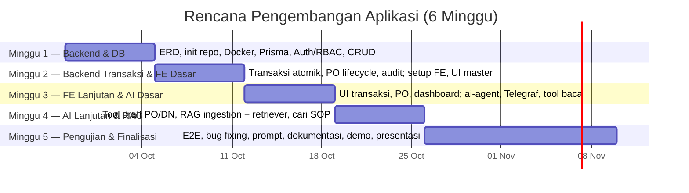
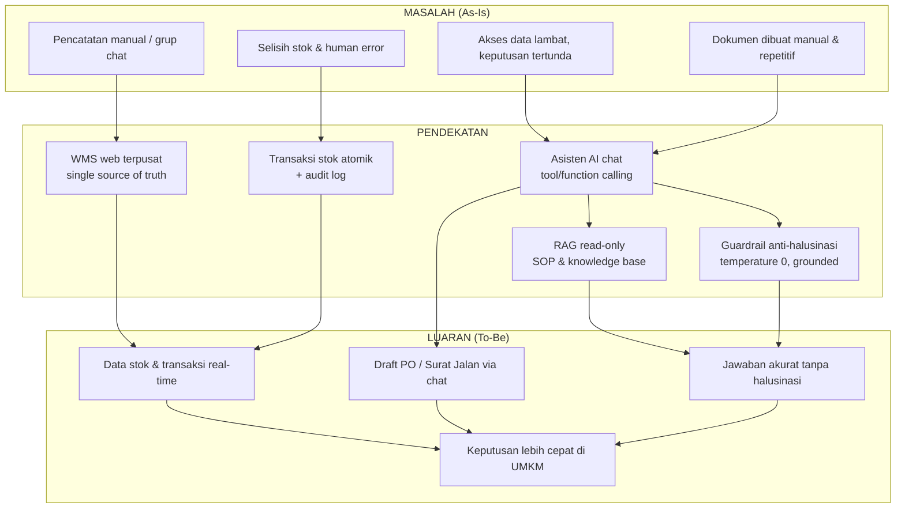
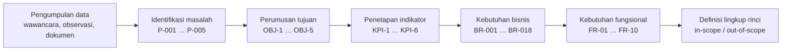
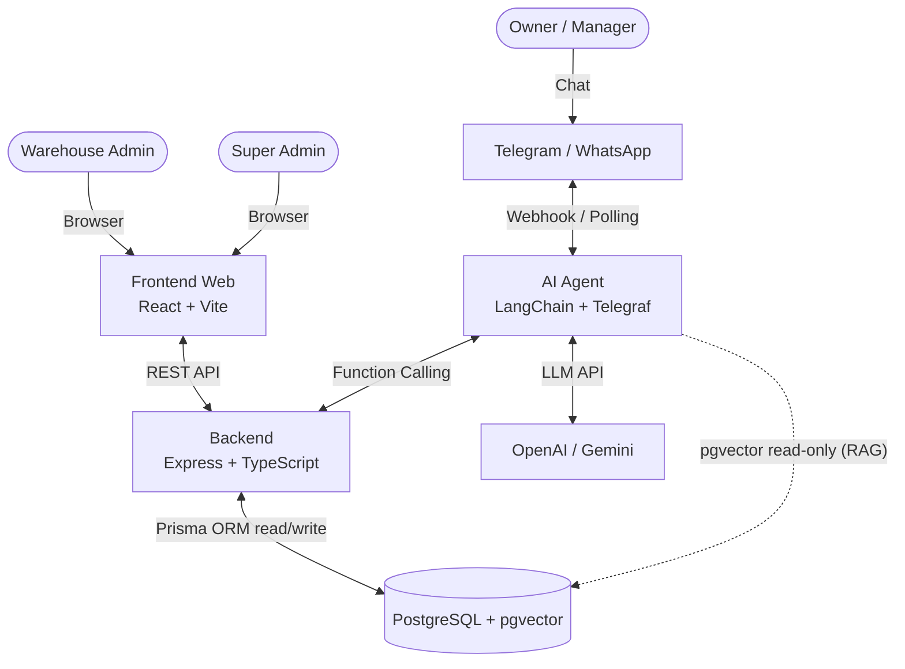
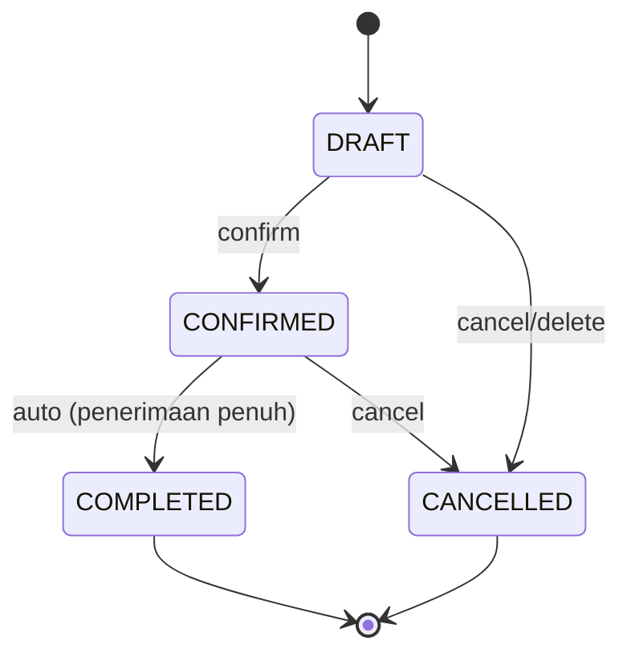
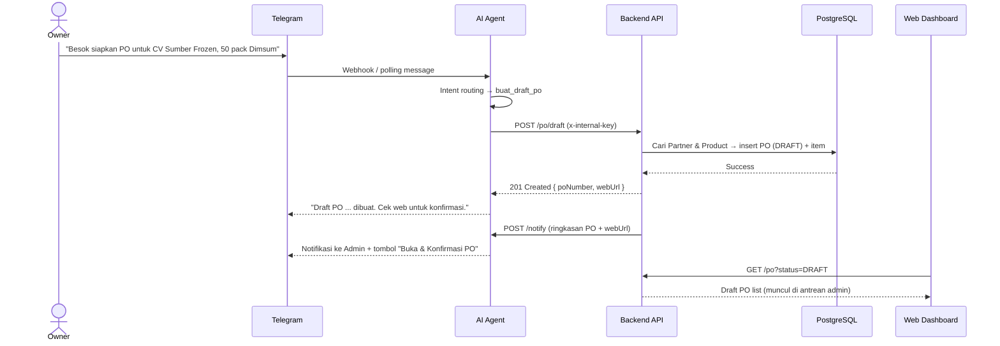
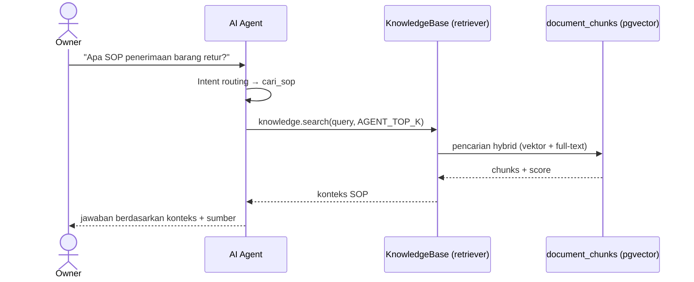

# Sistematika Laporan Kemajuan Capstone Project

**Judul Proyek:** Otomatisasi Warehouse Management System (WMS) dan Tata Kelola Dokumen Berbasis Web dengan Integrasi Asisten AI (RAG) pada Platform Pesan Instan

**Jenis Dokumen:** Laporan Kemajuan Capstone
**Versi:** 1.0.0
**Status:** Draft
**Status Data:** Simulasi (BAB I subbagian 1.1.2 dan 1.1.3 masih memakai data simulasi; lihat catatan pada tiap tabel)
**Penyusun:** [Nama Penyusun]
**Institusi/Program Studi:** [Nama Institusi / Program Studi]
**Pembimbing:** [Nama Pembimbing]
**Tanggal:** [Tanggal]

**Dokumen Terkait:** [Proposal Proyek](./PROPOSAL.md) · [BRD](../docs/BRD.md) · [FSD](../docs/FSD.md) · [ERD](../docs/ERD.md) · [TECHNICAL](../docs/TECHNICAL.md) · [README](../README.md)

---

## Daftar Isi

- [Catatan Pembacaan Dokumen](#catatan-pembacaan-dokumen)
- [I. Pendahuluan](#i-pendahuluan)
  - [1.1 Latar Belakang](#11-latar-belakang)
    - [1.1.1 Identifikasi Masalah](#111-identifikasi-masalah)
    - [1.1.2 Data Kuantitatif Dampak Masalah](#112-data-kuantitatif-dampak-masalah)
    - [1.1.3 Hasil Survei/Wawancara Pendahuluan](#113-hasil-surveiwawancara-pendahuluan)
  - [1.2 Tujuan](#12-tujuan)
  - [1.3 Ruang Lingkup](#13-ruang-lingkup)
  - [1.4 Jadwal Kegiatan](#14-jadwal-kegiatan)
- [II. Tinjauan Pustaka](#ii-tinjauan-pustaka)
- [III. Metodologi](#iii-metodologi)
  - [3.1 Metode Penelitian](#31-metode-penelitian)
  - [3.2 Proses Analisis](#32-proses-analisis)
  - [3.3 Proses Perancangan](#33-proses-perancangan)
  - [3.4 Implementasi](#34-implementasi)
  - [3.5 Pengujian dan Evaluasi](#35-pengujian-dan-evaluasi)
- [IV. Hasil dan Pembahasan](#iv-hasil-dan-pembahasan)
- [V. Kesimpulan dan Rekomendasi](#v-kesimpulan-dan-rekomendasi)
- [Daftar Pustaka](#daftar-pustaka)
- [VI. Lampiran](#vi-lampiran)

---

## Catatan Pembacaan Dokumen

Tiga hal yang perlu diketahui pembaca sebelum menilai isi dokumen ini.

**Pertama, bab yang masih kosong bukan kelalaian.** BAB IV (Hasil dan Pembahasan) dan BAB V (Kesimpulan dan Rekomendasi) sengaja dikosongkan karena hasil akhir dan kesimpulan baru dapat dirumuskan setelah seluruh target pengujian terpenuhi. Keduanya diisi pada tahap laporan akhir.

**Kedua, sebagian data pada BAB I masih simulasi.** Subbagian 1.1.2 dan 1.1.3 memakai angka simulasi. Angka itu disusun agar konsisten dengan baseline KPI pada subbagian 1.2, sehingga penggantian dengan data primer tidak memaksa penulisan ulang. Setiap tabel simulasi diberi label peringatan dan petunjuk cara menggantinya.

**Ketiga, dokumen ini melanjutkan proposal.** Uraian yang sudah lengkap pada `PROPOSAL.md` — daftar pustaka, cuplikan kode, diagram, dan konfigurasi — tidak dikutip ulang seluruhnya; dokumen ini merujuk kembali ke sana. Bagian yang ditambahkan di sini adalah metodologi, data pendukung latar belakang, instrumen survei, dan status realisasi pekerjaan.

**Catatan penomoran.** Proposal memakai nomor sitasi gaya angka (`[1]`–`[8]`). Dokumen ini memakai gaya APA 7 author-date agar sitasi dapat dimasukkan langsung melalui Mendeley Cite di Word. Pemetaan antara kedua gaya tersedia pada `references/PANDUAN-MENDELEY.md`.

---

# I. PENDAHULUAN

## 1.1 Latar Belakang

Usaha Mikro, Kecil, dan Menengah (UMKM) merupakan tulang punggung perekonomian Indonesia, dengan kontribusi terhadap Produk Domestik Bruto nasional dan penyerapan tenaga kerja yang besar. Pada sektor distribusi barang *fast-moving* seperti *frozen food*, perputaran barang masuk dan keluar berlangsung cepat setiap hari. Kondisi ini menuntut ketepatan pencatatan persediaan yang tinggi, karena selisih stok sekecil apa pun akan berakumulasi menjadi kerugian operasional.

Meskipun demikian, praktik pencatatan pada banyak UMKM masih dilakukan secara manual, menggunakan buku catatan, *spreadsheet* sederhana, atau tersebar di grup pesan instan. Pola kerja seperti ini rentan terhadap kesalahan manusia, sulit direkonsiliasi, dan menimbulkan beban administratif yang berulang. Pemilik usaha yang memiliki mobilitas tinggi juga tidak dapat dengan mudah membuka *dashboard* hanya untuk mengecek sisa stok atau status pengiriman. Akibatnya, keputusan bisnis tertunda dan data *real-time* tidak dimanfaatkan secara optimal.

Tantangan adopsi teknologi pada UMKM bukan semata soal ketersediaan perangkat lunak. Sistem ERP/WMS yang canggih sering ditinggalkan karena dianggap terlalu rumit dan menuntut kurva pembelajaran yang tinggi. Tinjauan pustaka sistematis menunjukkan bahwa transformasi digital UMKM di Indonesia memberi manfaat signifikan berupa perluasan pasar, efisiensi operasional, dan peningkatan profitabilitas, namun terhambat oleh keterbatasan sumber daya, keterampilan teknis, serta kebiasaan bisnis yang telah mengakar (Purnomo et al., 2024; Hasanah et al., 2024). Karena itu, dibutuhkan solusi yang menyatukan **data operasional terstruktur** dengan **antarmuka yang sudah familiar** bagi pengguna.

Perkembangan *Large Language Model* (LLM) membuka peluang untuk menjembatani kesenjangan tersebut. Melalui pola *tool/function calling*, model bahasa dapat dipandu untuk mengakses data perusahaan secara terkendali, bukan mengandalkan pengetahuannya sendiri (Schick et al., 2023; Mialon et al., 2023). Dengan arsitektur *Retrieval-Augmented Generation* (RAG), jawaban model dapat dibumikan pada sumber pengetahuan perusahaan sehingga menekan halusinasi (Lewis et al., 2020; Gao et al., 2023). Pendekatan ini memungkinkan pemilik usaha cukup "mengobrol" untuk mengecek stok, merekap pengiriman, hingga membuat draft dokumen, sementara staf tetap bekerja pada *dashboard* web yang komprehensif.

Berdasarkan uraian tersebut, proyek ini membangun **sistem Warehouse Management System (WMS) berbasis web** yang terintegrasi dengan **asisten AI berbasis RAG** melalui platform pesan instan (Telegram, dengan WhatsApp sebagai tahap lanjut). Masalah yang diidentifikasi dan dampaknya dirangkum pada Tabel 1.1.

**Tabel 1.1 — Identifikasi Masalah**

| ID | Masalah | Deskripsi | Dampak Bisnis |
| :--- | :--- | :--- | :--- |
| P-001 | Hambatan akses data | Pemilik harus membuka laptop, login, dan memfilter tabel hanya untuk mengecek stok/status kirim. | Keputusan tertunda; data *real-time* tidak termanfaatkan. |
| P-002 | *Human error* pada volume tinggi | Pencatatan manual/grup chat rentan salah dan sulit direkonsiliasi. | Selisih stok, kehilangan barang, kerugian operasional. |
| P-003 | Keterlambatan keputusan | Tanpa data instan, pemilik ragu menerima pesanan besar. | Kehilangan momentum dan peluang bisnis. |
| P-004 | Beban administratif repetitif | Pembuatan dokumen harian (PO, Surat Jalan) menyita waktu staf. | Produktivitas menurun; biaya tenaga kerja tidak efektif. |
| P-005 | Adopsi teknologi rendah | Sistem ERP/WMS dianggap terlalu rumit bagi pengguna UMKM. | Investasi teknologi tidak menghasilkan ROI. |

**Keterangan:**
- `P-001` … `P-005` = kode masalah (*Problem*) ke-1 sampai ke-5. Penomoran `P-00n` dipakai konsisten pada dokumen ini, pada `PROPOSAL.md`, dan pada `docs/BRD.md`.
- Kolom **Dampak Bisnis** menyatakan akibat yang timbul bila masalah dibiarkan, bukan hasil pengukuran.

**Akar masalah (*root cause*):** kesenjangan antara kompleksitas sistem dan kebiasaan komunikasi alami pengguna. Solusi yang diusulkan adalah menyediakan antarmuka yang familiar (chat) dengan *zero-learning-curve*, namun tetap terhubung ke data operasional yang terstruktur dan tervalidasi.

### 1.1.1 Identifikasi Masalah

Identifikasi masalah pada Tabel 1.1 diturunkan dari empat sumber: tinjauan pustaka (Purnomo et al., 2024; Hasanah et al., 2024), pengamatan proses gudang harian, wawancara pendahuluan dengan calon pengguna (subbagian 1.1.3), dan analisis dokumen operasional. Setiap kode masalah dipetakan ke tujuan proyek pada subbagian 1.2 sehingga tidak ada masalah yang tanpa penanganan, dan tidak ada tujuan yang tanpa dasar masalah.

### 1.1.2 Data Kuantitatif Dampak Masalah

> ⚠️ **DATA SIMULASI.** Angka pada subbagian ini adalah ilustrasi untuk memperlihatkan cara menghitung dampak kuantitatif, bukan data keuangan atau data operasional riil dari UMKM mana pun. Angka wajib diganti dengan hasil pengukuran sebelum dokumen masuk penilaian.

Tabel 1.2 menghitung dampak masalah dengan asumsi yang dinyatakan terbuka, sehingga pembaca dapat menelusuri asal setiap angka dan menggantinya satu per satu.

**Tabel 1.2 — Estimasi Dampak Kuantitatif (Ilustrasi)**

| Metrik | Asumsi | Perhitungan | Hasil (ilustrasi) |
| :--- | :--- | :--- | :--- |
| Waktu pengecekan stok/pengiriman | 6,4 menit/kejadian; 5 kejadian/hari; 26 hari kerja/bulan | 6,4 × 5 × 26 | ± 832 menit/bulan (13,9 jam) |
| Selisih stok saat *stock opname* | 6,8% dari nilai persediaan contoh Rp 250.000.000; opname bulanan | 6,8% × Rp 250.000.000 | ± Rp 17.000.000 per opname |
| Frekuensi selisih stok | Rata-rata wawancara (subbagian 1.1.3) | — | ± 3,4 kali/bulan |
| Waktu pembuatan draft PO | 8,2 menit/PO; 15 PO/bulan | 8,2 × 15 | ± 123 menit/bulan (2,1 jam) |
| Akumulasi waktu administratif | 832 + 123 menit per bulan | (13,87 + 2,05) jam × 12 | ± 191 jam/tahun |
| Estimasi nilai selisih setahun | Batas atas, seluruh selisih diasumsikan terealisasi | Rp 17.000.000 × 12 | ± Rp 204.000.000/tahun |

**Keterangan:**
- Angka pada kolom **Asumsi** diambil dari subbagian 1.1.3 agar kedua subbagian tidak saling bertentangan.
- Baris terakhir adalah **batas atas**; pada praktiknya tidak semua selisih stok berakhir sebagai kerugian nyata. Sebagian dapat dipulihkan melalui rekonsiliasi atau penyesuaian.
- Nilai persediaan Rp 250.000.000 adalah angka contoh yang berdiri sendiri, bukan hasil survei.

**Cara mengganti dengan data riil:** catat (1) nilai persediaan rata-rata dari laporan keuangan UMKM mitra, (2) hasil *stock opname* terakhir berupa persentase selisih, (3) hasil pengukuran waktu untuk pengecekan stok dan pembuatan PO, dan (4) jumlah PO per bulan dari buku atau sistem yang dipakai. Ganti angka pada kolom **Asumsi**, lalu hitung ulang kolom **Hasil**. Bila nilai persediaan belum tersedia, hapus baris estimasi rupiah dan pertahankan baris waktu, karena baris waktu hanya memerlukan pencatatan durasi.

### 1.1.3 Hasil Survei/Wawancara Pendahuluan

> ⚠️ **DATA SIMULASI.** Profil responden dan jawaban pada subbagian ini adalah simulasi untuk memperlihatkan bentuk analisis, bukan hasil wawancara riil. Bagian ini wajib digantikan hasil wawancara atau survei yang benar-benar dijalankan sebelum dokumen dinilai.

Wawancara pendahuluan dirancang untuk mengonfirmasi apakah masalah pada Tabel 1.1 benar dialami calon pengguna, dan seberapa besar dampaknya. Responden adalah pemilik atau pengelola UMKM yang bergerak di distribusi produk *frozen food*. Pedoman wawancara lengkap ada pada **Lampiran G**.

**Tabel 1.3 — Profil Responden (Simulasi, n = 10)**

| Kode | Jenis Usaha | Jumlah SKU | Transaksi/hari | Kanal Pencatatan Saat Ini |
| :--- | :--- | ---: | ---: | :--- |
| R1 | Distributor *frozen food* | 120 | 45 | Buku tulis |
| R2 | Toko *frozen food* | 85 | 30 | Grup pesan instan |
| R3 | Distributor *frozen food* | 160 | 60 | *Spreadsheet* |
| R4 | Toko *frozen food* | 60 | 25 | Buku tulis |
| R5 | Distributor *frozen food* | 200 | 75 | *Spreadsheet* |
| R6 | Toko *frozen food* | 45 | 18 | Grup pesan instan |
| R7 | Agen *frozen food* | 95 | 35 | *Spreadsheet* |
| R8 | Distributor *frozen food* | 140 | 50 | Aplikasi kasir sederhana |
| R9 | Toko *frozen food* | 70 | 28 | Buku tulis |
| R10 | Agen *frozen food* | 110 | 40 | Grup pesan instan |
| **Rata-rata** | — | **± 109** | **± 41** | — |

**Tabel 1.4 — Ringkasan Jawaban Wawancara (Simulasi)**

| Kode | Waktu Cek Stok (menit) | Selisih Stok (%) | Selisih Stok (kali/bulan) | Waktu Buat PO (menit) | Bersedia Pakai Asisten Chat |
| :--- | ---: | ---: | ---: | ---: | :---: |
| R1 | 7,0 | 7,5 | 4 | 9 | Ya |
| R2 | 5,5 | 6,7 | 3 | 7 | Ya |
| R3 | 8,0 | 8,0 | 5 | 10 | Ya |
| R4 | 6,0 | 6,5 | 3 | 9 | Ya |
| R5 | 7,5 | 7,0 | 4 | 9 | Ya |
| R6 | 6,0 | 6,0 | 2 | 7 | Tidak |
| R7 | 6,5 | 6,8 | 3 | 8 | Ya |
| R8 | 4,5 | 5,0 | 2 | 7 | Ya |
| R9 | 6,5 | 6,2 | 3 | 7 | Ya |
| R10 | 6,5 | 8,3 | 5 | 9 | Ya |
| **Rata-rata** | **6,4** | **6,8** | **3,4** | **8,2** | **9 dari 10** |

**Temuan utama (simulasi):**

1. **Kanal pencatatan terbagi tiga.** Tiga responden memakai buku tulis, tiga memakai *spreadsheet*, dan tiga mengandalkan grup pesan instan. Hanya satu responden memakai aplikasi kasir sederhana. Kondisi ini menjelaskan mengapa rekonsiliasi stok sulit dilakukan.
2. **Waktu akses informasi melebihi baseline.** Rata-rata 6,4 menit untuk memperoleh satu informasi stok atau pengiriman, dengan rentang 4,5–8,0 menit. Ini melampaui baseline KPI-1 (> 5 menit).
3. **Selisih stok konsisten di atas ambang.** Rata-rata selisih 6,8%, dengan rentang 5,0–8,3%. Seluruh responden berada di atas baseline KPI-2 (≥ 5%).
4. **Pembuatan dokumen menyita waktu.** Rata-rata 8,2 menit per draft PO, masuk rentang baseline KPI-3 (5–10 menit).
5. **Kesediaan mencoba tinggi.** Sembilan dari sepuluh responden bersedia memakai asisten berbasis chat. Angka ini menunjukkan kesediaan mencoba, bukan tingkat adopsi harian, sehingga tidak dapat dibandingkan langsung dengan target KPI-5.

**Cara mengganti dengan data riil:** jalankan pedoman wawancara pada Lampiran G, catat jumlah responden dan tanggal pelaksanaan, lalu isi ulang Tabel 1.3 dan 1.4. Setelah tabel terisi, perbarui angka pada Tabel 1.2 agar kedua subbagian tetap konsisten, dan sesuaikan baseline KPI pada subbagian 1.2 bila hasil wawancara berbeda.

## 1.2 Tujuan

Tujuan umum proyek ini adalah merancang dan membangun sistem WMS berbasis web yang terintegrasi asisten AI RAG untuk membantu UMKM distribusi *fast-moving goods* mengelola persediaan dan dokumen secara terpusat, akurat, dan mudah diakses. Tujuan khusus dirumuskan pada Tabel 1.5.

**Tabel 1.5 — Tujuan Proyek**

| ID | Tujuan | Masalah yang Disasar |
| :--- | :--- | :--- |
| OBJ-1 | Menyediakan akses data inventori *real-time* kepada pemilik tanpa harus membuka *dashboard* web. | P-001, P-003 |
| OBJ-2 | Mengurangi selisih stok melalui pencatatan transaksi masuk/keluar terpusat dan tervalidasi. | P-002 |
| OBJ-3 | Mempercepat pembuatan dokumen (PO & Surat Jalan) melalui otomatisasi dan eksekusi via chat. | P-004 |
| OBJ-4 | Meningkatkan adopsi teknologi dengan antarmuka chat yang *zero-learning-curve*. | P-005 |
| OBJ-5 | Menyediakan laporan operasional harian yang andal untuk pengambilan keputusan. | P-001, P-003 |

**Keterangan:**
- `OBJ-1` … `OBJ-5` = kode tujuan (*Objective*) ke-1 sampai ke-5. Kode ini dipakai konsisten pada `PROPOSAL.md` dan `docs/BRD.md`.
- Kolom **Masalah yang Disasar** menghubungkan setiap tujuan ke kode masalah pada Tabel 1.1. Satu tujuan dapat menangani lebih dari satu masalah.

**Tabel 1.6 — Indikator Keberhasilan (KPI)**

| ID | Metrik | Baseline | Target |
| :--- | :--- | :--- | :--- |
| KPI-1 | Waktu pemilik memperoleh info stok/pengiriman | > 5 menit (manual) | < 10 detik (chat) |
| KPI-2 | Selisih stok pada *stock opname* | ≥ 5% | ≤ 1% |
| KPI-3 | Waktu pembuatan draft PO | 5–10 menit | < 1 menit (via chat) |
| KPI-4 | Akurasi jawaban AI terhadap data aktual | N/A | 100% (dari basis data, tanpa halusinasi) |
| KPI-5 | Adopsi asisten chat oleh pemilik | 0% | ≥ 70% interaksi harian |
| KPI-6 | Waktu admin mengetahui draft PO baru dari chat | Cek berkala manual | < 10 detik (notifikasi Telegram) |

**Keterangan:**
- `KPI-1` … `KPI-6` = kode *Key Performance Indicator* ke-1 sampai ke-6.
- Kolom **Baseline** menyatakan kondisi sebelum sistem dibangun. Nilai baseline pada KPI-1, KPI-2, dan KPI-3 berasal dari simulasi wawancara pada subbagian 1.1.3 dan wajib diperbarui setelah wawancara riil dijalankan.
- `N/A` pada KPI-4 berarti tidak ada padanan sebelum sistem dibangun, karena pengukuran baru bermakna setelah asisten tersedia.
- KPI-4 dan KPI-5 diukur pada tahap pengujian (subbagian 3.5), bukan pada tahap ini.

**Tabel 1.7 — Keterkaitan Tujuan dan Indikator**

| ID Tujuan | Indikator Penilaian | Cara Pembuktian |
| :--- | :--- | :--- |
| OBJ-1 | KPI-1, KPI-6 | Pengukuran waktu tanggap chat dan waktu tiba notifikasi admin. |
| OBJ-2 | KPI-2 | Perbandingan hasil *stock opname* dengan catatan sistem. |
| OBJ-3 | KPI-3 | Pengukuran waktu dari instruksi chat sampai draft PO tersimpan. |
| OBJ-4 | KPI-5 | Pencatatan interaksi harian pemilik dengan asisten. |
| OBJ-1, OBJ-5 | KPI-4 | Pengujian akurasi jawaban AI terhadap isi basis data. |

**Keterangan:**
- Kolom **Cara Pembuktian** menyatakan bukti yang akan dikumpulkan pada subbagian 3.5. Tabel ini menjadi rujukan saat menyusun skenario pengujian.

## 1.3 Ruang Lingkup

### 1.3.1 Termasuk dalam Ruang Lingkup (In-Scope)

1. **Aplikasi WMS berbasis web (untuk admin gudang):**
   - Manajemen data master: Produk (SKU, unit, kategori, stok minimum), Kategori, Partner (Supplier/Customer), dan Gudang (multi-gudang).
   - Transaksi **barang masuk (inbound)** dan **barang keluar (outbound)** dengan stok dihitung otomatis.
   - Manajemen **Purchase Order (PO)** dengan alur status `DRAFT → CONFIRMED → COMPLETED / CANCELLED` dan penomoran otomatis.
   - Manajemen **Surat Jalan / Delivery Note (DN)** untuk partner `CUSTOMER`, termasuk halaman detail, edit saat `DRAFT`, dan cetak.
   - *Dashboard* dan **laporan/analitik** operasional pada halaman `/reports` dengan enam tab: ringkasan & tren, persediaan, pembelian, pengiriman, mutasi/kartu stok, dan analitik gerak stok.
   - Halaman **Knowledge Base** khusus `SUPER_ADMIN` untuk mengelola dokumen SOP/FAQ/kebijakan, melihat statistik indeks, dan memicu re-ingest.
   - Autentikasi dan kontrol akses berbasis peran: `SUPER_ADMIN`, `ADMIN`, `OWNER`.
   - **Audit log** untuk perubahan data penting.
2. **Asisten AI berbasis chat (untuk Owner/Manager), MVP Telegram:**
   - *Intent* baca: cek stok, katalog/varian produk, kategori, partner, gudang, transaksi masuk/keluar, rekap pengiriman, daftar/detail PO, surat jalan, stok tipis, dan ringkasan *dashboard*.
   - *Intent* tulis terbatas pada pembuatan **draft** PO (partner `SUPPLIER`) dan **draft** Surat Jalan (partner `CUSTOMER`).
   - Tanya SOP/kebijakan internal melalui **RAG** dari *knowledge base*.
   - *Guardrail* anti-halusinasi dan pencatatan percakapan untuk audit.
   - **Notifikasi proaktif (Telegram):** admin gudang menerima notifikasi berisi ringkasan PO dan tautan langsung ke halaman detail saat draft PO dibuat via chat; owner menerima notifikasi saat PO dikonfirmasi/dibatalkan dan saat penerimaan selesai.
3. **Backend REST API terpusat** sebagai satu-satunya penulis data bisnis dan sumber logika bisnis.
4. **Deployment berbasis container** (Docker Compose) yang dapat dijalankan ulang pada Linux/WSL2/VPS.

### 1.3.2 Di Luar Ruang Lingkup (Out-of-Scope)

| Item | Alasan |
| :--- | :--- |
| Modul akuntansi/jurnal keuangan | Fokus pada operasional gudang. |
| *Payroll* & HR | Di luar domain inventori. |
| Multi-tenant SaaS / multi-perusahaan | Diasumsikan satu perusahaan (*single tenant*). |
| Aplikasi *mobile* native (Android/iOS) | Antarmuka *mobile* diwakili oleh chat. |
| Integrasi EDI / *marketplace* / *e-invoice* | Kompleksitas integrasi eksternal di luar cakupan. |
| *Demand forecasting* / ML prediktif | Fitur lanjutan pasca-MVP. |
| WhatsApp sebagai kanal utama | MVP memakai Telegram; WhatsApp menjadi tahap lanjut. |

**Keterangan:**
- Batas ruang lingkup ini menjadi acuan resmi selama pengerjaan. Permintaan di luar daftar ini dicatat sebagai usulan pasca-MVP dan tidak dikerjakan sebelum laporan akhir.

## 1.4 Jadwal Kegiatan

Proyek mengikuti alur **pertemuan awal → diskusi & penyusunan proposal → pengerjaan aplikasi → laporan & presentasi**. Pengembangan aplikasi direncanakan enam minggu (28 September – 9 November 2026) dengan pendekatan sprint mingguan. Prioritas awal diberikan pada unsur kebaruan (*novelty*) berupa integrasi AI RAG, agar risiko keterlambatan dapat dikelola. Jadwal disajikan dalam tiga lapis: milestone proyek (Tabel 1.8), Gantt rencana (Gambar 1.1), dan realisasi per 18 Oktober 2026 (Gambar 1.2 dan Tabel 1.9).

**Tabel 1.8 — Milestone Kegiatan Proyek Capstone**

| Fase | Aktivitas | Periode |
| :--- | :--- | :--- |
| Pertemuan awal (*meeting*) | *Kick-off*, penentuan topik dan kebutuhan | Awal September 2026 |
| Diskusi & Penyusunan Proposal | Diskusi kebutuhan, studi pustaka, penyusunan proposal capstone | 14 September – 12 Oktober 2026 |
| Pengerjaan Aplikasi | Sprint pengembangan WMS + AI RAG | 28 September – 9 November 2026 |
| Laporan Kemajuan | Laporan kemajuan capstone + *timeline* pengembangan aplikasi | 15 – 26 Oktober 2026 |
| Laporan Akhir & Presentasi | Laporan akhir, dokumentasi, demo, dan presentasi | 19 Oktober – 9 November 2026 |

**Gambar 1.1 — Gantt Chart Rencana Pengembangan Aplikasi (6 Minggu)**



**Gambar 1.2 — Gantt Chart Realisasi Pengembangan Aplikasi (per 18 Oktober 2026)**


**Tabel 1.9 — Realisasi Pekerjaan per 18 Oktober 2026**

| Minggu Rencana | Fokus Rencana | Status | Bukti |
| :--- | :--- | :--- | :--- |
| 1 (28 Sep – 4 Okt) | Backend & DB: ERD, repo, Docker, Prisma, Auth/RBAC, CRUD master | Selesai | Commit 22–24 Sep (repo, Docker, WMS+RAG, ERD/BRD/FSD/TECHNICAL) |
| 2 (5 – 11 Okt) | Backend transaksi & FE dasar | Selesai lebih awal | Commit 22–29 Sep (transaksi atomik, PO lifecycle, audit, UI master) |
| 3 (12 – 18 Okt) | FE lanjutan & AI dasar | Selesai lebih awal | Commit 23 Sep – 7 Okt (tool baca, draft PO/DN, dashboard) |
| 4 (19 – 25 Okt) | AI lanjutan & RAG | Selesai lebih awal | Commit 6 Okt (knowledge base, retriever hybrid, cari SOP, ingest jobs) |
| 5 (26 Okt – 9 Nov) | Pengujian & finalisasi | Berjalan | 23 berkas uji tersedia; pengujian E2E dan finalisasi berlangsung |

**Keterangan:**
- **Selesai lebih awal** berarti pekerjaan yang direncanakan pada minggu tersebut telah tuntas sebelum minggu itu dimulai. Implementasi inti aplikasi tuntas pada 7 Oktober 2026, lebih cepat dari rencana.
- Karena implementasi selesai lebih awal, sisa waktu dialokasikan untuk pengujian, penyempurnaan, dan penyusunan laporan. Pada 18 Oktober 2026 jadwal diperluas dari lima menjadi enam minggu agar selaras dengan kalender capstone.
- **Bukti** merujuk riwayat versi repositori, sehingga status pada tabel ini dapat diverifikasi ulang.
- Tanggal realisasi diambil dari riwayat *commit* repositori. Tanggal ini menunjukkan kapan perubahan tercatat, bukan durasi pengerjaan.

---

# II. TINJAUAN PUSTAKA

Bab ini mengulas teori dan penelitian terdahulu yang mendasari perancangan sistem, mencakup manajemen persediaan digital, digitalisasi UMKM, model bahasa, arsitektur RAG, serta pola *tool calling* dan *grounding*. Uraian lengkap beserta kerangka pemikiran tersedia pada `PROPOSAL.md` BAB II; bab ini merangkum pokok-pokok yang langsung memengaruhi keputusan perancangan.

## 2.1 Warehouse Management System dan Manajemen Persediaan

*Warehouse Management System* (WMS) adalah sistem informasi yang mengelola dan mengendalikan seluruh aktivitas gudang, meliputi penerimaan barang, penyimpanan, pengeluaran, hingga pelaporan. Manajemen persediaan mencakup kebijakan penentuan tingkat stok, waktu pemesanan ulang, dan ukuran pesanan, dengan tujuan memenuhi permintaan sekaligus meminimalkan kelebihan atau kekurangan stok.

Pada praktiknya, sistem persediaan digital menonjolkan pemantauan stok secara *real-time*, pengurangan kesalahan pencatatan, serta dukungan pengambilan keputusan berbasis data. Prinsip yang diadopsi pada proyek ini adalah **stok sebagai konsekuensi transaksi**: nilai stok tidak diubah manual, melainkan dihitung dari akumulasi transaksi masuk, keluar, dan penyesuaian. Prinsip ini menjamin konsistensi dan auditabilitas data.

## 2.2 Digitalisasi UMKM di Indonesia

Kajian tinjauan pustaka sistematis terhadap UMKM di Indonesia menunjukkan bahwa transformasi digital berdampak positif pada jangkauan pasar, efisiensi operasional, dan profitabilitas, serta memberi akses informasi *real-time* dan integrasi fungsi bisnis (Purnomo et al., 2024; Hasanah et al., 2024). Adopsi tetap terhambat keterbatasan sumber daya, keterampilan teknis, infrastruktur, dan resistensi terhadap perubahan prosedur lama.

Temuan ini mengindikasikan bahwa solusi bagi UMKM tidak cukup hanya canggih, tetapi juga harus **tepat guna dan berbiaya rendah**. Karena itu proyek ini memilih kanal gratis (Telegram Bot API) untuk MVP dan arsitektur *container* yang ringan, sembari tetap menyediakan integrasi data terpusat yang menjadi keunggulan sistem informasi manajemen berbasis ERP (Hasanah et al., 2024).

## 2.3 Large Language Model dan Arsitektur Transformer

*Large Language Model* (LLM) adalah model bahasa berskala besar yang dilatih pada korpus teks masif dengan arsitektur **Transformer** (Vaswani et al., 2017). Kemampuan *in-context learning* memungkinkan LLM mengikuti instruksi dan mengerjakan tugas baru hanya dari beberapa contoh atau deskripsi tugas, tanpa pelatihan ulang (Brown et al., 2020).

LLM memiliki keterbatasan mendasar: pengetahuan yang tersimpan di dalam parameternya tidak selalu mutakhir, sulit ditelusuri sumbernya, dan cenderung berhalusinasi pada tugas yang membutuhkan fakta spesifik. Keterbatasan inilah yang mendorong pendekatan augmentasi eksternal berupa RAG dan *tool calling*.

## 2.4 Retrieval-Augmented Generation (RAG)

RAG adalah arsitektur yang menggabungkan **memori parametrik** (LLM) dengan **memori non-parametrik** (indeks vektor dokumen eksternal) (Lewis et al., 2020). Pada saat inferensi, kueri pengguna diubah menjadi vektor *embedding*, lalu sistem mengambil *top-K* potongan dokumen yang paling relevan berdasarkan kemiripan vektor. Konteks yang terambil kemudian disertakan dalam prompt agar model membentuk jawaban.

Komponen utama RAG pada proyek ini:

- ***Chunking*** — pemotongan dokumen agar konteks pas untuk model, dengan parameter `CHUNK_SIZE` dan `CHUNK_OVERLAP`.
- ***Embeddings*** — representasi vektor dari teks menggunakan model *embedding* (mis. `text-embedding-3-small`, dimensi 1536).
- **Penyimpanan vektor** — ekstensi `pgvector` pada PostgreSQL untuk pencarian tetangga terdekat dengan operasi *cosine distance* (`<=>`).
- ***Retrieval*** — pengambilan *top-K* potongan relevan sebagai konteks jawaban.

Survei terkini menunjukkan RAG menjadi pendekatan dominan untuk meningkatkan faktualitas dan *provenance* jawaban LLM pada domain pengetahuan spesifik (Gao et al., 2023).

## 2.5 Tool/Function Calling dan Augmented Language Models

*Augmented Language Models* memperkaya LLM dengan kemampuan bernalar serta menggunakan alat eksternal (Mialon et al., 2023). Salah satu bentuknya adalah *tool/function calling*: model memilih fungsi yang tersedia, mengisi parameter sesuai skema, lalu sistem mengeksekusi fungsi tersebut dan mengembalikan hasilnya ke model.

*Toolformer* menunjukkan bahwa LLM dapat memanggil API eksternal dan memanfaatkan hasilnya untuk prediksi token berikutnya (Schick et al., 2023). Pola ini sesuai untuk kasus proyek: alih-alih membiarkan LLM menebak angka stok, model dipandu memanggil *tool* yang membaca data langsung dari Backend API.

Pada proyek ini, *tool* didefinisikan dengan skema parameter (Zod) dan dipisahkan menjadi dua jenis: **tool baca** dan **tool tulis terbatas** (hanya `buat_draft_po` dan `buat_draft_surat_jalan`). LLM tidak menulis SQL langsung untuk data bisnis; seluruh akses data bisnis melalui endpoint backend yang tervalidasi.

## 2.6 Grounding dan Anti-Halusinasi

*Grounding* adalah upaya mengikat jawaban model pada sumber data yang dapat diverifikasi, bukan pada pengetahuan internalnya. Halusinasi ditekan melalui kombinasi strategi berikut:

1. **Tool-only data** — jawaban tentang stok/transaksi hanya berasal dari hasil pemanggilan *tool*.
2. ***Temperature* 0** — mengurangi variasi dan spekulasi keluaran model.
3. **Konteks RAG terbatas** — pertanyaan SOP hanya dijawab dari konteks hasil *retrieval*, dengan menyebut sumber bila tersedia.
4. ***Guardrail system prompt*** — instruksi eksplisit untuk menolak mengarang dan menyatakan ketiadaan data apa adanya.
5. ***Least privilege*** — kredensial basis data untuk *runtime* AI hanya berhak `SELECT` pada tabel vektor, tanpa hak tulis.

## 2.7 Penelitian Terdahulu

Tabel 2.1 merangkum penelitian dan kajian relevan serta posisi proyek ini.

**Tabel 2.1 — Perbandingan dengan Penelitian/Kajian Terdahulu**

| Kajian | Fokus | Kontribusi | Celah yang Diisi Proyek Ini |
| :--- | :--- | :--- | :--- |
| Lewis et al. (2020) | Arsitektur RAG | Memadukan memori parametrik & non-parametrik untuk tugas intensif pengetahuan. | Bersifat metodologis umum; belum diterapkan pada WMS UMKM. |
| Schick et al. (2023) | *Toolformer* | LLM belajar memanggil API eksternal. | Belum membahas tata kelola akses data perusahaan (RBAC, *read-only*). |
| Mialon et al. (2023) | Survei ALM | Peta riset augmentasi LLM dengan *tools*. | Konseptual; bukan implementasi sistem informasi. |
| Purnomo et al. (2024) | Digitalisasi UMKM Indonesia | Manfaat & hambatan transformasi digital UMKM. | Tidak menyentuh asisten AI berbasis chat maupun WMS. |
| Hasanah et al. (2024) | ERP untuk UMKM | Integrasi proses bisnis & akses data *real-time*. | Sistem ERP tergolong berat/mahal untuk UMKM mikro. |

**Keterangan:**
- Kolom **Celah yang Diisi Proyek Ini** menyatakan posisi proyek terhadap kajian tersebut, bukan klaim bahwa celah itu belum pernah diteliti sama sekali.
- Rincian rujukan lengkap tersedia pada **Daftar Pustaka**.

**Kebaruan (*novelty*) proyek** terletak pada penggabungan tiga elemen dalam satu sistem yang dapat dijalankan mandiri oleh UMKM: (1) WMS web terpusat sebagai sumber kebenaran data, (2) asisten AI berbasis chat dengan *tool calling* ke API backend, dan (3) RAG *read-only* untuk menjawab SOP/kebijakan. Kombinasi ini menyediakan antarmuka *zero-learning-curve* tanpa mengorbankan integritas dan auditabilitas data operasional.

## 2.8 Kerangka Pemikiran

Gambar 2.1 menggambarkan alur pemikiran dari masalah hingga luaran yang diharapkan.

**Gambar 2.1 — Kerangka Pemikiran**



**Keterangan:**
- Gambar ini identik dengan Gambar 2.1 pada `PROPOSAL.md` agar rujukan antara kedua dokumen tetap konsisten.

---

# III. METODOLOGI

Bab ini menjelaskan cara pekerjaan dilakukan: metode penelitian, proses analisis kebutuhan, proses perancangan, langkah implementasi, serta pengujian dan evaluasi. Uraian disusun mengikuti urutan pengerjaan yang sesungguhnya, sehingga pembaca dapat menelusuri bagaimana masalah pada BAB I berubah menjadi solusi yang dijelaskan pada subbagian 3.4.

## 3.1 Metode Penelitian

### 3.1.1 Pendekatan dan Model Proses

Proyek ini adalah penelitian pengembangan perangkat lunak (R&D) dengan pendekatan *incremental*. Setiap penambahan kemampuan dirancang, dibangun, dan diuji dalam satu siklus pendek, lalu hasilnya menjadi dasar siklus berikutnya. Model prosesnya adalah Agile versi ringkas yang dijalankan sembilan sprint mingguan setara lima fase pada Tabel 1.8. Pemilihan model ini didasari dua pertimbangan:

1. **Kebutuhan belum sepenuhnya pasti di awal.** Calon pengguna UMKM belum memiliki pengalaman dengan asisten AI, sehingga sebagian kebutuhan baru muncul setelah prototipe dapat dicoba.
2. **Risiko teknis terkonsentrasi pada satu bagian.** Unsur kebaruan berupa integrasi AI RAG memiliki ketidakpastian paling tinggi, sehingga dikerjakan lebih awal agar bila gagal, ruang lingkup dapat disesuaikan.

Setiap fase menghasilkan luaran yang dapat diperiksa: analisis kebutuhan, dokumen perancangan, kode teruji, dan hasil pengujian.

### 3.1.2 Teknik Pengumpulan Data

Data dikumpulkan dengan empat teknik yang saling melengkapi.

| Teknik | Sasaran | Hasil yang Diharapkan | Instrumen |
| :--- | :--- | :--- | :--- |
| Studi pustaka | Dasar teori dan posisi terhadap penelitian sebelumnya | Kerangka konsep, kebaruan, rujukan | Basis data akademik, arXiv, DOI |
| Wawancara semi-terstruktur | Pemilik/pengelola UMKM *frozen food* | Konfirmasi masalah, baseline metrik, preferensi antarmuka | Pedoman wawancara (Lampiran G) |
| Observasi proses | Alur kerja gudang harian | Pemetaan proses as-is, titik rawan kesalahan | Lembar observasi |
| Analisis dokumen | SOP, format PO, format Surat Jalan, catatan stok | Aturan bisnis, format keluaran, kamus istilah | Dokumen operasional UMKM |

**Keterangan:** saat dokumen ini disusun, pelaksanaan wawancara dan observasi masih pada tahap persiapan. Karena itu subbagian 1.1.3 masih memuat data simulasi, dan pedoman wawancara pada Lampiran G disertakan agar pengumpulan data dapat segera dijalankan.

### 3.1.3 Jenis dan Sumber Data

- **Data primer:** hasil wawancara dengan pemilik/pengelola UMKM, hasil observasi alur kerja gudang, dan pengukuran waktu pada saat uji coba sistem.
- **Data sekunder:** literatur ilmiah, dokumentasi resmi perangkat (PostgreSQL, Docker, LangChain, Telegram Bot API), serta dokumen operasional UMKM mitra.

### 3.1.4 Teknik Analisis Data

Data kualitatif dianalisis secara tematik sederhana: jawaban wawancara dikelompokkan menurut kemiripan tema, lalu setiap tema dinilai apakah dapat dipetakan ke salah satu masalah pada Tabel 1.1. Tema yang tidak dapat dipetakan dicatat sebagai temuan tambahan dan tidak dipaksakan masuk ke daftar masalah. Data kuantitatif hasil wawancara diolah menjadi rata-rata dan rentang, lalu dipakai sebagai baseline KPI pada Tabel 1.6.

### 3.1.5 Batasan Metodologis

Empat batasan berikut perlu dinyatakan terbuka agar penilaian hasil dapat dilakukan secara wajar:

1. Pengembangan dilakukan oleh satu orang dalam waktu terbatas, sehingga tidak ada pengujian bebas (independen) oleh pihak kedua.
2. Jumlah responden wawancara direncanakan kecil (sekitar 10 UMKM), sehingga hasilnya bersifat indikatif, bukan generalisasi statistik.
3. Pengukuran dampak (KPI-2 dan KPI-5) menuntut periode pemakaian nyata yang lebih panjang daripada durasi capstone; pada tahap ini pengukuran hanya dapat dilakukan secara terbatas pada lingkungan uji.
4. Perbandingan sebelum-sesudah untuk KPI-2 bergantung pada kedisiplinan pencatatan *stock opname* pada UMKM mitra, yang tidak sepenuhnya dapat dikendalikan.

## 3.2 Proses Analisis

### 3.2.1 Alur Analisis

Analisis dijalankan berurutan, dengan setiap langkah menghasilkan artefak yang menjadi masukan langkah berikutnya.

**Gambar 3.1 — Alur Analisis Kebutuhan**



### 3.2.2 Penelusuran Kebutuhan

Setiap masalah ditelusuri sampai ke kebutuhan fungsional, sehingga dapat dipastikan tidak ada kebutuhan yang tanpa dasar masalah. Tabel 3.1 merangkum penelusuran tersebut; kolom terakhir menyatakan di bagian mana kebutuhan itu dibuktikan pada tahap pengujian.

**Tabel 3.1 — Penelusuran Masalah ke Kebutuhan dan Pengujian**

| Masalah | Tujuan | Indikator | Kebutuhan Bisnis | Kebutuhan Fungsional | Bukti Uji |
| :--- | :--- | :--- | :--- | :--- | :--- |
| P-001 | OBJ-1 | KPI-1, KPI-6 | BR-006, BR-014 | FR-08 | AC-06, AC-18 |
| P-002 | OBJ-2 | KPI-2 | BR-002, BR-003 | FR-04, FR-05 | AC-04, AC-05, AC-21 |
| P-003 | OBJ-1, OBJ-5 | KPI-1, KPI-3 | BR-006, BR-009 | FR-08, FR-09 | AC-06, AC-07, AC-20 |
| P-004 | OBJ-3 | KPI-3 | BR-004, BR-005, BR-008 | FR-06, FR-07 | AC-07, AC-08, AC-14 |
| P-005 | OBJ-4 | KPI-5 | BR-006, BR-007 | FR-08 | AC-10, AC-11 |

**Keterangan:**
- Kode `BR-00n` adalah kebutuhan bisnis (*Business Requirement*) pada `docs/BRD.md`; kode `FR-0n` adalah kebutuhan fungsional (*Functional Requirement*) pada `docs/FSD.md`.
- Kode `AC-0n` adalah skenario pengujian pada Tabel 3.5 dan Lampiran C.
- Sel yang memuat lebih dari satu kode berarti kebutuhan itu melayani beberapa masalah sekaligus.

### 3.2.3 Pemetaan Proses

Proses bisnis dipetakan dalam dua keadaan: **as-is** untuk memahami titik masalah, dan **to-be** untuk merumuskan perbaikan. Pada kondisi as-is, pencatatan dilakukan manual atau melalui grup chat, lalu direkap kemudian; akibatnya informasi terlambat dan rawan salah. Pada kondisi to-be, pencatatan dilakukan sekali di aplikasi web, basis data menjadi rujukan tunggal, dan pemilik mengaksesnya melalui chat. Pemetaan lengkap ada pada `docs/BRD.md` §7.

### 3.2.4 Alat Analisis

Alat yang dipakai pada tahap analisis adalah diagram alir Mermaid untuk pemetaan proses, matriks penelusuran (Tabel 3.1) untuk memastikan keterhubungan kebutuhan, dan lembar observasi untuk mencatat alur kerja nyata. Pemilihan Mermaid dilakukan karena diagram tersimpan sebagai teks di dalam repositori, sehingga ikut terkendali versinya bersama kode dan dokumen lain.

## 3.3 Proses Perancangan

Perancangan dibagi menjadi enam bagian yang dikerjakan berurutan: arsitektur, data, perilaku sistem, antarmuka, kecerdasan buatan, dan keamanan.

### 3.3.1 Perancangan Arsitektur

Sistem dirancang sebagai empat layanan terpisah yang berjalan dalam satu jaringan *container*.

**Gambar 3.2 — Arsitektur Sistem**



Dua prinsip arsitektur yang mengikat seluruh keputusan berikutnya:

1. **Backend adalah satu-satunya penulis data bisnis.** Tidak ada layanan lain yang menulis tabel bisnis secara langsung. Dengan cara ini validasi dan aturan bisnis hanya berada pada satu tempat.
2. ***Least privilege* pada akses data.** AI Agent mengakses data bisnis melalui API backend, dan mendapat hak *read-only* pada tabel vektor.

### 3.3.2 Perancangan Struktur Kode

Kode pada `backend` dan `ai-agent` disusun dengan arsitektur berlapis: **Presentasi** (rute, pengendali, handler pesan), **Bisnis** (aturan dan alur kerja), dan **Persistensi** (akses data serta adapter keluar). Setiap ketergantungan keluar (basis data, Backend API, Telegram, layanan *embedding*) disembunyikan di balik *port* dan diimplementasikan sebagai adapter, lalu dirakit pada satu berkas komposisi. Arah ketergantungan ditegakkan aturan lint, sehingga lapisan bisnis tidak bergantung pada HTTP maupun ORM. Struktur ini dipilih agar logika bisnis dapat diuji tanpa menyalakan layanan eksternal.

### 3.3.3 Perancangan Data

Model data dirancang sebagai relasi relasional yang dinormalisasi, dengan beberapa keputusan penting:

- **Stok sebagai konsekuensi transaksi.** Nilai `Product.stock` tidak diubah manual; nilainya dihitung dari transaksi masuk, keluar, dan penyesuaian.
- **Kartu stok per gudang.** Tabel inventori menyimpan jumlah per kombinasi produk dan gudang, sehingga satu produk dapat tersebar di beberapa gudang.
- **Nomor dokumen berformat.** Nomor PO berformat `PO-YYYYMM-NNN` dan Surat Jalan `SJ-YYYYMM-NNN`, dengan penghitungan urutan dilakukan di dalam transaksi agar tidak terjadi duplikasi.
- **Riwayat percakapan AI** disimpan terpisah untuk keperluan audit dan evaluasi.

Skema lengkap dan diagram relasi tersedia pada `docs/ERD.md`.

### 3.3.4 Perancangan Perilaku Sistem

Perilaku dokumen dimodelkan sebagai mesin keadaan agar transisi status tidak ambigu. Purchase Order memiliki empat status dengan aturan transisi tegas: hanya `DRAFT` yang dapat diubah atau dihapus, `CONFIRMED` dapat dibatalkan, dan `COMPLETED` tercapai otomatis saat seluruh item diterima. Aturan ini mencegah dokumen yang sudah berjalan diubah kembali tanpa jejak.

**Gambar 3.3 — State Machine Purchase Order**



Dua alur interaksi lintas layanan juga dirancang sejak awal: alur pembuatan draft PO dari chat (Gambar 3.4) dan alur penjawaban SOP melalui RAG (Gambar 3.5). Keduanya menjadi acuan saat menulis skenario pengujian.

**Gambar 3.4 — Alur Buat Draft PO via Chat**



**Gambar 3.5 — Alur Jawab SOP via RAG (Read-Only)**



### 3.3.5 Perancangan Antarmuka

Antarmuka dirancang terpisah menurut peran. Admin gudang memakai *dashboard* web dengan halaman untuk setiap entitas: data master, transaksi, Purchase Order, Surat Jalan, laporan, dan Knowledge Base. Owner tidak memerlukan halaman khusus karena seluruh interaksinya berlangsung melalui chat. Pemisahan ini merupakan keputusan utama pada subbagian ini: alih-alih memaksa owner mempelajari *dashboard*, sistem membawa informasi ke kanal yang sudah dipakai owner sehari-hari.

### 3.3.6 Perancangan Kecerdasan Buatan

Perancangan AI agent menetapkan tiga hal.

- **Pembagian tool.** Tool dipisah menjadi tool baca dan tool tulis terbatas. Tool tulis tidak pernah menetapkan status akhir dokumen; draft PO dan draft Surat Jalan selalu berstatus `DRAFT` dan menunggu konfirmasi admin di web.
- **Penanganan nama ambigu.** Pencarian produk memakai normalisasi nama dan kecocokan token, sehingga penulisan tidak baku tetap dikenali. Bila satu nama cocok ke beberapa varian, tool mengembalikan daftar kandidat dan model diminta meminta klarifikasi, bukan memilih satu secara diam-diam.
- **Pipeline RAG.** Dokumen knowledge dikelola dari halaman web khusus `SUPER_ADMIN`, disimpan pada tabel `knowledge_documents` sebagai sumber kebenaran, lalu dipecah dan di-*embed* ke tabel `document_chunks`. Pencarian dilakukan secara *hybrid* — menggabungkan peringkat vektor dan pencarian teks penuh — dengan ambang skor minimum untuk membuang potongan yang tidak relevan.

Data transaksional tidak di-*embed*; hanya dokumen SOP, kebijakan, panduan, FAQ, dan sejenisnya. Kamus produk dan laporan periode diambil langsung dari API, sehingga angkanya selalu mutakhir.

### 3.3.7 Perancangan Keamanan

Kontrol akses dirancang pada empat lapis: autentikasi pengguna web dengan token akses berumur pendek dan token pembaruan, pembatasan rute berdasarkan peran, kunci internal untuk komunikasi antar layanan, dan hak baca saja untuk AI Agent pada tabel vektor. Selain itu, dokumen knowledge bertipe sensitif hanya dapat diakses peran tertentu, dengan peran diteruskan dari lapisan pesan sampai ke pembentukan tool.

## 3.4 Implementasi

### 3.4.1 Lingkungan dan Perkakas

Seluruh layanan berjalan di dalam Docker, sehingga versi *runtime* seragam dan Node.js tidak perlu dipasang di mesin pengembang. Tabel 3.2 merangkum teknologi yang dipakai.

**Tabel 3.2 — Teknologi yang Digunakan**

| Lapisan | Teknologi |
| :--- | :--- |
| Frontend | React (Vite), TypeScript, Tailwind CSS, TanStack Query |
| Backend | Node.js (Express), TypeScript, Prisma ORM, Zod |
| AI Agent | Node.js, TypeScript, LangChain.js, Telegraf |
| Basis data | PostgreSQL + ekstensi `pgvector` |
| Model bahasa | OpenAI (`gpt-4o-mini`) dan `text-embedding-3-small` |
| Infrastruktur | Docker, Docker Compose |

**Keterangan:** model dan versi dicatat sebagai konfigurasi, bukan bagian tetap sistem. Nilai sebenarnya dibaca dari variabel lingkungan (Lampiran F.4), sehingga penggantian model tidak menuntut perubahan kode.

### 3.4.2 Modul yang Diimplementasikan

| Layanan | Modul/Fitur | Keterangan |
| :--- | :--- | :--- |
| Backend | `auth`, `users`, `categories`, `products`, `partners`, `warehouses` | Autentikasi, RBAC, dan data master. |
| Backend | `transactions`, `purchase-orders`, `delivery-notes` | Transaksi stok atomik dan dokumen bisnis. |
| Backend | `reports`, `knowledge`, `audit-logs`, `internal` | Laporan agregat, knowledge base, audit, dan endpoint internal. |
| Frontend | `auth`, `dashboard`, `categories`, `products`, `partners`, `warehouses` | Halaman masuk dan data master. |
| Frontend | `transactions`, `purchase-orders`, `delivery-notes`, `reports`, `knowledge`, `audit-logs`, `users` | Halaman operasional dan administrasi. |
| AI Agent | `application/agent`, `application/tools`, `application/chat` | Perakitan agent, definisi tool, dan penanganan pesan. |
| AI Agent | `infrastructure/backend`, `infrastructure/rag`, `infrastructure/telegram` | Adapter ke Backend API, RAG, dan Telegram. |

**Keterangan:** daftar ini bersumber dari struktur direktori repositori pada saat dokumen disusun.

### 3.4.3 Implementasi Transaksi Stok

Inti perubahan stok adalah satu fungsi yang **wajib** dijalankan di dalam transaksi basis data. Di dalamnya, sistem memeriksa keberadaan produk dan gudang, menghitung selisih stok, menolak transaksi keluar yang melebihi stok tersedia, membuat catatan transaksi, menyesuaikan stok produk, dan memperbarui jumlah per gudang — semuanya dalam satu satuan kerja yang tak terpisah. Bila salah satu langkah gagal, tidak ada perubahan yang tersisa. Cuplikan kode tersedia pada `PROPOSAL.md` Lampiran A.1.

### 3.4.4 Implementasi Penomoran Dokumen

Logika format nomor dipisahkan ke lapisan domain sebagai fungsi murni tanpa akses basis data, sedangkan penghitungan urutan dilakukan di dalam transaksi. Pemisahan ini membuat format nomor dapat diuji tanpa basis data, sementara keunikan nomor tetap terjaga saat beberapa permintaan datang bersamaan. Cuplikan kode tersedia pada `PROPOSAL.md` Lampiran A.2.

### 3.4.5 Implementasi Asisten AI

Agent dirakit ulang untuk setiap pesan masuk, agar identitas percakapan dapat disertakan pada setiap panggilan dan jejak audit tetap utuh. Agent dibatasi jumlah langkahnya, dibangun dengan *temperature* 0, dan menerima daftar tool yang dibentuk sesuai peran pengirim pesan. Tabel 3.3 merangkum tool yang tersedia.

**Tabel 3.3 — Daftar Tool Asisten AI**

| Kategori | Nama Tool | Fungsi |
| :--- | :--- | :--- |
| Baca | `cek_stok_barang` | Cek stok satu produk berdasarkan nama; bila nama ambigu, menampilkan kandidat varian beserta stoknya. |
| Baca | `cari_produk` | Katalog/varian produk (SKU, kategori, stok). |
| Baca | `list_kategori`, `list_partner`, `list_gudang` | Daftar data master. |
| Baca | `stok_per_gudang` | Rincian stok per produk/gudang. |
| Baca | `list_transaksi` | Transaksi masuk/keluar/penyesuaian dengan filter. |
| Baca | `rekap_pengiriman` | Rekap barang keluar pada satu tanggal. |
| Baca | `list_po`, `list_po_status`, `detail_po` | Daftar dan detail Purchase Order. |
| Baca | `list_surat_jalan` | Daftar Surat Jalan. |
| Baca | `stok_tipis`, `ringkasan_dashboard` | Peringatan stok minimum dan ringkasan operasional. |
| Baca | `ringkasan_periode` | Ringkasan dan tren operasional pada satu periode. |
| Tulis | `buat_draft_po` | Membuat draft PO untuk partner `SUPPLIER`. |
| Tulis | `buat_draft_surat_jalan` | Membuat draft Surat Jalan untuk partner `CUSTOMER`. |
| RAG | `cari_sop` | Pengambilan SOP dan kebijakan dari `document_chunks`, dengan filter jenis dokumen. |

**Keterangan:** tool bertanda **Tulis** hanya membuat dokumen berstatus `DRAFT`; status akhir tetap ditentukan admin di aplikasi web.

### 3.4.6 Implementasi Pipeline RAG

Pipeline dijalankan dalam dua tahap. Tahap *ingest* membaca dokumen aktif, memotong teks dengan memperhatikan struktur markdown, menyisipkan judul, menghasilkan *embedding*, lalu menulis hasilnya ke tabel potongan dokumen di dalam satu transaksi. Tahap ini idempoten: dokumen yang isinya tidak berubah dilewati, sehingga ingest ulang tidak membuang waktu. Setiap eksekusi dipersist ke tabel `ingest_jobs`, dan statusnya dipulihkan saat layanan dinyalakan ulang, sehingga tab Index dan tab Ingest selalu menampilkan status yang sama.

Tahap *retrieval* menjalankan pencarian hybrid dan menyaring hasil dengan ambang skor. Kegagalan basis data atau layanan *embedding* ditangani dengan degradasi anggun, bukan kegagalan total. Karena ingesti kini bersumber dari tabel `knowledge_documents`, cuplikan kode pada `PROPOSAL.md` Lampiran A.3 menggambarkan rancangan awal; implementasi akhir dijelaskan pada `PROPOSAL.md` Lampiran C.

### 3.4.7 Implementasi Pelaporan

Halaman laporan awalnya hanya menampilkan stok dan rekap pengiriman harian. Cakupannya diperluas menjadi enam tab: ringkasan dan tren, persediaan, pembelian, pengiriman, mutasi/kartu stok, dan analitik gerak stok. Setiap tab memiliki filter periode dan dapat diekspor ke CSV. Perluasan ini penting bagi proyek karena menjawab OBJ-5, sekaligus menyediakan data historis yang dikonsumsi asisten melalui tool `ringkasan_periode`.

### 3.4.8 Implementasi Notifikasi Telegram

Notifikasi dijalankan sebagai panggilan *best-effort* dengan batas waktu lima detik: backend memanggil endpoint notifikasi pada AI Agent, yang lalu mengirim pesan ke admin beserta tombol menuju halaman detail PO. Karena sifatnya *best-effort*, kegagalan notifikasi tidak menggagalkan transaksi bisnis. Keputusan ini diambil agar gangguan pada kanal chat tidak menghambat pekerjaan gudang.

### 3.4.9 Ringkasan Realisasi

Tabel 3.4 memetakan aktivitas implementasi ke tanggal pengerjaannya.

**Tabel 3.4 — Realisasi Implementasi (Ringkas)**

| Tanggal | Aktivitas | Luaran |
| :--- | :--- | :--- |
| 22 Sep 2026 | Penyiapan repositori dan dokumen; implementasi awal WMS, frontend, dan AI Agent; Docker dengan *hot reload* | Kerangka sistem berjalan dalam satu perintah |
| 23–24 Sep 2026 | Penyempurnaan antarmuka; halaman detail/edit/cetak Surat Jalan; perluasan akses baca AI; dukungan model penalaran | Fitur operasional harian tersedia |
| 25 Sep 2026 | Mode produksi dengan Nginx; filter transaksi; kandidat varian produk; penyusunan proposal | Sistem dapat dijalankan dalam mode produksi |
| 29 Sep 2026 | Notifikasi Telegram untuk siklus PO | Admin dan owner menerima kabar perubahan status |
| 2 Okt 2026 | Penerapan arsitektur berlapis pada backend dan AI Agent | Batas lapisan ditegakkan aturan lint |
| 6 Okt 2026 | Knowledge base terkelola, retriever hybrid, ingest otomatis, persistensi job ingest, halaman laporan enam tab | Fitur RAG dan pelaporan lengkap |
| 7 Okt 2026 | Perbaikan keterbacaan balasan daftar data | Kualitas keluaran chat meningkat |
| 18 Okt 2026 | Penyesuaian jadwal proyek dari lima menjadi enam minggu | Jadwal selaras kalender capstone |

**Keterangan:** tanggal diambil dari riwayat versi repositori dan dapat diverifikasi ulang. Implementasi inti tuntas pada 7 Oktober 2026, lebih cepat dari rencana pada Tabel 1.8.

## 3.5 Pengujian dan Evaluasi

### 3.5.1 Strategi Pengujian

Pengujian dilakukan pada tiga tingkat, dari yang paling terisolasi sampai yang paling menyerupai pemakaian nyata.

| Tingkat | Sasaran | Perkakas |
| :--- | :--- | :--- |
| Unit | Fungsi murni dan logika bisnis tanpa basis data | Vitest |
| Integrasi | Rute API beserta basis data dan aturan akses | Vitest, Supertest |
| End-to-end (E2E) | Alur lengkap chat → dokumen → web | Uji manual terstruktur; Playwright opsional |
| Antarmuka | Komponen dan halaman React | Vitest + Testing Library |

**Keterangan:** pengujian dijalankan melalui target Makefile (`make test`, `make lint`, `make typecheck`) agar lingkungannya sama dengan lingkungan pengembangan.

### 3.5.2 Cakupan Pengujian yang Telah Tersedia

Saat dokumen ini disusun, repositori memuat 23 berkas pengujian.

**Tabel 3.5 — Sebaran Berkas Pengujian**

| Layanan | Jenis | Berkas Uji |
| :--- | :--- | :--- |
| AI Agent | Unit | `bot`, `format`, `ingest`, `ingestJob`, `messenger`, `notifier`, `retriever`, `tools` (8) |
| Backend | Integrasi | `auth`, `delivery-notes`, `knowledge`, `purchase-orders`, `reports`, `transactions` (6) |
| Backend | Unit | `knowledge.service`, `notify`, `numbering`, `pagination`, `po-state`, `product-resolver` (6) |
| Frontend | Komponen | `LoginPage`, `DeliveryNoteDetailPage`, `format` (3) |

**Keterangan:** jumlah berkas menunjukkan cakupan yang tersedia, bukan tingkat kelulusan. Tingkat kelulusan dilaporkan pada laporan akhir setelah seluruh berkas dijalankan.

### 3.5.3 Skenario Pengujian Penerimaan

Skenario berikut diturunkan dari kebutuhan fungsional dan dipakai untuk menilai kesiapan sistem. Kolom **Hasil Aktual** dan **Status** diisi saat pengujian dijalankan, sehingga tabel ini berfungsi sebagai lembar kerja sekaligus laporan hasil.

**Tabel 3.6 — Skenario Pengujian Penerimaan**

| ID | Skenario | Hasil yang Diharapkan | Hasil Aktual | Status |
| :--- | :--- | :--- | :--- | :--- |
| AC-01 | Login sukses | Redirect ke *dashboard*, token tersimpan. | | |
| AC-02 | RBAC menolak akses | Admin mengakses `/users` → `403 FORBIDDEN`. | | |
| AC-03 | Pembuatan produk | Produk muncul di daftar; audit log tercatat. | | |
| AC-04 | Barang masuk menambah stok | `Product.stock` bertambah sesuai kuantitas. | | |
| AC-05 | Barang keluar melebihi stok ditolak | Balasan `409 INSUFFICIENT_STOCK`. | | |
| AC-06 | AI mengecek stok secara akurat | Angka sama persis dengan basis data. | | |
| AC-07 | AI membuat draft PO | PO berstatus `DRAFT` muncul di antrean admin. | | |
| AC-08 | PO dari chat tidak langsung `CONFIRMED` | Status tetap `DRAFT` hingga admin mengonfirmasi. | | |
| AC-09 | Konfirmasi PO | Status menjadi `CONFIRMED`; hanya valid dari `DRAFT`. | | |
| AC-10 | Permintaan di luar cakupan ditangani | AI menolak dengan sopan dan menawarkan kemampuan yang ada. | | |
| AC-11 | Produk tidak ditemukan via chat | AI meminta klarifikasi, tidak mengarang. | | |
| AC-12 | Penghapusan PO draft berantai | Item ikut terhapus; basis data bersih. | | |
| AC-13 | Penyegaran TanStack Query | Tabel ter-*update* tanpa muat ulang manual. | | |
| AC-14 | Surat Jalan untuk customer | Surat Jalan terbentuk tanpa PO; partner non-customer ditolak. | | |
| AC-15 | AI menjawab SOP via RAG | Jawaban sesuai konteks SOP dan menyebut sumber. | | |
| AC-16 | RAG anti-halusinasi | AI menyatakan SOP tidak ditemukan, tidak mengarang. | | |
| AC-17 | AI Agent *read-only* pada basis data | Upaya tulis ke tabel vektor ditolak. | | |
| AC-18 | Notifikasi admin saat draft PO dari AI | Admin menerima pesan ringkasan PO dan tombol menuju halaman detail. | | |
| AC-19 | Notifikasi owner saat status PO berubah | Owner menerima notifikasi saat `CONFIRMED` dan saat `COMPLETED`. | | |
| AC-20 | Laporan enam tab | Data dan grafik tampil; filter periode berfungsi; ekspor CSV tersedia. | | |
| AC-21 | Kartu stok saldo berjalan | `saldo akhir = saldo awal + Σ mutasi`; konsisten dengan `Product.stock`. | | |
| AC-22 | Status ingest bertahan setelah restart | Status dan waktu selesai tetap tampil setelah AI Agent dinyalakan ulang. | | |

**Keterangan:**
- Kode `AC-0n` sama dengan yang dipakai pada `PROPOSAL.md` Lampiran C dan Tabel 3.1, sehingga hasil pengujian dapat dirujuk dari mana saja.
- Kolom **Hasil Aktual** diisi dengan nilai terukur, misalnya durasi dalam detik, bukan kata seperti "berhasil". Nilai terukur inilah yang dipakai menilai KPI.

### 3.5.4 Prosedur Uji End-to-End

Uji E2E dijalankan mengikuti urutan berikut, dan setiap langkah dicatat waktunya.

1. Nyalakan seluruh layanan, isi data awal, lalu bangun indeks knowledge (`make dev`, `make seed`, `make rag-ingest`).
2. Kirim pertanyaan stok melalui bot, catat balasan dan waktunya, lalu bandingkan dengan halaman produk.
3. Kirim perintah pembuatan PO melalui chat, catat nomor draft yang terbentuk.
4. Periksa daftar PO berstatus `DRAFT` pada aplikasi web.
5. Konfirmasi PO, catat penerimaan barang, lalu verifikasi perubahan stok.
6. Kirim pertanyaan SOP, verifikasi jawaban bersumber dari knowledge base dan menyebut sumbernya.
7. Periksa notifikasi pada sisi admin dan owner.
8. Isi kolom **Hasil Aktual** dan **Status** pada Tabel 3.6.

**Keterangan:** langkah 2, 3, dan 6 menghasilkan angka yang dipakai menilai KPI-1, KPI-3, dan KPI-4.

### 3.5.5 Rencana Evaluasi terhadap KPI

Tabel 3.7 menyatakan bagaimana setiap indikator akan dinilai, dan sejauh mana penilaian dapat diselesaikan pada tahap ini.

**Tabel 3.7 — Rencana dan Keterbatasan Pengukuran KPI**

| Indikator | Cara Ukur | Dapat Diselesaikan pada Tahap Ini? |
| :--- | :--- | :--- |
| KPI-1 | Ukur durasi dari pesan chat dikirim sampai balasan stok diterima; bandingkan dengan pencarian manual. | Ya, pada lingkungan uji. |
| KPI-2 | Bandingkan hasil *stock opname* dengan catatan sistem. | Sebagian; menuntut periode pemakaian nyata. |
| KPI-3 | Ukur durasi dari instruksi chat sampai draft PO tersimpan. | Ya, pada lingkungan uji. |
| KPI-4 | Uji jawaban AI terhadap basis data untuk kasus normal, ambigu, dan data tidak ada. | Ya. |
| KPI-5 | Catat interaksi harian pemilik dengan asisten. | Belum; menuntut pemakaian nyata. |
| KPI-6 | Ukur durasi dari draft PO tersimpan sampai notifikasi diterima admin. | Ya, pada lingkungan uji. |

**Keterangan:**
- Indikator yang belum dapat diselesaikan dicatat sebagai keterbatasan, bukan diabaikan. Rencana pengukurannya tetap disusun agar dapat dijalankan setelah laporan akhir.
- Hasil pengukuran beserta kesimpulan capaiannya dilaporkan pada BAB IV dan BAB V laporan akhir.

---

# IV. HASIL DAN PEMBAHASAN

> _(Dikosongkan — akan dilengkapi pada tahap berikutnya.)_

---

# V. KESIMPULAN DAN REKOMENDASI

> _(Dikosongkan — akan dilengkapi pada tahap berikutnya.)_

---

# Daftar Pustaka

Brown, T. B., Mann, B., Ryder, N., Subbiah, M., Kaplan, J., Dhariwal, P., Neelakantan, A., Shyam, P., Sastry, G., Askell, A., Agarwal, S., Herbert-Voss, A., Krueger, G., Henighan, T., Child, R., Ramesh, A., Ziegler, D. M., Wu, J., Winter, C., … Amodei, D. (2020). Language models are few-shot learners. *Advances in Neural Information Processing Systems, 33*. https://arxiv.org/abs/2005.14165

Gao, Y., Xiong, Y., Gao, X., Jia, K., Pan, J., Bi, Y., Dai, Y., Sun, J., Wang, M., & Wang, H. (2023). *Retrieval-augmented generation for large language models: A survey*. arXiv. https://arxiv.org/abs/2312.10997

Hasanah, N., Saputra, D. I. S., & Hiiyatin, D. L. (2024). *ERP-based management information system for MSMEs in Indonesia: A systematic literature review, 2*(2). https://doi.org/10.31004/riggs.v2i2.224

Lewis, P., Perez, E., Piktus, A., Petroni, F., Karpukhin, V., Goyal, N., Küttler, H., Lewis, M., Yih, W., Rocktäschel, T., Riedel, S., & Kiela, D. (2020). Retrieval-augmented generation for knowledge-intensive NLP tasks. *Advances in Neural Information Processing Systems, 33*. https://arxiv.org/abs/2005.11401

Mialon, G., Dessì, R., Lomeli, M., Nalmpantis, C., Pasunuru, R., Raileanu, R., Rozière, B., Schick, T., Dwivedi-Yu, J., Celikyilmaz, A., Grave, E., LeCun, Y., & Scialom, T. (2023). *Augmented language models: A survey*. arXiv. https://arxiv.org/abs/2302.07842

Purnomo, S., Nurmalitasari, N., & Nurchim, N. (2024). *Digital transformation of MSMEs in Indonesia: A systematic literature review, 4*(2). https://doi.org/10.53088/jmdb.v4i2.1121

Schick, T., Dwivedi-Yu, J., Dessì, R., Raileanu, R., Lomeli, M., Zettlemoyer, L., Cancedda, N., & Scialom, T. (2023). Toolformer: Language models can teach themselves to use tools. *Advances in Neural Information Processing Systems, 36*. https://arxiv.org/abs/2302.04761

Vaswani, A., Shazeer, N., Parmar, N., Uszkoreit, J., Jones, L., Gomez, A. N., Kaiser, L., & Polosukhin, I. (2017). Attention is all you need. *Advances in Neural Information Processing Systems, 30*. https://arxiv.org/abs/1706.03762

**Keterangan:**
- Daftar ini disusun mengikuti gaya APA 7 dan memuat delapan rujukan yang sama dengan `PROPOSAL.md`. Tidak ada rujukan baru yang ditambahkan tanpa penelusuran.
- Untuk memasukkan sitasi langsung di Word, impor `references/daftar-pustaka.ris` (atau `.bib`) ke Mendeley, lalu gunakan add-in Mendeley Cite. Petunjuk ada pada `references/PANDUAN-MENDELEY.md`.

---

# VI. LAMPIRAN

Lampiran memuat dokumen pendukung: kode program kunci, diagram, data pengujian, surat pernyataan, berita acara kerja kelompok, konfigurasi cara menjalankan, dan instrumen survei pendahuluan. Cuplikan kode dan diagram lengkap tersedia pada `PROPOSAL.md` Lampiran A dan B; lampiran di sini memuat bagian yang diperlukan untuk membuktikan pernyataan pada BAB I sampai BAB III.

## Lampiran A — Kode Program (Cuplikan Kunci)

Cuplikan berikut adalah bagian inti implementasi yang dirujuk pada subbagian 3.4. Versi lengkap beserta enam cuplikan kode tersedia pada `PROPOSAL.md` Lampiran A.

### A.1 Transaksi Stok Atomik (`backend/src/modules/transactions/transactions.service.ts`)

```ts
export async function applyStock(tx: Db, type: TransactionType, input: RecordInput) {
  const product = await productsRepo.findStock(input.productId, tx);
  if (!product) throw Errors.notFound("Product");

  const warehouse = await warehousesRepo.findById(input.warehouseId, tx);
  if (!warehouse) throw Errors.notFound("Warehouse");

  const delta = type === "OUT" ? -input.quantity : input.quantity;

  if (type === "OUT") {
    if (product.stock < input.quantity) throw Errors.insufficientStock();
    const inventory = await inventoryRepo.findInventory(input.productId, input.warehouseId, tx);
    if (!inventory || inventory.quantity < input.quantity) throw Errors.insufficientStock();
  }

  const txn = await transactionsRepo.create({ type, ...input }, tx);
  await productsRepo.adjustStock(input.productId, delta, tx);
  await inventoryRepo.upsertInventory(input.productId, input.warehouseId, input.quantity, delta, tx);

  return txn;
}
```

**Keterangan:** fungsi ini wajib dipanggil di dalam `container.uow.run(...)` agar pembuatan transaksi, perubahan stok produk, dan perubahan stok per gudang berlangsung satu paket. Semua akses data melewati *repository*; ORM tidak dipanggil langsung dari lapisan bisnis.

### A.2 Retrieval RAG (Read-Only)

```ts
export async function searchKnowledge(query: string, topK = env.AGENT_TOP_K): Promise<KnowledgeChunk[]> {
  const [vector] = await getEmbeddings().embedDocuments([query]);
  const { rows } = await db.query(
    `SELECT source, content, 1 - (embedding <=> $1::vector) AS score
     FROM document_chunks
     ORDER BY embedding <=> $1::vector
     LIMIT $2`,
    [JSON.stringify(vector), topK],
  );
  return rows as KnowledgeChunk[];
}
```

**Keterangan:** cuplikan ini menggambarkan rancangan awal berbasis pencarian vektor. Implementasi akhir memakai pencarian hybrid (vektor digabung pencarian teks penuh) dengan ambang skor dan filter jenis dokumen, sebagaimana dijelaskan pada subbagian 3.4.6.

## Lampiran B — Diagram

| Gambar | Judul | Letak |
| :--- | :--- | :--- |
| Gambar 1.1 | Gantt rencana pengembangan aplikasi | Subbagian 1.4 |
| Gambar 1.2 | Gantt realisasi pengembangan aplikasi | Subbagian 1.4 |
| Gambar 2.1 | Kerangka pemikiran | Subbagian 2.8 |
| Gambar 3.1 | Alur analisis kebutuhan | Subbagian 3.2.1 |
| Gambar 3.2 | Arsitektur sistem | Subbagian 3.3.1 |
| Gambar 3.3 | State machine Purchase Order | Subbagian 3.3.4 |
| Gambar 3.4 | Alur buat draft PO via chat | Subbagian 3.3.4 |
| Gambar 3.5 | Alur jawab SOP via RAG | Subbagian 3.3.4 |
| — | Entity Relationship Diagram lengkap | `docs/ERD.md` |

**Keterangan:** seluruh diagram disimpan sebagai teks Mermaid di dalam dokumen, sehingga ikut terkendali versinya dan dapat diperbarui tanpa alat gambar terpisah.

## Lampiran C — Data Pengujian

### C.1 Lingkungan Pengujian

| Aspek | Keterangan |
| :--- | :--- |
| Metode | Unit, integrasi, dan E2E (manual via chat → web) |
| Perkakas | Vitest, Supertest, Vitest + Testing Library, Playwright (opsional) |
| Perintah | `make test`, `make lint`, `make typecheck` (semua via Docker) |
| Basis data uji | PostgreSQL + pgvector (container terpisah) |

### C.2 Data Seed Acuan

| Entitas | Contoh Nilai |
| :--- | :--- |
| User | `owner@umkm.id` (`OWNER`, telegramId `123456789`), `admin@umkm.id` (`ADMIN`, telegramId `987654321`) |
| Kategori | `Frozen Food`, `Minuman`, `Bumbu` |
| Produk | `DMS-SDG-01` — Dimsum Ayam Ukuran Sedang, unit `pack`, stok `120` |
| Partner | `PT Maju Jaya` (`CUSTOMER`), `CV Sumber Frozen` (`SUPPLIER`) |
| Gudang | `GDG-01` — Gudang Utama |

### C.3 Lembar Hasil Pengujian

Gunakan Tabel 3.6 pada subbagian 3.5.3 sebagai lembar kerja. Isi kolom **Hasil Aktual** dengan nilai terukur dan kolom **Status** dengan `Lulus`, `Gagal`, atau `Tidak diuji`, beserta catatan singkat untuk status selain `Lulus`.

### C.4 Contoh Skenario Uji Manual

1. Jalankan seluruh layanan, lalu `make seed` dan `make rag-ingest`.
2. Kirim: *"Berapa sisa stok Dimsum Ayam Ukuran Sedang?"* — catat balasan dan bandingkan dengan halaman produk.
3. Kirim: *"Besok siapkan PO untuk CV Sumber Frozen isinya 50 pack Dimsum."* — catat nomor draft PO.
4. Buka `/purchase-orders?status=DRAFT` — pastikan PO muncul berstatus `DRAFT`.
5. Konfirmasi PO, catat penerimaan barang masuk, verifikasi stok bertambah.
6. Kirim: *"Apa SOP penerimaan barang retur?"* — verifikasi jawaban bersumber dari knowledge base.
7. Catat latensi balasan (target di bawah 5 detik) dan isi kolom **Hasil Aktual**.
8. Verifikasi notifikasi admin saat draft PO dibuat, dan notifikasi owner saat PO dikonfirmasi dan selesai.

## Lampiran D — Surat Pernyataan

> **Template — isi bagian bertanda `[...]`.**

**SURAT PERNYATAAN**

Yang bertanda tangan di bawah ini:

| | |
| :--- | :--- |
| Nama | [Nama Lengkap] |
| NIM / NIDN | [NIM/NIDN] |
| Program Studi | [Program Studi] |
| Institusi | [Nama Institusi] |

Menyatakan dengan sesungguhnya bahwa proyek berjudul **"Otomatisasi Warehouse Management System (WMS) dan Tata Kelola Dokumen Berbasis Web dengan Integrasi Asisten AI (RAG) pada Platform Pesan Instan"** adalah benar hasil karya saya/kelompok dan bukan merupakan plagiasi. Seluruh sumber yang dirujuk telah dicantumkan dalam daftar referensi.

Demikian surat pernyataan ini dibuat dengan sebenar-benarnya untuk dipergunakan sebagaimana mestinya.

[Kota], [Tanggal]

Yang membuat pernyataan,

________________________________
[Nama Lengkap]
NIM/NIDN: [......]

## Lampiran E — Berita Acara Kerja Kelompok

> **Template — isi bagian bertanda `[...]`.**

**BERITA ACARA RAPAT / KERJA KELOMPOK**

| | |
| :--- | :--- |
| Nama Kegiatan | [Rapat koordinasi / kerja kelompok] |
| Hari, Tanggal | [Hari, Tanggal] |
| Waktu | [Jam mulai] – [Jam selesai] |
| Tempat / Media | [Tempat / daring] |
| Agenda | [Agenda rapat] |

**Daftar Hadir & Pembagian Tugas**

| No | Nama | NIM | Peran / Tugas | Tanda Tangan |
| :--- | :--- | :--- | :--- | :--- |
| 1 | [Nama] | [NIM] | [Peran] | |
| 2 | [Nama] | [NIM] | [Peran] | |
| 3 | [Nama] | [NIM] | [Peran] | |

**Hasil / Keputusan Rapat**

1. [Poin keputusan 1]
2. [Poin keputusan 2]
3. [Poin keputusan 3]

Notulis, [Nama] — [Kota], [Tanggal] — Ketua, [Nama]

**Keterangan:** bila proyek dikerjakan secara mandiri, lampiran ini tetap disertakan dengan satu baris daftar hadir dan keterangan bahwa pekerjaan dilakukan perseorangan.

## Lampiran F — Konfigurasi & Cara Menjalankan

### F.1 Prasyarat

- Docker 24+ & Docker Compose v2
- Git
- Akun Telegram (bot melalui [@BotFather](https://t.me/BotFather)) dan kunci API penyedia model bahasa

> Seluruh layanan berjalan di dalam Docker; Node.js/npm tidak perlu dipasang di mesin pengembang.

### F.2 Langkah Menjalankan (Pengembangan)

```bash
# 1. Clone & masuk direktori
git clone <repo-url> inventory-rag
cd inventory-rag

# 2. Siapkan environment
cp .env.example .env
cp backend/.env.example backend/.env
cp frontend/.env.example frontend/.env
cp ai-agent/.env.example ai-agent/.env

# 3. Isi variabel penting: OPENAI_API_KEY, TELEGRAM_BOT_TOKEN,
#    INTERNAL_API_KEY, dan JWT_* (lihat docs/TECHNICAL.md §5)

# 4. Jalankan semua layanan
make dev

# 5. (terminal lain) isi data awal & bangun indeks knowledge
make seed
make rag-import-docs
make rag-ingest
```

### F.3 URL Layanan

| Layanan | URL |
| :--- | :--- |
| Frontend | http://localhost:5173 |
| Backend | http://localhost:3001 |
| AI Agent | http://localhost:8080 |
| Database | localhost:5433 (psql) |

### F.4 Variabel Environment Penting

| Variabel | Layanan | Fungsi |
| :--- | :--- | :--- |
| `OPENAI_API_KEY` | ai-agent | Akses model bahasa dan *embedding*. |
| `OPENAI_MODEL` | ai-agent | Model bahasa yang dipakai. |
| `OPENAI_EMBEDDING_MODEL` | ai-agent | Model *embedding*. |
| `EMBEDDING_DIMENSIONS` | ai-agent | Dimensi *embedding*, harus sama dengan `vector(1536)`. |
| `AGENT_TOP_K` | ai-agent | Jumlah potongan konteks RAG per kueri (default `5`). |
| `RAG_MIN_SCORE` | ai-agent | Ambang skor kemiripan minimum (default `0.3`). |
| `RAG_HYBRID` | ai-agent | Mengaktifkan pencarian hybrid vektor dan teks penuh (default `true`). |
| `RAG_AUTO_INGEST` | ai-agent | Ingest ulang otomatis saat dokumen berubah dari UI (default `true`). |
| `CHUNK_SIZE` / `CHUNK_OVERLAP` | ai-agent | Parameter pemotongan dokumen saat ingest. |
| `TELEGRAM_BOT_TOKEN` | ai-agent | Token bot Telegram. |
| `INTERNAL_API_KEY` | backend/ai-agent | Kunci endpoint internal (`/po/draft`, `/reports/*`). |
| `JWT_ACCESS_SECRET` / `JWT_REFRESH_SECRET` | backend | Penandatanganan token autentikasi. |
| `DATABASE_URL` | backend | Koneksi baca/tulis; tidak dibagikan ke AI Agent. |
| `AI_AGENT_URL` | backend | Base URL AI Agent untuk memicu notifikasi; kosong berarti nonaktif. |
| `WEB_APP_URL` | backend | Base URL *dashboard* untuk tautan notifikasi PO. |

### F.5 Perintah Makefile yang Sering Dipakai

| Kebutuhan | Perintah |
| :--- | :--- |
| Semua layanan | `make dev` / `make dev-down` |
| Per layanan | `make dev-backend` · `make dev-frontend` · `make dev-ai-agent` |
| Log | `make dev-logs` |
| Seed / ingest RAG | `make seed` · `make rag-import-docs` · `make rag-ingest` |
| Lint / Typecheck / Test | `make lint` · `make typecheck` · `make test` |
| Build produksi | `make up` / `make down` · `make prod-rag-ingest` |

## Lampiran G — Instrumen Survei/Wawancara Pendahuluan

> Instrumen ini disusun untuk menggantikan data simulasi pada subbagian 1.1.3. Tidak ada pertanyaan yang menuntut data keuangan rahasia; pertanyaan rupiah hanya diajukan bila responden bersedia dan boleh dilewati.

### G.1 Identitas Responden

| No | Pertanyaan | Bentuk Jawaban |
| :--- | :--- | :--- |
| 1 | Nama usaha (boleh disingkat atau disamarkan) | Teks |
| 2 | Jenis usaha | Distributor / Toko / Agen / lainnya |
| 3 | Perkiraan jumlah SKU aktif | Angka |
| 4 | Perkiraan jumlah transaksi masuk dan keluar per hari | Angka |
| 5 | Kanal pencatatan yang dipakai saat ini | Buku tulis / *spreadsheet* / grup pesan instan / aplikasi / lainnya |
| 6 | Jumlah orang yang menangani pencatatan | Angka |

### G.2 Waktu dan Cara Memperoleh Informasi

| No | Pertanyaan | Bentuk Jawaban |
| :--- | :--- | :--- |
| 7 | Berapa lama biasanya untuk mengetahui sisa stok satu produk? | Menit (perkiraan responden) |
| 8 | Bagaimana cara mengetahuinya saat ini? | Teks |
| 9 | Berapa lama untuk mengetahui barang yang dikirim pada satu tanggal? | Menit |
| 10 | Seberapa sering informasi yang dibutuhkan baru tersedia setelah dibutuhkan? | Skala 1–5 (1 = tidak pernah, 5 = selalu) |

### G.3 Selisih Stok

| No | Pertanyaan | Bentuk Jawaban |
| :--- | :--- | :--- |
| 11 | Seberapa sering diadakan penghitungan fisik stok? | Harian / mingguan / bulanan / tidak teratur |
| 12 | Pada penghitungan terakhir, berapa persen perkiraan selisih stok? | Persen (boleh perkiraan) |
| 13 | Dalam satu bulan, berapa kali biasanya muncul selisih stok? | Angka |
| 14 | Bila bersedia, berapa nilai persediaan rata-rata yang disimpan? | Rupiah (opsional) |

### G.4 Pembuatan Dokumen

| No | Pertanyaan | Bentuk Jawaban |
| :--- | :--- | :--- |
| 15 | Berapa lama membuat satu draft Purchase Order? | Menit |
| 16 | Berapa banyak PO yang dibuat dalam satu bulan? | Angka |
| 17 | Berapa lama membuat satu Surat Jalan? | Menit |
| 18 | Dokumen apa yang paling sering dibuat dan paling menyita waktu? | Teks |

### G.5 Sikap terhadap Asisten AI

| No | Pertanyaan | Bentuk Jawaban |
| :--- | :--- | :--- |
| 19 | Bila tersedia asisten yang dapat menjawab lewat chat, apakah bersedia mencoba? | Ya / Tidak / Ragu |
| 20 | Kanal chat apa yang paling nyaman dipakai sehari-hari? | Telegram / WhatsApp / lainnya |
| 21 | Hal apa yang paling dikhawatirkan dari asisten berbasis AI? | Teks (boleh lebih dari satu jawaban) |
| 22 | Siapa yang akan memakai asisten ini sehari-hari? | Pemilik / staf / keduanya |

### G.6 Catatan Pelaksanaan

- **Jumlah responden minimal:** 10 UMKM *frozen food*, atau sesuai kesepakatan dengan pembimbing.
- **Durasi wawancara:** sekitar 20–30 menit per responden.
- **Pencatatan:** setiap wawancara dicatat pada satu lembar jawaban beserta tanggal dan nama pewawancara.
- **Pengolahan:** jawaban pertanyaan 7, 9, 12, 15, dan 16 dihitung rata-rata dan rentangnya, lalu dipindahkan ke Tabel 1.3 dan 1.4.
- **Setelah terisi:** hapus seluruh penanda **DATA SIMULASI**, perbarui baris **Status Data** pada header dokumen, dan sesuaikan angka pada Tabel 1.2 bila hasil wawancara berbeda dari simulasi.

---

*End of Progress Report Document*
