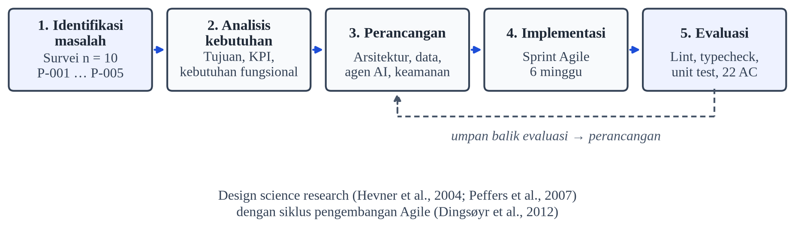
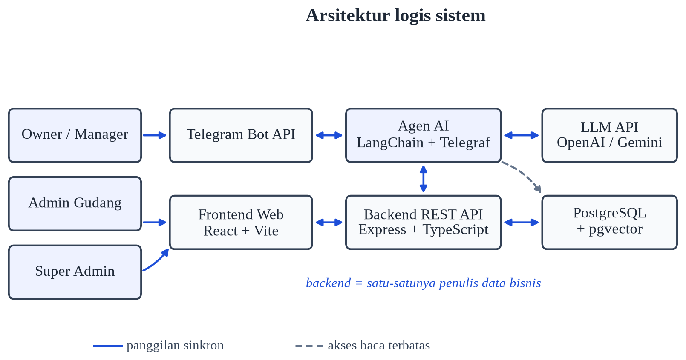
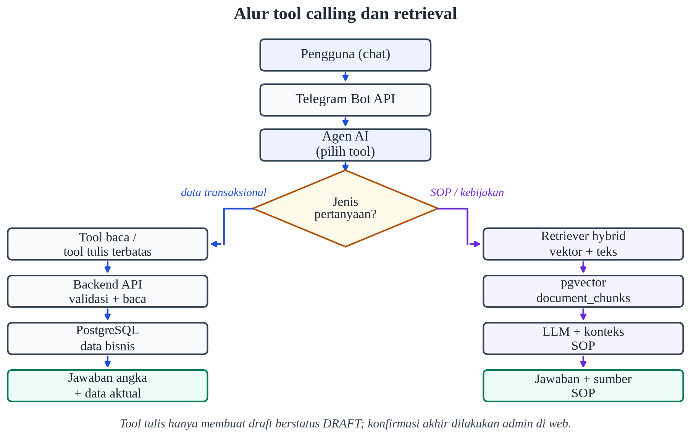

# WMS Berbasis Web Terintegrasi Asisten AI Retrieval-Augmented Generation melalui Telegram untuk UMKM Distribusi Barang

[Nama Mahasiswa]^1^, Hanafi Eko Darono^2^

^1^ Mahasiswa Program Studi Sistem Informasi Fakultas Sains dan Teknologi
^2^ Dosen Pembimbing Program Studi Sistem Informasi FST Universitas Terbuka

^1^ Email: [email@ecampus.ut.ac.id]
^2^ Email: 04000846@ecampus.ut.ac.id

## Abstrak

Usaha mikro, kecil, dan menengah (UMKM) di sektor distribusi barang menghadapi tekanan untuk mencatat persediaan secara akurat. Pencatatan manual yang tersebar di berbagai media menimbulkan selisih stok, memperlambat akses informasi, dan membebani administrasi. Penelitian ini merancang dan mengevaluasi secara formatif sebuah warehouse management system (WMS) berbasis web yang terintegrasi dengan asisten AI berbasis retrieval-augmented generation (RAG) melalui Telegram. Pendekatan yang digunakan adalah design science research dengan siklus pengembangan Agile. Data dikumpulkan melalui studi pustaka, survei terhadap 10 pelaku usaha, observasi proses, dan analisis dokumen. Artefak terdiri atas antarmuka web React, backend Express/TypeScript, agen AI berbasis LangChain dan Telegraf, serta PostgreSQL dengan ekstensi pgvector. Backend berperan sebagai satu-satunya penulis data bisnis, sedangkan agen AI mengakses data melalui 18 tool dan membaca indeks pengetahuan secara read-only. Evaluasi formatif menunjukkan bahwa lint dan typecheck ketiga layanan lulus, 117 test unit dan komponen lulus dari 17 berkas, sedangkan enam berkas uji integrasi belum dijalankan karena memerlukan basis data. Sebanyak 22 skenario penerimaan telah dirancang. Dampak jangka panjang terhadap selisih stok dan adopsi harian belum diukur. Kontribusi penelitian ini adalah rancangan integrasi WMS, tool calling, dan RAG yang menjaga integritas data serta menyediakan dasar evaluasi yang dapat dilanjutkan pada pilot.

**Kata Kunci:** asisten AI; RAG; Telegram; UMKM; WMS

## Pendahuluan

Usaha mikro, kecil, dan menengah (UMKM) merupakan bagian penting dari perekonomian Indonesia. Kajian transformasi digital UMKM menunjukkan bahwa pemanfaatan teknologi informasi memperluas jangkauan pasar, meningkatkan efisiensi operasional, dan memperkuat profitabilitas, tetapi adopsinya terhambat oleh keterbatasan sumber daya, keterampilan teknis, dan kebiasaan kerja lama (Purnomo et al., 2024). Kajian lain menemukan bahwa sistem informasi manajemen berbasis ERP dapat menyatukan proses bisnis dan menyediakan data real-time, namun sistem tersebut umumnya terlalu berat dan mahal bagi UMKM mikro (Hasanah et al., 2024). Kesenjangan antara manfaat teknologi dan kemampuan adopsi inilah yang menjadi titik tolak penelitian ini.

Pada sektor distribusi barang fast-moving, persediaan berputar cepat dan selisih pencatatan sekecil apa pun dapat berakumulasi menjadi kerugian. Warehouse management system (WMS) dirancang untuk mengendalikan penerimaan, penyimpanan, pengeluaran, dan pelaporan barang (Faber et al., 2013). Tinjauan operasi gudang menunjukkan bahwa keputusan tentang tata letak, alokasi, dan alur barang memengaruhi biaya serta ketepatan pengiriman (Gu et al., 2007). Namun, manfaat WMS bergantung pada disiplin pencatatan: sistem hanya akurat bila setiap transaksi masuk dan keluar tercatat pada saat kejadian.

Praktik pada banyak UMKM masih jauh dari kondisi tersebut. Survei pendahuluan yang dilakukan pada Oktober 2026 terhadap 10 pemilik atau pengelola usaha menemukan bahwa empat responden memakai buku tulis, dua memakai spreadsheet, dua memakai aplikasi kasir, satu memakai ERP, dan satu memakai grup pesan instan. Dengan demikian, tujuh dari sepuluh responden belum memakai sistem inventori terpadu. Media pencatatan yang tersebar membuat rekonsiliasi dilakukan belakangan, sering kali setelah barang sudah berpindah tangan.

Dampak dari pola kerja tersebut terlihat pada data waktu dan selisih stok. Median waktu untuk mengetahui sisa satu produk adalah 6,3 menit, median waktu pengecekan status pengiriman 15 menit, dan median waktu pembuatan rekap harian 23 menit. Median waktu pembuatan purchase order (PO) adalah 10,5 menit. Selisih stok dilaporkan oleh tujuh dari sepuluh responden dengan median 2,75%, sedangkan frekuensi selisih median 2,5 kali per bulan. Estimasi total waktu administratif mencapai median 35,6 jam per bulan per responden, dengan rentang 10,9–86,5 jam. Angka-angka ini merupakan persepsi responden, bukan hasil stopwatch atau audit stok, sehingga dibaca sebagai indikasi awal, bukan generalisasi.

Hambatan adopsi bukan semata soal ketersediaan perangkat lunak. Sistem ERP dan WMS yang lengkap menuntut konfigurasi, pelatihan, dan biaya lisensi yang tidak sebanding dengan kapasitas UMKM (Hasanah et al., 2024). Akibatnya, sistem ditinggalkan setelah masa uji coba, dan pekerjaan kembali ke spreadsheet atau grup chat. Solusi yang dibutuhkan bukan sekadar sistem yang lebih canggih, melainkan sistem yang menyatukan data operasional terstruktur dengan antarmuka yang sudah dikenal pengguna.

Perkembangan large language model (LLM) membuka peluang untuk menjembatani kesenjangan tersebut. LLM berbasis arsitektur Transformer mampu memproses bahasa alami dan mengikuti instruksi dari beberapa contoh (Vaswani et al., 2017; Brown et al., 2020). Namun, pengetahuan yang tersimpan dalam parameter model tidak selalu mutakhir dan sulit ditelusuri sumbernya; model juga dapat menghasilkan pernyataan yang tidak didukung bukti, atau halusinasi (Ji et al., 2023). Retrieval-augmented generation (RAG) mengurangi masalah itu dengan menggabungkan memori parametrik model dan memori non-parametrik berupa indeks dokumen eksternal (Lewis et al., 2020). Pada saat inferensi, sistem mengambil potongan dokumen yang relevan dan menyertakannya sebagai konteks, sehingga jawaban dapat dibumikan pada sumber tertentu (Gao et al., 2023). Pendekatan ini terbukti menurunkan halusinasi pada percakapan (Shuster et al., 2021), terutama bila retrieval memakai representasi vektor yang padat (Karpukhin et al., 2020).

Pola tool calling melengkapi RAG untuk data yang berubah cepat. Alih-alih membiarkan model menebak angka stok, model dipandu memanggil fungsi yang membaca data langsung dari sistem sumber (Schick et al., 2023). Survei augmented language models menunjukkan bahwa kemampuan bernalar, memanggil alat, dan bertindak merupakan arah penting pengembangan LLM (Mialon et al., 2023). Dengan pola ini, model bahasa berfungsi sebagai antarmuka, sedangkan kebenaran data tetap berada pada basis data operasional.

Penelitian terdahulu cenderung memisahkan tiga hal: kajian WMS dan ERP, kajian RAG sebagai metode umum, serta kajian tool calling sebagai kemampuan model. Lewis et al. (2020) dan Gao et al. (2023) membahas arsitektur RAG tanpa konteks tata kelola data perusahaan. Schick et al. (2023) dan Mialon et al. (2023) membahas pemanggilan alat tanpa membahas pemisahan hak tulis dan hak baca pada sistem informasi. Purnomo et al. (2024) dan Hasanah et al. (2024) membahas digitalisasi UMKM tanpa merancang asisten AI yang terhubung ke transaksi. Celah yang diisi penelitian ini adalah integrasi ketiganya dalam satu artefak yang dapat dijalankan sendiri oleh UMKM: WMS web sebagai sumber kebenaran, asisten chat dengan tool calling ke API backend, dan RAG read-only untuk SOP dan kebijakan.

Berdasarkan uraian tersebut, penelitian ini mengajukan tiga pertanyaan. Pertama, bagaimana WMS berbasis web dapat diintegrasikan dengan asisten AI berbasis RAG melalui platform pesan instan sehingga data operasional tetap konsisten? Kedua, bagaimana integrasi tersebut menjaga akurasi jawaban dan mencegah agen AI menulis data bisnis secara langsung? Ketiga, sejauh mana artefak yang dihasilkan memenuhi kebutuhan UMKM dan apa keterbatasan evaluasinya? Tujuan penelitian adalah merancang, membangun, dan mengevaluasi secara formatif artefak tersebut, serta merumuskan agenda pengujian lanjutan.

Kontribusi penelitian ini bersifat praktis dan metodologis. Secara praktis, penelitian menghasilkan artefak yang menyatukan pencatatan stok, dokumen bisnis, laporan, dan akses berbasis chat dalam satu sistem yang dapat dijalankan dengan Docker Compose. Secara metodologis, penelitian menunjukkan cara memisahkan hak tulis backend dan hak baca agen AI, serta cara menempatkan RAG sebagai pelengkap data transaksional, bukan pengganti basis data. Batasan penelitian dijelaskan pada bagian Metode dan Pembahasan, terutama karena evaluasi belum mencakup pilot jangka panjang.

**Tabel 1. Ringkasan masalah, baseline survei, dan target indikator**

| Masalah | Baseline survei (n = 10) | Target |
| :--- | :--- | :--- |
| P-001 Akses data lambat | Median 6,3 menit untuk cek stok; median 15 menit untuk cek pengiriman | Kurang dari 10 detik melalui chat |
| P-002 Selisih stok | Median 2,75%; 7 dari 10 responden mencatat selisih | Maksimal 1% pada stock opname |
| P-003 Keputusan tertunda | Median 23 menit untuk rekap harian; skor keterlambatan informasi 3 dari 5 | Laporan tersedia tanpa rekap manual |
| P-004 Beban dokumen | Median 10,5 menit untuk membuat PO | Kurang dari 1 menit melalui chat |
| P-005 Adopsi rendah | 7 dari 10 belum memakai sistem inventori terpadu; 6 dari 10 bersedia mencoba chat | Adopsi harian minimal 70% pada pilot |

## Metode

### 2.1 Desain penelitian

Penelitian ini menggunakan design science research karena luaran utamanya adalah artefak berupa sistem informasi, bukan sekadar penjelasan fenomena (Hevner et al., 2004). Prosedur penelitian mengikuti enam aktivitas design science research methodology: identifikasi masalah dan motivasi, penetapan tujuan solusi, perancangan dan pengembangan, demonstrasi, evaluasi, serta komunikasi (Peffers et al., 2007). Setiap aktivitas menghasilkan artefak yang dapat diperiksa, sehingga proses penelitian dapat ditelusuri dari masalah hingga bukti evaluasi.

Pengembangan artefak dijalankan dengan siklus Agile yang pendek. Agile dipilih karena kebutuhan pengguna belum sepenuhnya pasti pada awal proyek, terutama karena calon pengguna belum memiliki pengalaman dengan asisten AI (Dingsøyr et al., 2012). Setiap sprint menghasilkan fitur yang dapat dicoba, lalu hasilnya menjadi masukan sprint berikutnya. Prioritas diberikan pada integrasi AI dan RAG karena bagian itu memiliki ketidakpastian teknis paling tinggi.

Alur penelitian disajikan pada Gambar 1. Tahap identifikasi masalah menghasilkan daftar masalah P-001 sampai P-005 dan baseline survei. Tahap analisis kebutuhan memetakan masalah ke tujuan, indikator, dan kebutuhan fungsional. Tahap perancangan menghasilkan arsitektur, model data, perilaku dokumen, dan rancangan agen AI. Tahap implementasi dijalankan dalam sprint mingguan. Tahap evaluasi mencakup pemeriksaan statis, pengujian unit dan komponen, serta perancangan skenario penerimaan. Garis umpan balik dari evaluasi ke perancangan menunjukkan bahwa temuan evaluasi dapat mengubah keputusan desain pada iterasi berikutnya.

### 2.2 Pengumpulan data

Data dikumpulkan melalui empat teknik yang saling melengkapi (Tabel 2). Studi pustaka dipakai untuk membangun kerangka konsep dan memposisikan penelitian terhadap kajian sebelumnya. Survei semi-terstruktur dipakai untuk mengonfirmasi masalah dan memperoleh baseline metrik. Observasi proses dipakai untuk memetakan alur kerja gudang as-is. Analisis dokumen dipakai untuk memahami format PO, surat jalan, dan catatan stok yang berlaku.

**Tabel 2. Teknik pengumpulan data dan luaran**

| Teknik | Sasaran | Luaran |
| :--- | :--- | :--- |
| Studi pustaka | Konsep WMS, RAG, tool calling, dan digitalisasi UMKM | Kerangka konsep dan posisi penelitian |
| Survei semi-terstruktur | Pemilik atau pengelola usaha yang mengelola persediaan (n = 10) | Konfirmasi masalah, baseline waktu, selisih stok, preferensi kanal |
| Observasi proses | Alur kerja gudang harian | Peta proses as-is dan titik rawan kesalahan |
| Analisis dokumen | SOP, format PO, surat jalan, catatan stok | Aturan bisnis dan format keluaran |

Survei dilaksanakan pada 29 Oktober 2026 terhadap 10 responden yang dipilih secara purposif. Responden terlibat langsung dalam pencatatan stok dan usahanya menyimpan atau mengelola persediaan. Komposisi responden terdiri atas tiga usaha frozen food, tiga makanan-minuman, dan empat usaha lain (retail umum, toko plastik, manufaktur elektroda las, dan distributor suku cadang mesin). Satu distributor memiliki 1.104 SKU, sehingga sebaran data lebar dan median dipilih sebagai ukuran pusat. Nama responden dan nama usaha tidak ditampilkan; kode R01 sampai R10 dipakai untuk menjaga privasi.

Data kuantitatif diolah dengan menghitung nilai per responden terlebih dahulu, lalu meringkasnya menjadi median dan rentang. Jawaban berupa rentang dikonversi ke titik tengah. Jawaban "≤5 menit" dipakai 2,5 menit dan ">60 menit" dipakai 60 menit, sehingga estimasi cenderung konservatif. Data kosong tidak diimputasi. Data kualitatif dianalisis secara tematik: jawaban dikelompokkan menurut kemiripan tema, lalu dipetakan ke masalah P-001 sampai P-005. Tema yang tidak dapat dipetakan dicatat sebagai temuan tambahan.

### 2.3 Analisis kebutuhan

Analisis kebutuhan dimulai dari masalah yang dikonfirmasi survei. Setiap masalah dipetakan ke tujuan proyek, indikator keberhasilan, kebutuhan bisnis, dan kebutuhan fungsional. Pemetaan ini berfungsi sebagai matriks penelusuran: tidak ada kebutuhan yang tanpa dasar masalah, dan tidak ada tujuan yang tanpa bukti uji. Sebagai contoh, P-002 (selisih stok) dipetakan ke tujuan pengurangan selisih stok, indikator selisih maksimal 1%, kebutuhan transaksi stok terpusat, dan kebutuhan fungsional transaksi masuk/keluar yang atomik.

Analisis proses dilakukan pada dua keadaan. Pada kondisi as-is, pencatatan dilakukan manual atau melalui grup chat, lalu direkap kemudian. Pada kondisi to-be, pencatatan dilakukan sekali di aplikasi web, basis data menjadi rujukan tunggal, dan pemilik mengakses informasi melalui chat. Perbedaan ini menjadi dasar perancangan antarmuka: admin bekerja pada dashboard web, sedangkan pemilik bekerja pada kanal chat yang sudah dikenal.

### 2.4 Perancangan dan implementasi

Perancangan mengikuti dua prinsip yang mengikat seluruh keputusan teknis. Pertama, backend adalah satu-satunya penulis data bisnis. Tidak ada layanan lain yang menulis tabel bisnis secara langsung, sehingga validasi dan aturan bisnis berada pada satu tempat. Kedua, agen AI mengakses data bisnis melalui API backend dan hanya memiliki hak baca pada tabel vektor. Prinsip least privilege ini membatasi dampak kesalahan model atau penyalahgunaan kanal chat.

Sistem dirancang sebagai empat layanan yang berjalan dalam satu jaringan container: frontend web, backend REST API, agen AI, dan basis data PostgreSQL dengan ekstensi pgvector. Frontend memakai React, Vite, TypeScript, Tailwind CSS, dan TanStack Query. Backend memakai Node.js, Express, TypeScript, Prisma ORM, dan Zod. Agen AI memakai Node.js, TypeScript, LangChain.js, dan Telegraf. Model bahasa dan model embedding diakses melalui API eksternal dan dibaca dari variabel lingkungan, sehingga penggantian model tidak menuntut perubahan kode.

Model data dirancang relasional dan ternormalisasi. Nilai stok tidak diubah manual; nilainya dihitung dari transaksi masuk, keluar, dan penyesuaian. Stok per gudang disimpan pada tabel inventori, sehingga satu produk dapat tersebar di beberapa gudang. Nomor PO berformat PO-YYYYMM-NNN dan surat jalan berformat SJ-YYYYMM-NNN; penghitungan urutan dilakukan di dalam transaksi agar tidak terjadi duplikasi. Riwayat percakapan AI disimpan terpisah untuk keperluan audit dan evaluasi.

Perilaku dokumen dimodelkan sebagai mesin keadaan. Purchase order memiliki empat status: DRAFT, CONFIRMED, COMPLETED, dan CANCELLED. Hanya DRAFT yang dapat diubah atau dihapus; CONFIRMED dapat dibatalkan; COMPLETED tercapai otomatis saat seluruh item diterima. Aturan ini mencegah dokumen yang sudah berjalan diubah kembali tanpa jejak. Surat jalan memiliki alur serupa untuk partner bertipe CUSTOMER, termasuk halaman detail, edit saat DRAFT, dan cetak.

Perancangan agen AI menetapkan tiga hal. Pertama, tool dipisah menjadi tool baca dan tool tulis terbatas. Tool tulis tidak pernah menetapkan status akhir dokumen; draft PO dan draft surat jalan selalu berstatus DRAFT dan menunggu konfirmasi admin di web. Kedua, pencarian produk memakai normalisasi nama dan kecocokan token, sehingga penulisan tidak baku tetap dikenali. Bila satu nama cocok ke beberapa varian, tool mengembalikan daftar kandidat dan model diminta meminta klarifikasi, bukan memilih satu secara diam-diam. Ketiga, pipeline RAG hanya memakai dokumen SOP, kebijakan, panduan, dan FAQ; data transaksional tidak di-embed, tetapi diambil langsung dari API agar angkanya selalu mutakhir.

Kontrol keamanan dirancang pada empat lapis: autentikasi pengguna web dengan token akses berumur pendek dan token pembaruan, pembatasan rute berdasarkan peran (SUPER_ADMIN, ADMIN, OWNER), kunci internal untuk komunikasi antar layanan, dan hak baca saja bagi agen AI pada tabel vektor. Dokumen knowledge bertipe sensitif hanya dapat diakses peran tertentu, dengan peran diteruskan dari lapisan pesan sampai ke pembentukan tool.

### 2.5 Evaluasi

Evaluasi dilakukan pada tiga tingkat. Pengujian unit menyasar fungsi murni dan logika bisnis tanpa basis data. Pengujian integrasi menyasar rute API beserta basis data dan aturan akses. Pengujian end-to-end menyasar alur lengkap dari chat sampai dokumen terbentuk di web. Pengujian antarmuka menyasar komponen dan halaman React. Perkakas yang dipakai adalah Vitest, Supertest, dan Testing Library; pengujian dijalankan melalui target Makefile agar lingkungannya sama dengan lingkungan pengembangan.

Evaluasi formatif pada tahap ini mencakup pemeriksaan statis (lint dan typecheck), pengujian unit dan komponen yang tidak memerlukan basis data, serta penelusuran 22 skenario penerimaan. Pengujian integrasi backend dan pengukuran KPI pada lingkungan uji belum dapat diselesaikan karena lingkungan penelitian tidak menyediakan Docker dan basis data PostgreSQL. Keterbatasan ini dicatat sebagai batas evaluasi, bukan diabaikan. Rancangan pengukuran KPI tetap disusun agar dapat dijalankan pada pilot.

Pemilihan studi kasus tunggal dan evaluasi formatif mengikuti panduan pelaporan studi kasus dalam rekayasa perangkat lunak (Runeson & Höst, 2009). Studi kasus cocok untuk mengevaluasi artefak dalam konteks nyata ketika kendali peneliti terbatas dan fenomena tidak dapat dipisahkan dari konteksnya. Konsekuensinya, hasil penelitian ini tidak dimaksudkan untuk digeneralisasi secara statistik, melainkan untuk menjelaskan mekanisme dan kondisi yang membuat integrasi WMS, tool calling, dan RAG dapat bekerja.

## Hasil dan Pembahasan

### 3.1 Gambaran umum artefak

Artefak yang dihasilkan adalah sistem empat layanan yang berjalan dalam satu jaringan container (Gambar 2). Frontend web dipakai admin gudang dan super admin untuk mengelola data master, transaksi, dokumen, laporan, dan knowledge base. Backend REST API menjadi pusat logika bisnis dan satu-satunya penulis data. Agen AI menerima pesan dari Telegram, memilih tool yang sesuai, lalu memanggil backend atau retriever RAG. PostgreSQL menyimpan data transaksional sekaligus indeks vektor pada ekstensi pgvector. Model bahasa dan model embedding diakses melalui API eksternal.

Pemisahan layanan mengikuti dua prinsip. Pertama, backend adalah satu-satunya penulis data bisnis. Agen AI tidak memiliki kredensial tulis ke tabel bisnis; ia memanggil endpoint backend yang memvalidasi peran, payload, dan aturan bisnis. Kedua, agen AI hanya memiliki hak baca pada tabel vektor. Data transaksional tidak di-embed, sehingga jawaban tentang stok atau status PO selalu berasal dari basis data operasional, bukan dari salinan yang mungkin sudah usang.

Dari sisi ukuran, backend memiliki 13 modul yang mencakup autentikasi, pengguna, kategori, produk, partner, gudang, transaksi, purchase order, surat jalan, laporan, knowledge, audit log, dan endpoint internal. Frontend memiliki 13 kelompok halaman yang sejajar dengan modul tersebut. Agen AI menyediakan 18 tool yang terdiri atas tool baca, tool tulis terbatas, dan tool RAG. Angka-angka ini dipakai sebagai gambaran cakupan implementasi, bukan sebagai ukuran kualitas.

### 3.2 WMS berbasis web

WMS web menangani data master produk, kategori, partner, dan gudang. Produk menyimpan SKU, satuan, kategori, stok minimum, dan stok agregat. Partner dibedakan menjadi supplier dan customer karena relasi keduanya berbeda pada PO dan surat jalan. Gudang memungkinkan satu produk tersebar di beberapa lokasi, dengan jumlah per gudang disimpan pada tabel inventori.

Inti perubahan stok adalah satu fungsi yang wajib dijalankan di dalam transaksi basis data. Fungsi tersebut memeriksa keberadaan produk dan gudang, menghitung selisih stok, menolak transaksi keluar yang melebihi stok tersedia, membuat catatan transaksi, menyesuaikan stok produk, dan memperbarui jumlah per gudang. Bila salah satu langkah gagal, seluruh perubahan dibatalkan. Prinsip ini menjadikan stok sebagai konsekuensi transaksi, bukan angka yang dapat diubah manual.

Purchase order mengikuti mesin keadaan DRAFT, CONFIRMED, COMPLETED, dan CANCELLED. Hanya DRAFT yang dapat diubah atau dihapus. CONFIRMED dapat dibatalkan, sedangkan COMPLETED tercapai otomatis saat seluruh item diterima. Nomor PO berformat PO-YYYYMM-NNN dan dihitung di dalam transaksi, sehingga dua permintaan bersamaan tidak menghasilkan nomor yang sama. Surat jalan memakai format SJ-YYYYMM-NNN dan hanya dapat dibuat untuk partner bertipe CUSTOMER.

Halaman laporan menyediakan enam tab: ringkasan dan tren, persediaan, pembelian, pengiriman, mutasi atau kartu stok, dan analitik gerak stok. Setiap tab memiliki filter periode dan dapat diekspor ke CSV. Tab mutasi menampilkan saldo berjalan, sehingga admin dapat menelusuri apakah saldo akhir sama dengan saldo awal ditambah seluruh mutasi. Tab analitik menandai produk yang bergerak cepat, produk yang tidak bergerak, dan kategori ABC.

Kontrol akses memakai tiga peran: SUPER_ADMIN, ADMIN, dan OWNER. SUPER_ADMIN mengelola pengguna dan knowledge base; ADMIN mengelola operasi gudang; OWNER memiliki akses baca dan menerima notifikasi. Setiap perubahan penting dicatat pada audit log. Pemisahan peran ini penting karena asisten AI meneruskan identitas pengirim pesan ke lapisan tool, sehingga daftar tool yang tersedia dapat dibatasi sesuai peran.

**Tabel 3. Modul utama dan bukti implementasi**

| Modul | Fungsi | Bukti |
| :--- | :--- | :--- |
| Data master | Produk, kategori, partner, gudang | Halaman CRUD dan validasi Zod |
| Transaksi stok | Barang masuk, keluar, penyesuaian | Fungsi stok atomik dan penolakan stok kurang |
| Purchase order | Siklus DRAFT sampai COMPLETED | Mesin keadaan dan penomoran otomatis |
| Surat jalan | Dokumen pengiriman untuk customer | Halaman detail, edit saat DRAFT, cetak |
| Laporan | Enam tab analitik dan ekspor CSV | Filter periode dan saldo berjalan |
| Knowledge base | Dokumen SOP, statistik indeks, re-ingest | Halaman khusus SUPER_ADMIN |
| Autentikasi dan audit | RBAC dan jejak perubahan | Token akses, token pembaruan, audit log |

### 3.3 Asisten AI dan tool calling

Agen AI dirakit ulang untuk setiap pesan masuk agar identitas percakapan dan peran pengirim dapat disertakan pada setiap panggilan. Agen dibatasi jumlah langkahnya, dibangun dengan temperature 0, dan menerima daftar tool yang dibentuk sesuai peran. Temperature 0 dipilih untuk mengurangi variasi jawaban pada pertanyaan faktual, meskipun tidak menghilangkan kemungkinan salah tafsir atas pertanyaan yang ambigu.

Tool dipisah menjadi tiga kelompok (Tabel 4). Tool baca mengambil data master, stok, transaksi, PO, surat jalan, dan ringkasan dashboard. Tool tulis hanya membuat draft PO dan draft surat jalan; keduanya selalu berstatus DRAFT dan menunggu konfirmasi admin di web. Tool RAG mencari SOP dan kebijakan pada indeks pengetahuan. Pembatasan ini menerapkan prinsip bahwa model bahasa tidak pernah menjadi penulis akhir data bisnis.

Penanganan nama produk yang ambigu menjadi bagian penting dari desain. Pencarian memakai normalisasi nama dan kecocokan token, sehingga penulisan seperti "mie instan" dapat cocok dengan "Mi Instan". Bila satu nama cocok ke beberapa varian, tool mengembalikan daftar kandidat beserta stoknya, dan model diminta meminta klarifikasi. Pola ini menghindari pemilihan varian secara diam-diam yang dapat menghasilkan jawaban salah meskipun angkanya benar untuk produk lain.

Alur tool calling disajikan pada Gambar 3. Pesan pengguna masuk melalui Telegram, diteruskan ke agen AI, lalu dipetakan ke tool yang sesuai. Untuk pertanyaan stok, agen memanggil tool baca yang meneruskan permintaan ke backend; backend membaca basis data dan mengembalikan hasil terstruktur. Untuk pertanyaan SOP, agen memanggil retriever yang mengambil potongan dokumen dari pgvector, lalu menyusun jawaban dengan konteks tersebut. Jawaban akhir menyebut sumber SOP bila pertanyaan bersifat pengetahuan, dan menyebut data aktual bila pertanyaan bersifat transaksional.

**Tabel 4. Kelompok tool asisten AI**

| Kelompok | Tool | Fungsi |
| :--- | :--- | :--- |
| Stok | cek_stok_barang, stok_per_gudang, stok_tipis | Stok satu produk, rincian per gudang, dan peringatan stok minimum |
| Katalog | cari_produk, list_kategori, list_partner, list_gudang | Pencarian produk dan daftar data master |
| Transaksi | list_transaksi, rekap_pengiriman | Riwayat masuk/keluar dan rekap pengiriman per tanggal |
| Purchase order | list_po, list_po_status, detail_po | Daftar dan detail PO berdasarkan status |
| Surat jalan | list_surat_jalan | Daftar surat jalan |
| Ringkasan | ringkasan_dashboard, ringkasan_periode | Ringkasan operasional dan tren periode |
| Tulis terbatas | buat_draft_po, buat_draft_surat_jalan | Membuat draft berstatus DRAFT |
| RAG | cari_sop | Mencari SOP dan kebijakan pada knowledge base |

### 3.4 Pipeline RAG

Knowledge base dikelola dari halaman web khusus SUPER_ADMIN. Dokumen SOP, FAQ, kebijakan, dan panduan disimpan pada tabel knowledge_documents sebagai sumber kebenaran. Dokumen aktif dipotong dengan RecursiveCharacterTextSplitter yang memperhatikan struktur markdown, disisipi judul, lalu diubah menjadi embedding dengan model text-embedding-3-small berdimensi 1536. Hasilnya disimpan pada tabel document_chunks bersama vektor dan metadata sumber.

Proses ingest bersifat idempoten: dokumen yang isinya tidak berubah dilewati, sehingga ingest ulang tidak membuang waktu dan biaya embedding. Setiap eksekusi dicatat pada tabel ingest_jobs, dan statusnya dipulihkan saat layanan dinyalakan ulang. Dengan cara ini, tab Index dan tab Ingest menampilkan status yang sama setelah restart, dan admin dapat mengetahui apakah indeks sudah mutakhir.

Retrieval menggabungkan peringkat vektor dan pencarian teks penuh. Pencarian vektor memakai cosine distance pada pgvector, sedangkan pencarian teks penuh membantu ketika pengguna memakai istilah yang persis ada pada dokumen. Hasil gabungan disaring dengan ambang skor minimum untuk membuang potongan yang tidak relevan. Bila basis data atau layanan embedding gagal, retriever mengembalikan hasil kosong dan agen menyatakan bahwa SOP tidak ditemukan, bukan mengarang jawaban.

Pemisahan data transaksional dan pengetahuan adalah keputusan desain yang disengaja. Data stok, transaksi, dan status dokumen berubah setiap hari, sehingga tidak cocok di-embed. Sebaliknya, SOP dan kebijakan berubah jarang dan bersifat tekstual, sehingga cocok untuk RAG. Dengan pemisahan ini, pertanyaan "berapa stok dimsum" dijawab dari API, sedangkan pertanyaan "apa SOP penerimaan barang retur" dijawab dari indeks pengetahuan.

### 3.5 Keamanan dan notifikasi

Kontrol keamanan diterapkan pada empat lapis. Lapis pertama adalah autentikasi pengguna web dengan token akses berumur pendek dan token pembaruan. Lapis kedua adalah pembatasan rute berdasarkan peran. Lapis ketiga adalah kunci internal untuk komunikasi antara backend dan agen AI, sehingga endpoint internal tidak dapat dipanggil dari luar jaringan layanan. Lapis keempat adalah hak baca saja bagi agen AI pada tabel vektor, sehingga kebocoran kredensial agen tidak memberi akses tulis ke data bisnis.

Notifikasi Telegram dijalankan sebagai panggilan best-effort dengan batas waktu lima detik. Saat draft PO dibuat melalui chat, backend memanggil endpoint notifikasi pada agen AI, lalu agen mengirim ringkasan PO dan tombol menuju halaman detail kepada admin. Owner menerima notifikasi saat PO dikonfirmasi atau dibatalkan dan saat penerimaan selesai. Karena sifatnya best-effort, kegagalan notifikasi tidak menggagalkan transaksi bisnis; kegagalan hanya dicatat pada log. Keputusan ini diambil agar gangguan pada kanal chat tidak menghambat pekerjaan gudang.

### 3.6 Evaluasi formatif

Evaluasi formatif dijalankan pada lingkungan pengembangan tanpa Docker dan tanpa basis data PostgreSQL. Pemeriksaan statis dilakukan dengan lint dan typecheck pada ketiga layanan; keduanya lulus tanpa kesalahan. Pengujian unit dan komponen dijalankan pada berkas yang tidak memerlukan basis data. Hasilnya, 117 test lulus dari 17 berkas: 37 test backend, 71 test agen AI, dan 9 test frontend. Enam berkas uji integrasi backend tidak dijalankan karena memerlukan PostgreSQL; total berkas uji pada repositori adalah 23 (Tabel 5).

**Tabel 5. Cakupan dan hasil pengujian formatif**

| Tingkat | Berkas | Test | Status |
| :--- | ---: | ---: | :--- |
| Unit backend | 6 | 37 | Lulus |
| Unit dan komponen agen AI | 8 | 71 | Lulus |
| Komponen frontend | 3 | 9 | Lulus |
| Integrasi backend | 6 | — | Belum dijalankan (memerlukan basis data) |
| **Total** | **23** | **117** | **17 berkas lulus; 6 berkas tertunda** |

Selain pengujian otomatis, 22 skenario penerimaan telah dirancang untuk menilai kesiapan sistem (Tabel 6). Skenario mencakup autentikasi dan RBAC, transaksi stok, akurasi jawaban AI, pembuatan draft PO, penolakan permintaan di luar cakupan, Surat Jalan, RAG, notifikasi, laporan, kartu stok, dan ketahanan status ingest. Sebagian skenario telah tercakup oleh unit test, misalnya penolakan stok kurang, penomoran dokumen, dan penanganan nama produk ambigu. Skenario end-to-end belum dieksekusi penuh karena memerlukan seluruh layanan dan basis data.

**Tabel 6. Kelompok skenario penerimaan**

| Kelompok | Contoh skenario | Status |
| :--- | :--- | :--- |
| Autentikasi dan RBAC | AC-01 login, AC-02 akses ditolak | Dirancang |
| Transaksi stok | AC-04 barang masuk, AC-05 stok kurang ditolak, AC-21 kartu stok | Sebagian tercakup unit test |
| Asisten AI | AC-06 cek stok akurat, AC-10 di luar cakupan, AC-11 produk ambigu | Sebagian tercakup unit test |
| Dokumen | AC-07 draft PO, AC-08 tetap DRAFT, AC-09 konfirmasi, AC-14 surat jalan | Dirancang |
| RAG dan keamanan | AC-15 jawaban SOP, AC-16 anti-halusinasi, AC-17 read-only | Sebagian tercakup unit test |
| Notifikasi dan laporan | AC-18 notifikasi admin, AC-19 notifikasi owner, AC-20 enam tab | Dirancang |

Tabel 7 merangkum status pengukuran KPI. Tiga KPI yang dapat diukur pada lingkungan uji adalah KPI-1 (waktu jawaban stok), KPI-3 (waktu pembuatan draft PO), dan KPI-6 (waktu notifikasi admin). KPI-4 (akurasi jawaban) dapat diuji secara terbatas dengan membandingkan jawaban tool terhadap isi basis data. KPI-2 (selisih stok) dan KPI-5 (adopsi harian) memerlukan pilot jangka panjang dan tidak dapat disimpulkan dari evaluasi formatif ini.

**Tabel 7. Status pengukuran indikator**

| Indikator | Target | Status pada penelitian ini |
| :--- | :--- | :--- |
| KPI-1 Waktu info stok | < 10 detik | Belum diukur pada pilot; jalur uji AC-06 tersedia |
| KPI-2 Selisih stok | ≤ 1% | Belum diukur; memerlukan stock opname berulang |
| KPI-3 Waktu draft PO | < 1 menit | Belum diukur pada pilot; jalur uji AC-07 tersedia |
| KPI-4 Akurasi jawaban | 100% dari basis data | Belum diuji empiris; unit test mencakup resolusi nama produk |
| KPI-5 Adopsi harian | ≥ 70% | Belum diukur; 6 dari 10 responden bersedia mencoba |
| KPI-6 Waktu notifikasi | < 10 detik | Belum diukur; jalur uji AC-18 tersedia |

### 3.7 Pembahasan

Pertanyaan pertama penelitian ini adalah bagaimana WMS berbasis web dapat diintegrasikan dengan asisten AI berbasis RAG melalui platform pesan instan sehingga data operasional tetap konsisten. Artefak menjawabnya dengan memisahkan peran layanan: backend memegang logika bisnis dan hak tulis, agen AI memegang pemahaman bahasa dan pemilihan tool, sedangkan basis data menjadi rujukan tunggal. Integrasi tidak dilakukan dengan memberi agen akses langsung ke tabel bisnis, tetapi melalui API yang tervalidasi. Pola ini sejalan dengan gagasan augmented language models yang memakai alat eksternal untuk memperluas kemampuan model (Mialon et al., 2023; Schick et al., 2023), tetapi menambahkan lapisan tata kelola yang jarang dibahas pada kajian tersebut.

Pertanyaan kedua adalah bagaimana integrasi menjaga akurasi jawaban dan mencegah agen menulis data bisnis secara langsung. Ada tiga mekanisme. Pertama, data transaksional tidak di-embed; agen memanggil tool baca yang membaca basis data secara langsung. Kedua, tool tulis hanya membuat draft, sehingga keputusan akhir tetap berada pada admin. Ketiga, RAG memakai ambang skor dan menyebut sumber, sehingga jawaban SOP dapat ditelusuri. Mekanisme ini mengurangi risiko halusinasi yang lazim pada LLM (Ji et al., 2023) dan memanfaatkan RAG sebagai grounding (Lewis et al., 2020; Shuster et al., 2021). Meski demikian, evaluasi empiris terhadap akurasi jawaban belum dilakukan; klaim yang dapat diajukan pada tahap ini adalah bahwa mekanisme desainnya tersedia dan dapat diuji.

Pertanyaan ketiga adalah sejauh mana artefak memenuhi kebutuhan UMKM dan apa keterbatasan evaluasinya. Survei menunjukkan bahwa masalah yang paling terasa adalah waktu akses informasi dan beban administrasi, bukan semata selisih stok. Median 35,6 jam per bulan untuk empat komponen administrasi memberi gambaran bahwa beban tersebut cukup besar bagi usaha kecil. Antarmuka chat berpotensi mengurangi waktu akses karena pengguna tidak perlu membuka dashboard dan memfilter tabel. Namun, preferensi kanal tidak sepenuhnya mendukung keputusan Telegram: sembilan dari sepuluh responden memilih WhatsApp dan hanya satu memilih Telegram. Keputusan memakai Telegram pada MVP merupakan kompromi teknis, bukan cerminan preferensi pengguna.

Perbandingan dengan penelitian terdahulu disajikan pada Tabel 8. Penelitian ini tidak mengklaim kebaruan pada komponen RAG atau tool calling, karena keduanya sudah dikembangkan pada penelitian sebelumnya. Kebaruan yang diajukan terletak pada kombinasi tiga elemen dalam satu artefak yang dapat dijalankan sendiri: WMS web sebagai sumber kebenaran, asisten chat dengan tool calling ke API, dan RAG read-only untuk SOP. Kombinasi ini menjawab celah yang tidak disentuh oleh kajian RAG yang bersifat umum (Lewis et al., 2020; Gao et al., 2023) maupun kajian ERP yang bersifat makro (Hasanah et al., 2024).

**Tabel 8. Perbandingan dengan penelitian terdahulu**

| Kajian | Fokus | Yang belum disentuh | Posisi penelitian ini |
| :--- | :--- | :--- | :--- |
| Lewis et al. (2020) | Arsitektur RAG | Tata kelola data perusahaan | RAG read-only pada SOP, data transaksi lewat API |
| Schick et al. (2023) | Tool calling | Pemisahan hak baca dan tulis | Tool tulis hanya membuat draft |
| Mialon et al. (2023) | Survei augmented language models | Implementasi sistem informasi | Artefak WMS dengan agen AI |
| Purnomo et al. (2024) | Digitalisasi UMKM | Asisten AI dan WMS | Integrasi chat, WMS, dan RAG |
| Hasanah et al. (2024) | ERP untuk UMKM | Kanal chat dan grounding | WMS ringan dengan antarmuka chat |
| Penelitian ini | Integrasi WMS, tool calling, RAG | Evaluasi pilot jangka panjang | Artefak dan evaluasi formatif |

Implikasi teoretis penelitian ini adalah pentingnya memisahkan kebenaran data dari bahasa. LLM berguna untuk memahami pertanyaan dan menyusun jawaban, tetapi tidak dapat dijadikan sumber kebenaran untuk angka stok atau status dokumen. Pemisahan ini sejalan dengan pembagian memori parametrik dan non-parametrik pada RAG (Lewis et al., 2020), tetapi diperluas menjadi pembagian tanggung jawab antar layanan. Implikasi praktisnya, UMKM dapat memperoleh antarmuka chat tanpa mengorbankan integritas data, asalkan ada backend yang memvalidasi setiap permintaan dan ada admin yang mengonfirmasi dokumen.

Keterbatasan penelitian ini perlu dinyatakan terbuka. Pertama, pengembangan dilakukan oleh satu orang dalam waktu terbatas, sehingga tidak ada pengujian independen oleh pihak kedua. Kedua, survei melibatkan 10 responden yang dipilih secara purposif; hasilnya indikatif, bukan generalisasi statistik. Ketiga, evaluasi belum mencakup pilot jangka panjang, sehingga KPI-2 dan KPI-5 belum dapat diukur. Keempat, enam berkas uji integrasi belum dijalankan karena lingkungan tidak menyediakan basis data. Kelima, ketergantungan pada API model bahasa menimbulkan risiko biaya, latensi, dan perubahan kebijakan penyedia. Keenam, keamanan prompt injection dan penyalahgunaan kanal chat belum diuji secara khusus. Ketujuh, pilihan Telegram tidak sejalan dengan preferensi mayoritas responden yang memilih WhatsApp.

## Penutup

Penelitian ini merancang dan mengevaluasi secara formatif WMS berbasis web yang terintegrasi dengan asisten AI RAG melalui Telegram. Artefak terdiri atas frontend web, backend REST API, agen AI, dan PostgreSQL dengan pgvector. Backend berperan sebagai satu-satunya penulis data bisnis, agen AI mengakses data melalui 18 tool, dan RAG dipakai hanya untuk pengetahuan SOP dan kebijakan. Evaluasi formatif menunjukkan bahwa lint dan typecheck ketiga layanan lulus, 117 test unit dan komponen lulus dari 17 berkas, dan 22 skenario penerimaan telah dirancang. Enam berkas uji integrasi belum dijalankan karena memerlukan basis data.

Simpulan utama penelitian ini adalah bahwa integrasi WMS, tool calling, dan RAG dapat dirancang dengan memisahkan kebenaran data dari bahasa. Model bahasa tidak perlu memiliki akses tulis ke data bisnis untuk memberi pengalaman chat yang berguna; cukup dengan tool baca yang terkontrol dan tool tulis yang hanya membuat draft. RAG berperan sebagai pelengkap untuk pengetahuan tekstual, bukan pengganti basis data transaksional.

Saran untuk penelitian lanjutan adalah menjalankan pilot selama empat sampai delapan minggu pada satu atau dua UMKM untuk mengukur KPI-1 sampai KPI-6 secara empiris. Pengujian integrasi dan end-to-end perlu dijalankan pada lingkungan yang menyediakan PostgreSQL dan Docker. Evaluasi RAG dapat memakai kerangka seperti RAGAS untuk mengukur faithfulness, answer relevance, dan context precision (Es et al., 2024). Pengembangan berikutnya juga perlu mempertimbangkan WhatsApp sebagai kanal utama, pengujian keamanan prompt injection, dan pemantauan biaya serta latensi model.

## Daftar Pustaka

Brown, T. B., Mann, B., Ryder, N., Subbiah, M., Kaplan, J., Dhariwal, P., … Amodei, D. (2020). Language models are few-shot learners. In *Advances in Neural Information Processing Systems* (Vol. 33). Retrieved from https://arxiv.org/abs/2005.14165

Dingsøyr, T., Nerur, S., Balijepally, V., & Moe, N. B. (2012). A decade of agile methodologies: Towards explaining agile software development. *Journal of Systems and Software, 85*(6), 1213–1221. doi:10.1016/j.jss.2012.02.033

Es, S., James, J., Espinosa-Anke, L., & Schockaert, S. (2024). RAGAS: Automated evaluation of retrieval augmented generation. In *Proceedings of the 18th Conference of the European Chapter of the Association for Computational Linguistics: System Demonstrations* (pp. 150–158). doi:10.18653/v1/2024.eacl-demo.16

Faber, N., de Koster, M. B. M., & Smidts, A. (2013). Organizing warehouse management. *International Journal of Operations & Production Management, 33*(9), 1230–1256. doi:10.1108/IJOPM-12-2011-0471

Gao, Y., Xiong, Y., Gao, X., Jia, K., Pan, J., Bi, Y., … Wang, H. (2023). *Retrieval-augmented generation for large language models: A survey*. arXiv preprint arXiv:2312.10997. Retrieved from https://arxiv.org/abs/2312.10997

Gu, J., Goetschalckx, M., & McGinnis, L. F. (2007). Research on warehouse operation: A comprehensive review. *European Journal of Operational Research, 177*(1), 1–21. doi:10.1016/j.ejor.2006.02.025

Hasanah, N., Saputra, D. I. S., & Hiiyatin, D. L. (2024). ERP-based management information system for MSMEs in Indonesia: A systematic literature review. *RIGGS: Journal of Artificial Intelligence and Digital Business, 2*(2), 36–42. doi:10.31004/riggs.v2i2.224

Hevner, A. R., March, S. T., Park, J., & Ram, S. (2004). Design science in information systems research. *MIS Quarterly, 28*(1), 75–105. doi:10.2307/25148625

Ji, Z., Lee, N., Frieske, R., Yu, T., Su, D., Xu, Y., … Fung, P. (2023). Survey of hallucination in natural language generation. *ACM Computing Surveys, 55*(12), 1–38. doi:10.1145/3571730

Karpukhin, V., Oğuz, B., Min, S., Lewis, P., Wu, L., Edunov, S., … Yih, W. (2020). Dense passage retrieval for open-domain question answering. In *Proceedings of the 2020 Conference on Empirical Methods in Natural Language Processing* (pp. 6769–6781). doi:10.18653/v1/2020.emnlp-main.550

Lewis, P., Perez, E., Piktus, A., Petroni, F., Karpukhin, V., Goyal, N., … Kiela, D. (2020). Retrieval-augmented generation for knowledge-intensive NLP tasks. In *Advances in Neural Information Processing Systems* (Vol. 33). Retrieved from https://arxiv.org/abs/2005.11401

Mialon, G., Dessì, R., Lomeli, M., Nalmpantis, C., Pasunuru, R., Raileanu, R., … Scialom, T. (2023). *Augmented language models: A survey*. arXiv preprint arXiv:2302.07842. Retrieved from https://arxiv.org/abs/2302.07842

Peffers, K., Tuunanen, T., Rothenberger, M. A., & Chatterjee, S. (2007). A design science research methodology for information systems research. *Journal of Management Information Systems, 24*(3), 45–77. doi:10.2753/MIS0742-1222240302

Purnomo, S., Nurmalitasari, N., & Nurchim, N. (2024). Digital transformation of MSMEs in Indonesia: A systematic literature review. *Journal of Management and Digital Business, 4*(2), 301–312. doi:10.53088/jmdb.v4i2.1121

Runeson, P., & Höst, M. (2009). Guidelines for conducting and reporting case study research in software engineering. *Empirical Software Engineering, 14*(2), 131–164. doi:10.1007/s10664-008-9102-8

Schick, T., Dwivedi-Yu, J., Dessì, R., Raileanu, R., Lomeli, M., Zettlemoyer, L., … Scialom, T. (2023). Toolformer: Language models can teach themselves to use tools. In *Advances in Neural Information Processing Systems* (Vol. 36). Retrieved from https://arxiv.org/abs/2302.04761

Shuster, K., Poff, S., Chen, M., Kiela, D., & Weston, J. (2021). Retrieval augmentation reduces hallucination in conversation. In *Findings of the Association for Computational Linguistics: EMNLP 2021* (pp. 3784–3803). doi:10.18653/v1/2021.findings-emnlp.320

Vaswani, A., Shazeer, N., Parmar, N., Uszkoreit, J., Jones, L., Gomez, A. N., … Polosukhin, I. (2017). Attention is all you need. In *Advances in Neural Information Processing Systems* (Vol. 30). Retrieved from https://arxiv.org/abs/1706.03762
